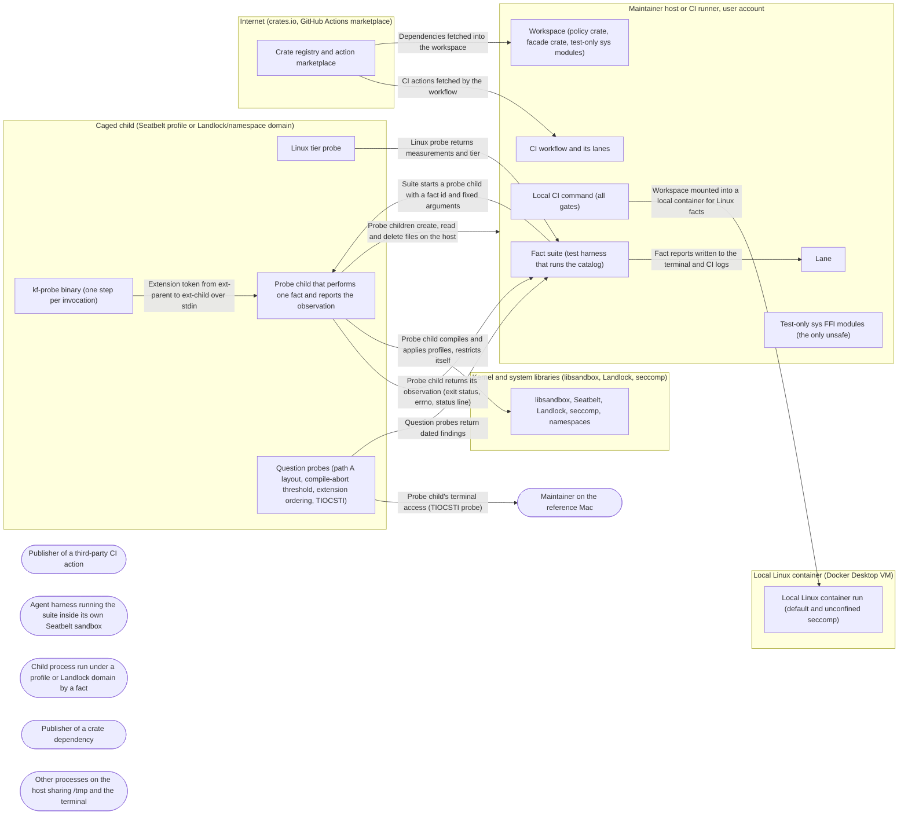

# Threat Model: Kernel facts as regression tests

**Feature**: `001-kernel-facts` · **Generated**: 2026-11-01T17:26:05Z · **Profiles**: stride, llm, agent · **Canonical**: `threat-model.yaml`

> Rendered by ThreatSpec. Edit `threat-model.yaml`, not this file.

## Summary

| Threats | Critical | High | Medium | Low | Needs clarification | Not applicable | Mitigations | Requirements | Decisions |
|---|---|---|---|---|---|---|---|---|---|
| 17 | 1 | 5 | 7 | 4 | 0 | 26 | 17 | 17 | 0 |

## Actors

| ID | Name | Trust | Description |
|---|---|---|---|
| `actor.action-publisher` | Publisher of a third-party CI action | untrusted |  |
| `actor.agent-harness` | Agent harness running the suite inside its own Seatbelt sandbox | semi-trusted |  |
| `actor.caged-child` | Child process run under a profile or Landlock domain by a fact | untrusted |  |
| `actor.dependency-publisher` | Publisher of a crate dependency | untrusted |  |
| `actor.local-process` | Other processes on the host sharing /tmp and the terminal | untrusted |  |
| `actor.maintainer` | Maintainer on the reference Mac | trusted |  |

## Trust Zones

| ID | Name | Trust rating | Description |
|---|---|---|---|
| `tz.caged` | Caged child (Seatbelt profile or Landlock/namespace domain) | 10 |  |
| `tz.container` | Local Linux container (Docker Desktop VM) | 50 |  |
| `tz.host` | Maintainer host or CI runner, user account | 70 |  |
| `tz.internet` | Internet (crates.io, GitHub Actions marketplace) | 1 |  |
| `tz.os` | Kernel and system libraries (libsandbox, Landlock, seccomp) | 90 |  |

## Assets

| ID | Name | Type | Classification | C / I / A | Source |
|---|---|---|---|---|---|
| `asset.ci-token` | CI job token and runner | credential | secret | 80 / 80 / 40 | spec.md#FR-017 |
| `asset.fact-report` | Fact run report (per fact pass/fail, OS build, date) | log | internal | 20 / 85 / 40 | spec.md#FR-004 |
| `asset.kernel-fact` | Kernel fact | business-data | public | 5 / 95 / 40 | spec.md#Key-Entities |
| `asset.maintainer-session` | Maintainer user account, terminal and home directory | configuration | confidential | 80 / 95 / 60 | spec.md#User-Story-1 |
| `asset.probe-result` | Probe result (Linux) | business-data | public | 10 / 90 / 40 | spec.md#Key-Entities |
| `asset.question-finding` | Question finding | business-data | public | 5 / 85 / 30 | spec.md#Key-Entities |
| `asset.source-tree` | Published source tree and lockfile | source-code | public | 10 / 90 / 50 | spec.md#FR-014 |

## Components

| ID | Name | Type | Trust zone | Source |
|---|---|---|---|---|
| `component.ci-workflow` | CI workflow and its lanes | service | `tz.host` | spec.md#FR-017 |
| `component.container` | Local Linux container run (default and unconfined seccomp) | service | `tz.container` | spec.md#SC-003 |
| `component.fact-suite` | Fact suite (test harness that runs the catalog) | service | `tz.host` | spec.md#FR-001 |
| `component.kf-probe` | kf-probe binary (one step per invocation) | process | `tz.caged` | plan.md#Project-Structure |
| `component.lane` | Lane | service | `tz.host` | spec.md#Key-Entities |
| `component.linux-probe` | Linux tier probe | process | `tz.caged` | spec.md#FR-009 |
| `component.local-ci` | Local CI command (all gates) | service | `tz.host` | spec.md#FR-016 |
| `component.probe-child` | Probe child that performs one fact and reports the observation | process | `tz.caged` | spec.md#FR-003 |
| `component.question-probes` | Question probes (path A layout, compile-abort threshold, extension ordering, TIOCSTI) | process | `tz.caged` | spec.md#FR-012 |
| `component.registry` | Crate registry and action marketplace | service | `tz.internet` | spec.md#FR-019 |
| `component.sys-ffi` | Test-only sys FFI modules (the only unsafe) | library | `tz.host` | plan.md#Complexity-Tracking |
| `component.system-sandbox` | libsandbox, Seatbelt, Landlock, seccomp, namespaces | library | `tz.os` | spec.md#Context |
| `component.workspace` | Workspace (policy crate, facade crate, test-only sys modules) | library | `tz.host` | spec.md#FR-014 |

## Data Flows

| ID | Name | From | To | Assets | Crosses |
|---|---|---|---|---|---|
| `flow.actions-fetch` | CI actions fetched by the workflow | `component.registry` | `component.ci-workflow` | `asset.ci-token` | `tz.internet`, `tz.host` |
| `flow.child-to-filesystem` | Probe children create, read and delete files on the host | `component.probe-child` | `tz.host` | `asset.maintainer-session` | `tz.host` |
| `flow.child-to-terminal` | Probe child's terminal access (TIOCSTI probe) | `component.question-probes` | `actor.maintainer` | `asset.maintainer-session` | `tz.host` |
| `flow.deps-fetch` | Dependencies fetched into the workspace | `component.registry` | `component.workspace` | `asset.source-tree` | `tz.internet`, `tz.host` |
| `flow.host-to-container` | Workspace mounted into a local container for Linux facts | `component.local-ci` | `component.container` | `asset.source-tree`, `asset.maintainer-session` | `tz.container` |
| `flow.linux-probe-to-suite` | Linux probe returns measurements and tier | `component.linux-probe` | `component.fact-suite` | `asset.probe-result` | `tz.caged` |
| `flow.probe-to-suite` | Probe child returns its observation (exit status, errno, status line) | `component.probe-child` | `component.fact-suite` | `asset.fact-report` | `tz.caged` |
| `flow.probe-to-system` | Probe child compiles and applies profiles, restricts itself | `component.probe-child` | `component.system-sandbox` | `asset.kernel-fact` | `tz.os` |
| `flow.questions-to-suite` | Question probes return dated findings | `component.question-probes` | `component.fact-suite` | `asset.question-finding` | `tz.caged` |
| `flow.report-to-log` | Fact reports written to the terminal and CI logs | `component.fact-suite` | `component.lane` | `asset.fact-report` |  |
| `flow.suite-to-probe` | Suite starts a probe child with a fact id and fixed arguments | `component.fact-suite` | `component.probe-child` | `asset.kernel-fact` | `tz.caged` |
| `flow.token-pipe` | Extension token from ext-parent to ext-child over stdin | `component.kf-probe` | `component.probe-child` | `asset.maintainer-session` | `tz.caged` |

## Threats

| ID | Threat | Category | Technique | Severity | Status | Mitigations | Mappings | Source |
|---|---|---|---|---|---|---|---|---|
| `threat.sandboxed-runner-false-result` | When the suite runs inside an agent harness's Seatbelt sandbox, applies fail or are silently ignored, so enforcement facts report wrong outcomes or skip | Spoofing | false-evidence | **critical** | mitigated | `mitigation.outside-sandbox-precheck` |  | spec.md#FR-007 |
| `threat.compile-abort-kills-harness` | The 20,000-rule libsandbox abort, or a compile-abort bisection step, runs in the test process and kills the whole run, so no other fact is reported | Denial of Service | resource-exhaustion | **high** | mitigated | `mitigation.crash-isolated-children` |  | spec.md#FR-005 |
| `threat.false-pass-enforcement-fact` | An enforcement fact passes because the child failed for an unrelated reason (missing binary, wrong path spelling, setup error), so a broken enforcement looks verified | Spoofing, Tampering | false-evidence | **high** | mitigated | `mitigation.positive-controls` |  | spec.md#FR-003 |
| `threat.ffi-misdeclaration` | A wrong FFI declaration (variadic sandbox_check, apply argument struct, extension calls) causes undefined behaviour, so the suite records garbage observations or corrupts memory | Tampering | memory-safety | **high** | mitigated | `mitigation.confined-audited-ffi` |  | spec.md#FR-015 |
| `threat.probe-overstates-tier` | The Linux probe reports a higher tier than the host supports (inferred from the kernel version, or a crashed measurement counted as success), so later specs trust protection that is absent | Spoofing, Elevation of Privilege | false-evidence | **high** | mitigated | `mitigation.measured-tier-floor` |  | spec.md#FR-010 |
| `threat.tiocsti-injects-into-maintainer-terminal` | The TIOCSTI probe injects input into the maintainer's or CI's real terminal, where it runs as the user | Elevation of Privilege, Tampering | terminal-injection | **high** | mitigated | `mitigation.private-pty` |  | spec.md#FR-012 |
| `threat.escape-fact-runs-unconfined-payload` | Escape facts (no-sandbox exec, inherited-fd read, setuid exec) run code unconfined or elevated; built from variable input or interactive, they could run arbitrary commands or hang on a password prompt | Elevation of Privilege | privilege-escalation-via-config | **medium** | mitigated | `mitigation.fixed-argv-no-shell` |  | spec.md#Fact-catalog |
| `threat.fork-in-multithreaded-harness` | A child forked from the multithreaded test runner allocates or takes locks before exec and deadlocks or misbehaves, giving hangs or flaky results | Denial of Service, Tampering | memory-safety | **medium** | mitigated | `mitigation.exec-fresh-probe-binary` |  | spec.md#FR-003 |
| `threat.malicious-dependency` | A crate dependency with a known advisory, an unexpected licence or a non-registry source enters the workspace | Tampering | data-tampering-in-transit | **medium** | mitigated | `mitigation.dependency-policy` |  | spec.md#FR-016 |
| `threat.shared-tmp-races` | Facts that create files under /private/tmp or delete them race with or follow symlinks planted by other local processes, writing or deleting outside the test's own files | Tampering | data-tampering-in-transit | **medium** | mitigated | `mitigation.private-scratch-dirs` |  | spec.md#Fact-catalog |
| `threat.unattributed-evidence` | A fact report or question finding lacks the OS build, kernel, tier or date, so nobody can tell which release a fact was verified on | Repudiation | missing-audit-trail | **medium** | mitigated | `mitigation.attributed-reports` |  | spec.md#FR-004 |
| `threat.unbounded-fact-runtime` | Contention trials or the compile-abort bisection hang or run for many minutes, blocking local runs and CI lanes | Denial of Service | resource-exhaustion | **medium** | mitigated | `mitigation.bounded-trials` |  | spec.md#FR-006 |
| `threat.unpinned-ci-actions` | A third-party CI action referenced by a mutable tag is replaced and runs attacker code with the job token | Elevation of Privilege, Tampering | privilege-escalation-via-config | **medium** | mitigated | `mitigation.pinned-least-privilege-ci` |  | spec.md#FR-017 |
| `threat.container-host-exposure` | The local Linux run uses a privileged container, root or a writable host mount, so a fact or escape probe can modify the host workspace or Docker VM | Elevation of Privilege | privilege-escalation-via-config | **low** | mitigated | `mitigation.unprivileged-container` |  | spec.md#SC-003 |
| `threat.extension-token-exposure` | The per-spawn sandbox extension token (a write capability for a directory) passed between ext-parent and ext-child steps via argv or printed in observations is readable by other same-user processes or CI logs and consumable by them | Information Disclosure, Elevation of Privilege | sensitive-data-exposure | **low** | mitigated | `mitigation.token-over-pipe` |  | plan.md#Project-Structure; contracts/probe-protocol.md#Steps-macOS |
| `threat.planning-path-leak` | The published tree cites local planning paths (the private notes directory, specs/, .specify/), exposing internal notes and creating dead references | Information Disclosure | sensitive-data-exposure | **low** | mitigated | `mitigation.planning-path-gate` |  | spec.md#FR-018 |
| `threat.secret-leak-in-reports` | Probes print environment variables or contents of files they read into terminal and CI logs, leaking secrets | Information Disclosure | sensitive-data-exposure | **low** | mitigated | `mitigation.report-redaction` |  | spec.md#FR-004 |

### Techniques evaluated without findings

| Technique | Disposition | Reason |
|---|---|---|
| credential-theft | not-applicable | no authentication surface: the suite authenticates no principal; CI uses the platform token only, covered under privilege-escalation-via-config |
| identity-spoofing | not-applicable | no authentication surface: no component accepts identities |
| cross-tenant-leak | not-applicable | no shared-tenant surface: hosted CI runners are single-job ephemeral VMs; the suite stores no tenant data |
| broken-access-control | not-applicable | no authorization surface: the feature tests the kernel's access control but enforces none of its own |
| injection | no-threat-detected | checked flow.probe-to-suite and flow.suite-to-probe: results travel as fixed exit codes and a fixed-format status line, argv is built from constants and the fact id; there is no shell, SQL, template or path sink fed by child output (held by SR-004) |
| data-tampering-at-rest | no-threat-detected | checked asset.kernel-fact and asset.question-finding: expectations live in the published test source under version control, so a change is a reviewed diff; no separate mutable store exists |
| prompt-injection-direct | not-applicable | no llm-inference surface: the feature calls no language model |
| prompt-injection-indirect | not-applicable | no untrusted-content-to-model surface |
| sensitive-information-disclosure | not-applicable | no llm-inference surface |
| excessive-agency | not-applicable | no llm-inference surface |
| model-supply-chain | not-applicable | no model-supply-chain surface: no models, adapters or datasets |
| training-data-poisoning | not-applicable | no persistent-model-input surface |
| unbounded-consumption | not-applicable | no cost-bearing-inference surface |
| misinformation | not-applicable | no user-facing-generation surface |
| hidden-context-exposure | not-applicable | no llm-inference surface |
| vector-embedding-weakness | not-applicable | no retrieval-path surface |
| improper-output-handling | not-applicable | no output-to-sink surface: no model output exists |
| model-extraction | not-applicable | no llm-inference surface |
| goal-hijack | not-applicable | no agent-autonomy surface: the feature contains no agent; an agent harness is only a possible runner, covered by threat.sandboxed-runner-false-result |
| tool-misuse | not-applicable | no write-capable-tool surface exposed to an agent |
| identity-privilege-abuse | not-applicable | no delegated-identity surface |
| agentic-supply-chain | not-applicable | no external-skill-supply surface in the shipped feature; crate and CI-action supply chain is modelled under STRIDE |
| unexpected-code-execution | not-applicable | no code-execution surface for an agent; children run fixed commands chosen by the suite (SR-004) |
| memory-context-poisoning | not-applicable | no agent-memory surface |
| insecure-inter-agent-communication | not-applicable | no multi-agent surface |
| cascading-failure | not-applicable | no multi-agent or agent-autonomy surface |
| human-agent-trust-exploitation | not-applicable | no human-in-loop agent surface |
| rogue-agent | not-applicable | no agent-autonomy surface |

## Mitigations

| ID | Mitigation | Kind | Threats | Requirements | Touchpoints | Status |
|---|---|---|---|---|---|---|
| `mitigation.attributed-reports` | Every report and finding carries OS version and build or kernel release, architecture, tier, date, and for findings the method and proven/inferred flag | detective | `threat.unattributed-evidence` | SR-012 | `tests/kernel_facts/tests/kernel_facts.rs`, `tests/kernel_facts/src/lib.rs` | verified |
| `mitigation.bounded-trials` | Fixed trial counts, per-child timeouts with kill, and an opt-in time-budgeted compile-abort bisection | corrective | `threat.unbounded-fact-runtime` | SR-007 | `tests/kernel_facts/src/lib.rs`, `tests/kernel_facts/tests/kernel_facts.rs`, `justfile` | verified |
| `mitigation.confined-audited-ffi` | All FFI and unsafe confined to one test-only sys module per OS, symbols resolved by dynamic lookup with missing symbols reported by name, variadics declared variadic, SAFETY comment on every unsafe block | preventive | `threat.ffi-misdeclaration` | SR-009 | `tests/kernel_facts/src/sys/mod.rs`, `tests/kernel_facts/src/sys/macos.rs`, `tests/kernel_facts/src/sys/linux.rs`, `tests/kernel_facts/Cargo.toml`, `Cargo.toml` | verified |
| `mitigation.crash-isolated-children` | Compile-heavy and abort-prone facts run in a separate child; an abort is an observation, never a crash of the suite | preventive | `threat.compile-abort-kills-harness` | SR-006 | `tests/kernel_facts/src/lib.rs`, `tests/kernel_facts/tests/kernel_facts.rs` | verified |
| `mitigation.dependency-policy` | Dependency policy gate (advisories, licence allowlist, registry-only sources, bans) with the lockfile committed | preventive | `threat.malicious-dependency` | SR-011 | `deny.toml`, `justfile`, `Cargo.lock` | verified |
| `mitigation.exec-fresh-probe-binary` | Facts run in a freshly exec'd probe binary (spawned via the standard process API), so no fact code runs between fork and exec in the multithreaded test runner | preventive | `threat.fork-in-multithreaded-harness` | SR-008 | `tests/kernel_facts/tests/kernel_facts.rs`, `tests/kernel_facts/src/bin/kf-probe/main.rs` | verified |
| `mitigation.fixed-argv-no-shell` | Facts execute only absolute-path, fixed-argument, non-interactive commands (no shell, no environment-derived argv, setuid test non-interactive) on files the test created | preventive | `threat.escape-fact-runs-unconfined-payload` | SR-004 | `tests/kernel_facts/src/bin/kf-probe/main.rs`, `tests/kernel_facts/src/bin/kf-probe/macos.rs` | verified |
| `mitigation.measured-tier-floor` | Each tier measurement runs in a throwaway child; failure, crash or timeout means absent; the tier is derived only from measurements and never from the kernel version | preventive | `threat.probe-overstates-tier` | SR-016 | `tests/kernel_facts/src/bin/kf-probe/linux.rs`, `tests/kernel_facts/tests/kernel_facts.rs` | verified |
| `mitigation.outside-sandbox-precheck` | Before any enforcement fact, check the sandbox self-check of the test process; if sandboxed, fail every enforcement fact with a named message and the outside-sandbox command | preventive | `threat.sandboxed-runner-false-result` | SR-001 | `tests/kernel_facts/tests/kernel_facts.rs`, `justfile` | verified |
| `mitigation.pinned-least-privilege-ci` | CI actions pinned by full commit SHA, workflow token permissions read-only, no secrets on fact lanes, checkout without persisted credentials | preventive | `threat.unpinned-ci-actions` | SR-010 | `.github/workflows/ci.yml` | verified |
| `mitigation.planning-path-gate` | A local CI gate fails when the published tree mentions the private notes directory, specs/ or .specify/ | detective | `threat.planning-path-leak` | SR-015 | `justfile` | verified |
| `mitigation.positive-controls` | Every enforcement fact pairs the denied action with a control run of the same action that must succeed, and matches the specific errno or exit code expected | detective | `threat.false-pass-enforcement-fact` | SR-002 | `tests/kernel_facts/tests/kernel_facts.rs`, `tests/kernel_facts/src/bin/kf-probe/macos.rs`, `tests/kernel_facts/src/bin/kf-probe/linux.rs` | verified |
| `mitigation.private-pty` | The TIOCSTI probe runs on a pseudo-terminal pair the probe creates and owns, detached from the inherited controlling terminal, and injects only an inert marker without newline | preventive | `threat.tiocsti-injects-into-maintainer-terminal` | SR-003 | `tests/kernel_facts/src/bin/kf-probe/macos.rs`, `tests/kernel_facts/src/sys/macos.rs` | verified |
| `mitigation.private-scratch-dirs` | Each fact uses its own freshly created, 0700, canonicalised temp directory; names under shared /tmp are unique and created exclusively; nothing in $HOME is written | preventive | `threat.shared-tmp-races` | SR-005 | `tests/kernel_facts/src/lib.rs` | verified |
| `mitigation.report-redaction` | Probes report byte counts, errno and exit codes, never file contents or environment values | preventive | `threat.secret-leak-in-reports` | SR-014 | `tests/kernel_facts/src/lib.rs`, `tests/kernel_facts/src/bin/kf-probe/main.rs` | verified |
| `mitigation.token-over-pipe` | Extension tokens are passed to the child only over its stdin pipe, never in argv or env, never printed; the granted directory is a 0700 scratch dir, and the token is released after the run | preventive | `threat.extension-token-exposure` | SR-017 | `tests/kernel_facts/src/bin/kf-probe/macos.rs` | verified |
| `mitigation.unprivileged-container` | Local Linux runs never use --privileged or host networking, run as a non-root user, and mount the workspace read-only with a container-local target directory | preventive | `threat.container-host-exposure` | SR-013 | `justfile` | verified |

## Security Requirements

### SR-001 (P1) — verified

The fact suite MUST fail, never skip or pass, every enforcement fact when the test process is already inside a Seatbelt sandbox, and the failure message MUST name the condition and the outside-sandbox command.

- **Given** the suite is started under a Seatbelt profile (e.g. sandbox-exec or an agent harness), **when** an enforcement fact runs, **then** it fails with an already-sandboxed message naming the outside-sandbox command; no enforcement fact reports pass or skip
- Mitigations: `mitigation.outside-sandbox-precheck`
- Tasks: T014 ✓, T043 ✓, T046 ✓
- Verification `verification.sr-001.2026-10-29`: test → pass (verified) — `tests/kernel_facts/tests/kernel_facts.rs::main (sandbox precheck); run under sandbox-exec recorded in quickstart.md scenario 3`
- Verification `verification.sr-001.2026-10-29-2`: test → pass (verified) — `tests/kernel_facts/tests/kernel_facts.rs::main (sandbox precheck); run under sandbox-exec recorded in quickstart.md scenario 3`

### SR-002 (P1) — verified

Every enforcement fact MUST include a control run of the same action without the restriction that succeeds, and MUST match the specific expected errno, exit code or data, never just "the child failed".

- **Given** an enforcement fact whose target file is missing, **when** the fact runs, **then** the control run fails and the fact reports a setup failure, not a pass
- **Given** a denied action that fails with an unexpected errno, **when** the fact runs, **then** the fact fails and reports expected and observed errno
- Mitigations: `mitigation.positive-controls`
- Tasks: T015 ✓, T020 ✓, T021 ✓, T022 ✓, T028 ✓, T032 ✓, T033 ✓, T050 ✓
- Verification `verification.sr-002.2026-10-29`: review → inconclusive (implemented-unverified) — `tests/kernel_facts/tests/kernel_facts.rs::control (maps a failed control to SetupFailed); ::expect`
- Verification `verification.sr-002.2026-10-29-2`: test → pass (verified) — `tests/kernel_facts/src/lib.rs::tests::controls_and_expectations`

### SR-003 (P1) — verified

The TIOCSTI probe MUST operate only on a pseudo-terminal pair it creates, after detaching from any controlling terminal, and MUST NOT write a newline or command text.

- **Given** the maintainer runs the suite in an interactive terminal, **when** the TIOCSTI probe runs, **then** no character appears in, or is executed by, the maintainer's terminal; the observation is read back from the probe's own pty
- Mitigations: `mitigation.private-pty`
- Tasks: T041 ✓, T051 ✓
- Verification `verification.sr-003.2026-10-29`: review → inconclusive (implemented-unverified) — `tests/kernel_facts/src/bin/kf-probe/macos.rs::tiocsti_child (setsid, then opens the probe's own pty slave; stdin /dev/null; single byte, no newline)`
- Verification `verification.sr-003.2026-10-29-2`: test → pass (verified) — `tests/kernel_facts/tests/kernel_facts.rs::m26 (KF-M26 asserts ctty_before_errno=6)`

### SR-004 (P2) — verified

Facts MUST execute only absolute-path commands with constant arguments, never through a shell or with arguments derived from the environment, and any setuid exec MUST be non-interactive and time-bounded.

- **Given** the probe source, **when** it is reviewed or grepped, **then** no fact execs a shell or builds argv from environment variables
- **Given** the setuid fact on a host where sudo would prompt, **when** it runs, **then** it completes within its timeout without prompting
- Mitigations: `mitigation.fixed-argv-no-shell`
- Tasks: T012 ✓, T023 ✓, T024 ✓
- Verification `verification.sr-004.2026-10-29`: review → pass (verified) — `tests/kernel_facts/src/bin/kf-probe/macos.rs SETUID_ARGV and nested(); main.rs::scratch_arg; grep for shells and fork in the runner and probe found none`
- Verification `verification.sr-004.2026-10-29-2`: review → pass (verified) — `tests/kernel_facts/src/bin/kf-probe/macos.rs SETUID_ARGV and nested(); main.rs::scratch_arg; grep for shells and fork in the runner and probe found none`

### SR-005 (P2) — verified

Facts MUST create and touch files only in their own freshly created 0700 temp directory (or under unique, exclusively created names where a fact needs /private/tmp itself), MUST NOT write under $HOME, and MUST remove what they create.

- **Given** a pre-existing symlink at a predictable /tmp name, **when** the /tmp facts run, **then** they neither follow it nor write through it
- **Given** a full suite run, **when** it finishes, **then** no files created by the suite remain and nothing under $HOME changed
- Mitigations: `mitigation.private-scratch-dirs`
- Tasks: T007 ✓, T021 ✓, T026 ✓, T027 ✓, T052 ✓
- Verification `verification.sr-005.2026-10-29`: review → inconclusive (implemented-unverified) — `tests/kernel_facts/src/lib.rs::Scratch (exclusive 0700 create, canonicalised, removed on drop); lib.rs::tests::scratch_is_private_and_removed`
- Verification `verification.sr-005.2026-10-29-2`: test → pass (verified) — `tests/kernel_facts/src/lib.rs::tests::planted_symlinks_are_not_followed; ::tests::scratch_is_private_and_removed`

### SR-006 (P1) — verified

Every fact that may abort inside a system library MUST run in a separate child process, and an abort MUST be recorded as an observation while the suite continues.

- **Given** the 20,000-rule fact, **when** libsandbox aborts, **then** the fact records the abort signal and every later fact still runs
- Mitigations: `mitigation.crash-isolated-children`
- Tasks: T006 ✓, T018 ✓, T019 ✓, T038 ✓, T039 ✓
- Verification `verification.sr-006.2026-10-29`: test → pass (verified) — `tests/kernel_facts/tests/kernel_facts.rs::m17 (KF-M17 observes exit=signal:6 in a child; later facts KF-M18…M28 ran in the same run)`
- Verification `verification.sr-006.2026-10-29-2`: test → pass (verified) — `tests/kernel_facts/tests/kernel_facts.rs::m17 (KF-M17 observes exit=signal:6 in a child; later facts KF-M18…M28 ran in the same run)`

### SR-007 (P2) — verified

Timing-dependent facts MUST use fixed trial counts and per-child timeouts that kill the child and fail the fact; the compile-abort bisection MUST be opt-in and time-budgeted.

- **Given** a child that hangs, **when** its timeout expires, **then** it is killed and the fact fails with a timeout
- **Given** the default test command, **when** it runs, **then** the compile-abort bisection does not run; the asserting fact checks only the recorded bracket edges
- Mitigations: `mitigation.bounded-trials`
- Tasks: T006 ✓, T019 ✓, T023 ✓, T025 ✓, T038 ✓, T053 ✓
- Verification `verification.sr-007.2026-10-29`: review → inconclusive (implemented-unverified) — `tests/kernel_facts/src/lib.rs::run_step (deadline, SIGKILL, Exit::Timeout); justfile bisect recipe (PROCAGE_KF_BISECT opt-in)`
- Verification `verification.sr-007.2026-10-29-2`: test → pass (verified) — `tests/kernel_facts/src/lib.rs::tests::hanging_child_is_killed`

### SR-008 (P2) — verified

Fact code MUST NOT run between fork and exec in the test runner process; each fact runs in a freshly exec'd probe binary, and fork-then-apply code exists only in that binary and issues syscalls only.

- **Given** the test harness source, **when** it is reviewed, **then** it contains no pre_exec closure or raw fork; children start through the standard process API
- Mitigations: `mitigation.exec-fresh-probe-binary`
- Tasks: T006 ✓, T012 ✓, T025 ✓
- Verification `verification.sr-008.2026-10-29`: review → pass (verified) — `tests/kernel_facts/tests/kernel_facts.rs (steps only via run_step/Command); the only fork is tests/kernel_facts/src/sys/macos.rs::PreparedExec::spawn, exercised by KF-M18`
- Verification `verification.sr-008.2026-10-29-2`: review → pass (verified) — `tests/kernel_facts/tests/kernel_facts.rs (steps only via run_step/Command); the only fork is tests/kernel_facts/src/sys/macos.rs::PreparedExec::spawn, exercised by KF-M18`

### SR-009 (P1) — verified

All unsafe code MUST be confined to one test-only sys module per OS, with a SAFETY comment on every unsafe block; private symbols MUST be resolved by dynamic lookup and a missing symbol MUST fail its fact by name.

- **Given** the workspace, **when** lints run, **then** unsafe_code is forbidden in every module except the sys modules, and every unsafe block has a SAFETY comment
- **Given** a symbol name that does not exist, **when** it is resolved, **then** the fact fails reporting the symbol as unavailable and the suite continues
- Mitigations: `mitigation.confined-audited-ffi`
- Tasks: T003 ✓, T009 ✓, T010 ✓, T011 ✓, T016 ✓, T049 ✓, T054 ✓
- Verification `verification.sr-009.2026-10-29`: review → inconclusive (implemented-unverified) — `Cargo.toml / tests/kernel_facts/Cargo.toml lints (unsafe_code forbid/deny, undocumented_unsafe_blocks deny); tests/kernel_facts/src/sys/mod.rs; sys/macos.rs::Sandbox::load`
- Verification `verification.sr-009.2026-10-29-2`: test → pass (verified) — `tests/kernel_facts/src/sys/macos.rs::tests::missing_symbol_is_named`

### SR-010 (P2) — verified

The CI workflow MUST pin every third-party action to a full commit SHA, set token permissions to read-only, use no secrets on fact lanes, and check out without persisted credentials.

- **Given** the CI workflow file, **when** it is checked, **then** every uses reference has a 40-hex SHA, permissions is contents read, and no secrets reference appears
- Mitigations: `mitigation.pinned-least-privilege-ci`
- Tasks: T044 ✓
- Verification `verification.sr-010.2026-10-29`: review → pass (verified) — `.github/workflows/ci.yml:9 (permissions contents read), :27/:35 (40-hex SHA pins), persist-credentials false on every checkout`
- Verification `verification.sr-010.2026-10-29-2`: review → pass (verified) — `.github/workflows/ci.yml:9 (permissions contents read), :27/:35 (40-hex SHA pins), persist-credentials false on every checkout`

### SR-011 (P2) — verified

The local CI command MUST run a dependency policy check (advisories, licence allowlist, crates.io-only sources, bans), and the lockfile MUST be part of the tree.

- **Given** a dependency with a disallowed licence or a git source, **when** the local CI command runs, **then** it fails at the dependency gate
- Mitigations: `mitigation.dependency-policy`
- Tasks: T004 ✓, T042 ✓, T043 ✓
- Verification `verification.sr-011.2026-10-29`: test → pass (verified) — `justfile deny recipe (cargo deny --workspace check); quickstart.md scenario 9 (GPL path dependency caught)`
- Verification `verification.sr-011.2026-10-29-2`: test → pass (verified) — `justfile deny recipe (cargo deny --workspace check); quickstart.md scenario 9 (GPL path dependency caught)`

### SR-012 (P2) — verified

Every fact report and question finding MUST record OS version and build or kernel release, architecture, tier (Linux), and date; question findings MUST also record the method and whether the answer is proven or inferred.

- **Given** any suite run, **when** the report is printed, **then** its header contains OS build or kernel, architecture, date and tier
- Mitigations: `mitigation.attributed-reports`
- Tasks: T008 ✓, T013 ✓
- Verification `verification.sr-012.2026-10-29`: test → pass (verified) — `tests/kernel_facts/tests/kernel_facts.rs::header; target/kernel-facts/report-*.txt; question finding doc comments on m23/m25/m26 and the compile-abort bracket constants`
- Verification `verification.sr-012.2026-10-29-2`: test → pass (verified) — `tests/kernel_facts/tests/kernel_facts.rs::header; target/kernel-facts/report-*.txt; question finding doc comments on m23/m25/m26 and the compile-abort bracket constants`

### SR-013 (P3) — verified

Local Linux fact runs MUST NOT use privileged containers or host networking, MUST run the facts as a non-root user, and MUST mount the host workspace read-only.

- **Given** the documented container recipe, **when** it is inspected, **then** it has no --privileged, no host network, a read-only source mount and a non-root user
- Mitigations: `mitigation.unprivileged-container`
- Tasks: T036 ✓
- Verification `verification.sr-013.2026-10-29`: review → pass (verified) — `justfile kf-linux and kf-linux-t1 recipes`
- Verification `verification.sr-013.2026-10-29-2`: review → pass (verified) — `justfile kf-linux and kf-linux-t1 recipes`

### SR-014 (P3) — verified

Probes MUST report byte counts, errno values and exit codes only, never file contents or environment variable values.

- **Given** the inherited-fd fact reads a file, **when** it reports, **then** the report shows the byte count, not the contents
- Mitigations: `mitigation.report-redaction`
- Tasks: T005 ✓, T012 ✓, T021 ✓, T026 ✓
- Verification `verification.sr-014.2026-10-29`: test → pass (verified) — `tests/kernel_facts/src/lib.rs::emit (asserts the observation alphabet) and ::tests::observations; KF-M19 reports fd_bytes=16, never contents`
- Verification `verification.sr-014.2026-10-29-2`: test → pass (verified) — `tests/kernel_facts/src/lib.rs::emit (asserts the observation alphabet) and ::tests::observations; KF-M19 reports fd_bytes=16, never contents`

### SR-015 (P3) — verified

The local CI command MUST fail when any published file mentions the private notes directory, specs/ or .specify/.

- **Given** a source comment citing a private research note, **when** the local CI command runs, **then** the planning-path gate fails naming the file
- Mitigations: `mitigation.planning-path-gate`
- Tasks: T043 ✓, T045 ✓, T048 ✓
- Verification `verification.sr-015.2026-10-29`: test → pass (verified) — `justfile planning-paths recipe; quickstart.md scenario 10`
- Verification `verification.sr-015.2026-10-29-2`: test → pass (verified) — `justfile planning-paths recipe; quickstart.md scenario 10`

### SR-016 (P1) — verified

The Linux probe MUST derive the tier only from measurements taken in throwaway children, MUST treat a failed, crashed or timed-out measurement as absent, and MUST NOT consult the kernel version string for capabilities.

- **Given** a container with default seccomp, **when** the probe runs, **then** it reports T2 with user namespaces absent (EPERM)
- **Given** a measurement child that crashes, **when** the probe derives the tier, **then** the capability counts as absent and the tier is not raised
- Mitigations: `mitigation.measured-tier-floor`
- Tasks: T029 ✓, T030 ✓, T055 ✓
- Verification `verification.sr-016.2026-10-29`: review → inconclusive (implemented-unverified) — `tests/kernel_facts/tests/kernel_facts.rs::linux::Probe::measure; just kf-linux (tier T2, userns errno 1)`
- Verification `verification.sr-016.2026-10-29-2`: test → pass (verified) — `tests/kernel_facts/src/lib.rs::tests::broken_measurements_are_absent`

### SR-017 (P3) — verified

Sandbox extension tokens MUST be passed between steps only over a stdin pipe, MUST NOT appear in argv, environment or observations, and MUST grant only a 0700 scratch directory.

- **Given** the KF-M20 and KF-M25 steps run, **when** argv, env and the report are inspected, **then** no token string appears; the child reads it from stdin
- Mitigations: `mitigation.token-over-pipe`
- Tasks: T027 ✓, T040 ✓
- Verification `verification.sr-017.2026-10-29`: review → pass (verified) — `tests/kernel_facts/src/bin/kf-probe/macos.rs::ext_parent (token written to the child's stdin, never in argv or emit) and ::ext_child (reads stdin)`
- Verification `verification.sr-017.2026-10-29-2`: review → pass (verified) — `tests/kernel_facts/src/bin/kf-probe/macos.rs::ext_parent (token written to the child's stdin, never in argv or emit) and ::ext_child (reads stdin)`
