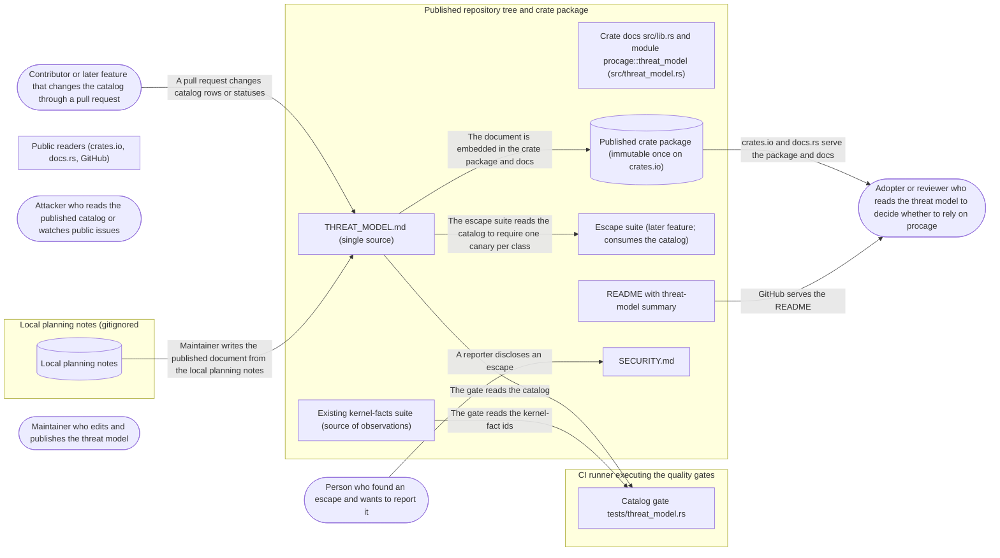

# Threat Model: Published threat model and escape-class contract

**Feature**: `002-threat-model` · **Generated**: 2026-11-01T17:26:06Z · **Profiles**: stride, llm, agent · **Canonical**: `threat-model.yaml`

> Rendered by ThreatSpec. Edit `threat-model.yaml`, not this file.

## Summary

| Threats | Critical | High | Medium | Low | Needs clarification | Not applicable | Mitigations | Requirements | Decisions |
|---|---|---|---|---|---|---|---|---|---|
| 10 | 0 | 6 | 3 | 1 | 0 | 26 | 10 | 10 | 0 |

## Actors

| ID | Name | Trust | Description |
|---|---|---|---|
| `actor.adopter` | Adopter or reviewer who reads the threat model to decide whether to rely on procage | semi-trusted |  |
| `actor.attacker` | Attacker who reads the published catalog or watches public issues | untrusted |  |
| `actor.contributor` | Contributor or later feature that changes the catalog through a pull request | semi-trusted |  |
| `actor.maintainer` | Maintainer who edits and publishes the threat model | trusted |  |
| `actor.reporter` | Person who found an escape and wants to report it | semi-trusted |  |

## Trust Zones

| ID | Name | Trust rating | Description |
|---|---|---|---|
| `tz.ci` | CI runner executing the quality gates | 60 |  |
| `tz.internet` | Public readers (crates.io, docs.rs, GitHub) | 1 |  |
| `tz.local` | Local planning notes (gitignored | 90 |  |
| `tz.repo` | Published repository tree and crate package | 70 |  |

## Assets

| ID | Name | Type | Classification | C / I / A | Source |
|---|---|---|---|---|---|
| `asset.escape-catalog` | Escape-class catalog (rows with id, disposition, status, evidence) | business-data | public | 0 / 95 / 50 | spec.md#FR-005 |
| `asset.evidence-reference` | Evidence reference | business-data | public | 0 / 95 / 30 | spec.md#FR-007 |
| `asset.kernel-observation` | Kernel observation | business-data | public | 0 / 85 / 30 | spec.md#FR-008 |
| `asset.planning-notes` | Local planning notes (internal decisions, open user actions) | business-data | internal | 70 / 50 / 20 | spec.md#FR-014 |
| `asset.published-id-baseline` | Published-id baseline | business-data | public | 0 / 90 / 40 | spec.md#FR-006 |
| `asset.security-policy` | Security policy | business-data | public | 0 / 80 / 50 | spec.md#FR-013 |
| `asset.threat-model-doc` | Threat model document | business-data | public | 0 / 95 / 50 | spec.md#Key-Entities |
| `asset.vulnerability-report` | Undisclosed vulnerability report | business-data | confidential | 95 / 60 / 30 | spec.md#User-Story-4 |

## Components

| ID | Name | Type | Trust zone | Source |
|---|---|---|---|---|
| `component.catalog-gate` | Catalog gate tests/threat_model.rs | process | `tz.ci` | spec.md#FR-010 |
| `component.crate-docs` | Crate docs src/lib.rs and module procage::threat_model (src/threat_model.rs) | document | `tz.repo` | spec.md#FR-001 |
| `component.crate-package` | Published crate package (immutable once on crates.io) | datastore | `tz.repo` | spec.md#FR-001 |
| `component.escape-suite` | Escape suite (later feature; consumes the catalog) | process | `tz.repo` | spec.md#FR-015 |
| `component.kernel-facts-suite` | Existing kernel-facts suite (source of observations) | process | `tz.repo` | spec.md#FR-008 |
| `component.planning-notes` | Local planning notes | datastore | `tz.local` | spec.md#FR-014 |
| `component.readme` | README with threat-model summary | document | `tz.repo` | spec.md#FR-011 |
| `component.security-policy` | SECURITY.md | document | `tz.repo` | spec.md#FR-013 |
| `component.threat-model-doc` | THREAT_MODEL.md (single source) | document | `tz.repo` | spec.md#FR-001 |

## Data Flows

| ID | Name | From | To | Assets | Crosses |
|---|---|---|---|---|---|
| `flow.catalog-to-escape-suite` | The escape suite reads the catalog to require one canary per class | `component.threat-model-doc` | `component.escape-suite` | `asset.escape-catalog` |  |
| `flow.catalog-to-gate` | The gate reads the catalog | `component.threat-model-doc` | `component.catalog-gate` | `asset.escape-catalog`, `asset.published-id-baseline`, `asset.evidence-reference` | `tz.ci` |
| `flow.contributor-to-catalog` | A pull request changes catalog rows or statuses | `actor.contributor` | `component.threat-model-doc` | `asset.escape-catalog`, `asset.evidence-reference` | `tz.repo` |
| `flow.doc-to-package` | The document is embedded in the crate package and docs | `component.threat-model-doc` | `component.crate-package` | `asset.threat-model-doc` |  |
| `flow.kernel-facts-to-gate` | The gate reads the kernel-fact ids | `component.kernel-facts-suite` | `component.catalog-gate` | `asset.kernel-observation` | `tz.ci` |
| `flow.package-to-readers` | crates.io and docs.rs serve the package and docs | `component.crate-package` | `actor.adopter` | `asset.threat-model-doc`, `asset.escape-catalog` | `tz.internet` |
| `flow.planning-to-doc` | Maintainer writes the published document from the local planning notes | `component.planning-notes` | `component.threat-model-doc` | `asset.planning-notes`, `asset.escape-catalog` | `tz.local`, `tz.repo` |
| `flow.repo-to-readers` | GitHub serves the README | `component.readme` | `actor.adopter` | `asset.threat-model-doc`, `asset.security-policy` | `tz.internet` |
| `flow.reporter-to-maintainer` | A reporter discloses an escape | `actor.reporter` | `component.security-policy` | `asset.vulnerability-report` | `tz.internet` |

## Threats

| ID | Threat | Category | Technique | Severity | Status | Mitigations | Mappings | Source |
|---|---|---|---|---|---|---|---|---|
| `threat.divergent-or-missing-published-copy` | The crate package or docs page ships without the threat model, or with a copy that differs from the repository, so crates.io readers see no boundary or a stale one that cannot be corrected once published | Tampering | data-tampering-at-rest | **high** | mitigated | `mitigation.single-source-embedding` |  | spec.md#FR-001 |
| `threat.evidence-not-a-caged-test` | A mitigated row names evidence that exists but does not cage a child (a unit test, a constant assertion, an SBPL string comparison), so the evidence rule is met in form only | Spoofing | false-evidence | **high** | mitigated | `mitigation.evidence-location-rule` |  | spec.md#FR-007 |
| `threat.malformed-row-skipped` | A malformed or reformatted catalog row is silently skipped by the gate, so a class vanishes from checking while still appearing to be listed | Tampering | data-tampering-at-rest | **high** | mitigated | `mitigation.strict-row-parser` |  | spec.md#FR-010 |
| `threat.missing-scope-section` | A required threat-model section (out of scope, strength versus microVMs, private-interface dependency, release status) is dropped in an edit, so adopters over-trust the cage against kernel bugs or think the release enforces | Spoofing | false-evidence | **high** | mitigated | `mitigation.required-sections-check` |  | spec.md#FR-002 |
| `threat.overclaimed-enforcement` | A contributor or later feature marks an escape class mitigated or detected, or the README states enforcement, without a caged-child test, so adopters trust protection that does not exist | Spoofing, Repudiation | false-evidence | **high** | mitigated | `mitigation.evidence-gate` |  | spec.md#FR-007 |
| `threat.silent-id-removal` | A change removes, renumbers or reuses a published escape-class id, so audits and the escape suite citing that id silently lose their meaning | Tampering | data-tampering-at-rest | **high** | mitigated | `mitigation.published-id-baseline` |  | spec.md#FR-006 |
| `threat.dangling-kernel-observation` | A cited kernel fact is renamed or removed from the kernel-facts suite, so the catalog cites evidence that no longer runs | Tampering, Repudiation | data-tampering-at-rest | **medium** | mitigated | `mitigation.kernel-fact-resolution` |  | spec.md#FR-008 |
| `threat.planning-content-leak` | Writing the published document from the local planning notes copies planning paths or internal content (open user actions, unpublished decisions) into the public tree | Information Disclosure | sensitive-data-exposure | **medium** | mitigated | `mitigation.planning-gate-coverage` |  | spec.md#FR-014 |
| `threat.public-escape-report` | Without a private reporting route, a reporter files an escape as a public issue, disclosing it to attackers before a fix | Information Disclosure | sensitive-data-exposure | **medium** | mitigated | `mitigation.private-reporting-policy` |  | spec.md#FR-013 |
| `threat.catalog-as-exploit-guide` | An attacker uses the published catalog, with its planned statuses, as a recipe of working escapes against early adopters | Information Disclosure | sensitive-data-exposure | **low** | mitigated | `mitigation.class-level-descriptions` |  | spec.md#FR-005 |

### Techniques evaluated without findings

| Technique | Disposition | Reason |
|---|---|---|
| credential-theft | not-applicable | no authentication surface: the feature publishes documents and a test gate; no principal is authenticated |
| identity-spoofing | not-applicable | no authentication surface: no component accepts identities |
| cross-tenant-leak | not-applicable | no shared-tenant surface: one public repository and crate, no tenant data |
| broken-access-control | not-applicable | no authorization surface: the feature enforces no permissions; repository write access is the platform's |
| data-tampering-in-transit | no-threat-detected | checked flow.package-to-readers and flow.repo-to-readers: crates.io, docs.rs and GitHub serve over TLS and crates.io packages are checksummed; the feature adds no transport of its own |
| injection | no-threat-detected | checked flow.catalog-to-gate and flow.kernel-facts-to-gate: the gate reads repository files as text and compares strings; no shell, template or path sink is fed by catalog content |
| missing-audit-trail | no-threat-detected | checked asset.escape-catalog and asset.published-id-baseline: every change is a reviewed commit in version control, so status changes are attributable |
| resource-exhaustion | no-threat-detected | checked component.catalog-gate: it parses a few repository files of bounded size inside the existing test run |
| privilege-escalation-via-config | no-threat-detected | checked component.crate-package: the package adds a document only; no configuration or secret is written or read |
| prompt-injection-direct | not-applicable | no llm-inference surface: the feature calls no language model (the threat model only describes LLM-driven adversaries) |
| prompt-injection-indirect | not-applicable | no untrusted-content-to-model surface |
| sensitive-information-disclosure | not-applicable | no llm-inference surface |
| excessive-agency | not-applicable | no llm-inference surface |
| model-supply-chain | not-applicable | no model-supply-chain surface: no models, adapters or datasets |
| training-data-poisoning | not-applicable | no persistent-model-input surface |
| unbounded-consumption | not-applicable | no cost-bearing-inference surface |
| misinformation | not-applicable | no user-facing-generation surface: documents are written and reviewed by people; overclaiming is modelled under STRIDE as threat.overclaimed-enforcement |
| hidden-context-exposure | not-applicable | no system-prompt surface |
| vector-embedding-weakness | not-applicable | no retrieval-path surface |
| improper-output-handling | not-applicable | no model-output surface |
| model-extraction | not-applicable | no inference-endpoint surface |
| goal-hijack | not-applicable | no agent surface in this feature |
| tool-misuse | not-applicable | no agent tool surface |
| identity-privilege-abuse | not-applicable | no agent identity surface |
| agentic-supply-chain | not-applicable | no agent plugin or MCP surface |
| unexpected-code-execution | not-applicable | no agent code-execution surface; the gate runs no catalog content |
| memory-context-poisoning | not-applicable | no agent memory surface |
| insecure-inter-agent-communication | not-applicable | no multi-agent surface |
| cascading-failure | not-applicable | no agent pipeline surface |
| human-agent-trust-exploitation | not-applicable | no agent-to-human surface |
| rogue-agent | not-applicable | no agent surface |

## Mitigations

| ID | Mitigation | Kind | Threats | Requirements | Touchpoints | Status |
|---|---|---|---|---|---|---|
| `mitigation.class-level-descriptions` | Catalog rows describe the class and cite only publicly known sources; no step-by-step exploit, payload or proof of concept is published | preventive | `threat.catalog-as-exploit-guide` | SR-010 | `THREAT_MODEL.md` | verified |
| `mitigation.evidence-gate` | The gate fails any row with status mitigated or detected whose evidence does not resolve to an existing test, and fails present-tense enforcement wording in README and crate docs per review checklist | preventive | `threat.overclaimed-enforcement` | SR-001 | `tests/threat_model.rs`, `README.md`, `src/lib.rs` | verified |
| `mitigation.evidence-location-rule` | Evidence may only point at tests in the integration-test locations that run caged children (escape suite canaries, kernel-level spawn tests), never at unit tests in the library source | preventive | `threat.evidence-not-a-caged-test` | SR-002 | `tests/threat_model.rs` | verified |
| `mitigation.kernel-fact-resolution` | The gate resolves every observed-on id against the kernel-facts catalog | detective | `threat.dangling-kernel-observation` | SR-005 | `tests/threat_model.rs`, `tests/kernel_facts/tests/kernel_facts.rs` | verified |
| `mitigation.planning-gate-coverage` | The planning-path gate scans the new published files, and the document is reviewed so that no internal planning content is copied | preventive | `threat.planning-content-leak` | SR-008 | `justfile`, `THREAT_MODEL.md`, `SECURITY.md` | verified |
| `mitigation.private-reporting-policy` | A security policy names a private reporting route and asks reporters not to open public issues for escapes | preventive | `threat.public-escape-report` | SR-009 | `SECURITY.md` | verified |
| `mitigation.published-id-baseline` | The gate holds the append-only list of published ids and fails when any is absent or duplicated | preventive | `threat.silent-id-removal` | SR-003 | `tests/threat_model.rs` | verified |
| `mitigation.required-sections-check` | The gate checks that each required heading of the threat model is present and that the release-status section names the current crate version | detective | `threat.missing-scope-section` | SR-007 | `tests/threat_model.rs`, `THREAT_MODEL.md` | verified |
| `mitigation.single-source-embedding` | The crate docs embed the document from one file that the package includes; a check builds the docs from the packaged crate | preventive | `threat.divergent-or-missing-published-copy` | SR-006 | `Cargo.toml`, `src/threat_model.rs`, `justfile` | verified |
| `mitigation.strict-row-parser` | Every table row in the catalog section must parse into all fields with allowed values; an unparsable row fails the gate instead of being skipped, and the parsed count must equal the baseline count | preventive | `threat.malformed-row-skipped` | SR-004 | `tests/threat_model.rs` | verified |

## Security Requirements

### SR-001 (P1) — verified

The catalog gate MUST fail when a row has status mitigated or detected and its evidence is empty or names a test that does not exist in the repository, and the README and crate docs MUST NOT state enforcement in the present tense while no sandboxing API ships.

- **Given** a row marked mitigated with empty evidence, **when** the gate runs, **then** it fails naming the id and the evidence rule
- **Given** a row marked detected whose evidence names a non-existent test, **when** the gate runs, **then** it fails naming the id and the unresolved reference
- **Given** the README and crate docs of a release with no sandboxing API, **when** they are reviewed, **then** no sentence describes enforcement in the present tense
- Mitigations: `mitigation.evidence-gate`
- Tasks: T006 ✓, T007 ✓, T014 ✓, T015 ✓, T016 ✓, T020 ✓
- Verification `verification.sr-001.2026-10-29`: test → pass (verified) — `tests/threat_model.rs::mitigated_without_evidence_is_caught; tests/threat_model.rs::nonexistent_evidence_is_caught; tests/threat_model.rs::valid_evidence_is_accepted; review of README.md and src/lib.rs recorded in quickstart.md scenario 8`

### SR-002 (P1) — verified

Evidence for mitigated or detected MUST resolve to a test function in an integration-test location that runs a caged child; references into library source or unit tests MUST fail the gate.

- **Given** evidence pointing at a unit test inside the library source, **when** the gate runs, **then** it fails naming the id and the location rule
- Mitigations: `mitigation.evidence-location-rule`
- Tasks: T014 ✓, T015 ✓
- Verification `verification.sr-002.2026-10-29`: test → pass (verified) — `tests/threat_model.rs::evidence_in_library_source_is_caught; tests/threat_model.rs::kernel_fact_as_evidence_is_caught`

### SR-003 (P1) — verified

The gate MUST fail when any id in the published-id baseline is absent from the catalog or an id appears twice.

- **Given** the R-22 row deleted, **when** the gate runs, **then** it fails naming R-22 as missing
- **Given** a second row with id R-10, **when** the gate runs, **then** it fails naming R-10 as duplicated
- Mitigations: `mitigation.published-id-baseline`
- Tasks: T012 ✓, T015 ✓
- Verification `verification.sr-003.2026-10-29`: test → pass (verified) — `tests/threat_model.rs::removed_id_is_caught; tests/threat_model.rs::duplicate_id_is_caught; tests/threat_model.rs::unknown_id_is_caught`

### SR-004 (P1) — verified

The gate MUST reject, not skip, any row in the catalog section that does not parse into every field with an allowed value, and MUST fail when the parsed row count differs from the baseline count.

- **Given** a row with status "done", **when** the gate runs, **then** it fails naming the id, the field and the allowed values
- **Given** a row with a missing column, **when** the gate runs, **then** it fails naming the line instead of ignoring the row
- Mitigations: `mitigation.strict-row-parser`
- Tasks: T003 ✓, T004 ✓, T015 ✓
- Verification `verification.sr-004.2026-10-29`: test → pass (verified) — `tests/threat_model.rs::unknown_status_is_caught; tests/threat_model.rs::missing_cell_is_caught; quickstart.md scenario 3 (blank line inside the table reported as row-format, not skipped)`

### SR-005 (P2) — verified

The gate MUST fail when an observed-on entry names a kernel fact absent from the kernel-facts catalog.

- **Given** a row citing KF-M99, **when** the gate runs, **then** it fails naming the id and KF-M99
- Mitigations: `mitigation.kernel-fact-resolution`
- Tasks: T013 ✓, T015 ✓
- Verification `verification.sr-005.2026-10-29`: test → pass (verified) — `tests/threat_model.rs::unknown_kernel_fact_is_caught; tests/threat_model.rs::gate (asserts at least 40 kernel-fact ids were read)`

### SR-006 (P1) — verified

The threat model MUST come from one source file that the crate package includes, and the crate documentation MUST build from the packaged crate alone with warnings as errors.

- **Given** the packaged crate, **when** its file list is inspected, **then** it contains the threat-model file
- **Given** the unpacked package, **when** its docs are built with warnings denied, **then** the build succeeds and the threat-model page is present
- Mitigations: `mitigation.single-source-embedding`
- Tasks: T001 ✓, T019 ✓
- Verification `verification.sr-006.2026-10-29`: test → pass (verified) — `justfile package-docs recipe (part of just ci); quickstart.md scenario 4 (include entry removed → fails)`

### SR-007 (P1) — verified

The gate MUST fail when a required threat-model heading (adversary, assets, trusted, in scope, out of scope, strength, dependencies, non-goals, release status, escape classes) is missing or the release-status section does not name the crate's current version.

- **Given** the out-of-scope heading removed, **when** the gate runs, **then** it fails naming the missing heading
- **Given** a release-status section naming 0.0.0 while the crate is 0.0.1, **when** the gate runs, **then** it fails naming both versions
- Mitigations: `mitigation.required-sections-check`
- Tasks: T002 ✓, T009 ✓, T015 ✓
- Verification `verification.sr-007.2026-10-29`: test → pass (verified) — `tests/threat_model.rs::missing_heading_is_caught; tests/threat_model.rs::wrong_release_is_caught`

### SR-008 (P2) — verified

The planning-path gate MUST scan the threat-model document and the security policy, and the published files MUST NOT contain internal planning content (open user actions, unpublished decisions).

- **Given** a planning path injected into the threat-model document, **when** the planning-path gate runs, **then** it fails naming the file
- **Given** the finished document, **when** it is reviewed, **then** it contains no open user action or unpublished decision from the planning notes
- Mitigations: `mitigation.planning-gate-coverage`
- Tasks: T005 ✓, T018 ✓, T020 ✓
- Verification `verification.sr-008.2026-10-29`: test → pass (verified) — `justfile planning-paths (paths include THREAT_MODEL.md and SECURITY.md); quickstart.md scenarios 6 and 8`

### SR-009 (P2) — verified

The repository MUST contain a security policy that names a private reporting route, asks reporters not to file escapes as public issues, and refers to the threat model for scope.

- **Given** the repository root, **when** a reporter opens the security policy, **then** it names a private route, asks for no public issue and links the threat model
- Mitigations: `mitigation.private-reporting-policy`
- Tasks: T017 ✓
- Verification `verification.sr-009.2026-10-29`: review → pass (verified) — `SECURITY.md (Reporting a vulnerability, Scope, Supported versions)`

### SR-010 (P3) — verified

Catalog rows MUST describe classes at the level of a one-line description with public sources and MUST NOT include exploit steps, payloads or proofs of concept.

- **Given** the published catalog, **when** it is reviewed, **then** no row contains commands, payloads or exploit steps
- Mitigations: `mitigation.class-level-descriptions`
- Tasks: T010 ✓, T020 ✓
- Verification `verification.sr-010.2026-10-29`: review → pass (verified) — `THREAT_MODEL.md Escape classes table, reviewed in quickstart.md scenario 8`
