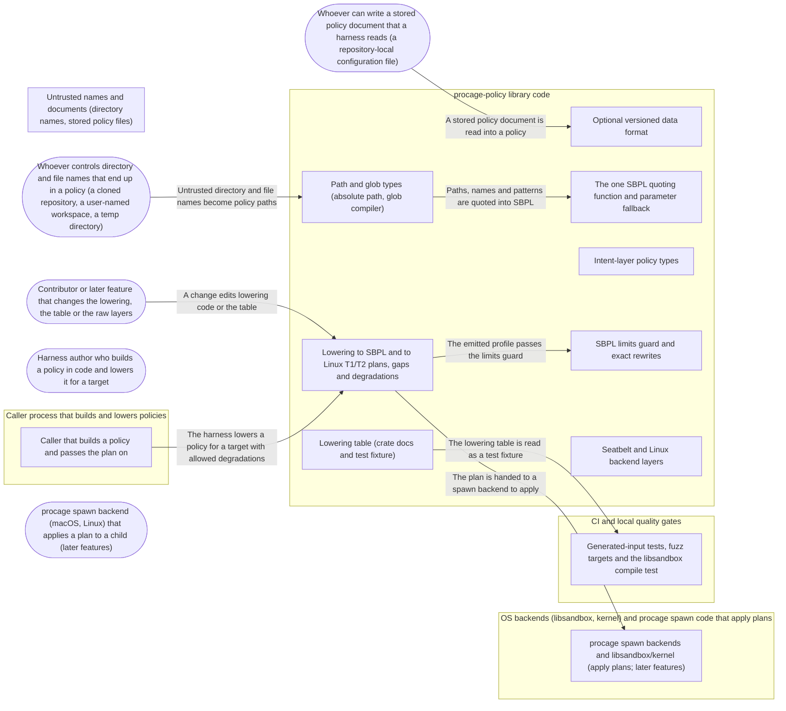

# Threat Model: Portable policy IR and its lowering to each backend

**Feature**: `003-policy-ir` · **Generated**: 2026-11-01T17:26:06Z · **Profiles**: stride, llm, agent · **Canonical**: `threat-model.yaml`

> Rendered by ThreatSpec. Edit `threat-model.yaml`, not this file.

## Summary

| Threats | Critical | High | Medium | Low | Needs clarification | Not applicable | Mitigations | Requirements | Decisions |
|---|---|---|---|---|---|---|---|---|---|
| 15 | 0 | 12 | 3 | 0 | 0 | 25 | 11 | 11 | 0 |

## Actors

| ID | Name | Trust | Description |
|---|---|---|---|
| `actor.config-source` | Whoever can write a stored policy document that a harness reads (a repository-local configuration file) | untrusted |  |
| `actor.contributor` | Contributor or later feature that changes the lowering, the table or the raw layers | semi-trusted |  |
| `actor.harness-author` | Harness author who builds a policy in code and lowers it for a target | semi-trusted |  |
| `actor.path-source` | Whoever controls directory and file names that end up in a policy (a cloned repository, a user-named workspace, a temp directory) | untrusted |  |
| `actor.spawn-backend` | procage spawn backend (macOS, Linux) that applies a plan to a child (later features) | trusted |  |

## Trust Zones

| ID | Name | Trust rating | Description |
|---|---|---|---|
| `tz.backend` | OS backends (libsandbox, kernel) and procage spawn code that apply plans | 90 |  |
| `tz.ci` | CI and local quality gates | 60 |  |
| `tz.harness` | Caller process that builds and lowers policies | 70 |  |
| `tz.policy-crate` | procage-policy library code | 80 |  |
| `tz.untrusted-input` | Untrusted names and documents (directory names, stored policy files) | 5 |  |

## Assets

| ID | Name | Type | Classification | C / I / A | Source |
|---|---|---|---|---|---|
| `asset.hard-deny-tier` | Hard-deny tier and its waivers | configuration | internal | 0 / 95 / 20 | spec.md#FR-009 |
| `asset.lowered-plan` | Lowered plan (SBPL profile text and params, Linux plan) or the list of capability gaps; degradations recorded | configuration | internal | 10 / 95 / 60 | spec.md#FR-013 |
| `asset.lowering-table` | Published lowering table (construct x target outcomes) | business-data | public | 0 / 85 / 30 | spec.md#FR-016 |
| `asset.policy` | Intent-layer policy (file rules, network, process, IPC, hygiene settings, grants, waivers) | configuration | internal | 10 / 95 / 40 | spec.md#FR-007 |
| `asset.policy-paths` | Paths and globs inside a policy | configuration | internal | 20 / 95 / 30 | spec.md#FR-001 |
| `asset.raw-layers` | Seatbelt and Linux backend layers (raw rules) | configuration | internal | 0 / 95 / 20 | spec.md#FR-010 |
| `asset.stored-policy` | Serialised policy document | configuration | internal | 10 / 90 / 30 | spec.md#FR-021 |

## Components

| ID | Name | Type | Trust zone | Source |
|---|---|---|---|---|
| `component.assurance` | Generated-input tests, fuzz targets and the libsandbox compile test | process | `tz.ci` | spec.md#FR-023 |
| `component.data-format` | Optional versioned data format | library | `tz.policy-crate` | spec.md#FR-021 |
| `component.escaper` | The one SBPL quoting function and parameter fallback | library | `tz.policy-crate` | spec.md#FR-005 |
| `component.harness` | Caller that builds a policy and passes the plan on | process | `tz.harness` | spec.md#User-Story-1 |
| `component.intent-layer` | Intent-layer policy types | library | `tz.policy-crate` | spec.md#FR-007 |
| `component.limits-guard` | SBPL limits guard and exact rewrites | library | `tz.policy-crate` | spec.md#FR-019 |
| `component.lowering` | Lowering to SBPL and to Linux T1/T2 plans, gaps and degradations | library | `tz.policy-crate` | spec.md#FR-013 |
| `component.lowering-table` | Lowering table (crate docs and test fixture) | document | `tz.policy-crate` | spec.md#FR-016 |
| `component.path-types` | Path and glob types (absolute path, glob compiler) | library | `tz.policy-crate` | spec.md#FR-001 |
| `component.raw-layers` | Seatbelt and Linux backend layers | library | `tz.policy-crate` | spec.md#FR-010 |
| `component.spawn-backends` | procage spawn backends and libsandbox/kernel (apply plans; later features) | process | `tz.backend` | spec.md#Context |

## Data Flows

| ID | Name | From | To | Assets | Crosses |
|---|---|---|---|---|---|
| `flow.config-to-format` | A stored policy document is read into a policy | `actor.config-source` | `component.data-format` | `asset.stored-policy`, `asset.policy` | `tz.untrusted-input`, `tz.policy-crate` |
| `flow.contributor-to-lowering` | A change edits lowering code or the table | `actor.contributor` | `component.lowering` | `asset.lowering-table`, `asset.lowered-plan` | `tz.policy-crate` |
| `flow.harness-to-lowering` | The harness lowers a policy for a target with allowed degradations | `component.harness` | `component.lowering` | `asset.policy`, `asset.raw-layers`, `asset.hard-deny-tier` | `tz.harness`, `tz.policy-crate` |
| `flow.lowering-to-guard` | The emitted profile passes the limits guard | `component.lowering` | `component.limits-guard` | `asset.lowered-plan` |  |
| `flow.names-to-policy` | Untrusted directory and file names become policy paths | `actor.path-source` | `component.path-types` | `asset.policy-paths` | `tz.untrusted-input`, `tz.policy-crate` |
| `flow.paths-to-escaper` | Paths, names and patterns are quoted into SBPL | `component.path-types` | `component.escaper` | `asset.policy-paths` |  |
| `flow.plan-to-backend` | The plan is handed to a spawn backend to apply | `component.lowering` | `component.spawn-backends` | `asset.lowered-plan` | `tz.policy-crate`, `tz.backend` |
| `flow.table-to-tests` | The lowering table is read as a test fixture | `component.lowering-table` | `component.assurance` | `asset.lowering-table` | `tz.ci` |

## Threats

| ID | Threat | Category | Technique | Severity | Status | Mitigations | Mappings | Source |
|---|---|---|---|---|---|---|---|---|
| `threat.format-drops-restriction` | Reading a stored policy ignores an unknown field or skips a constructor check, so a restriction written by a newer writer, or an invalid path or glob, is silently dropped or accepted | Tampering | data-tampering-at-rest | **high** | mitigated | `mitigation.strict-format` |  | spec.md#FR-021 |
| `threat.glob-metachar-widening` | Glob or regular-expression characters in a resolved path are read as pattern syntax, so a rule for one directory matches others (escape class R-03) | Tampering, Elevation of Privilege | injection | **high** | mitigated | `mitigation.typed-patterns` |  | spec.md#FR-002 |
| `threat.guard-broadens` | The limits guard shrinks an oversized profile by merging rules into a broader one (a common prefix or parent subtree), so the plan allows more than the policy | Elevation of Privilege | broken-access-control | **high** | mitigated | `mitigation.exact-rewrite-only` |  | spec.md#FR-020 |
| `threat.hard-deny-missing-or-shadowed` | The hard-deny tier is missing, not emitted last, or a later allow follows a deny-within-allow rule, so last-match-wins evaluation lets an allow override a hard deny or a protect/hide rule | Elevation of Privilege | broken-access-control | **high** | mitigated | `mitigation.fixed-precedence` |  | spec.md#FR-009 |
| `threat.identifier-injection` | A grant name or other identifier that becomes part of profile syntax (an extension class, a parameter name) carries quotes or spaces and changes the profile | Tampering | injection | **high** | mitigated | `mitigation.closed-raw-layer` |  | spec.md#Edge-Cases |
| `threat.overclaimed-enforcement` | Crate docs or tests present a lowered profile, or its successful compilation, as evidence that a child is caged, although nothing in this feature applies a plan | Spoofing, Repudiation | false-evidence | **high** | mitigated | `mitigation.no-enforcement-wording` |  | spec.md#FR-024 |
| `threat.oversize-profile` | A policy with thousands of rules or a path over the inline literal cap yields a profile libsandbox rejects without a message or aborts the calling process on, or the long path is truncated | Denial of Service, Tampering | resource-exhaustion | **high** | mitigated | `mitigation.limits-and-params` |  | spec.md#FR-019 |
| `threat.quote-injection` | A directory name containing a quote or backslash ends the SBPL string early, so the path source injects profile syntax (an allow, or a sandbox-off modifier) into every policy that names it | Tampering, Elevation of Privilege | injection | **high** | mitigated | `mitigation.single-escaper` |  | spec.md#FR-005 |
| `threat.raw-layer-sandbox-off` | A raw Seatbelt rule, built in code or read from a stored document, carries (with no-sandbox), (with no-profile) or extra syntax through an unchecked operation name, so the child's next exec runs unsandboxed (escape class R-11) | Elevation of Privilege | privilege-escalation-via-config | **high** | mitigated | `mitigation.closed-raw-layer` |  | spec.md#FR-011 |
| `threat.relative-path-silent` | A relative, home-relative or dot-dot path is accepted and emitted, so the rule silently matches nothing or something other than intended (lexical half of escape class R-02) | Tampering | injection | **high** | mitigated | `mitigation.abs-path-validation` |  | spec.md#FR-001 |
| `threat.silent-degradation` | A construct a target cannot express (protect on Landlock-only T2, a literal or glob on Linux, loopback ports on T2) or a tier below the one asked for is lowered to a weaker plan without a typed gap, so the child gets less isolation than the caller asked for | Elevation of Privilege, Repudiation | broken-access-control | **high** | mitigated | `mitigation.typed-gaps` |  | spec.md#FR-014 |
| `threat.table-drift` | The published lowering table and the actual lowering disagree, so authors choose a target trusting an outcome (exact) the code does not deliver | Repudiation, Tampering | data-tampering-at-rest | **high** | mitigated | `mitigation.table-as-fixture` |  | spec.md#FR-016 |
| `threat.lossy-path` | A path with non-UTF-8 bytes or a control character is converted lossily or dropped, so the emitted rule names a different file than the policy | Tampering | data-tampering-at-rest | **medium** | mitigated | `mitigation.abs-path-validation`, `mitigation.single-escaper` |  | spec.md#FR-001 |
| `threat.lowering-panic` | An adversarial stored document or policy makes parsing or lowering panic or run unbounded, taking down the harness that tried to build a sandbox | Denial of Service | resource-exhaustion | **medium** | mitigated | `mitigation.strict-format` |  | spec.md#FR-023 |
| `threat.unrecorded-degradation` | An allowed degradation or a hard-deny waiver is applied but not listed in the plan, so receipts later cannot show that the run was weaker than the policy | Repudiation | missing-audit-trail | **medium** | mitigated | `mitigation.fixed-precedence`, `mitigation.typed-gaps` |  | spec.md#FR-009 |

### Techniques evaluated without findings

| Technique | Disposition | Reason |
|---|---|---|
| credential-theft | not-applicable | no authentication surface: the crate authenticates no principal and holds no credential |
| identity-spoofing | not-applicable | no authentication surface: no component accepts identities |
| cross-tenant-leak | not-applicable | no shared-tenant surface: a pure library evaluated inside one caller process |
| data-tampering-in-transit | no-threat-detected | checked flow.config-to-format: the crate reads bytes the harness hands it and adds no transport; integrity of storage and transport is the harness's, and every read value passes the constructor checks (threat.format-drops-restriction) |
| sensitive-data-exposure | no-threat-detected | checked component.lowering and component.data-format: the crate writes no file, log or telemetry; paths in a plan return only to the caller that supplied them |
| prompt-injection-direct | not-applicable | no llm-inference surface: the crate calls no language model (LLM-driven code is the adversary of later features, inside the child) |
| prompt-injection-indirect | not-applicable | no untrusted-content-to-model surface |
| sensitive-information-disclosure | not-applicable | no llm-inference surface |
| excessive-agency | not-applicable | no llm-inference surface |
| model-supply-chain | not-applicable | no model-supply-chain surface: no models, adapters or datasets |
| training-data-poisoning | not-applicable | no persistent-model-input surface |
| unbounded-consumption | not-applicable | no cost-bearing-inference surface |
| misinformation | not-applicable | no user-facing-generation surface; overclaiming in docs is modelled under STRIDE as threat.overclaimed-enforcement |
| hidden-context-exposure | not-applicable | no system-prompt surface |
| vector-embedding-weakness | not-applicable | no retrieval-path surface |
| improper-output-handling | not-applicable | no model-output surface |
| model-extraction | not-applicable | no inference-endpoint surface |
| goal-hijack | not-applicable | no agent surface in this feature |
| tool-misuse | not-applicable | no agent tool surface |
| identity-privilege-abuse | not-applicable | no agent identity surface |
| agentic-supply-chain | not-applicable | no agent plugin or MCP surface |
| unexpected-code-execution | not-applicable | no agent code-execution surface; the crate executes nothing (profile injection is modelled under STRIDE as threat.quote-injection) |
| memory-context-poisoning | not-applicable | no agent memory surface |
| insecure-inter-agent-communication | not-applicable | no multi-agent surface |
| cascading-failure | not-applicable | no agent pipeline surface |
| human-agent-trust-exploitation | not-applicable | no agent-to-human surface |
| rogue-agent | not-applicable | no agent surface |

## Mitigations

| ID | Mitigation | Kind | Threats | Requirements | Touchpoints | Status |
|---|---|---|---|---|---|---|
| `mitigation.abs-path-validation` | The absolute-path constructor refuses empty, relative, tilde, dot, dot-dot, empty-component, trailing-slash and NUL inputs with typed errors and stores exact bytes | preventive | `threat.relative-path-silent`, `threat.lossy-path` | SR-003 | `crates/procage-policy/src/path.rs`, `crates/procage-policy/src/glob.rs`, `crates/procage-policy/tests/paths.rs`, `crates/procage-policy/tests/escaping.rs` | verified |
| `mitigation.closed-raw-layer` | The Seatbelt layer has a closed operation list proven to compile, an unstable escape hatch limited to [a-z0-9*-], no modifier type except the run tag, and validated identifiers for grant and parameter names | preventive | `threat.raw-layer-sandbox-off`, `threat.identifier-injection` | SR-004 | `crates/procage-policy/src/seatbelt.rs`, `crates/procage-policy/src/name.rs`, `crates/procage-policy/src/policy.rs`, `tests/kernel_facts/tests/policy_compiles.rs` | verified |
| `mitigation.exact-rewrite-only` | The limits guard only merges adjacent rules with the same effect and operation; a reference evaluator compares guarded and unguarded profiles over generated requests | preventive | `threat.guard-broadens` | SR-008 | `crates/procage-policy/src/sbpl.rs`, `crates/procage-policy/tests/limits.rs`, `crates/procage-policy/tests/common/mod.rs` | verified |
| `mitigation.fixed-precedence` | Lowering sorts rules into fixed precedence (allows, then protect and hide, then the hard-deny tier last), lists every waiver, and a test asserts the tier is last and present for every reference policy and shuffled rule order | preventive | `threat.hard-deny-missing-or-shadowed`, `threat.unrecorded-degradation` | SR-007 | `crates/procage-policy/src/lower/mod.rs`, `crates/procage-policy/src/lower/macos.rs`, `crates/procage-policy/src/lower/linux.rs`, `crates/procage-policy/tests/gaps.rs`, `crates/procage-policy/tests/precedence.rs` | verified |
| `mitigation.limits-and-params` | A configurable rule limit fails with a typed error naming limit and count; a quoted value over the inline cap becomes a named parameter whose exact value travels in the plan | preventive | `threat.oversize-profile` | SR-009 | `crates/procage-policy/src/sbpl.rs`, `crates/procage-policy/src/lower/macos.rs`, `crates/procage-policy/tests/limits.rs` | verified |
| `mitigation.no-enforcement-wording` | Crate docs describe what lowering produces, never that it is enforced; the libsandbox compile test is labelled a well-formedness check | preventive | `threat.overclaimed-enforcement` | SR-011 | `crates/procage-policy/src/lowering.md`, `crates/procage-policy/tests/lowering_table.rs`, `crates/procage-policy/src/lib.rs`, `tests/kernel_facts/tests/policy_compiles.rs` | verified |
| `mitigation.single-escaper` | One quoting function escapes backslash and quote and refuses NUL, control characters and invalid UTF-8; every emitter calls it; a decoder test and a fuzz target check that every output reads back to the exact input | preventive | `threat.quote-injection`, `threat.lossy-path` | SR-001 | `crates/procage-policy/src/sbpl.rs`, `crates/procage-policy/tests/escaping.rs`, `crates/procage-policy/fuzz/fuzz_targets/quote.rs` | verified |
| `mitigation.strict-format` | The data format is versioned, refuses unknown fields and routes every value through its constructor; reading and lowering are fuzzed for panics and round-trip | preventive | `threat.format-drops-restriction`, `threat.lowering-panic` | SR-010 | `crates/procage-policy/src/format.rs`, `crates/procage-policy/tests/format.rs`, `crates/procage-policy/fuzz/fuzz_targets/format.rs`, `crates/procage-policy/fuzz/fuzz_targets/lower.rs` | verified |
| `mitigation.table-as-fixture` | The lowering table in the crate docs is parsed by a test that lowers each construct for each target and asserts the stated outcome | detective | `threat.table-drift` | SR-006 | `crates/procage-policy/src/lowering.md`, `crates/procage-policy/tests/lowering_table.rs`, `crates/procage-policy/src/lib.rs`, `tests/kernel_facts/tests/policy_compiles.rs` | verified |
| `mitigation.typed-gaps` | Lowering returns every capability gap for a construct the target cannot express exactly; an approximation is accepted only when allowed by name and is listed as a degradation; tiers and Landlock versions below the minimum are refused, never substituted | preventive | `threat.silent-degradation`, `threat.unrecorded-degradation` | SR-005 | `crates/procage-policy/src/lower/mod.rs`, `crates/procage-policy/src/lower/macos.rs`, `crates/procage-policy/src/lower/linux.rs`, `crates/procage-policy/tests/gaps.rs`, `crates/procage-policy/tests/precedence.rs` | verified |
| `mitigation.typed-patterns` | Literal, subtree and glob are distinct types; the glob compiler escapes every non-glob character and anchors the pattern; unsupported wildcard syntax is refused | preventive | `threat.glob-metachar-widening` | SR-002 | `crates/procage-policy/src/path.rs`, `crates/procage-policy/src/glob.rs`, `crates/procage-policy/tests/paths.rs`, `crates/procage-policy/tests/escaping.rs` | verified |

## Security Requirements

### SR-001 (P1) — verified

Every path, name and pattern text emitted into SBPL MUST pass through the one quoting function or be passed as a named parameter; the function MUST escape backslash and quote and MUST refuse NUL, control characters and invalid UTF-8 with a typed error, and every accepted value MUST decode back to the exact input.

- **Given** a subtree named /tmp/a"b\c(d), **when** the policy is lowered for macOS, **then** the profile holds one subtree rule whose quoted string decodes to exactly those bytes and adds no other syntax
- **Given** a path containing a newline or a non-UTF-8 byte, **when** it is lowered for macOS, **then** lowering fails with a typed error and the path is not altered or dropped
- **Given** at least 10,000 generated byte strings and the fuzz corpus, **when** each is quoted, **then** each result either decodes to its input or is refused
- Mitigations: `mitigation.single-escaper`
- Tasks: T006 ✓, T007 ✓, T012 ✓, T020 ✓, T026 ✓, T029 ✓
- Verification `verification.sr-001.2026-10-30`: test → pass (verified) — `crates/procage-policy/tests/escaping.rs::quoting_round_trips_or_refuses; crates/procage-policy/tests/escaping.rs::a_hostile_directory_name_stays_one_subpath; crates/procage-policy/tests/gaps.rs::a_control_character_is_unrepresentable_on_macos`

### SR-002 (P1) — verified

Literal, subtree and glob MUST be distinct kinds chosen by the author; a glob MUST lower to one anchored pattern in which every non-glob character is escaped, and unsupported wildcard syntax MUST be refused.

- **Given** a subtree whose name contains * ? [ ] . + ( ) |, **when** it is lowered for macOS, **then** it is emitted as a subtree, not a pattern
- **Given** the glob /work/**/*.rs, **when** it is lowered for macOS, **then** the result is one pattern anchored at both ends with the dot escaped
- **Given** a glob containing [ or {, **when** it is constructed, **then** it is refused with a typed error
- Mitigations: `mitigation.typed-patterns`
- Tasks: T005 ✓, T020 ✓
- Verification `verification.sr-002.2026-10-30`: test → pass (verified) — `crates/procage-policy/tests/escaping.rs::generated_globs_escape_every_literal; crates/procage-policy/tests/escaping.rs::a_glob_becomes_one_anchored_escaped_pattern; crates/procage-policy/tests/escaping.rs::unsupported_glob_syntax_is_refused`

### SR-003 (P1) — verified

A policy path MUST be exact bytes of an absolute, lexically normal path; empty, relative, tilde, dot, dot-dot, empty-component, trailing-slash and NUL inputs MUST be refused with typed errors and nothing is silently resolved.

- **Given** relative/dir, ~/dir, /a/../b, /a//b, /a/ or a NUL byte, **when** each is used as a policy path, **then** each is refused with an error naming its reason
- **Given** a valid path with non-UTF-8 bytes, **when** it is stored and read back, **then** the bytes are identical
- Mitigations: `mitigation.abs-path-validation`
- Tasks: T004 ✓, T019 ✓
- Verification `verification.sr-003.2026-10-30`: test → pass (verified) — `crates/procage-policy/tests/paths.rs::each_refusal_names_its_reason; crates/procage-policy/tests/paths.rs::bytes_are_kept_exactly; crates/procage-policy/tests/paths.rs::generated_inputs_match_the_rules`

### SR-004 (P1) — verified

No value of the Seatbelt layer, including deserialised values, MUST be able to produce (with no-sandbox), (with no-profile) or any modifier other than the run tag; operation names outside the closed list MUST be accepted only behind the unstable option and only if they match [a-z0-9*-]+; grant and parameter names MUST be short identifiers.

- **Given** an unstable operation name containing a parenthesis, space or quote, **when** it is constructed or read from a document, **then** it is refused
- **Given** every operation in the closed list, **when** each is compiled through libsandbox on the development Mac, **then** each compiles
- **Given** a grant name containing a quote, space or slash, **when** it is constructed, **then** it is refused
- Mitigations: `mitigation.closed-raw-layer`
- Tasks: T003 ✓, T009 ✓, T020 ✓, T021 ✓
- Verification `verification.sr-004.2026-10-30`: test → pass (verified) — `crates/procage-policy/tests/escaping.rs::identifiers_cannot_carry_syntax; crates/procage-policy/tests/format.rs::invalid_values_are_refused_with_the_constructor_message; tests/kernel_facts/tests/policy_compiles.rs::every_operation_of_the_closed_list_compiles`

### SR-005 (P1) — verified

Lowering MUST return the complete list of capability gaps for constructs the target cannot express exactly; an approximation MUST be accepted only when the caller allowed that construct by name and MUST then be listed as a degradation in the plan; tier T2 with a Landlock version below 4 MUST be refused and no other tier substituted.

- **Given** a policy with a protect rule and a glob rule, **when** it is lowered for Linux T2 without allowed degradations, **then** lowering fails listing both gaps with construct, target and tier
- **Given** a single-file rule and the single-file approximation allowed by name, **when** it is lowered for Linux, **then** a plan is returned and its degradations name that construct
- **Given** tier T2 with Landlock version 3, **when** lowering runs, **then** it fails with a typed tier error and returns no plan
- Mitigations: `mitigation.typed-gaps`
- Tasks: T011 ✓, T012 ✓, T013 ✓, T017 ✓
- Verification `verification.sr-005.2026-10-30`: test → pass (verified) — `crates/procage-policy/tests/gaps.rs::every_gap_is_listed_and_no_plan_is_returned; crates/procage-policy/tests/gaps.rs::an_allowed_approximation_is_recorded_once; crates/procage-policy/tests/gaps.rs::tiers_below_their_minimum_are_refused`

### SR-006 (P2) — verified

The lowering table published in the crate docs MUST be the fixture of a test that lowers each construct for each target and asserts the stated outcome.

- **Given** a row of the table changed without a matching change to lowering (or the reverse), **when** the tests run, **then** they fail naming the construct and target
- Mitigations: `mitigation.table-as-fixture`
- Tasks: T014 ✓, T016 ✓
- Verification `verification.sr-006.2026-10-30`: test → pass (verified) — `crates/procage-policy/tests/lowering_table.rs::every_row_matches_the_lowering; crates/procage-policy/tests/lowering_table.rs::a_changed_cell_is_detected`

### SR-007 (P1) — verified

Every plan MUST place allows first, then protect and hide rules, then the hard-deny tier last, regardless of input order, and MUST list every hard-deny waiver; a waiver MUST name a known class.

- **Given** any reference policy with its rules shuffled, **when** it is lowered for macOS, **then** the profile is byte-identical and its last rules are the hard-deny tier
- **Given** a policy waiving one hard-deny class by name, **when** it is lowered, **then** that class is absent and the plan lists the waiver
- Mitigations: `mitigation.fixed-precedence`
- Tasks: T012 ✓, T018 ✓
- Verification `verification.sr-007.2026-10-30`: test → pass (verified) — `crates/procage-policy/tests/precedence.rs::rule_order_never_changes_the_plan; crates/procage-policy/tests/precedence.rs::blocks_are_in_fixed_order_and_the_tier_is_last; crates/procage-policy/tests/precedence.rs::waivers_remove_exactly_their_class_and_are_listed`

### SR-008 (P1) — verified

The limits guard MUST only apply rewrites that match exactly the same requests and MUST never broaden an allow.

- **Given** generated profiles and at least 10,000 generated requests, **when** guarded and unguarded profiles are evaluated by the reference evaluator, **then** every decision is identical
- Mitigations: `mitigation.exact-rewrite-only`
- Tasks: T022 ✓, T023 ✓
- Verification `verification.sr-008.2026-10-30`: test → pass (verified) — `crates/procage-policy/tests/limits.rs::merging_never_changes_a_decision; crates/procage-policy/tests/limits.rs::merged_rules_never_mix_effects`

### SR-009 (P2) — verified

Lowering for macOS MUST fail with a typed limit error naming the limit and the count when the profile exceeds the configured rule limit, and MUST emit a quoted value over the inline cap as a named parameter whose exact value the plan carries.

- **Given** a policy one rule over the configured limit, **when** it is lowered for macOS, **then** it fails naming the limit and the count
- **Given** a path whose quoted form is longer than 1016 bytes, **when** it is lowered for macOS, **then** the profile references a parameter and the plan holds the exact path bytes
- Mitigations: `mitigation.limits-and-params`
- Tasks: T022 ✓, T023 ✓
- Verification `verification.sr-009.2026-10-30`: test → pass (verified) — `crates/procage-policy/tests/limits.rs::over_the_limit_fails_closed; crates/procage-policy/tests/escaping.rs::long_values_go_through_a_parameter; tests/kernel_facts/tests/policy_compiles.rs::a_parameter_backed_long_path_compiles`

### SR-010 (P1) — verified

The data format MUST be versioned, MUST refuse unknown fields, MUST apply every constructor check on reading, and reading and lowering MUST never panic on any input.

- **Given** a document with an unknown field, **when** it is read, **then** reading fails naming the field
- **Given** a document with a relative path or a malformed glob, **when** it is read, **then** reading fails with the constructor's error
- **Given** the fuzz targets for reading and lowering, **when** each runs at least 60 seconds, **then** no panic occurs and every accepted document round-trips
- Mitigations: `mitigation.strict-format`
- Tasks: T024 ✓, T025 ✓, T026 ✓, T029 ✓
- Verification `verification.sr-010.2026-10-30`: test → pass (verified) — `crates/procage-policy/tests/format.rs::unknown_fields_are_refused; crates/procage-policy/tests/format.rs::invalid_values_are_refused_with_the_constructor_message; crates/procage-policy/tests/format.rs::versions_other_than_one_are_refused; crates/procage-policy/tests/format.rs::mutated_documents_never_panic_and_accepted_ones_round_trip`

### SR-011 (P2) — verified

Crate docs MUST describe what lowering produces and MUST NOT claim that a profile or plan is enforced; the libsandbox compile test MUST be described as a well-formedness check only.

- **Given** the policy crate docs and the compile test, **when** they are reviewed, **then** no sentence states or implies that a child is caged by them
- Mitigations: `mitigation.no-enforcement-wording`
- Tasks: T014 ✓, T021 ✓, T028 ✓
- Verification `verification.sr-011.2026-10-30`: review → pass (verified) — `crates/procage-policy/src/lowering.md:24; crates/procage-policy/src/lib.rs:19; tests/kernel_facts/tests/policy_compiles.rs:1; specs/003-policy-ir/quickstart.md#Recorded-outcomes`
