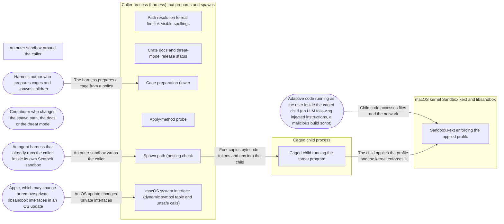

# Threat Model: Spawn a caged child on macOS

**Feature**: `004-spawn-macos` · **Generated**: 2026-11-01T17:26:07Z · **Profiles**: stride, llm, agent · **Canonical**: `threat-model.yaml`

> Rendered by ThreatSpec. Edit `threat-model.yaml`, not this file.

## Summary

| Threats | Critical | High | Medium | Low | Needs clarification | Not applicable | Mitigations | Requirements | Decisions |
|---|---|---|---|---|---|---|---|---|---|
| 12 | 1 | 9 | 2 | 0 | 0 | 25 | 11 | 11 | 0 |

## Actors

| ID | Name | Trust | Description |
|---|---|---|---|
| `actor.apple` | Apple, which may change or remove private libsandbox interfaces in an OS update | trusted |  |
| `actor.child-code` | Adaptive code running as the user inside the caged child (an LLM following injected instructions, a malicious build script) | untrusted |  |
| `actor.contributor` | Contributor who changes the spawn path, the docs or the threat model | semi-trusted |  |
| `actor.harness-author` | Harness author who prepares cages and spawns children | semi-trusted |  |
| `actor.outer-sandbox` | An agent harness that already runs the caller inside its own Seatbelt sandbox | semi-trusted |  |

## Trust Zones

| ID | Name | Trust rating | Description |
|---|---|---|---|
| `tz.child` | Caged child process | 5 |  |
| `tz.os` | macOS kernel Sandbox.kext and libsandbox | 90 |  |
| `tz.outer` | An outer sandbox around the caller | 50 |  |
| `tz.parent` | Caller process (harness) that prepares and spawns | 70 |  |

## Assets

| ID | Name | Type | Classification | C / I / A | Source |
|---|---|---|---|---|---|
| `asset.cage` | Prepared cage (compiled bytecode, grant classes, path rewrites, hygiene settings) | configuration | internal | 10 / 95 / 60 | spec.md#Key-Entities |
| `asset.grant-token` | Per-spawn sandbox-extension token for a grant | credential | internal | 60 / 90 / 30 | spec.md#FR-012 |
| `asset.harness-process` | The caller process itself (must not crash or hang) | business-data | internal | 20 / 60 / 90 | spec.md#FR-015 |
| `asset.parent-env` | The caller's environment (may hold tokens and agent sockets) | credential | confidential | 90 / 40 / 10 | spec.md#FR-011 |
| `asset.terminal` | The caller's controlling terminal | business-data | internal | 50 / 90 / 40 | spec.md#Edge-Cases |
| `asset.user-files` | Files outside the policy's grants (secrets, source trees, configuration) | business-data | confidential | 90 / 90 / 50 | spec.md#User-Story-1 |

## Components

| ID | Name | Type | Trust zone | Source |
|---|---|---|---|---|
| `component.canon` | Path resolution to real firmlink-visible spellings | library | `tz.parent` | spec.md#FR-004 |
| `component.child` | Caged child running the target program | process | `tz.child` | spec.md#User-Story-1 |
| `component.docs` | Crate docs and threat-model release status | document | `tz.parent` | spec.md#FR-016 |
| `component.kernel` | Sandbox.kext enforcing the applied profile | process | `tz.os` | spec.md#Context |
| `component.prepare` | Cage preparation (lower | library | `tz.parent` | spec.md#FR-003 |
| `component.probe` | Apply-method probe | process | `tz.parent` | spec.md#FR-009 |
| `component.spawn` | Spawn path (nesting check | process | `tz.parent` | spec.md#FR-010 |
| `component.sys` | macOS system interface (dynamic symbol table and unsafe calls) | library | `tz.parent` | spec.md#FR-001 |

## Data Flows

| ID | Name | From | To | Assets | Crosses |
|---|---|---|---|---|---|
| `flow.child-to-files` | Child code accesses files and the network | `actor.child-code` | `component.kernel` | `asset.user-files`, `asset.terminal` | `tz.child`, `tz.os` |
| `flow.child-to-kernel` | The child applies the profile and the kernel enforces it | `component.child` | `component.kernel` | `asset.user-files` | `tz.child`, `tz.os` |
| `flow.os-update-to-sys` | An OS update changes private interfaces | `actor.apple` | `component.sys` | `asset.harness-process` | `tz.os`, `tz.parent` |
| `flow.outer-to-parent` | An outer sandbox wraps the caller | `actor.outer-sandbox` | `component.spawn` | `asset.cage` | `tz.outer`, `tz.parent` |
| `flow.parent-to-child` | Fork copies bytecode, tokens and env into the child | `component.spawn` | `component.child` | `asset.cage`, `asset.grant-token`, `asset.parent-env` | `tz.parent`, `tz.child` |
| `flow.policy-to-cage` | The harness prepares a cage from a policy | `actor.harness-author` | `component.prepare` | `asset.cage` |  |

## Threats

| ID | Threat | Category | Technique | Severity | Status | Mitigations | Mappings | Source |
|---|---|---|---|---|---|---|---|---|
| `threat.noncanonical-path` | A policy path in a symlinked or data-volume spelling (/tmp, /etc, /System/Volumes/Data/Users) yields a rule the kernel never matches, so an allow does nothing or a deny protects nothing (escape classes R-02, R-12) | Elevation of Privilege | broken-access-control | **critical** | mitigated | `mitigation.canonicaliser` |  | spec.md#FR-004 |
| `threat.compile-abort` | A large profile makes libsandbox abort the calling process during an in-process compile (risk R-14) | Denial of Service | resource-exhaustion | **high** | mitigated | `mitigation.compile-limit` |  | spec.md#FR-006 |
| `threat.env-secret-leak` | The child inherits the caller's environment (tokens, agent sockets) although the policy's environment setting excludes it (escape class R-24) | Information Disclosure | sensitive-data-exposure | **high** | mitigated | `mitigation.env-from-policy` |  | spec.md#FR-011 |
| `threat.fork-deadlock` | Code between fork and exec takes a lock or allocates while another thread held it, so the child hangs forever in a multithreaded harness (risk R-13) | Denial of Service | resource-exhaustion | **high** | mitigated | `mitigation.syscalls-only-child` |  | spec.md#FR-010 |
| `threat.grant-leak` | A grant token issued for one spawn also unlocks other grants or other spawns (shared class, token reuse, undeclared name), or an unresolved grant path matches nothing | Elevation of Privilege | broken-access-control | **high** | mitigated | `mitigation.per-spawn-tokens` |  | spec.md#FR-012 |
| `threat.overclaimed-enforcement` | Docs or the threat model present this development version as covering fd hygiene, descendant lifetime, a base profile or Linux, or flip escape-class statuses without escape-suite canaries; inherited fds still bypass path rules (R-21) | Spoofing, Repudiation | false-evidence | **high** | mitigated | `mitigation.honest-status` |  | spec.md#FR-016 |
| `threat.silent-nesting` | The caller already runs inside a Seatbelt sandbox, so the kernel refuses a different second profile or silently ignores an identical one, and the child runs with the outer policy instead of the requested one | Elevation of Privilege, Repudiation | broken-access-control | **high** | mitigated | `mitigation.nesting-check` |  | spec.md#FR-008 |
| `threat.symbol-removal` | Apple removes or changes a private libsandbox symbol, so a hard-linked call fails to load or crashes the harness (risk R-01) | Denial of Service | resource-exhaustion | **high** | mitigated | `mitigation.dlsym-table` |  | spec.md#FR-001 |
| `threat.terminal-injection` | The child keeps the caller's controlling terminal and injects keystrokes into it with TIOCSTI (escape class R-22, observed by KF-M26) | Elevation of Privilege | privilege-escalation-via-config | **high** | mitigated | `mitigation.new-session` |  | spec.md#Edge-Cases |
| `threat.uncaged-run` | Applying or confirming the profile fails in the child (or the apply method silently stops working on an OS release) and the target program runs anyway, uncaged | Elevation of Privilege | privilege-escalation-via-config | **high** | mitigated | `mitigation.fail-closed-sequence` |  | spec.md#FR-010 |
| `threat.cache-confusion` | The compile cache returns bytecode compiled for a different profile (key collision, stale or on-disk bytecode), so a child gets another policy's cage | Tampering, Elevation of Privilege | data-tampering-at-rest | **medium** | mitigated | `mitigation.exact-memory-cache` |  | spec.md#FR-005 |
| `threat.ffi-memory-error` | An unsafe call misuses a libsandbox pointer (use after free of a profile, unchecked error string, wrong signature), corrupting the harness's memory | Tampering, Denial of Service | data-tampering-at-rest | **medium** | mitigated | `mitigation.dlsym-table` |  | spec.md#FR-002 |

### Techniques evaluated without findings

| Technique | Disposition | Reason |
|---|---|---|
| credential-theft | not-applicable | no authentication surface: procage authenticates no principal; secrets in the environment are modelled as threat.env-secret-leak |
| identity-spoofing | not-applicable | no authentication surface |
| cross-tenant-leak | not-applicable | no shared-tenant surface: one caller, its own children |
| data-tampering-in-transit | no-threat-detected | checked flow.parent-to-child: the bytecode and tokens are in the parent's memory, copied into the child by fork; nothing crosses a network |
| missing-audit-trail | no-threat-detected | checked asset.cage: path rewrites and degradations are recorded in the cage; full receipts are feature 011 |
| prompt-injection-direct | not-applicable | no llm-inference surface: procage calls no language model (LLM-driven code is the adversary inside the child) |
| prompt-injection-indirect | not-applicable | no untrusted-content-to-model surface |
| sensitive-information-disclosure | not-applicable | no llm-inference surface |
| excessive-agency | not-applicable | no llm-inference surface |
| model-supply-chain | not-applicable | no model-supply-chain surface: no models, adapters or datasets |
| training-data-poisoning | not-applicable | no persistent-model-input surface |
| unbounded-consumption | not-applicable | no cost-bearing-inference surface |
| misinformation | not-applicable | no user-facing-generation surface; overclaiming in docs is modelled under STRIDE as threat.overclaimed-enforcement |
| hidden-context-exposure | not-applicable | no system-prompt surface |
| vector-embedding-weakness | not-applicable | no retrieval-path surface |
| improper-output-handling | not-applicable | no model-output surface |
| model-extraction | not-applicable | no inference-endpoint surface |
| goal-hijack | not-applicable | no agent surface in this feature |
| tool-misuse | not-applicable | no agent tool surface |
| identity-privilege-abuse | not-applicable | no agent identity surface |
| agentic-supply-chain | not-applicable | no agent plugin or MCP surface |
| unexpected-code-execution | not-applicable | procage executes only the program its caller names; the adversary inside the child is modelled under STRIDE |
| memory-context-poisoning | not-applicable | no agent memory surface |
| insecure-inter-agent-communication | not-applicable | no multi-agent surface |
| cascading-failure | not-applicable | no agent pipeline surface |
| human-agent-trust-exploitation | not-applicable | no agent-to-human surface |
| rogue-agent | not-applicable | no agent surface |

## Mitigations

| ID | Mitigation | Kind | Threats | Requirements | Touchpoints | Status |
|---|---|---|---|---|---|---|
| `mitigation.canonicaliser` | Every policy path is resolved to its real spelling (longest existing prefix, firmlink-visible form, glob prefix escaped) and the rewrite recorded before lowering | preventive | `threat.noncanonical-path` | SR-005 | `src/macos/canon.rs`, `tests/spawn_macos.rs` | verified |
| `mitigation.compile-limit` | Profiles over the in-process rule limit are refused with LimitExceeded before compiling | preventive | `threat.compile-abort` | SR-008 | `src/macos/mod.rs`, `tests/spawn_macos.rs` | verified |
| `mitigation.dlsym-table` | All private symbols are resolved by dlsym once, before any fork, into a table; absence is Unsupported naming symbol and OS build; unsafe is confined to macos::sys with SAFETY comments | preventive | `threat.symbol-removal`, `threat.ffi-memory-error` | SR-003 | `src/macos/sys.rs`, `Cargo.toml` | verified |
| `mitigation.env-from-policy` | The child's environment is built from the policy (allowlist or passthrough minus denied names) plus explicit command variables | preventive | `threat.env-secret-leak` | SR-009 | `src/macos/spawn.rs`, `tests/spawn_macos.rs` | verified |
| `mitigation.exact-memory-cache` | The cache is in memory only and keyed by the exact profile text and parameters | preventive | `threat.cache-confusion` | SR-007 | `src/macos/mod.rs`, `tests/spawn_macos.rs` | verified |
| `mitigation.fail-closed-sequence` | The child runs a fixed syscall sequence and exits before exec on any failed step, reporting step and errno; the probe requires a caged child and a denied canary before any spawn | preventive | `threat.uncaged-run` | SR-001 | `src/macos/spawn.rs`, `src/macos/probe.rs`, `tests/spawn_macos.rs` | verified |
| `mitigation.honest-status` | Crate docs and the threat-model release status name what this version does on macOS and what it does not (fd hygiene, lifetime, base profile, Linux); escape-class statuses unchanged; the catalog gate still runs | preventive | `threat.overclaimed-enforcement` | SR-011 | `src/lib.rs`, `src/macos/mod.rs`, `THREAT_MODEL.md`, `README.md` | verified |
| `mitigation.nesting-check` | The parent checks whether it is sandboxed before forking and returns AlreadySandboxed | preventive | `threat.silent-nesting` | SR-002 | `src/macos/spawn.rs`, `tests/spawn_macos.rs` | verified |
| `mitigation.new-session` | With Tty::None the child calls setsid and has no controlling terminal; Tty::NewPty is refused until feature 005 | preventive | `threat.terminal-injection` | SR-010 | `src/macos/spawn.rs`, `tests/spawn_macos.rs` | verified |
| `mitigation.per-spawn-tokens` | Each grant has its own class procage.<name>; tokens are issued per spawn for resolved existing paths and consumed after apply; undeclared names and missing paths are typed errors | preventive | `threat.grant-leak` | SR-006 | `src/macos/spawn.rs`, `tests/spawn_macos.rs` | verified |
| `mitigation.syscalls-only-child` | Everything the child needs (bytecode pointer, token C strings, rlimits) is prepared in the parent; the child calls only setsid, setrlimit, __mac_syscall, sandbox_check and sandbox_extension_consume; a test spawns 100 children under dyld contention | preventive | `threat.fork-deadlock` | SR-004 | `src/macos/spawn.rs`, `tests/spawn_macos.rs` | verified |

## Security Requirements

### SR-001 (P1) — verified

The child MUST NOT execute its target unless applying the profile, confirming the sandbox and consuming its tokens all succeeded; spawning MUST return an error naming the failed step and OS error; spawning MUST be refused when the apply-method probe has not shown a caged child with a denied canary.

- **Given** a cage and a child whose apply step is made to fail, **when** spawn runs, **then** it returns an error naming the step and the target never runs
- **Given** the first spawn of the process, **when** the probe runs, **then** it reports the apply method usable only after a throwaway child is caged and its canary access is denied
- **Given** a policy granting one directory, **when** the child reads outside it, **then** the kernel refuses with EPERM
- Mitigations: `mitigation.fail-closed-sequence`
- Tasks: T005 ✓, T006 ✓, T007 ✓, T008 ✓, T014 ✓
- Verification `verification.sr-001.2026-10-30`: test → pass (verified) — `tests/spawn_macos.rs::a_failed_step_never_runs_the_target; tests/spawn_macos.rs::reads_inside_the_grant_and_is_refused_outside; tests/spawn_macos.rs::the_apply_method_passes_its_probe; tests/spawn_macos.rs::a_target_the_policy_does_not_let_run_is_refused`

### SR-002 (P1) — verified

Spawning from an already-sandboxed process MUST return AlreadySandboxed without forking a target.

- **Given** a process that is itself a caged child, **when** it asks procage to spawn, **then** it gets AlreadySandboxed and no grandchild runs
- Mitigations: `mitigation.nesting-check`
- Tasks: T007 ✓, T013 ✓
- Verification `verification.sr-002.2026-10-30`: test → pass (verified) — `tests/spawn_macos.rs::a_caged_process_cannot_spawn_a_nested_cage`

### SR-003 (P1) — verified

Private libsandbox symbols MUST be resolved at runtime before any fork, and a missing symbol MUST yield Unsupported naming it; unsafe code MUST be confined to macos::sys with a SAFETY comment on every block.

- **Given** a symbol name that does not exist, **when** the resolver looks it up, **then** it returns Unsupported naming the symbol and OS build
- **Given** the root crate, **when** lints run, **then** unsafe code outside macos::sys fails the build and every unsafe block has a SAFETY comment
- Mitigations: `mitigation.dlsym-table`
- Tasks: T001 ✓, T003 ✓, T014 ✓, T015 ✓
- Verification `verification.sr-003.2026-10-30`: test → pass (verified) — `tests/spawn_macos.rs::a_missing_symbol_is_unsupported_and_named; tests/unsafe_confined.rs::unsafe_is_confined_to_macos_sys_with_safety_comments`

### SR-004 (P1) — verified

Between fork and exec the child MUST only issue system calls on parent-prepared data; at least 100 caged children spawned from a parent with four threads under dyld contention MUST all be caged with none hanging.

- **Given** four threads looping dlopen/dlsym/dlclose, **when** 100 caged children are spawned, **then** all deny their canary access and none exceeds a 10 s timeout
- Mitigations: `mitigation.syscalls-only-child`
- Tasks: T005 ✓, T008 ✓
- Verification `verification.sr-004.2026-10-30`: test → pass (verified) — `tests/spawn_macos.rs::contention_every_child_is_caged_and_none_hangs`

### SR-005 (P1) — verified

Every policy path MUST be resolved to its real, firmlink-visible spelling before lowering (longest existing prefix, remainder byte-exact, glob prefix escaped), with each rewrite recorded.

- **Given** a policy granting write to /tmp/<dir>, **when** the child creates a file via /tmp, **then** it succeeds and the cage records the rewrite to /private/tmp/<dir>
- **Given** a path not yet existing below /tmp, **when** the cage is prepared, **then** the existing prefix is resolved and the remainder kept
- **Given** a glob under /tmp whose resolved prefix contains a glob character, **when** the cage is prepared, **then** the character is escaped and matched literally
- Mitigations: `mitigation.canonicaliser`
- Tasks: T009 ✓, T010 ✓
- Verification `verification.sr-005.2026-10-30`: test → pass (verified) — `tests/spawn_macos.rs::a_tmp_spelling_works_as_written; tests/spawn_macos.rs::a_missing_leaf_keeps_its_remainder; tests/spawn_macos.rs::glob_characters_in_a_resolved_prefix_are_literal; tests/spawn_macos.rs::a_data_volume_spelling_resolves_to_the_visible_one`

### SR-006 (P1) — verified

A grant token MUST be issued per spawn, of class procage.<name>, for a resolved existing path, and MUST unlock only that grant for that spawn; undeclared grant names and missing paths MUST be typed errors; an unbound grant MUST give no access.

- **Given** one cage with a write grant, bound to A then to B, **when** two children write to A and B, **then** each succeeds only in its own directory
- **Given** an unbound grant, **when** the child writes through it, **then** access is refused
- **Given** a binding for an undeclared name or a missing path, **when** spawn runs, **then** it fails with a typed grant error
- Mitigations: `mitigation.per-spawn-tokens`
- Tasks: T011 ✓, T012 ✓
- Verification `verification.sr-006.2026-10-30`: test → pass (verified) — `tests/spawn_macos.rs::a_grant_binds_for_one_spawn_only; tests/spawn_macos.rs::wrong_bindings_are_typed_errors`

### SR-007 (P2) — verified

Compiled profiles MUST be cached only in memory, keyed by the exact profile text and parameters.

- **Given** the same policy prepared twice, **when** the second cage is prepared, **then** no compile happens
- **Given** two policies differing in one rule, **when** both are prepared, **then** two compiles happen
- Mitigations: `mitigation.exact-memory-cache`
- Tasks: T007 ✓, T012 ✓
- Verification `verification.sr-007.2026-10-30`: test → pass (verified) — `tests/spawn_macos.rs::the_same_policy_is_compiled_once; src/macos/mod.rs:396`

### SR-008 (P2) — verified

A profile over the in-process compile limit MUST be refused with LimitExceeded before libsandbox is called.

- **Given** a policy over the configured limit, **when** the cage is prepared, **then** it fails with LimitExceeded and the compile counter is unchanged
- Mitigations: `mitigation.compile-limit`
- Tasks: T007 ✓, T014 ✓
- Verification `verification.sr-008.2026-10-30`: test → pass (verified) — `tests/spawn_macos.rs::refusals_before_any_child`

### SR-009 (P1) — verified

The child's environment MUST be exactly the policy's allowlist (or passthrough minus denied names) of the caller's environment plus variables set explicitly on the command.

- **Given** the caller has SECRET_TOKEN and PATH set and the policy allowlists PATH, **when** the child prints its environment, **then** it shows PATH and not SECRET_TOKEN
- **Given** passthrough denying SECRET_TOKEN, **when** the child prints its environment, **then** SECRET_TOKEN is absent and other variables are present
- Mitigations: `mitigation.env-from-policy`
- Tasks: T005 ✓, T013 ✓
- Verification `verification.sr-009.2026-10-30`: test → pass (verified) — `tests/spawn_macos.rs::the_environment_is_the_policys`

### SR-010 (P1) — verified

With Tty::None the child MUST start a new session without a controlling terminal; Tty::NewPty MUST be refused with Unsupported until implemented.

- **Given** Tty::None, **when** the child queries its session and opens /dev/tty, **then** it leads its own session and has no controlling terminal
- **Given** Tty::NewPty, **when** the cage is prepared, **then** it fails with Unsupported naming the setting
- Mitigations: `mitigation.new-session`
- Tasks: T005 ✓, T013 ✓
- Verification `verification.sr-010.2026-10-30`: test → pass (verified) — `tests/spawn_macos.rs::the_child_leads_its_own_session_unless_the_terminal_is_inherited; tests/spawn_macos.rs::refusals_before_any_child`

### SR-011 (P2) — verified

Crate docs and the threat-model release status MUST state what this development version enforces on macOS (each claim backed by a caged-child test) and what it does not (fd hygiene, descendant lifetime, base profile, Linux); escape-class statuses MUST stay unchanged until escape-suite canaries exist.

- **Given** the crate docs, README and threat model, **when** they are reviewed, **then** every enforcement sentence maps to a test in tests/spawn_macos.rs and the inherited-fd gap is stated
- Mitigations: `mitigation.honest-status`
- Tasks: T016 ✓
- Verification `verification.sr-011.2026-10-30`: review → pass (verified) — `src/macos/mod.rs:1; src/lib.rs:8; THREAT_MODEL.md#Release-status; README.md:8; tests/threat_model.rs::gate`
