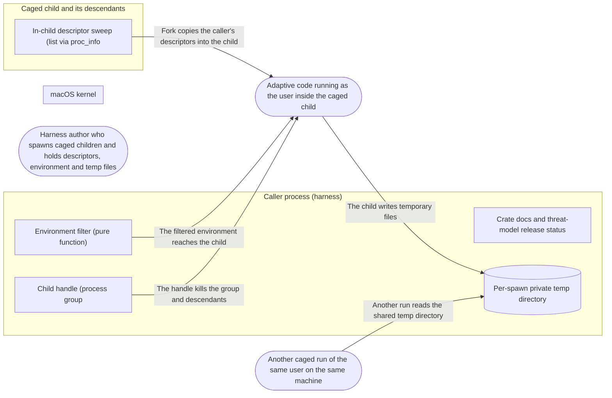

# Threat Model: Process hygiene for caged children

**Feature**: `005-hygiene` · **Generated**: 2026-11-01T17:26:07Z · **Profiles**: stride, llm, agent · **Canonical**: `threat-model.yaml`

> Rendered by ThreatSpec. Edit `threat-model.yaml`, not this file.

## Summary

| Threats | Critical | High | Medium | Low | Needs clarification | Not applicable | Mitigations | Requirements | Decisions |
|---|---|---|---|---|---|---|---|---|---|
| 7 | 2 | 3 | 2 | 0 | 0 | 24 | 5 | 7 | 0 |

## Actors

| ID | Name | Trust | Description |
|---|---|---|---|
| `actor.child-code` | Adaptive code running as the user inside the caged child | untrusted |  |
| `actor.harness-author` | Harness author who spawns caged children and holds descriptors, environment and temp files | semi-trusted |  |
| `actor.other-run` | Another caged run of the same user on the same machine | untrusted |  |

## Trust Zones

| ID | Name | Trust rating | Description |
|---|---|---|---|
| `tz.child` | Caged child and its descendants | 5 |  |
| `tz.os` | macOS kernel | 90 |  |
| `tz.parent` | Caller process (harness) | 70 |  |

## Assets

| ID | Name | Type | Classification | C / I / A | Source |
|---|---|---|---|---|---|
| `asset.parent-env` | The caller's environment (tokens, agent sockets, injection variables) | credential | confidential | 90 / 60 / 10 | spec.md#FR-007 |
| `asset.parent-fds` | The caller's open descriptors (files, sockets, pipes) | credential | confidential | 90 / 80 / 30 | spec.md#User-Story-1 |
| `asset.run-lifetime` | The guarantee that no process of a run outlives it | configuration | internal | 40 / 80 / 40 | spec.md#User-Story-2 |
| `asset.tmp-files` | Temporary files of this and other runs | business-data | internal | 70 / 70 / 20 | spec.md#FR-009 |

## Components

| ID | Name | Type | Trust zone | Source |
|---|---|---|---|---|
| `component.child-handle` | Child handle (process group | library | `tz.parent` | spec.md#FR-005 |
| `component.docs` | Crate docs and threat-model release status | document | `tz.parent` | spec.md#FR-011 |
| `component.env-filter` | Environment filter (pure function) | library | `tz.parent` | spec.md#FR-008 |
| `component.fd-sweep` | In-child descriptor sweep (list via proc_info | process | `tz.child` | spec.md#FR-001 |
| `component.tmpdir` | Per-spawn private temp directory | datastore | `tz.parent` | spec.md#FR-009 |

## Data Flows

| ID | Name | From | To | Assets | Crosses |
|---|---|---|---|---|---|
| `flow.child-to-tmp` | The child writes temporary files | `actor.child-code` | `component.tmpdir` | `asset.tmp-files` | `tz.child`, `tz.parent` |
| `flow.env-to-child` | The filtered environment reaches the child | `component.env-filter` | `actor.child-code` | `asset.parent-env` | `tz.parent`, `tz.child` |
| `flow.fds-to-child` | Fork copies the caller's descriptors into the child | `component.fd-sweep` | `actor.child-code` | `asset.parent-fds` | `tz.parent`, `tz.child` |
| `flow.handle-to-kernel` | The handle kills the group and descendants | `component.child-handle` | `actor.child-code` | `asset.run-lifetime` | `tz.parent`, `tz.child` |
| `flow.other-run-to-tmp` | Another run reads the shared temp directory | `actor.other-run` | `component.tmpdir` | `asset.tmp-files` | `tz.child` |

## Threats

| ID | Threat | Category | Technique | Severity | Status | Mitigations | Mappings | Source |
|---|---|---|---|---|---|---|---|---|
| `threat.env-secret-passthrough` | Passthrough hands the child tokens, the SSH agent socket or dyld injection variables from the caller's environment (escape class R-24) | Information Disclosure | sensitive-data-exposure | **critical** | mitigated | `mitigation.env-denylist` |  | spec.md#FR-007 |
| `threat.inherited-fd` | The child uses a descriptor the caller opened before the spawn (without close-on-exec) to read or write a file the profile denies (escape class R-21, observed by KF-M19) | Information Disclosure, Elevation of Privilege | sensitive-data-exposure | **critical** | mitigated | `mitigation.cloexec-sweep` |  | spec.md#FR-001 |
| `threat.outliving-descendants` | A descendant of the child keeps running after the caller dropped the handle, acting outside the run's intended lifetime (escape class R-23) | Elevation of Privilege | privilege-escalation-via-config | **high** | mitigated | `mitigation.group-and-tree-kill` |  | spec.md#FR-005 |
| `threat.shared-tmpdir` | Runs share the user's TMPDIR, so one caged run reads or plants files of another (escape class R-10) | Information Disclosure, Tampering | data-tampering-at-rest | **high** | mitigated | `mitigation.private-tmpdir` |  | spec.md#FR-009 |
| `threat.sweep-unbounded` | With a huge descriptor limit the sweep takes seconds per spawn, or skips descriptors above a guessed bound | Denial of Service, Information Disclosure | resource-exhaustion | **high** | mitigated | `mitigation.cloexec-sweep` |  | spec.md#FR-003 |
| `threat.overclaimed-hygiene` | Docs or the threat model claim lifetime control on macOS without stating the double-fork escape, or flip escape-class statuses without escape-suite canaries | Spoofing | false-evidence | **medium** | mitigated | `mitigation.group-and-tree-kill` |  | spec.md#FR-011 |
| `threat.sweep-breaks-reporting` | The descriptor sweep closes std's error pipe, so a failed in-child step looks like a successful spawn and the caller misreads the outcome | Repudiation | missing-audit-trail | **medium** | mitigated | `mitigation.mark-not-close` |  | spec.md#Edge-Cases |

### Techniques evaluated without findings

| Technique | Disposition | Reason |
|---|---|---|
| credential-theft | not-applicable | no authentication surface; environment secrets are modelled as threat.env-secret-passthrough |
| identity-spoofing | not-applicable | no authentication surface |
| cross-tenant-leak | no-threat-detected | checked asset.tmp-files: runs of one user share TMPDIR; modelled as threat.shared-tmpdir |
| data-tampering-in-transit | no-threat-detected | checked flow.fds-to-child and flow.env-to-child: they cross from parent to child by fork and exec inside one kernel; nothing travels over a network, and what the child receives is modelled as threat.inherited-fd and threat.env-secret-passthrough |
| missing-audit-trail | no-threat-detected | checked component.child-handle: dropped environment names are reported on the handle; receipts are feature 011 |
| prompt-injection-direct | not-applicable | no llm-inference surface: procage calls no language model (LLM-driven code is the adversary inside the child) |
| prompt-injection-indirect | not-applicable | no untrusted-content-to-model surface |
| sensitive-information-disclosure | not-applicable | no llm-inference surface |
| excessive-agency | not-applicable | no llm-inference surface |
| model-supply-chain | not-applicable | no model-supply-chain surface: no models, adapters or datasets |
| training-data-poisoning | not-applicable | no persistent-model-input surface |
| unbounded-consumption | not-applicable | no cost-bearing-inference surface |
| misinformation | not-applicable | no user-facing-generation surface; overclaiming in docs is modelled under STRIDE as threat.overclaimed-enforcement |
| hidden-context-exposure | not-applicable | no system-prompt surface |
| vector-embedding-weakness | not-applicable | no retrieval-path surface |
| improper-output-handling | not-applicable | no model-output surface |
| model-extraction | not-applicable | no inference-endpoint surface |
| goal-hijack | not-applicable | no agent surface in this feature |
| tool-misuse | not-applicable | no agent tool surface |
| identity-privilege-abuse | not-applicable | no agent identity surface |
| agentic-supply-chain | not-applicable | no agent plugin or MCP surface |
| unexpected-code-execution | not-applicable | procage executes only the program its caller names; the adversary inside the child is modelled under STRIDE |
| memory-context-poisoning | not-applicable | no agent memory surface |
| insecure-inter-agent-communication | not-applicable | no multi-agent surface |
| cascading-failure | not-applicable | no agent pipeline surface |
| human-agent-trust-exploitation | not-applicable | no agent-to-human surface |
| rogue-agent | not-applicable | no agent surface |

## Mitigations

| ID | Mitigation | Kind | Threats | Requirements | Touchpoints | Status |
|---|---|---|---|---|---|---|
| `mitigation.cloexec-sweep` | The child lists its descriptors with proc_pidinfo into a parent-allocated buffer (fcntl sweep fallback) and marks every fd >= 3 not named close-on-exec; named fds have close-on-exec cleared | preventive | `threat.inherited-fd`, `threat.sweep-unbounded` | SR-001, SR-002 | `src/macos/sys.rs`, `src/macos/mod.rs`, `tests/spawn_macos.rs` | verified |
| `mitigation.env-denylist` | Passthrough drops DYLD_*, LD_PRELOAD, LD_LIBRARY_PATH, SSH_AUTH_SOCK, *_TOKEN, *_SECRET, *_PASSWORD, *_API_KEY and AWS_* unless set explicitly; the handle lists them | preventive | `threat.env-secret-passthrough` | SR-005 | `src/hygiene.rs`, `src/macos/spawn.rs`, `tests/spawn_macos.rs` | verified |
| `mitigation.group-and-tree-kill` | The child gets its own process group; the handle kills the group and every descendant found by walking child PIDs, then reaps; detach opts out; the double-fork gap is documented | preventive | `threat.outliving-descendants`, `threat.overclaimed-hygiene` | SR-004, SR-007 | `src/macos/child.rs`, `src/macos/sys.rs`, `src/macos/mod.rs`, `tests/spawn_macos.rs` | verified |
| `mitigation.mark-not-close` | Descriptors are marked close-on-exec rather than closed | preventive | `threat.sweep-breaks-reporting` | SR-003 | `src/macos/sys.rs`, `tests/spawn_macos.rs` | verified |
| `mitigation.private-tmpdir` | A policy grant named tmpdir is bound per spawn to a fresh 0700 directory, TMPDIR points to it, and the handle removes it | preventive | `threat.shared-tmpdir` | SR-006 | `src/macos/child.rs`, `src/macos/mod.rs`, `tests/spawn_macos.rs` | verified |

## Security Requirements

### SR-001 (P1) — verified

Every descriptor >= 3 not named for the spawn MUST be unusable in the child after exec, including descriptors the caller left without close-on-exec, using only system calls on parent-prepared data.

- **Given** the caller holds a descriptor to a denied file without close-on-exec, **when** the caged child checks that descriptor number, **then** it does not exist (EBADF)
- **Given** the caller holds 1,000 extra descriptors, **when** the child counts its descriptors >= 3, **then** none remain
- Mitigations: `mitigation.cloexec-sweep`
- Tasks: T002 ✓, T003 ✓, T004 ✓
- Verification `verification.sr-001.2026-10-30`: test → pass (verified) — `tests/spawn_macos.rs::an_inherited_descriptor_does_not_reach_the_child; tests/spawn_macos.rs::a_thousand_open_descriptors_are_all_closed`

### SR-002 (P2) — verified

A descriptor named for a spawn MUST be usable in the child; a named descriptor that is not open MUST fail the spawn with a typed error; the sweep MUST stay fast under a very large descriptor limit.

- **Given** a named descriptor, **when** the child reads it, **then** it succeeds
- **Given** a named descriptor number that is not open, **when** spawn runs, **then** it fails with a typed error and no child runs
- Mitigations: `mitigation.cloexec-sweep`
- Tasks: T003 ✓, T004 ✓
- Verification `verification.sr-002.2026-10-30`: test → pass (verified) — `tests/spawn_macos.rs::an_inherited_descriptor_does_not_reach_the_child; src/macos/mod.rs::tests::a_descriptor_that_is_not_open_is_refused; specs/005-hygiene/quickstart.md#Recorded-outcomes`

### SR-003 (P1) — verified

A failed in-child step MUST still reach the parent as a typed error after the descriptor sweep.

- **Given** a child whose rlimit step fails after the sweep ran, **when** spawn returns, **then** it is Apply with step Rlimit, not success
- Mitigations: `mitigation.mark-not-close`
- Tasks: T002 ✓, T004 ✓
- Verification `verification.sr-003.2026-10-30`: test → pass (verified) — `tests/spawn_macos.rs::a_failed_step_after_the_sweep_is_still_reported`

### SR-004 (P1) — verified

Dropping or killing the handle MUST kill the child's process group and every descendant reachable from the child, including descendants in a new session, and reap the child; a detached handle MUST NOT kill.

- **Given** a caged child with a grandchild in its group and one that called setsid, **when** the handle is dropped, **then** both are gone within 1 s
- **Given** a detached handle, **when** it is dropped, **then** the child keeps running
- Mitigations: `mitigation.group-and-tree-kill`
- Tasks: T005 ✓, T006 ✓
- Verification `verification.sr-004.2026-10-30`: test → pass (verified) — `tests/spawn_macos.rs::dropping_the_handle_kills_every_descendant; tests/spawn_macos.rs::a_reaped_leader_still_takes_its_group_down; tests/spawn_macos.rs::a_detached_child_keeps_running`

### SR-005 (P1) — verified

Under passthrough the child MUST NOT receive DYLD_*, LD_PRELOAD, LD_LIBRARY_PATH, SSH_AUTH_SOCK, *_TOKEN, *_SECRET, *_PASSWORD, *_API_KEY or AWS_* variables unless set explicitly on the command, and the handle MUST list each dropped name.

- **Given** a caller with GITHUB_TOKEN, SSH_AUTH_SOCK and DYLD_INSERT_LIBRARIES set, **when** a passthrough child prints its environment, **then** none is present and all three are reported dropped
- **Given** GITHUB_TOKEN set explicitly on the command, **when** the child prints its environment, **then** it is present
- Mitigations: `mitigation.env-denylist`
- Tasks: T001 ✓, T007 ✓, T009 ✓
- Verification `verification.sr-005.2026-10-30`: test → pass (verified) — `tests/spawn_macos.rs::passthrough_drops_secrets_unless_set_explicitly; src/hygiene.rs::tests::passthrough_drops_the_default_denylist_and_reports_it`

### SR-006 (P2) — verified

A policy grant named tmpdir MUST be bound per spawn to a fresh directory accessible only to the user, TMPDIR MUST point to it, and dropping the handle MUST remove it.

- **Given** a policy with a tmpdir grant, **when** two children run, **then** their TMPDIRs differ, each child writes its own, and each directory is gone after its handle is dropped
- Mitigations: `mitigation.private-tmpdir`
- Tasks: T008 ✓, T009 ✓
- Verification `verification.sr-006.2026-10-30`: test → pass (verified) — `tests/spawn_macos.rs::each_run_gets_its_own_private_tmpdir`

### SR-007 (P2) — verified

Docs and the threat-model release status MUST state the macOS double-fork escape from lifetime control, keep pseudo-terminals and Linux as open gaps, and leave escape-class statuses unchanged.

- **Given** the macos module docs, README and threat model, **when** they are reviewed, **then** the double-fork gap is stated and no closed gap is still listed as open
- Mitigations: `mitigation.group-and-tree-kill`
- Tasks: T010 ✓
- Verification `verification.sr-007.2026-10-30`: review → pass (verified) — `src/macos/mod.rs:21; src/lib.rs:8; THREAT_MODEL.md#Release-status; README.md:8; tests/threat_model.rs::gate`
