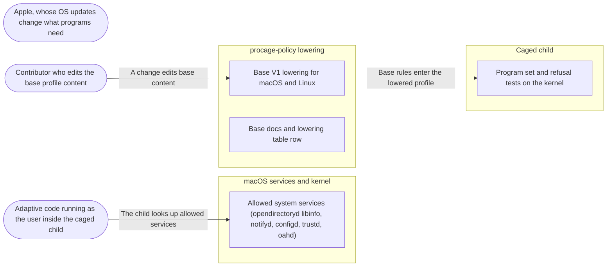

# Threat Model: A base profile that lets ordinary programs start

**Feature**: `006-base-profile` · **Generated**: 2026-11-01T17:26:08Z · **Profiles**: stride, llm, agent · **Canonical**: `threat-model.yaml`

> Rendered by ThreatSpec. Edit `threat-model.yaml`, not this file.

## Summary

| Threats | Critical | High | Medium | Low | Needs clarification | Not applicable | Mitigations | Requirements | Decisions |
|---|---|---|---|---|---|---|---|---|---|
| 6 | 0 | 3 | 3 | 0 | 0 | 25 | 6 | 6 | 0 |

## Actors

| ID | Name | Trust | Description |
|---|---|---|---|
| `actor.apple` | Apple, whose OS updates change what programs need | trusted |  |
| `actor.child-code` | Adaptive code running as the user inside the caged child | untrusted |  |
| `actor.contributor` | Contributor who edits the base profile content | semi-trusted |  |

## Trust Zones

| ID | Name | Trust rating | Description |
|---|---|---|---|
| `tz.child` | Caged child | 5 |  |
| `tz.os` | macOS services and kernel | 90 |  |
| `tz.policy` | procage-policy lowering | 80 |  |

## Assets

| ID | Name | Type | Classification | C / I / A | Source |
|---|---|---|---|---|---|
| `asset.base-content` | The frozen content of base V1 per target | configuration | public | 0 / 90 / 60 | spec.md#FR-001 |
| `asset.terminal` | The caller's terminal | business-data | internal | 50 / 90 / 30 | spec.md#FR-003 |
| `asset.user-data` | The user's home, project trees, temporary files and other users' files | business-data | confidential | 90 / 90 / 40 | spec.md#FR-005 |

## Components

| ID | Name | Type | Trust zone | Source |
|---|---|---|---|---|
| `component.base-lowering` | Base V1 lowering for macOS and Linux | library | `tz.policy` | spec.md#FR-002 |
| `component.base-tests` | Program set and refusal tests on the kernel | process | `tz.child` | spec.md#FR-008 |
| `component.docs` | Base docs and lowering table row | document | `tz.policy` | spec.md#FR-009 |
| `component.services` | Allowed system services (opendirectoryd libinfo, notifyd, configd, trustd, oahd) | process | `tz.os` | spec.md#FR-002 |

## Data Flows

| ID | Name | From | To | Assets | Crosses |
|---|---|---|---|---|---|
| `flow.base-to-profile` | Base rules enter the lowered profile | `component.base-lowering` | `component.base-tests` | `asset.base-content` | `tz.policy`, `tz.child` |
| `flow.child-to-services` | The child looks up allowed services | `actor.child-code` | `component.services` | `asset.user-data` | `tz.child`, `tz.os` |
| `flow.contributor-to-base` | A change edits base content | `actor.contributor` | `component.base-lowering` | `asset.base-content` | `tz.policy` |

## Threats

| ID | Threat | Category | Technique | Severity | Status | Mitigations | Mappings | Source |
|---|---|---|---|---|---|---|---|---|
| `threat.base-drift` | The content of base V1 changes silently in a later version of procage, loosening every policy that names V1 | Tampering | data-tampering-at-rest | **high** | mitigated | `mitigation.frozen-snapshot` |  | spec.md#FR-001 |
| `threat.base-too-broad` | The base grants access to the user's home, project trees, temp files, the network or writes, so every policy that opts in loses its confinement | Information Disclosure, Elevation of Privilege | broken-access-control | **high** | mitigated | `mitigation.base-refusal-tests` |  | spec.md#FR-005 |
| `threat.tty-surface` | Terminal devices are allowed to every child, widening the keystroke-injection surface (R-22) for children that should have no terminal | Elevation of Privilege | privilege-escalation-via-config | **high** | mitigated | `mitigation.tty-only-on-inherit` |  | spec.md#FR-003 |
| `threat.base-insufficient` | An OS update makes base V1 insufficient, so programs fail in confusing ways (or callers add broad rules to compensate) without anyone noticing | Denial of Service | resource-exhaustion | **medium** | mitigated | `mitigation.program-set-on-every-lane` |  | spec.md#FR-008 |
| `threat.base-overrides-deny` | A base allow is emitted after a protect, hide or hard-deny rule and overrides it under last-match-wins | Elevation of Privilege | broken-access-control | **medium** | mitigated | `mitigation.base-in-allow-block` |  | spec.md#FR-006 |
| `threat.service-handoff-via-base` | A Mach service the base allows performs work outside the sandbox on the child's behalf (handoff) or discloses user data beyond the user's own account | Elevation of Privilege, Information Disclosure | broken-access-control | **medium** | mitigated | `mitigation.read-only-services` |  | spec.md#FR-002 |

### Techniques evaluated without findings

| Technique | Disposition | Reason |
|---|---|---|
| credential-theft | not-applicable | no authentication surface |
| identity-spoofing | not-applicable | no authentication surface |
| cross-tenant-leak | not-applicable | one user, own processes |
| data-tampering-in-transit | no-threat-detected | checked flow.base-to-profile: base rules are compiled into the profile in the parent; nothing crosses a network |
| missing-audit-trail | no-threat-detected | checked asset.base-content: the base is a named, frozen version visible in the policy and the lowered profile |
| resource-exhaustion | no-threat-detected | checked component.base-lowering: the base adds a fixed number of rules (under 20) to every profile |
| injection | no-threat-detected | checked component.base-lowering: base paths and names are constants and pass through the one quoting function like any value |
| prompt-injection-direct | not-applicable | no llm-inference surface: procage calls no language model (LLM-driven code is the adversary inside the child) |
| prompt-injection-indirect | not-applicable | no untrusted-content-to-model surface |
| sensitive-information-disclosure | not-applicable | no llm-inference surface |
| excessive-agency | not-applicable | no llm-inference surface |
| model-supply-chain | not-applicable | no model-supply-chain surface: no models, adapters or datasets |
| training-data-poisoning | not-applicable | no persistent-model-input surface |
| unbounded-consumption | not-applicable | no cost-bearing-inference surface |
| misinformation | not-applicable | no user-facing-generation surface; overclaiming in docs is modelled under STRIDE as threat.overclaimed-enforcement |
| hidden-context-exposure | not-applicable | no system-prompt surface |
| vector-embedding-weakness | not-applicable | no retrieval-path surface |
| improper-output-handling | not-applicable | no model-output surface |
| model-extraction | not-applicable | no inference-endpoint surface |
| goal-hijack | not-applicable | no agent surface in this feature |
| tool-misuse | not-applicable | no agent tool surface |
| identity-privilege-abuse | not-applicable | no agent identity surface |
| agentic-supply-chain | not-applicable | no agent plugin or MCP surface |
| unexpected-code-execution | not-applicable | procage executes only the program its caller names; the adversary inside the child is modelled under STRIDE |
| memory-context-poisoning | not-applicable | no agent memory surface |
| insecure-inter-agent-communication | not-applicable | no multi-agent surface |
| cascading-failure | not-applicable | no agent pipeline surface |
| human-agent-trust-exploitation | not-applicable | no agent-to-human surface |
| rogue-agent | not-applicable | no agent surface |

## Mitigations

| ID | Mitigation | Kind | Threats | Requirements | Touchpoints | Status |
|---|---|---|---|---|---|---|
| `mitigation.base-in-allow-block` | Base rules are emitted in the allow block; the precedence tests include a base policy | preventive | `threat.base-overrides-deny` | SR-003 | `crates/procage-policy/src/lower/macos.rs`, `crates/procage-policy/tests/base.rs` | verified |
| `mitigation.base-refusal-tests` | Caged tests under base V1 alone: home listing and stat, temp-dir reads, /tmp writes and loopback connects are refused; the base lists no /Users, /private/var/folders, /private/tmp or /Volumes rule | detective | `threat.base-too-broad` | SR-001 | `tests/spawn_macos.rs`, `crates/procage-policy/src/lower/macos.rs`, `crates/procage-policy/tests/base.rs` | verified |
| `mitigation.frozen-snapshot` | A test pins the exact lowered rules of base V1 per target; changing them fails the test and needs a new version | preventive | `threat.base-drift` | SR-002 | `crates/procage-policy/tests/base.rs`, `crates/procage-policy/src/base.rs` | verified |
| `mitigation.program-set-on-every-lane` | The verified program set runs under base V1 on every macOS CI lane, and the docs state the release it was measured on | detective | `threat.base-insufficient` | SR-006 | `tests/spawn_macos.rs`, `.github/workflows/ci.yml`, `src/macos/mod.rs` | verified |
| `mitigation.read-only-services` | Only query services are allowed (user lookup, notifications, configuration, certificate trust, Rosetta); handoff services stay hard-denied, and a test asserts the base names none of the hard-deny services | preventive | `threat.service-handoff-via-base` | SR-005 | `crates/procage-policy/src/base.rs`, `crates/procage-policy/tests/base.rs` | verified |
| `mitigation.tty-only-on-inherit` | Terminal device rules are added only with Tty::Inherit; the TIOCSTI hard deny stays last | preventive | `threat.tty-surface` | SR-004 | `crates/procage-policy/src/lower/macos.rs`, `crates/procage-policy/tests/base.rs` | verified |

## Security Requirements

### SR-001 (P1) — verified

Base V1 alone MUST NOT give a caged child access to the user's home, the user's temporary directory, /tmp writes or the network.

- **Given** base V1 only, **when** the child lists or stats the home directory, **then** it is refused
- **Given** base V1 only, **when** the child reads a temp-dir file, creates a /tmp file or connects to loopback, **then** each is refused
- Mitigations: `mitigation.base-refusal-tests`
- Tasks: T002 ✓, T006 ✓
- Verification `verification.sr-001.2026-10-30`: test → pass (verified) — `tests/spawn_macos.rs::base_grants_nothing_personal; crates/procage-policy/tests/base.rs::base_names_nothing_personal`

### SR-002 (P2) — verified

The lowered content of base V1 MUST be pinned per target by a test, so any change fails until a new version is introduced.

- **Given** base V1, **when** it is lowered for macOS and Linux, **then** the rules equal the pinned list
- Mitigations: `mitigation.frozen-snapshot`
- Tasks: T001 ✓, T004 ✓
- Verification `verification.sr-002.2026-10-30`: test → pass (verified) — `crates/procage-policy/tests/base.rs::macos_content_is_pinned; crates/procage-policy/tests/base.rs::linux_content_is_pinned`

### SR-003 (P1) — verified

Base allows MUST be emitted before every protect, hide and hard-deny rule.

- **Given** base V1 plus a protect rule, **when** it is lowered for macOS, **then** every base allow precedes the protect deny and the hard-deny tier
- Mitigations: `mitigation.base-in-allow-block`
- Tasks: T003 ✓, T004 ✓
- Verification `verification.sr-003.2026-10-30`: test → pass (verified) — `crates/procage-policy/tests/base.rs::base_allows_come_before_every_deny`

### SR-004 (P1) — verified

Terminal devices MUST be allowed only with Tty::Inherit, and the TIOCSTI deny MUST still come after them.

- **Given** base V1 with Tty::None, **when** lowered, **then** no /dev/tty rule appears
- **Given** base V1 with Tty::Inherit, **when** lowered, **then** the terminal allows precede the TIOCSTI deny
- Mitigations: `mitigation.tty-only-on-inherit`
- Tasks: T002 ✓, T004 ✓
- Verification `verification.sr-004.2026-10-30`: test → pass (verified) — `crates/procage-policy/tests/base.rs::a_terminal_only_with_inherit; crates/procage-policy/tests/base.rs::base_allows_come_before_every_deny`

### SR-005 (P2) — verified

The base MUST allow only the listed query services and MUST NOT name any service the hard-deny tier denies.

- **Given** the base service list and the hard-deny service list, **when** compared, **then** they are disjoint
- Mitigations: `mitigation.read-only-services`
- Tasks: T002 ✓, T004 ✓
- Verification `verification.sr-005.2026-10-30`: test → pass (verified) — `crates/procage-policy/tests/base.rs::base_services_are_not_hard_denied_services`

### SR-006 (P2) — verified

Every program of the verified set MUST run correctly under base V1 on the real kernel, on every macOS CI lane, and the docs MUST state the release measured and the programs not covered.

- **Given** base V1 and a granted working directory, **when** each program of the set runs, **then** it exits 0 with correct output (user name, local zone)
- Mitigations: `mitigation.program-set-on-every-lane`
- Tasks: T005 ✓, T007 ✓
- Verification `verification.sr-006.2026-10-30`: test → pass (verified) — `tests/spawn_macos.rs::base_runs_ordinary_programs; tests/spawn_macos.rs::base_runs_a_rust_program_and_dev_null_stdio; crates/procage-policy/src/base.rs:1`
