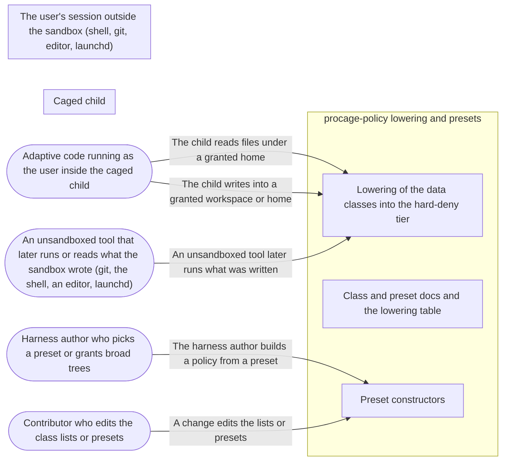

# Threat Model: Data-driven hard denies and frozen presets

**Feature**: `007-hard-deny-and-presets` · **Generated**: 2026-11-01T17:26:08Z · **Profiles**: stride, llm, agent · **Canonical**: `threat-model.yaml`

> Rendered by ThreatSpec. Edit `threat-model.yaml`, not this file.

## Summary

| Threats | Critical | High | Medium | Low | Needs clarification | Not applicable | Mitigations | Requirements | Decisions |
|---|---|---|---|---|---|---|---|---|---|
| 7 | 2 | 4 | 1 | 0 | 0 | 24 | 5 | 6 | 0 |

## Actors

| ID | Name | Trust | Description |
|---|---|---|---|
| `actor.child-code` | Adaptive code running as the user inside the caged child | untrusted |  |
| `actor.contributor` | Contributor who edits the class lists or presets | semi-trusted |  |
| `actor.harness-author` | Harness author who picks a preset or grants broad trees | semi-trusted |  |
| `actor.unsandboxed-tool` | An unsandboxed tool that later runs or reads what the sandbox wrote (git, the shell, an editor, launchd) | trusted |  |

## Trust Zones

| ID | Name | Trust rating | Description |
|---|---|---|---|
| `tz.child` | Caged child | 5 |  |
| `tz.policy` | procage-policy lowering and presets | 80 |  |
| `tz.user` | The user's session outside the sandbox (shell, git, editor, launchd) | 80 |  |

## Assets

| ID | Name | Type | Classification | C / I / A | Source |
|---|---|---|---|---|---|
| `asset.class-lists` | The frozen pattern lists of the data classes | configuration | public | 0 / 90 / 40 | spec.md#FR-005 |
| `asset.handoff-files` | Files unsandboxed tools later execute or read as configuration (git hooks and config, rc files, editor and agent config, PATH bins) | configuration | internal | 20 / 100 / 30 | spec.md#FR-003 |
| `asset.persistence-locations` | Launch agents, launch daemons and login items | configuration | internal | 10 / 100 / 30 | spec.md#FR-004 |
| `asset.presets` | The frozen presets V1 | configuration | public | 0 / 90 / 50 | spec.md#FR-007 |
| `asset.secrets` | Credentials and private data in home directories (SSH, cloud, keychains, browsers, mail) | credential | confidential | 100 / 80 / 30 | spec.md#FR-002 |

## Components

| ID | Name | Type | Trust zone | Source |
|---|---|---|---|---|
| `component.class-lowering` | Lowering of the data classes into the hard-deny tier | library | `tz.policy` | spec.md#FR-001 |
| `component.docs` | Class and preset docs and the lowering table | document | `tz.policy` | spec.md#FR-010 |
| `component.presets` | Preset constructors | library | `tz.policy` | spec.md#FR-007 |

## Data Flows

| ID | Name | From | To | Assets | Crosses |
|---|---|---|---|---|---|
| `flow.author-picks-preset` | The harness author builds a policy from a preset | `actor.harness-author` | `component.presets` | `asset.presets` | `tz.policy` |
| `flow.child-reads-secrets` | The child reads files under a granted home | `actor.child-code` | `component.class-lowering` | `asset.secrets` | `tz.child`, `tz.policy` |
| `flow.child-writes-handoff` | The child writes into a granted workspace or home | `actor.child-code` | `component.class-lowering` | `asset.handoff-files`, `asset.persistence-locations` | `tz.child`, `tz.policy` |
| `flow.contributor-edits` | A change edits the lists or presets | `actor.contributor` | `component.presets` | `asset.class-lists`, `asset.presets` | `tz.policy` |
| `flow.tool-runs-handoff` | An unsandboxed tool later runs what was written | `actor.unsandboxed-tool` | `component.class-lowering` | `asset.handoff-files` | `tz.user` |

## Threats

| ID | Threat | Category | Technique | Severity | Status | Mitigations | Mappings | Source |
|---|---|---|---|---|---|---|---|---|
| `threat.secret-read-in-granted-tree` | A policy grants a broad tree (the home directory) and the child reads SSH keys, cloud credentials, keychains or browser data from it | Information Disclosure | sensitive-data-exposure | **critical** | mitigated | `mitigation.secrets-class` |  | spec.md#FR-002 |
| `threat.trust-handoff-write` | The child writes a git hook, git config, shell rc file, editor or agent configuration, or a PATH binary that an unsandboxed tool later runs (escape class R-07) | Elevation of Privilege, Tampering | data-tampering-at-rest | **critical** | mitigated | `mitigation.handoff-and-persistence-classes` |  | spec.md#FR-003 |
| `threat.case-variant-bypass` | A path spelled in another case (.SSH, .GIT/HOOKS, .ZSHRC) escapes a case-sensitive pattern on a case-insensitive volume | Elevation of Privilege | broken-access-control | **high** | mitigated | `mitigation.case-folded-patterns` |  | spec.md#FR-005 |
| `threat.linux-silently-weaker` | A Linux plan omits the data classes without saying so, so a future Linux spawn grants secrets or handoff files that macOS denies | Repudiation, Information Disclosure | broken-access-control | **high** | mitigated | `mitigation.linux-pending-explicit` |  | spec.md#FR-006 |
| `threat.list-or-preset-drift` | A later change silently loosens a class list or a preset version, weakening every policy that relies on it | Tampering | data-tampering-at-rest | **high** | mitigated | `mitigation.pinned-lists-and-presets` |  | spec.md#FR-008 |
| `threat.persistence-plant` | The child plants a launch agent or login item that runs outside any run (escape class R-23) | Elevation of Privilege | data-tampering-at-rest | **high** | mitigated | `mitigation.handoff-and-persistence-classes` |  | spec.md#FR-004 |
| `threat.git-broken` | The trust-handoff patterns are so broad that git cannot write objects, refs or the index, and harness authors waive the whole class to get work done | Denial of Service | resource-exhaustion | **medium** | mitigated | `mitigation.handoff-and-persistence-classes` |  | spec.md#Edge-Cases |

### Techniques evaluated without findings

| Technique | Disposition | Reason |
|---|---|---|
| identity-spoofing | not-applicable | no authentication surface |
| cross-tenant-leak | no-threat-detected | checked asset.secrets: patterns cover every home under /Users, so another user's readable files are denied too |
| data-tampering-in-transit | not-applicable | no network-boundary surface: lists and presets are compiled into the profile in the caller process |
| missing-audit-trail | no-threat-detected | checked asset.presets and asset.class-lists: waivers are listed in the plan and presets carry name and version in the policy data |
| resource-exhaustion | no-threat-detected | checked component.class-lowering: the classes add a fixed set of about 40 patterns, merged into a handful of rules, far under the rule limit |
| injection | no-threat-detected | checked component.class-lowering: patterns are constants passed through the glob compiler and the one quoting function |
| privilege-escalation-via-config | no-threat-detected | checked component.presets: presets only build ordinary policies; they cannot add raw rules or remove hard-deny classes |
| prompt-injection-direct | not-applicable | no llm-inference surface: procage calls no language model (LLM-driven code is the adversary inside the child) |
| prompt-injection-indirect | not-applicable | no untrusted-content-to-model surface |
| sensitive-information-disclosure | not-applicable | no llm-inference surface |
| excessive-agency | not-applicable | no llm-inference surface |
| model-supply-chain | not-applicable | no model-supply-chain surface: no models, adapters or datasets |
| training-data-poisoning | not-applicable | no persistent-model-input surface |
| unbounded-consumption | not-applicable | no cost-bearing-inference surface |
| misinformation | not-applicable | no user-facing-generation surface; overclaiming in docs is modelled under STRIDE as threat.overclaimed-enforcement |
| hidden-context-exposure | not-applicable | no system-prompt surface |
| vector-embedding-weakness | not-applicable | no retrieval-path surface |
| improper-output-handling | not-applicable | no model-output surface |
| model-extraction | not-applicable | no inference-endpoint surface |
| goal-hijack | not-applicable | no agent surface in this feature |
| tool-misuse | not-applicable | no agent tool surface |
| identity-privilege-abuse | not-applicable | no agent identity surface |
| agentic-supply-chain | not-applicable | no agent plugin or MCP surface |
| unexpected-code-execution | not-applicable | procage executes only the program its caller names; the adversary inside the child is modelled under STRIDE |
| memory-context-poisoning | not-applicable | no agent memory surface |
| insecure-inter-agent-communication | not-applicable | no multi-agent surface |
| cascading-failure | not-applicable | no agent pipeline surface |
| human-agent-trust-exploitation | not-applicable | no agent-to-human surface |
| rogue-agent | not-applicable | no agent surface |

## Mitigations

| ID | Mitigation | Kind | Threats | Requirements | Touchpoints | Status |
|---|---|---|---|---|---|---|
| `mitigation.case-folded-patterns` | Patterns are compiled to case-folded regexes; tests use upper-case spellings | preventive | `threat.case-variant-bypass` | SR-004 | `crates/procage-policy/src/glob.rs`, `tests/spawn_macos.rs` | verified |
| `mitigation.handoff-and-persistence-classes` | trust-handoff and persistence deny writes to the listed paths anywhere or in every home, last in the profile; git objects, refs and index stay writable | preventive | `threat.trust-handoff-write`, `threat.persistence-plant`, `threat.git-broken` | SR-002, SR-003 | `crates/procage-policy/src/presets.rs`, `crates/procage-policy/src/lower/macos.rs`, `tests/spawn_macos.rs` | verified |
| `mitigation.linux-pending-explicit` | The lowering table marks the data classes as pending on Linux and the 008 spec carries their implementation | detective | `threat.linux-silently-weaker` | SR-006 | `crates/procage-policy/src/lowering.md` | verified |
| `mitigation.pinned-lists-and-presets` | Tests pin every class list and every preset V1 | preventive | `threat.list-or-preset-drift` | SR-005 | `crates/procage-policy/tests/presets.rs` | verified |
| `mitigation.secrets-class` | secrets denies read and write of the listed home paths for every home under /Users, last in the profile, waivable only by name | preventive | `threat.secret-read-in-granted-tree` | SR-001 | `crates/procage-policy/src/presets.rs`, `crates/procage-policy/src/lower/macos.rs`, `tests/spawn_macos.rs` | verified |

## Security Requirements

### SR-001 (P1) — verified

With a read grant on the home directory, the listed secret paths MUST stay unreadable to the child unless the secrets class is waived by name.

- **Given** read access to HOME, **when** the child lists ~/.ssh, ~/.aws and ~/.gnupg, **then** each is refused and listing HOME succeeds
- **Given** secrets waived, **when** the child lists ~/.ssh, **then** it succeeds and the plan lists the waiver
- Mitigations: `mitigation.secrets-class`
- Tasks: T003 ✓, T004 ✓, T005 ✓
- Verification `verification.sr-001.2026-10-30`: test → pass (verified) — `tests/spawn_macos.rs::hard_deny_secrets`

### SR-002 (P1) — verified

With write access to a workspace, the child MUST NOT create or modify git hooks, git config, .gitmodules, shell rc files, editor or agent config directories or tool config files, while git objects, refs and the index stay writable; waiving trust-handoff by name allows them.

- **Given** write access to a workspace with .git, **when** the child creates .git/hooks/pre-commit, .zshrc, .envrc and .vscode/settings.json, **then** each is refused and .git/objects/x succeeds
- **Given** trust-handoff waived, **when** the child creates .git/hooks/pre-commit, **then** it succeeds
- Mitigations: `mitigation.handoff-and-persistence-classes`
- Tasks: T003 ✓, T004 ✓, T006 ✓
- Verification `verification.sr-002.2026-10-30`: test → pass (verified) — `tests/spawn_macos.rs::hard_deny_trust_handoff; tests/spawn_macos.rs::preset_agent_workspace`

### SR-003 (P1) — verified

The child MUST NOT create files in launch-agent or login-item locations, even when the policy grants write access there.

- **Given** write access to ~/Library/LaunchAgents, **when** the child creates a file there, **then** it is refused and nothing is created
- Mitigations: `mitigation.handoff-and-persistence-classes`
- Tasks: T003 ✓, T004 ✓, T006 ✓
- Verification `verification.sr-003.2026-10-30`: test → pass (verified) — `tests/spawn_macos.rs::hard_deny_persistence`

### SR-004 (P1) — verified

Data-class patterns MUST deny case variants of the listed names.

- **Given** read access to HOME, **when** the child lists ~/.SSH, **then** it is refused
- **Given** a writable workspace with .git, **when** the child creates .GIT/HOOKS/x or .ZSHRC, **then** each is refused
- Mitigations: `mitigation.case-folded-patterns`
- Tasks: T001 ✓, T005 ✓, T006 ✓
- Verification `verification.sr-004.2026-10-30`: test → pass (verified) — `tests/spawn_macos.rs::hard_deny_secrets; tests/spawn_macos.rs::hard_deny_trust_handoff; crates/procage-policy/src/glob.rs::tests::folding`

### SR-005 (P2) — verified

The class lists and every preset V1 MUST be pinned by tests.

- **Given** each preset and class, **when** it is lowered or serialised, **then** it equals the pinned content
- Mitigations: `mitigation.pinned-lists-and-presets`
- Tasks: T002 ✓, T007 ✓, T008 ✓
- Verification `verification.sr-005.2026-10-30`: test → pass (verified) — `crates/procage-policy/tests/presets.rs::every_preset_is_pinned; crates/procage-policy/tests/presets.rs::the_class_lists_are_pinned; crates/procage-policy/tests/presets.rs::presets_round_trip_with_their_tag`

### SR-006 (P2) — verified

The lowering table and docs MUST state that Linux enforcement of the data classes is pending, and the Linux spawn spec (008) MUST carry it.

- **Given** the lowering table and the 008 spec, **when** reviewed, **then** the Linux cells say pending and 008 lists the requirement
- Mitigations: `mitigation.linux-pending-explicit`
- Tasks: T004 ✓, T010 ✓
- Verification `verification.sr-006.2026-10-30`: review → pass (verified) — `crates/procage-policy/src/lowering.md; crates/procage-policy/src/presets.rs:1; THREAT_MODEL.md#Release-status`
