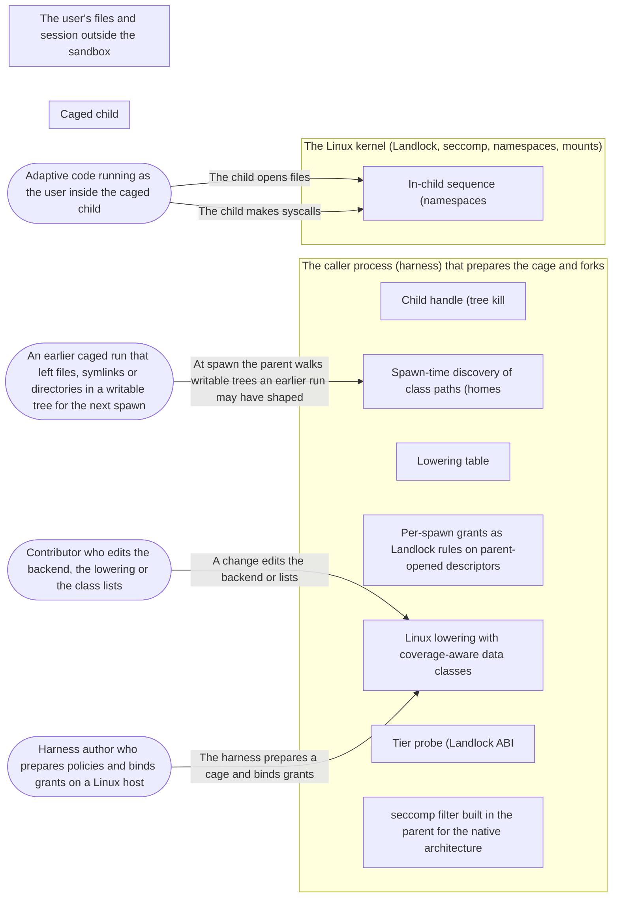

# Threat Model: Spawning a caged child on Linux

**Feature**: `008-spawn-linux` · **Generated**: 2026-11-01T17:26:09Z · **Profiles**: stride, llm, agent · **Canonical**: `threat-model.yaml`

> Rendered by ThreatSpec. Edit `threat-model.yaml`, not this file.

## Summary

| Threats | Critical | High | Medium | Low | Needs clarification | Not applicable | Mitigations | Requirements | Decisions |
|---|---|---|---|---|---|---|---|---|---|
| 12 | 3 | 9 | 0 | 0 | 0 | 24 | 10 | 12 | 0 |

## Actors

| ID | Name | Trust | Description |
|---|---|---|---|
| `actor.child-code` | Adaptive code running as the user inside the caged child | untrusted |  |
| `actor.contributor` | Contributor who edits the backend, the lowering or the class lists | semi-trusted |  |
| `actor.earlier-run` | An earlier caged run that left files, symlinks or directories in a writable tree for the next spawn | untrusted |  |
| `actor.harness-author` | Harness author who prepares policies and binds grants on a Linux host | semi-trusted |  |

## Trust Zones

| ID | Name | Trust rating | Description |
|---|---|---|---|
| `tz.caller` | The caller process (harness) that prepares the cage and forks | 80 |  |
| `tz.child` | Caged child | 5 |  |
| `tz.kernel` | The Linux kernel (Landlock, seccomp, namespaces, mounts) | 95 |  |
| `tz.user` | The user's files and session outside the sandbox | 80 |  |

## Assets

| ID | Name | Type | Classification | C / I / A | Source |
|---|---|---|---|---|---|
| `asset.handoff-files` | Files unsandboxed tools later run or read (git hooks and config, rc files, editor and agent config, PATH bins, systemd user units, autostart) | configuration | internal | 20 / 100 / 30 | spec.md#FR-013 |
| `asset.kernel-surface` | Kernel attack surface reachable by syscalls (io_uring, bpf, ptrace, keyctl, namespaces, mounts) | capability | internal | 80 / 100 / 60 | spec.md#FR-007 |
| `asset.linux-class-lists` | The frozen Linux pattern lists of the data classes | configuration | public | 0 / 90 / 40 | spec.md#FR-013 |
| `asset.network` | Network reachability (host loopback services, the internet) | capability | internal | 80 / 50 / 20 | spec.md#FR-010 |
| `asset.policy-intent` | The caller's policy and the guarantee that the child runs at least that confined | configuration | internal | 0 / 100 / 50 | spec.md#FR-003 |
| `asset.secrets` | Credentials and private data in Linux homes (SSH, cloud, keyrings, browser profiles) | credential | confidential | 100 / 80 / 30 | spec.md#FR-013 |
| `asset.user-files` | Files outside the policy's rules (the rest of the filesystem) | pii | confidential | 90 / 90 / 40 | spec.md#US1 |

## Components

| ID | Name | Type | Trust zone | Source |
|---|---|---|---|---|
| `component.child-handle` | Child handle (tree kill | library | `tz.caller` | spec.md#FR-012 |
| `component.child-sequence` | In-child sequence (namespaces | process | `tz.kernel` | spec.md#FR-005 |
| `component.class-masks` | Spawn-time discovery of class paths (homes | library | `tz.caller` | spec.md#FR-015 |
| `component.docs` | Lowering table | document | `tz.caller` | spec.md#FR-019 |
| `component.grants` | Per-spawn grants as Landlock rules on parent-opened descriptors | library | `tz.caller` | spec.md#FR-011 |
| `component.lowering-linux` | Linux lowering with coverage-aware data classes | library | `tz.caller` | spec.md#FR-014 |
| `component.probe` | Tier probe (Landlock ABI | library | `tz.caller` | spec.md#FR-001 |
| `component.seccomp-builder` | seccomp filter built in the parent for the native architecture | library | `tz.caller` | spec.md#FR-007 |

## Data Flows

| ID | Name | From | To | Assets | Crosses |
|---|---|---|---|---|---|
| `flow.child-file-access` | The child opens files | `actor.child-code` | `component.child-sequence` | `asset.user-files`, `asset.secrets`, `asset.handoff-files` | `tz.child`, `tz.kernel` |
| `flow.child-syscalls` | The child makes syscalls | `actor.child-code` | `component.child-sequence` | `asset.kernel-surface`, `asset.network` | `tz.child`, `tz.kernel` |
| `flow.contributor-edits` | A change edits the backend or lists | `actor.contributor` | `component.lowering-linux` | `asset.linux-class-lists`, `asset.policy-intent` | `tz.caller` |
| `flow.prepare` | The harness prepares a cage and binds grants | `actor.harness-author` | `component.lowering-linux` | `asset.policy-intent` | `tz.caller` |
| `flow.spawn-walk` | At spawn the parent walks writable trees an earlier run may have shaped | `actor.earlier-run` | `component.class-masks` | `asset.handoff-files` | `tz.user`, `tz.caller` |

## Threats

| ID | Threat | Category | Technique | Severity | Status | Mitigations | Mappings | Source |
|---|---|---|---|---|---|---|---|---|
| `threat.fs-outside-policy` | The child reads or writes a file outside its policy's rules on Linux | Information Disclosure, Tampering | broken-access-control | **critical** | mitigated | `mitigation.landlock-ruleset` |  | spec.md#US1 |
| `threat.linux-secret-read` | On Linux the child reads SSH keys, cloud credentials or browser profiles through a rule that covers a home | Information Disclosure | sensitive-data-exposure | **critical** | mitigated | `mitigation.linux-class-masks` |  | spec.md#US3 |
| `threat.linux-trust-handoff` | On Linux the child writes a git hook, rc file, editor config or systemd user unit, or renames .git to do so, for an unsandboxed tool to run later (R-07, R-23) | Elevation of Privilege, Tampering | data-tampering-at-rest | **critical** | mitigated | `mitigation.linux-class-masks` |  | spec.md#US3 |
| `threat.foreign-abi-bypass` | The child issues a syscall through another architecture or ABI (x32, 32-bit compat) whose numbers the filter does not check | Elevation of Privilege | privilege-escalation | **high** | mitigated | `mitigation.seccomp-hard-deny` |  | spec.md#Edge-Cases |
| `threat.hygiene-leak` | The child inherits a caller descriptor, a secret environment variable, or outlives its handle on Linux | Information Disclosure, Denial of Service | sensitive-data-exposure | **high** | mitigated | `mitigation.hygiene-parity` |  | spec.md#US4 |
| `threat.kernel-surface-syscall` | The child reaches kernel attack surface (ptrace, io_uring, bpf, keyctl, perf, userfaultfd, namespace creation, mounts) to escape or attack the host | Elevation of Privilege | privilege-escalation | **high** | mitigated | `mitigation.seccomp-hard-deny` |  | spec.md#FR-007 |
| `threat.linux-overclaim` | The docs or lowering table claim Linux enforcement that the backend does not apply, or a plan field the backend ignores | Repudiation | broken-access-control | **high** | mitigated | `mitigation.honest-linux-docs` |  | spec.md#FR-019 |
| `threat.mount-undo` | On T1 the child uses its namespace capabilities to unmount or remount a protect or mask, or to map new ids | Elevation of Privilege | privilege-escalation | **high** | mitigated | `mitigation.no-caps-locked-mounts` |  | spec.md#US5 |
| `threat.network-exfil` | With Network::None the child still opens a socket and reaches a host or loopback service | Information Disclosure | sensitive-data-exposure | **high** | mitigated | `mitigation.netns-or-socket-deny` |  | spec.md#FR-010 |
| `threat.silent-downgrade` | A construct the tier cannot enforce (protect on T2, a host without Landlock) is applied weaker or not at all without an error | Repudiation, Elevation of Privilege | broken-access-control | **high** | mitigated | `mitigation.tier-gaps` |  | spec.md#US2 |
| `threat.step-failure-runs-target` | A step in the child fails (Landlock, seccomp, a mount) and the target runs anyway, unconfined or partly confined | Elevation of Privilege | broken-access-control | **high** | mitigated | `mitigation.verify-and-step-errors` |  | spec.md#FR-006 |
| `threat.walk-shaped-by-earlier-run` | An earlier run shapes a writable tree (symlinks, huge trees) so the spawn-time walk skips class paths or follows links out of the tree | Tampering, Denial of Service | resource-exhaustion | **high** | mitigated | `mitigation.bounded-walk` |  | spec.md#FR-017 |

### Techniques evaluated without findings

| Technique | Disposition | Reason |
|---|---|---|
| identity-spoofing | not-applicable | no authentication surface |
| data-tampering-in-transit | not-applicable | no network-boundary surface: the plan is built and applied inside the caller process and its forked child |
| missing-audit-trail | no-threat-detected | checked component.lowering-linux: every degradation and waiver is listed in the plan, and the tier and ABI are reported by the probe |
| injection | no-threat-detected | checked component.child-sequence: paths reach the kernel as NUL-terminated byte strings and descriptors, never through a shell or a parsed language |
| cross-tenant-leak | no-threat-detected | checked asset.secrets: homes are every directory under /home plus /root, so another user's readable secrets are masked too |
| prompt-injection-direct | not-applicable | no llm-inference surface: procage calls no language model (LLM-driven code is the adversary inside the child) |
| prompt-injection-indirect | not-applicable | no untrusted-content-to-model surface |
| sensitive-information-disclosure | not-applicable | no llm-inference surface |
| excessive-agency | not-applicable | no llm-inference surface |
| model-supply-chain | not-applicable | no model-supply-chain surface: no models, adapters or datasets |
| training-data-poisoning | not-applicable | no persistent-model-input surface |
| unbounded-consumption | not-applicable | no cost-bearing-inference surface |
| misinformation | not-applicable | no user-facing-generation surface; overclaiming in docs is modelled under STRIDE as threat.overclaimed-enforcement |
| hidden-context-exposure | not-applicable | no system-prompt surface |
| vector-embedding-weakness | not-applicable | no retrieval-path surface |
| improper-output-handling | not-applicable | no model-output surface |
| model-extraction | not-applicable | no inference-endpoint surface |
| goal-hijack | not-applicable | no agent surface in this feature |
| tool-misuse | not-applicable | no agent tool surface |
| identity-privilege-abuse | not-applicable | no agent identity surface |
| agentic-supply-chain | not-applicable | no agent plugin or MCP surface |
| unexpected-code-execution | not-applicable | procage executes only the program its caller names; the adversary inside the child is modelled under STRIDE |
| memory-context-poisoning | not-applicable | no agent memory surface |
| insecure-inter-agent-communication | not-applicable | no multi-agent surface |
| cascading-failure | not-applicable | no agent pipeline surface |
| human-agent-trust-exploitation | not-applicable | no agent-to-human surface |
| rogue-agent | not-applicable | no agent surface |

## Mitigations

| ID | Mitigation | Kind | Threats | Requirements | Touchpoints | Status |
|---|---|---|---|---|---|---|
| `mitigation.bounded-walk` | The walk never follows symlinks, mounts follow links only to protect their targets, and a tree over the bound fails the spawn | preventive | `threat.walk-shaped-by-earlier-run` | SR-011 | `src/linux/classes.rs` | verified |
| `mitigation.honest-linux-docs` | Lowering table fixtures match the backend; docs list the gaps this feature leaves; escape statuses unchanged | detective | `threat.linux-overclaim` | SR-012 | `crates/procage-policy/src/lowering.md`, `crates/procage-policy/tests/lowering_table.rs`, `THREAT_MODEL.md`, `src/linux/mod.rs` | verified |
| `mitigation.hygiene-parity` | Session, env denylist, rlimits, fd close-on-exec, parent-death signal, tree kill on drop, private TMPDIR | preventive | `threat.hygiene-leak` | SR-010 | `src/linux/child.rs`, `src/unix.rs`, `src/linux/sys.rs`, `tests/spawn_linux.rs` | verified |
| `mitigation.landlock-ruleset` | Landlock ruleset built in the parent from the plan, handling every right of the ABI; rules on parent-opened descriptors; missing paths fail the spawn | preventive | `threat.fs-outside-policy` | SR-001 | `src/linux/spawn.rs`, `src/linux/sys.rs`, `tests/spawn_linux.rs` | verified |
| `mitigation.linux-class-masks` | T1 masks secrets, makes handoff and persistence paths read-only and pins .git at spawn; T2 gaps when covered and refuses covering grants; coverage-aware lowering | preventive | `threat.linux-secret-read`, `threat.linux-trust-handoff` | SR-006, SR-007 | `crates/procage-policy/src/presets.rs`, `crates/procage-policy/src/lower/linux.rs`, `src/linux/classes.rs`, `tests/spawn_linux.rs` | verified |
| `mitigation.netns-or-socket-deny` | Network::None is a new network namespace on T1 and a seccomp socket deny plus Landlock network rights on T2 | preventive | `threat.network-exfil` | SR-009 | `src/linux/sys.rs`, `crates/procage-policy/src/lower/linux.rs`, `tests/spawn_linux.rs` | verified |
| `mitigation.no-caps-locked-mounts` | T1 drops every capability before exec, keeps locked mount flags, and seccomp denies mount, umount and namespace calls | preventive | `threat.mount-undo` | SR-008 | `src/linux/sys.rs`, `tests/spawn_linux.rs` | verified |
| `mitigation.seccomp-hard-deny` | seccomp filter from the plan, last in the sequence, EPERM per rule; foreign architecture and x32 kill | preventive | `threat.kernel-surface-syscall`, `threat.foreign-abi-bypass` | SR-002, SR-003 | `src/linux/seccomp.rs`, `src/linux/sys.rs`, `tests/spawn_linux.rs` | verified |
| `mitigation.tier-gaps` | Probe picks the tier; lowering for the tier and ABI fails on every gap not allowed by name; no Landlock is Unsupported | preventive | `threat.silent-downgrade` | SR-004 | `src/linux/probe.rs`, `src/linux/mod.rs`, `crates/procage-policy/src/lower/linux.rs`, `tests/spawn_linux.rs` | verified |
| `mitigation.verify-and-step-errors` | Each child step returns a coded error before exec; the child verifies seccomp filter mode and Landlock before exec | preventive | `threat.step-failure-runs-target` | SR-005 | `src/linux/sys.rs`, `src/linux/spawn.rs`, `tests/spawn_linux.rs` | verified |

## Security Requirements

### SR-001 (P1) — verified

On both tiers the child MUST be refused every file access its policy's rules and grants do not allow, and a grant MUST apply only to the spawn it was bound for.

- **Given** read on R and write on W, on T1 and T2, **when** the child reads R/f, writes W/g, reads a file outside both and writes R/h, **then** only the first two succeed
- **Given** a grant bound for one spawn, **when** a second spawn without the binding reads the path, **then** it is refused
- Mitigations: `mitigation.landlock-ruleset`
- Tasks: T007 ✓, T009 ✓, T010 ✓
- Verification `verification.sr-001.2026-10-30`: test → pass (verified) — `tests/spawn_linux.rs::files_outside_the_policy_are_refused`
- Verification `verification.sr-001.2026-10-30-2`: test → pass (verified) — `tests/spawn_linux.rs::files_outside_the_policy_are_refused`

### SR-002 (P1) — verified

The child MUST be refused ptrace, io_uring_setup, bpf, keyctl, perf_event_open, userfaultfd, unshare, mount and the other hard-deny syscalls with EPERM, on both tiers.

- **Given** any policy on T1 and T2, **when** the child calls ptrace, io_uring_setup, bpf, keyctl, unshare and mount, **then** each fails with EPERM
- Mitigations: `mitigation.seccomp-hard-deny`
- Tasks: T006 ✓, T007 ✓, T010 ✓, T019 ✓
- Verification `verification.sr-002.2026-10-30`: test → partial (partial) — `tests/spawn_linux.rs::hard_deny_syscalls_are_refused`
- Verification `verification.sr-002.2026-10-30-2`: test → pass (verified) — `tests/spawn_linux.rs::hard_deny_syscalls_are_refused`

### SR-003 (P1) — verified

The seccomp filter MUST kill a syscall made through a foreign architecture or the x32 ABI.

- **Given** the built filter, **when** it is evaluated for a foreign audit architecture and for an x32 syscall number, **then** the verdict is kill
- Mitigations: `mitigation.seccomp-hard-deny`
- Tasks: T006 ✓, T020 ✓
- Verification `verification.sr-003.2026-10-30`: test → partial (partial) — `src/linux/seccomp.rs::tests::a_foreign_architecture_is_killed`
- Verification `verification.sr-003.2026-10-30-2`: test → pass (verified) — `src/linux/seccomp.rs::tests::an_x86_64_filter_kills_x32_and_i386_calls`

### SR-004 (P1) — verified

Preparation MUST fail with a named capability gap for every construct the tier cannot enforce unless that degradation is allowed by name, and MUST fail with Unsupported on a host without the required Landlock ABI or when a tier the host lacks is requested.

- **Given** T2 and Protect inside a write rule, **when** the cage is prepared, **then** it fails with a gap naming fs-protect, and with that degradation allowed the plan lists it
- **Given** a host without user namespaces, **when** T1 is requested, **then** it fails with Unsupported
- Mitigations: `mitigation.tier-gaps`
- Tasks: T005 ✓, T008 ✓, T009 ✓, T011 ✓
- Verification `verification.sr-004.2026-10-30`: test → pass (verified) — `tests/spawn_linux.rs::t2_cannot_protect_inside_a_writable_tree`
- Verification `verification.sr-004.2026-10-30-2`: test → pass (verified) — `tests/spawn_linux.rs::t2_cannot_protect_inside_a_writable_tree`

### SR-005 (P1) — verified

A failing step in the child MUST be reported as Apply with the step and errno, and the target MUST NOT run; the child MUST verify seccomp filter mode and Landlock before exec.

- **Given** a forced failure in a child step, **when** spawning, **then** the error names the step and the target did not run
- Mitigations: `mitigation.verify-and-step-errors`
- Tasks: T007 ✓, T009 ✓, T011 ✓
- Verification `verification.sr-005.2026-10-30`: test → pass (verified) — `tests/spawn_linux.rs::a_failed_step_is_named_and_the_target_does_not_run`
- Verification `verification.sr-005.2026-10-30-2`: test → pass (verified) — `tests/spawn_linux.rs::a_failed_step_is_named_and_the_target_does_not_run`

### SR-006 (P1) — verified

On Linux the secret paths in every home MUST stay unreadable to the child on T1 even under a covering read rule, and on T2 a covering rule or grant MUST be a gap or a refused grant, unless the secrets class is waived by name.

- **Given** T1 and read on a home with .ssh and .aws, **when** the child lists them, **then** both are refused or empty and listing the home succeeds
- **Given** T2 and a grant bound to a home that holds .ssh, **when** spawning, **then** the grant is refused naming secrets
- Mitigations: `mitigation.linux-class-masks`
- Tasks: T003 ✓, T004 ✓, T005 ✓, T012 ✓, T013 ✓
- Verification `verification.sr-006.2026-10-30`: test → pass (verified) — `tests/spawn_linux.rs::t1_masks_secrets_in_a_readable_home`
- Verification `verification.sr-006.2026-10-30-2`: test → pass (verified) — `tests/spawn_linux.rs::t1_masks_secrets_in_a_readable_home`

### SR-007 (P1) — verified

On T1 the child MUST NOT write existing trust-handoff or persistence paths under writable rules or in homes, nor rename or remove an existing .git, while .git/objects and ordinary files stay writable; on T2 a covering write rule MUST be a gap.

- **Given** T1 and write on W with .git/hooks, .vscode and .bashrc, **when** the child writes each and renames .git, **then** each is refused and W/.git/objects/x and W/src/x succeed
- **Given** T2 and write on W, **when** the cage is prepared, **then** it fails with a gap naming hd-trust-handoff, and with the class waived the plan lists the waiver
- **Given** trust-handoff waived on T1, **when** the child writes W/.git/hooks/x, **then** it succeeds
- Mitigations: `mitigation.linux-class-masks`
- Tasks: T003 ✓, T004 ✓, T005 ✓, T012 ✓, T013 ✓
- Verification `verification.sr-007.2026-10-30`: test → pass (verified) — `tests/spawn_linux.rs::t1_protects_trust_handoff_paths_in_a_writable_workspace`
- Verification `verification.sr-007.2026-10-30-2`: test → pass (verified) — `tests/spawn_linux.rs::t1_protects_trust_handoff_paths_in_a_writable_workspace`

### SR-008 (P1) — verified

On T1 the child MUST hold no capabilities and MUST NOT undo a mount (umount, remount, new namespace).

- **Given** T1 with a protected subtree, **when** the child reads its capability sets and tries umount and a rw remount, **then** the sets are empty and both calls fail and the subtree stays read-only (EROFS)
- Mitigations: `mitigation.no-caps-locked-mounts`
- Tasks: T007 ✓, T015 ✓
- Verification `verification.sr-008.2026-10-30`: test → pass (verified) — `tests/spawn_linux.rs::t1_children_hold_no_capabilities`
- Verification `verification.sr-008.2026-10-30-2`: test → pass (verified) — `tests/spawn_linux.rs::t1_children_hold_no_capabilities`

### SR-009 (P1) — verified

With Network::None the child MUST NOT reach any socket endpoint on T1 or T2.

- **Given** Network::None and a listener on the host loopback, **when** the child connects, **then** it fails on both tiers
- Mitigations: `mitigation.netns-or-socket-deny`
- Tasks: T005 ✓, T007 ✓, T010 ✓, T015 ✓
- Verification `verification.sr-009.2026-10-30`: test → pass (verified) — `tests/spawn_linux.rs::without_network_nothing_is_reachable`
- Verification `verification.sr-009.2026-10-30-2`: test → pass (verified) — `tests/spawn_linux.rs::without_network_nothing_is_reachable`

### SR-010 (P2) — verified

The Linux child MUST get macOS hygiene parity, with only standard and handed-over descriptors, the denylisted environment dropped, its own session, and the tree killed on drop.

- **Given** a leaked descriptor and passthrough env with GITHUB_TOKEN, **when** spawning, **then** neither reaches the child and a handed-over descriptor does
- **Given** a child with a grandchild, **when** the handle drops, **then** both are gone
- Mitigations: `mitigation.hygiene-parity`
- Tasks: T007 ✓, T014 ✓
- Verification `verification.sr-010.2026-10-30`: test → pass (verified) — `tests/spawn_linux.rs::descriptors_reach_the_child_only_when_handed_over`
- Verification `verification.sr-010.2026-10-30-2`: test → pass (verified) — `tests/spawn_linux.rs::descriptors_reach_the_child_only_when_handed_over`

### SR-011 (P2) — verified

The spawn-time walk MUST NOT follow symbolic links and MUST fail the spawn when a tree exceeds the bound.

- **Given** a writable tree with a symlink to a directory outside it, **when** spawning, **then** the walk does not enter the target
- **Given** a bound lower than the tree size, **when** spawning, **then** the spawn fails naming the tree
- Mitigations: `mitigation.bounded-walk`
- Tasks: T012 ✓, T013 ✓
- Verification `verification.sr-011.2026-10-30`: test → pass (verified) — `src/linux/classes.rs::tests::the_walk_does_not_follow_links`
- Verification `verification.sr-011.2026-10-30-2`: test → pass (verified) — `src/linux/classes.rs::tests::the_walk_does_not_follow_links`

### SR-012 (P2) — verified

The lowering table MUST state each Linux outcome as the backend applies it, including the gaps this feature leaves, and the docs MUST keep the escape statuses unchanged.

- **Given** the lowering table fixture test, **when** it runs, **then** every Linux cell matches the lowering and names the gaps
- Mitigations: `mitigation.honest-linux-docs`
- Tasks: T005 ✓, T016 ✓
- Verification `verification.sr-012.2026-10-30`: test → pass (verified) — `crates/procage-policy/tests/lowering_table.rs::every_row_matches_the_lowering`
- Verification `verification.sr-012.2026-10-30-2`: test → pass (verified) — `crates/procage-policy/tests/lowering_table.rs::every_row_matches_the_lowering`
