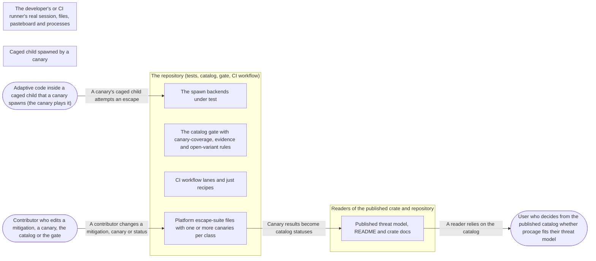

# Threat Model: The escape suite

**Feature**: `009-escape-suite` · **Generated**: 2026-11-01T17:26:09Z · **Profiles**: stride, llm, agent · **Canonical**: `threat-model.yaml`

> Rendered by ThreatSpec. Edit `threat-model.yaml`, not this file.

## Summary

| Threats | Critical | High | Medium | Low | Needs clarification | Not applicable | Mitigations | Requirements | Decisions |
|---|---|---|---|---|---|---|---|---|---|
| 8 | 1 | 7 | 0 | 0 | 0 | 25 | 6 | 7 | 0 |

## Actors

| ID | Name | Trust | Description |
|---|---|---|---|
| `actor.child-code` | Adaptive code inside a caged child that a canary spawns (the canary plays it) | untrusted |  |
| `actor.contributor` | Contributor who edits a mitigation, a canary, the catalog or the gate | semi-trusted |  |
| `actor.reader` | User who decides from the published catalog whether procage fits their threat model | trusted |  |

## Trust Zones

| ID | Name | Trust rating | Description |
|---|---|---|---|
| `tz.child` | Caged child spawned by a canary | 5 |  |
| `tz.host` | The developer's or CI runner's real session, files, pasteboard and processes | 80 |  |
| `tz.public` | Readers of the published crate and repository | 60 |  |
| `tz.repo` | The repository (tests, catalog, gate, CI workflow) | 70 |  |

## Assets

| ID | Name | Type | Classification | C / I / A | Source |
|---|---|---|---|---|---|
| `asset.catalog-truth` | The truth of each published class status, its evidence and its open variants | configuration | public | 0 / 100 / 40 | spec.md#US2 |
| `asset.host-state` | The host session around the suite (real launch agents, cron, shell rc, pasteboard, applications, running processes) | capability | internal | 50 / 90 / 50 | spec.md#FR-013 |
| `asset.mitigations` | The mitigations under test (canonicaliser, hard-deny tier, hygiene, Linux seccomp, mounts, Landlock) | capability | internal | 0 / 100 / 50 | spec.md#Context |

## Components

| ID | Name | Type | Trust zone | Source |
|---|---|---|---|---|
| `component.cage` | The spawn backends under test | library | `tz.repo` | spec.md#FR-002 |
| `component.catalog` | Published threat model, README and crate docs | document | `tz.public` | spec.md#FR-010 |
| `component.catalog-gate` | The catalog gate with canary-coverage, evidence and open-variant rules | test-suite | `tz.repo` | spec.md#FR-007 |
| `component.ci` | CI workflow lanes and just recipes | pipeline | `tz.repo` | spec.md#FR-011 |
| `component.escape-suite` | Platform escape-suite files with one or more canaries per class | test-suite | `tz.repo` | spec.md#FR-001 |

## Data Flows

| ID | Name | From | To | Assets | Crosses |
|---|---|---|---|---|---|
| `flow.attempt` | A canary's caged child attempts an escape | `actor.child-code` | `component.cage` | `asset.mitigations`, `asset.host-state` | `tz.child`, `tz.host` |
| `flow.claim` | Canary results become catalog statuses | `component.escape-suite` | `component.catalog` | `asset.catalog-truth` | `tz.repo`, `tz.public` |
| `flow.edit` | A contributor changes a mitigation, canary or status | `actor.contributor` | `component.escape-suite` | `asset.catalog-truth`, `asset.mitigations` | `tz.repo` |
| `flow.read` | A reader relies on the catalog | `component.catalog` | `actor.reader` | `asset.catalog-truth` | `tz.public` |

## Threats

| ID | Threat | Category | Technique | Severity | Status | Mitigations | Mappings | Source |
|---|---|---|---|---|---|---|---|---|
| `threat.uninformative-lane` | The host refuses the attempt on its own (Docker seccomp, AppArmor, Yama) so the canary passes without testing procage's mitigation | Spoofing | repudiation | **critical** | mitigated | `mitigation.informative-report`, `mitigation.positive-control` |  | spec.md#Edge-Cases |
| `threat.canary-side-effect` | A canary whose escape succeeds changes the real host (launch agent, cron, rc file, pasteboard, launched application) | Tampering | data-tampering | **high** | mitigated | `mitigation.scratch-only` |  | spec.md#FR-013 |
| `threat.false-pass` | A canary passes because the attempt fails for an unrelated reason (missing file, missing tool, wrong path, permission bits) and a contributor marks the class mitigated | Spoofing | repudiation | **high** | mitigated | `mitigation.defect-injection`, `mitigation.positive-control` |  | spec.md#FR-003 |
| `threat.hidden-open-variant` | A known open variant is not published, so a reader trusts a partial class as fully handled | Information Disclosure | repudiation | **high** | mitigated | `mitigation.gate-rules` |  | spec.md#FR-006 |
| `threat.mitigation-regression` | A later change weakens a mitigation and no canary notices because it covers a different variant | Tampering | data-tampering | **high** | mitigated | `mitigation.defect-injection` |  | spec.md#US1 |
| `threat.overclaimed-status` | The catalog marks a class mitigated with evidence on one platform only, with an ignored canary, or while an open canary for it exists | Tampering | data-tampering | **high** | mitigated | `mitigation.gate-rules` |  | spec.md#FR-007 |
| `threat.silent-skip` | A canary or lane skips (already sandboxed, lower tier, missing tool) and reports green | Repudiation | repudiation | **high** | mitigated | `mitigation.no-skip` |  | spec.md#US3 |
| `threat.surviving-descendant` | An open lifetime canary leaves an escaped descendant running on the developer machine or CI runner | Denial of Service | resource-exhaustion | **high** | mitigated | `mitigation.scratch-only` |  | spec.md#SC-005 |

### Techniques evaluated without findings

| Technique | Disposition | Reason |
|---|---|---|
| identity-spoofing | not-applicable | no authentication surface |
| data-tampering-in-transit | not-applicable | no network-boundary surface: canaries run locally and the gate reads repository files |
| injection | no-threat-detected | checked component.catalog-gate: the catalog is parsed as a fixed table grammar and evidence paths are restricted to two files; nothing is executed |
| cross-tenant-leak | not-applicable | no multi-tenant surface |
| prompt-injection-direct | not-applicable | no llm-inference surface: procage calls no language model (LLM-driven code is the adversary inside the child) |
| prompt-injection-indirect | not-applicable | no untrusted-content-to-model surface |
| sensitive-information-disclosure | not-applicable | no llm-inference surface |
| excessive-agency | not-applicable | no llm-inference surface |
| model-supply-chain | not-applicable | no model-supply-chain surface: no models, adapters or datasets |
| training-data-poisoning | not-applicable | no persistent-model-input surface |
| unbounded-consumption | not-applicable | no cost-bearing-inference surface |
| misinformation | not-applicable | no user-facing-generation surface; overclaiming in docs is modelled under STRIDE as threat.overclaimed-enforcement |
| hidden-context-exposure | not-applicable | no system-prompt surface |
| vector-embedding-weakness | not-applicable | no retrieval-path surface |
| improper-output-handling | not-applicable | no model-output surface |
| model-extraction | not-applicable | no inference-endpoint surface |
| goal-hijack | not-applicable | no agent surface in this feature |
| tool-misuse | not-applicable | no agent tool surface |
| identity-privilege-abuse | not-applicable | no agent identity surface |
| agentic-supply-chain | not-applicable | no agent plugin or MCP surface |
| unexpected-code-execution | not-applicable | procage executes only the program its caller names; the adversary inside the child is modelled under STRIDE |
| memory-context-poisoning | not-applicable | no agent memory surface |
| insecure-inter-agent-communication | not-applicable | no multi-agent surface |
| cascading-failure | not-applicable | no agent pipeline surface |
| human-agent-trust-exploitation | not-applicable | no agent-to-human surface |
| rogue-agent | not-applicable | no agent surface |

## Mitigations

| ID | Mitigation | Kind | Threats | Requirements | Touchpoints | Status |
|---|---|---|---|---|---|---|
| `mitigation.defect-injection` | Removing each covered mitigation makes a canary fail (recorded per system) | detective | `threat.mitigation-regression`, `threat.false-pass` | SR-007 | `crates/procage-policy/src/lower/macos.rs`, `crates/procage-policy/src/lower/linux.rs`, `src/linux/sys.rs`, `src/macos/sys.rs` | verified |
| `mitigation.gate-rules` | Gate rules for canary coverage per platform, evidence location, no ignored evidence, no open canary on a mitigated class, partial needs a note | preventive | `threat.overclaimed-status`, `threat.hidden-open-variant` | SR-003, SR-004 | `tests/threat_model.rs`, `THREAT_MODEL.md` | verified |
| `mitigation.informative-report` | Syscall canaries report whether the lane was informative (uncaged control allowed); evidence for kernel-surface classes is recorded from the T1 lane | detective | `threat.uninformative-lane` | SR-002 | `tests/escape_linux.rs`, `quickstart.md` | verified |
| `mitigation.no-skip` | Canaries fail on AlreadySandboxed and on a tier mismatch; lanes set the expected tier; external tools are avoided | preventive | `threat.silent-skip` | SR-005 | `tests/escape_macos.rs`, `tests/escape_linux.rs`, `.github/workflows/ci.yml`, `justfile` | verified |
| `mitigation.positive-control` | Each canary pairs the refused attempt with a control that succeeds (the same operation on a granted target, or uncaged) and asserts the specific refusal (errno, typed error), not just failure | detective | `threat.false-pass`, `threat.uninformative-lane` | SR-001, SR-002 | `tests/escape_macos.rs`, `tests/escape_linux.rs` | verified |
| `mitigation.scratch-only` | Canaries use fake homes and scratch paths, service lookups instead of actions, and kill every pid they learn | preventive | `threat.canary-side-effect`, `threat.surviving-descendant` | SR-006 | `tests/escape_macos.rs`, `tests/escape_linux.rs` | verified |

## Security Requirements

### SR-001 (P1) — verified

Every active canary MUST assert the specific refusal (errno or typed error) and MUST include a positive control showing the same operation succeeds where the policy allows it.

- **Given** a canary for a file-based class, **when** the child attempts the escape and the control, **then** the control succeeds and the attempt fails with the expected errno
- **Given** a canary whose attempt target does not exist, **when** it runs, **then** it fails rather than passes
- Mitigations: `mitigation.positive-control`
- Tasks: T005 ✓, T006 ✓, T007 ✓, T008 ✓
- Verification `verification.sr-001.2026-10-30`: test → pass (verified) — `tests/escape_macos.rs::r05_modifying_fcntl_commands_are_refused, tests/escape_macos.rs::r10_runs_do_not_share_temporary_files, tests/escape_linux.rs::r22_terminal_input_injection_is_refused`

### SR-002 (P1) — verified

A syscall canary MUST report whether its lane was informative, and a kernel-surface class MUST NOT be marked mitigated from uninformative lanes alone.

- **Given** the Docker default seccomp lane, **when** the R-28 canary runs, **then** it passes and prints which attempts were uninformative
- **Given** the T1 lane, **when** the R-28 and R-29 canaries run, **then** the uncaged controls succeed and the caged attempts fail with EPERM
- Mitigations: `mitigation.positive-control`, `mitigation.informative-report`
- Tasks: T007 ✓, T008 ✓
- Verification `verification.sr-002.2026-10-30`: test → pass (verified) — `tests/escape_linux.rs::r28_filter_bypassing_interfaces_are_refused, tests/escape_linux.rs::r29_nested_user_namespaces_and_mount_changes_are_refused`

### SR-003 (P1) — verified

The gate MUST reject a mitigated or detected class without a non-ignored canary on every listed platform, evidence outside the platform escape-suite files, ignored canaries as evidence, and a mitigated class that has an open canary.

- **Given** a class marked mitigated with a macOS canary only but listing Linux, **when** the gate runs, **then** exactly the per-platform evidence rule fires
- **Given** evidence naming an ignored canary, **when** the gate runs, **then** the ignored-evidence rule fires
- **Given** an open canary for a mitigated class, **when** the gate runs, **then** the open-canary rule fires
- Mitigations: `mitigation.gate-rules`
- Tasks: T003 ✓, T004 ✓, T011 ✓
- Verification `verification.sr-003.2026-10-30`: test → pass (verified) — `tests/threat_model.rs::mitigated_on_one_platform_only_is_caught, tests/threat_model.rs::ignored_canary_as_evidence_is_caught, tests/threat_model.rs::mitigated_with_an_open_canary_is_caught, tests/threat_model.rs::evidence_in_another_test_file_is_caught`

### SR-004 (P1) — verified

Every class MUST have a canary per listed platform, and a partial class MUST have an entry under Open variants; the release status MUST name every open class.

- **Given** a class with no canary for one listed platform, **when** the gate runs, **then** the coverage rule fires
- **Given** a partial class without a note, **when** the gate runs, **then** the open-variant rule fires
- Mitigations: `mitigation.gate-rules`
- Tasks: T003 ✓, T004 ✓, T011 ✓
- Verification `verification.sr-004.2026-10-30`: test → pass (verified) — `tests/threat_model.rs::missing_canary_is_caught, tests/threat_model.rs::partial_without_a_note_is_caught, tests/threat_model.rs::gate`

### SR-005 (P1) — verified

The suite MUST fail, never skip, when the parent is already sandboxed or the host tier differs from the expected tier, and every CI lane MUST run it with its expected tier.

- **Given** a T2 container with PROCAGE_EXPECT_TIER=T1, **when** the Linux suite runs, **then** it fails with a tier mismatch
- **Given** the CI workflow, **when** it is read, **then** every macOS and Linux lane runs the suite and Linux lanes set the expected tier
- Mitigations: `mitigation.no-skip`
- Tasks: T005 ✓, T007 ✓, T014 ✓, T015 ✓
- Verification `verification.sr-005.2026-10-30`: test → pass (verified) — `tests/escape_linux.rs::r21_an_inherited_descriptor_does_not_reach_the_child`

### SR-006 (P2) — verified

Canaries MUST NOT write outside scratch directories, write the real pasteboard, launch applications, or leave processes running.

- **Given** a full suite run including the open canaries, **when** it ends, **then** no canary process is alive and no file outside scratch directories changed
- Mitigations: `mitigation.scratch-only`
- Tasks: T005 ✓, T006 ✓, T007 ✓, T008 ✓
- Verification `verification.sr-006.2026-10-30`: test → pass (verified) — `tests/escape_macos.rs::r23_a_double_forked_descendant_dies_with_the_run, tests/escape_macos.rs::r23_a_launch_agent_cannot_be_planted`

### SR-007 (P2) — verified

For each system at least one covered mitigation MUST be removed in a defect-injection run and a canary MUST fail; at least five defects in total.

- **Given** a mitigation removed from the code, **when** the suite runs, **then** the canary for its class fails
- Mitigations: `mitigation.defect-injection`
- Tasks: T010 ✓
- Verification `verification.sr-007.2026-10-30`: evidence → pass (verified) — `specs/009-escape-suite/quickstart.md#Recorded-outcomes`
