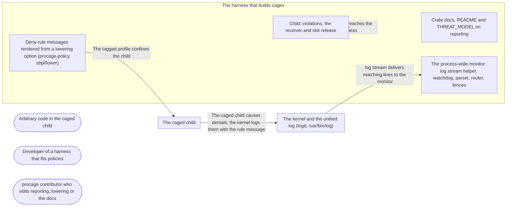

# Threat Model: Violations: what the sandbox denied, and why

**Feature**: `010-violations` · **Generated**: 2026-11-01T17:26:10Z · **Profiles**: stride, llm, agent · **Canonical**: `threat-model.yaml`

> Rendered by ThreatSpec. Edit `threat-model.yaml`, not this file.

## Summary

| Threats | Critical | High | Medium | Low | Needs clarification | Not applicable | Mitigations | Requirements | Decisions |
|---|---|---|---|---|---|---|---|---|---|
| 8 | 0 | 1 | 3 | 4 | 0 | 24 | 7 | 7 | 0 |

## Actors

| ID | Name | Trust | Description |
|---|---|---|---|
| `actor.caged-code` | Arbitrary code in the caged child | untrusted |  |
| `actor.consumer` | Developer of a harness that fits policies | trusted |  |
| `actor.contributor` | procage contributor who edits reporting, lowering or the docs | semi-trusted |  |

## Trust Zones

| ID | Name | Trust rating | Description |
|---|---|---|---|
| `tz.cage` | The caged child | 5 |  |
| `tz.harness` | The harness that builds cages | 90 |  |
| `tz.os` | The kernel and the unified log (logd, /usr/bin/log) | 95 |  |

## Assets

| ID | Name | Type | Classification | C / I / A | Source |
|---|---|---|---|---|---|
| `asset.harness` | The harness process: memory, threads, the time wait and violations() take | capability | internal | 0 / 50 / 70 | spec.md#FR-005 |
| `asset.host` | The user's files, secrets and processes outside the policy | credential | secret | 100 / 90 / 50 | spec.md#Context |
| `asset.record` | The violation record the harness shows its user and may act on (e.g. ask for a grant) | capability | internal | 30 / 80 / 30 | spec.md#US1 |

## Components

| ID | Name | Type | Trust zone | Source |
|---|---|---|---|---|
| `component.docs` | Crate docs, README and THREAT_MODEL on reporting | document | `tz.harness` | spec.md#FR-009 |
| `component.lowering` | Deny-rule messages rendered from a lowering option (procage-policy sbpl/lower) | library | `tz.harness` | spec.md#FR-002 |
| `component.monitor` | The process-wide monitor: log stream helper, watchdog, parser, router, fences | library | `tz.harness` | spec.md#FR-003 |
| `component.record` | Child::violations, the receiver and slot release | library | `tz.harness` | spec.md#FR-005 |

## Data Flows

| ID | Name | From | To | Assets | Crosses |
|---|---|---|---|---|---|
| `flow.confine` | The tagged profile confines the child | `component.lowering` | `tz.cage` | `asset.host` | `tz.harness`, `tz.cage` |
| `flow.denial` | The caged child causes denials; the kernel logs them with the rule message | `tz.cage` | `tz.os` | `asset.record` | `tz.cage`, `tz.os` |
| `flow.log` | log stream delivers matching lines to the monitor | `tz.os` | `component.monitor` | `asset.record` | `tz.os`, `tz.harness` |
| `flow.record` | The record reaches the harness | `component.record` | `tz.harness` | `asset.record` |  |

## Threats

| ID | Threat | Category | Technique | Severity | Status | Mitigations | Mappings | Source |
|---|---|---|---|---|---|---|---|---|
| `threat.forged-attribution` | Caged code makes a denial whose path holds a newline and a fake tag or kind, so the monitor attributes it to another run or reports a wrong reason the harness acts on | Spoofing | identity-spoofing | **high** | mitigated | `mitigation.last-line` |  | spec.md#Edge-Cases |
| `threat.false-complete` | The record says complete (or the harness reads an empty list as no denial) when the stream was down, the fence timed out or lines were dropped | Repudiation | missing-audit-trail | **medium** | mitigated | `mitigation.honest-record` |  | spec.md#FR-005 |
| `threat.profile-drift` | Adding messages changes what the profile allows or denies (a message on the marker block, a dropped rule, a different profile without reporting), weakening confinement | Elevation of Privilege | privilege-escalation-via-config | **medium** | mitigated | `mitigation.identical-off` |  | spec.md#FR-002 |
| `threat.record-flood` | Caged code causes millions of distinct denials and exhausts the harness memory through the record or the receiver | Denial of Service | resource-exhaustion | **medium** | mitigated | `mitigation.cap` |  | spec.md#US3 |
| `threat.enforcement-claim` | Docs present reporting as a control or as complete, so harnesses rely on it for security decisions | Repudiation | missing-audit-trail | **low** | mitigated | `mitigation.honest-record` |  | spec.md#FR-009 |
| `threat.helper-leak` | The log stream helper outlives the harness, inherits its descriptors or environment, or runs a replaced or PATH-found binary | Elevation of Privilege | privilege-escalation-via-config | **low** | mitigated | `mitigation.watchdog` |  | spec.md#FR-003 |
| `threat.slot-reuse` | A denial still in transit when the run ends is attributed to the next run that gets the slot | Repudiation | missing-audit-trail | **low** | mitigated | `mitigation.fence-before-free` |  | spec.md#FR-006 |
| `threat.wait-hang` | violations() or slot release blocks forever when the helper is down or slow, hanging the harness | Denial of Service | resource-exhaustion | **low** | mitigated | `mitigation.bounded-waits` |  | spec.md#FR-005 |

### Techniques evaluated without findings

| Technique | Disposition | Reason |
|---|---|---|
| identity-spoofing | not-applicable | no authentication surface |
| data-tampering-in-transit | no-threat-detected | checked flow.log: the helper reads the local unified log over a pipe from /usr/bin/log; forged lines are threat.forged-attribution |
| cross-tenant-leak | not-applicable | no multi-tenant surface |
| credential-theft | no-threat-detected | evaluated: the record holds paths the caged code tried, which the harness already passed or the code chose; no secret content is read |
| data-tampering-at-rest | no-threat-detected | evaluated: the only profile change is messages on deny rules; a changed allow/deny is threat.profile-drift |
| prompt-injection-direct | not-applicable | procage is a library that calls no model and runs no agent; LLM-written code is the adversary inside the child, modelled under STRIDE |
| prompt-injection-indirect | not-applicable | procage is a library that calls no model and runs no agent; LLM-written code is the adversary inside the child, modelled under STRIDE |
| sensitive-information-disclosure | not-applicable | procage is a library that calls no model and runs no agent; LLM-written code is the adversary inside the child, modelled under STRIDE |
| excessive-agency | not-applicable | procage is a library that calls no model and runs no agent; LLM-written code is the adversary inside the child, modelled under STRIDE |
| model-supply-chain | not-applicable | procage is a library that calls no model and runs no agent; LLM-written code is the adversary inside the child, modelled under STRIDE |
| training-data-poisoning | not-applicable | procage is a library that calls no model and runs no agent; LLM-written code is the adversary inside the child, modelled under STRIDE |
| unbounded-consumption | not-applicable | procage is a library that calls no model and runs no agent; LLM-written code is the adversary inside the child, modelled under STRIDE |
| misinformation | not-applicable | procage is a library that calls no model and runs no agent; LLM-written code is the adversary inside the child, modelled under STRIDE |
| hidden-context-exposure | not-applicable | procage is a library that calls no model and runs no agent; LLM-written code is the adversary inside the child, modelled under STRIDE |
| vector-embedding-weakness | not-applicable | procage is a library that calls no model and runs no agent; LLM-written code is the adversary inside the child, modelled under STRIDE |
| improper-output-handling | not-applicable | procage is a library that calls no model and runs no agent; LLM-written code is the adversary inside the child, modelled under STRIDE |
| model-extraction | not-applicable | procage is a library that calls no model and runs no agent; LLM-written code is the adversary inside the child, modelled under STRIDE |
| goal-hijack | not-applicable | procage is a library that calls no model and runs no agent; LLM-written code is the adversary inside the child, modelled under STRIDE |
| tool-misuse | not-applicable | procage is a library that calls no model and runs no agent; LLM-written code is the adversary inside the child, modelled under STRIDE |
| identity-privilege-abuse | not-applicable | procage is a library that calls no model and runs no agent; LLM-written code is the adversary inside the child, modelled under STRIDE |
| agentic-supply-chain | not-applicable | procage is a library that calls no model and runs no agent; LLM-written code is the adversary inside the child, modelled under STRIDE |
| unexpected-code-execution | not-applicable | procage is a library that calls no model and runs no agent; LLM-written code is the adversary inside the child, modelled under STRIDE |
| memory-context-poisoning | not-applicable | procage is a library that calls no model and runs no agent; LLM-written code is the adversary inside the child, modelled under STRIDE |
| insecure-inter-agent-communication | not-applicable | procage is a library that calls no model and runs no agent; LLM-written code is the adversary inside the child, modelled under STRIDE |
| cascading-failure | not-applicable | procage is a library that calls no model and runs no agent; LLM-written code is the adversary inside the child, modelled under STRIDE |
| human-agent-trust-exploitation | not-applicable | procage is a library that calls no model and runs no agent; LLM-written code is the adversary inside the child, modelled under STRIDE |
| rogue-agent | not-applicable | procage is a library that calls no model and runs no agent; LLM-written code is the adversary inside the child, modelled under STRIDE |

## Mitigations

| ID | Mitigation | Kind | Threats | Requirements | Touchpoints | Status |
|---|---|---|---|---|---|---|
| `mitigation.bounded-waits` | Ready, fence and release waits have time limits; a timeout marks the record incomplete | preventive | `threat.wait-hang` | SR-007 | `crates/procage/src/macos/violations.rs` | verified |
| `mitigation.cap` | Per-run cap with a dropped count; bounded receiver queue | preventive | `threat.record-flood` | SR-004 | `crates/procage/src/violation.rs` | verified |
| `mitigation.fence-before-free` | A slot is freed only after a fence passed after its last process ended | preventive | `threat.slot-reuse` | SR-002 | `crates/procage/src/macos/child.rs`, `crates/procage/src/macos/violations.rs` | verified |
| `mitigation.honest-record` | complete only after a fence; coverage states off, unavailable (reason) or not observed; docs say best-effort | detective | `threat.false-complete`, `threat.enforcement-claim` | SR-005 | `crates/procage/src/violation.rs`, `crates/procage/src/lib.rs`, `crates/procage/THREAT_MODEL.md` | verified |
| `mitigation.identical-off` | Without reporting the profile is byte-identical; with it only messages differ; the marker block has none; escape suite runs with reporting on | preventive | `threat.profile-drift` | SR-003 | `crates/procage-policy/src/sbpl.rs`, `crates/procage-policy/src/lower/macos.rs`, `crates/procage/tests/escape_macos.rs` | verified |
| `mitigation.last-line` | Attribute only by the exact marker of a live run on the last line (kernel-written, after the target); the target is everything between the operation and that line | preventive | `threat.forged-attribution` | SR-001 | `crates/procage/src/violation.rs`, `crates/procage/src/macos/violations.rs` | verified |
| `mitigation.watchdog` | Absolute /usr/bin/log and /bin/sh checked root-owned, not writable by others, on a read-only volume; empty environment, close-on-exec, stdin watchdog ends the helper with the process | preventive | `threat.helper-leak` | SR-006 | `crates/procage/src/macos/violations.rs` | verified |

## Security Requirements

### SR-001 (P1) — verified

A violation MUST be attributed only by the exact marker of a live run of this process on the last line of the message; a path containing a newline and another tag MUST stay with the run that caused it.

- **Given** two runs and a path containing a newline followed by the other run's marker, **when** the first run is denied that path, **then** the violation is in the first run's record with the full path, and not in the other's
- **Given** a message whose last line is no live marker, **when** it is parsed, **then** it is ignored
- Mitigations: `mitigation.last-line`
- Tasks: T004 ✓, T008 ✓
- Verification `verification.sr-001.2026-11-01`: test → pass (verified) — `crates/procage/src/violation.rs::a_newline_in_the_target_cannot_move_the_violation; crates/procage/tests/spawn_macos.rs::a_newline_in_a_path_stays_with_its_run`

### SR-002 (P1) — verified

A run slot MUST NOT be freed before a fence passed after the run ended.

- **Given** a run denied just before it ends, **when** its slot is reused by the next run, **then** the denial is in the first record and not in the second
- Mitigations: `mitigation.fence-before-free`
- Tasks: T007 ✓, T008 ✓
- Verification `verification.sr-002.2026-11-01`: test → pass (verified) — `crates/procage/tests/spawn_macos.rs::runs_keep_their_own_violations; crates/procage-kernel-facts/tests/kernel_facts.rs::KF-M29`

### SR-003 (P1) — verified

Without reporting the rendered profile MUST equal the lowering fixtures recorded before this feature; with reporting only rule messages MUST differ, the run-marker block MUST carry none, and the escape suite MUST pass with reporting on.

- **Given** every lowering fixture, **when** rendered with and without reporting, **then** removing the messages gives the same text, and without reporting it equals the fixture
- **Given** the macOS escape suite, **when** run with reporting on, **then** every canary still holds
- Mitigations: `mitigation.identical-off`
- Tasks: T001 ✓, T002 ✓, T003 ✓, T009 ✓
- Verification `verification.sr-003.2026-11-01`: test → pass (verified) — `crates/procage-policy/tests/violations.rs::reporting_adds_only_messages; crates/procage-policy/tests/violations.rs::the_run_marker_block_carries_no_message; crates/procage/tests/escape_macos.rs (PROCAGE_ESCAPE_VIOLATIONS=1)`

### SR-004 (P2) — verified

A run record MUST keep at most a fixed number of violations and count the rest; the receiver MUST be bounded.

- **Given** more distinct denials than the cap, **when** the record is read, **then** it holds the cap and counts the dropped ones
- Mitigations: `mitigation.cap`
- Tasks: T010 ✓
- Verification `verification.sr-004.2026-11-01`: test → pass (verified) — `crates/procage/src/violation.rs::the_record_keeps_the_cap_and_counts_the_rest; crates/procage/src/violation.rs::the_receiver_is_bounded_and_never_blocks`

### SR-005 (P1) — verified

A record MUST say complete only after a fence passed after the child exited, and MUST state its coverage (off, unavailable with reason, not observed on this platform); docs MUST call reporting best-effort and diagnostic.

- **Given** a running child, **when** the record is read, **then** it is not complete
- **Given** a cage without reporting, or Linux, **when** the record is read, **then** coverage says off or not observed, never complete with zero violations as a claim
- Mitigations: `mitigation.honest-record`
- Tasks: T007 ✓, T008 ✓, T011 ✓, T012 ✓
- Verification `verification.sr-005.2026-11-01`: test → pass (verified) — `crates/procage/tests/spawn_macos.rs::violations_arrive_while_the_child_runs; crates/procage/tests/spawn_macos.rs::reporting_is_off_by_default; crates/procage/tests/native.rs::violation_records_have_the_same_shape`

### SR-006 (P2) — verified

The helper MUST run absolute /usr/bin/log under /bin/sh, both passing the integrity check (owned by root, not group- or world-writable, on a read-only volume), with an empty environment and no inherited descriptors, and MUST end when the process that started it dies.

- **Given** a process that started the helper, **when** it is killed with SIGKILL, **then** no helper of it remains within a second
- **Given** a helper path that fails the integrity check, **when** the monitor starts, **then** it runs nothing and coverage is unavailable with the reason
- Mitigations: `mitigation.watchdog`
- Tasks: T006 ✓, T010 ✓
- Verification `verification.sr-006.2026-11-01`: test → pass (verified) — `crates/procage/tests/spawn_macos.rs::the_helper_ends_with_its_process; crates/procage/src/macos/violations.rs::user_files_are_not_trusted`

### SR-007 (P2) — verified

Waiting for the helper, a fence or a slot release MUST be bounded; a timeout MUST leave the record incomplete instead of blocking.

- **Given** a helper that never answers, **when** violations() is called after exit, **then** it returns within the limit, incomplete
- Mitigations: `mitigation.bounded-waits`
- Tasks: T006 ✓, T010 ✓
- Verification `verification.sr-007.2026-11-01`: test → pass (verified) — `crates/procage/src/macos/violations.rs::a_silent_helper_times_out; crates/procage/tests/spawn_macos.rs::a_dead_helper_is_reported_and_restarted`
