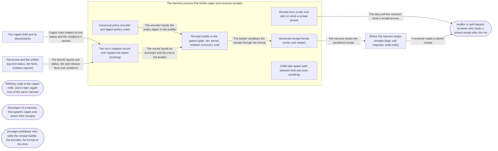

# Threat Model: Receipts, evidence of how a run was caged

**Feature**: `011-receipts` · **Generated**: 2026-11-01T21:13:40Z · **Profiles**: stride, llm, agent · **Canonical**: `threat-model.yaml`

> Rendered by ThreatSpec. Edit `threat-model.yaml`, not this file.

## Summary

| Threats | Critical | High | Medium | Low | Needs clarification | Not applicable | Mitigations | Requirements | Decisions |
|---|---|---|---|---|---|---|---|---|---|
| 9 | 0 | 5 | 2 | 2 | 3 | 27 | 8 | 9 | 0 |

### Needs clarification

- `threat.grants-unrecorded` — [NEEDS CLARIFICATION: does the receipt record the per-spawn grants (as a digest, a count, or paths on request)? FR-002 does not list them, and without them two runs with equal policy digests may have reached different paths] (spec.md#FR-002)
- `threat.lowering-version-unrecorded` — [NEEDS CLARIFICATION: does the receipt name the procage version or a digest of the lowered plan? Equal policy, preset and base versions lowered by different procage releases may be enforced differently] (spec.md#FR-002)
- `threat.unknown-field-rule` — [NEEDS CLARIFICATION: does a reader refuse unknown fields like the policy format (FR-003), or preserve or ignore them (US3)? The two requirements disagree] (spec.md#US3)

## Actors

| ID | Name | Trust | Description |
|---|---|---|---|
| `actor.caged-code` | Arbitrary code in the caged child, and in later caged runs of the same harness | untrusted |  |
| `actor.consumer` | Developer of a harness that spawns cages and stores their receipts | trusted |  |
| `actor.contributor` | procage contributor who edits the receipt builder, the encoder, the format or the docs | semi-trusted |  |
| `actor.reviewer` | Auditor or pull-request reviewer who reads a stored receipt after the run | trusted |  |

## Trust Zones

| ID | Name | Trust rating | Description |
|---|---|---|---|
| `tz.cage` | The caged child and its descendants | 5 |  |
| `tz.harness` | The harness process that builds cages and receives receipts | 90 |  |
| `tz.os` | The kernel and the unified log (exit status, tier facts, violation reports) | 95 |  |
| `tz.store` | Where the harness keeps receipts (logs, pull requests, audit trails) | 50 |  |

## Assets

| ID | Name | Type | Classification | C / I / A | Source |
|---|---|---|---|---|---|
| `asset.digest` | The policy digest, the identity a reviewer uses to tell two policies apart | capability | internal | 10 / 95 / 20 | spec.md#FR-002 |
| `asset.receipt` | The per-run receipt a reviewer reads to decide how a command was caged | capability | internal | 30 / 90 / 30 | spec.md#Key-Entities |
| `asset.secrets` | Environment values, file contents, policy paths and violation paths the caller did not ask to log | credential | secret | 90 / 20 / 0 | spec.md#FR-004 |
| `asset.spawn` | The child's call sequence between fork and exec | capability | internal | 0 / 70 / 70 | spec.md#FR-005 |

## Components

| ID | Name | Type | Trust zone | Source |
|---|---|---|---|---|
| `component.builder` | Receipt builder in the parent (plan, tier, kernel, violation summary, exit) | library | `tz.harness` | spec.md#FR-001 |
| `component.docs` | Receipt docs (crate and site) on what a receipt proves | document | `tz.harness` | spec.md#FR-006 |
| `component.encoder` | Canonical policy encoder and digest (policy crate) | library | `tz.harness` | spec.md#Assumptions |
| `component.format` | Versioned receipt format (writer and reader) | library | `tz.harness` | spec.md#FR-003 |
| `component.record` | The run's violation record and reaped exit status (existing) | library | `tz.harness` | spec.md#Edge-Cases |
| `component.spawn` | Child-side spawn path between fork and exec (existing) | library | `tz.harness` | spec.md#FR-005 |

## Data Flows

| ID | Name | From | To | Assets | Crosses |
|---|---|---|---|---|---|
| `flow.child-output` | Caged code shapes its exit status and the violations it causes | `tz.cage` | `component.record` | `asset.receipt`, `asset.secrets` | `tz.cage`, `tz.harness` |
| `flow.claims` | The docs tell the reviewer what a receipt proves | `component.docs` | `actor.reviewer` | `asset.receipt` |  |
| `flow.digest` | The encoder hands the policy digest to the builder | `component.encoder` | `component.builder` | `asset.digest` |  |
| `flow.read` | A reviewer reads a stored receipt | `tz.store` | `actor.reviewer` | `asset.receipt`, `asset.digest` | `tz.store` |
| `flow.run-facts` | The kernel reports exit status, tier and release facts and violations | `tz.os` | `component.record` | `asset.receipt` | `tz.os`, `tz.harness` |
| `flow.serialise` | The builder serialises the receipt through the format | `component.builder` | `component.format` | `asset.receipt`, `asset.digest`, `asset.secrets` |  |
| `flow.store` | The harness stores the serialised receipt | `component.format` | `tz.store` | `asset.receipt`, `asset.secrets` | `tz.harness`, `tz.store` |
| `flow.summary` | The record hands its summary and the exit to the builder | `component.record` | `component.builder` | `asset.receipt`, `asset.secrets` |  |

## Threats

| ID | Threat | Category | Technique | Severity | Status | Mitigations | Mappings | Source |
|---|---|---|---|---|---|---|---|---|
| `threat.digest-collision` | A non-canonical encoding (rule order, a path as text or as bytes, omitted defaults) or a weak hash gives two different policies the same digest, so a reviewer reads a loosened policy as the reviewed one | Tampering | data-tampering-at-rest | **high** | open | `mitigation.canonical-digest` |  | spec.md#US1 |
| `threat.not-observed-as-none` | With reporting off or unavailable, or a lossy macOS record, the receipt's violation summary reads as zero denials, and a reviewer concludes nothing was denied | Repudiation | missing-audit-trail | **high** | open | `mitigation.honest-docs`, `mitigation.typed-coverage` |  | spec.md#Edge-Cases |
| `threat.receipt-as-attestation` | A later caged run, or anyone who can write where receipts are kept, rewrites a stored receipt, and a reviewer who reads the unsigned receipt as an attestation trusts the forgery | Tampering | data-tampering-at-rest | **high** | open | `mitigation.honest-docs` |  | spec.md#Clarifications |
| `threat.relaxation-omitted` | The receipt leaves out an accepted approximation, a fit relaxation or a waived hard-deny class, so a relaxed run reads as fully enforced | Repudiation | missing-audit-trail | **high** | open | `mitigation.plan-is-the-source` |  | spec.md#US2 |
| `threat.unknown-field-dropped` | A reader that ignores a field it does not know (a new relaxation kind written by a newer version) reports the run as fully enforced | Repudiation | missing-audit-trail | **high** | open | `mitigation.fail-closed-reader` |  | spec.md#US3 |
| `threat.fork-exec-work` | Receipt bookkeeping adds allocation or locking to the child between fork and exec, so a multithreaded parent's child can deadlock or run unconfined code paths | Denial of Service | resource-exhaustion | **medium** | open | `mitigation.parent-only-facts` |  | spec.md#FR-005 |
| `threat.receipt-leaks-secrets` | The receipt carries environment values, command arguments, policy paths or violation paths into a log or pull request the caller did not mean to expose | Information Disclosure | sensitive-data-exposure | **medium** | open | `mitigation.field-allowlist` |  | spec.md#FR-004 |
| `threat.child-shaped-fields` | Caged code shapes receipt fields beyond its exit status (process names, paths or forged reports), changing what the receipt says about the cage | Tampering | injection | **low** | open | `mitigation.parent-only-facts` |  | spec.md#FR-002 |
| `threat.final-state-misstated` | The receipt claims a state the run did not reach, a partial view taken while it runs read as final, or a kill, signal or timeout recorded as a normal exit | Repudiation | missing-audit-trail | **low** | open | `mitigation.final-after-reap` |  | spec.md#Clarifications |

### Techniques evaluated without findings

| Technique | Disposition | Reason |
|---|---|---|
| credential-theft | not-applicable | no authentication surface; a receipt is handed to the caller in-process |
| identity-spoofing | not-applicable | no authentication or network boundary; procage never sends a receipt anywhere |
| data-tampering-in-transit | not-applicable | no data in transit; the receipt is returned to the caller's own process |
| injection | no-threat-detected | checked flow.child-output: the only child-controlled inputs are the exit status and the violation record; covered by threat.child-shaped-fields |
| cross-tenant-leak | not-applicable | single user; a receipt belongs to the run of the caller that spawned it |
| broken-access-control | not-applicable | no principals; procage authorises nothing when it builds or reads a receipt |
| privilege-escalation-via-config | no-threat-detected | checked component.format: reading a receipt never configures or relaxes a cage; a receipt is output only |
| prompt-injection-direct | not-applicable | procage is a library that calls no model and runs no agent; LLM-written code is the adversary inside the child, modelled under STRIDE |
| prompt-injection-indirect | not-applicable | procage is a library that calls no model and runs no agent; LLM-written code is the adversary inside the child, modelled under STRIDE |
| sensitive-information-disclosure | not-applicable | procage is a library that calls no model and runs no agent; LLM-written code is the adversary inside the child, modelled under STRIDE |
| excessive-agency | not-applicable | procage is a library that calls no model and runs no agent; LLM-written code is the adversary inside the child, modelled under STRIDE |
| model-supply-chain | not-applicable | procage is a library that calls no model and runs no agent; LLM-written code is the adversary inside the child, modelled under STRIDE |
| training-data-poisoning | not-applicable | procage is a library that calls no model and runs no agent; LLM-written code is the adversary inside the child, modelled under STRIDE |
| unbounded-consumption | not-applicable | procage is a library that calls no model and runs no agent; LLM-written code is the adversary inside the child, modelled under STRIDE |
| misinformation | not-applicable | procage is a library that calls no model and runs no agent; LLM-written code is the adversary inside the child, modelled under STRIDE |
| hidden-context-exposure | not-applicable | procage is a library that calls no model and runs no agent; LLM-written code is the adversary inside the child, modelled under STRIDE |
| vector-embedding-weakness | not-applicable | procage is a library that calls no model and runs no agent; LLM-written code is the adversary inside the child, modelled under STRIDE |
| improper-output-handling | not-applicable | procage is a library that calls no model and runs no agent; LLM-written code is the adversary inside the child, modelled under STRIDE |
| model-extraction | not-applicable | procage is a library that calls no model and runs no agent; LLM-written code is the adversary inside the child, modelled under STRIDE |
| goal-hijack | not-applicable | procage is a library that calls no model and runs no agent; LLM-written code is the adversary inside the child, modelled under STRIDE |
| tool-misuse | not-applicable | procage is a library that calls no model and runs no agent; LLM-written code is the adversary inside the child, modelled under STRIDE |
| identity-privilege-abuse | not-applicable | procage is a library that calls no model and runs no agent; LLM-written code is the adversary inside the child, modelled under STRIDE |
| agentic-supply-chain | not-applicable | procage is a library that calls no model and runs no agent; LLM-written code is the adversary inside the child, modelled under STRIDE |
| unexpected-code-execution | not-applicable | procage is a library that calls no model and runs no agent; LLM-written code is the adversary inside the child, modelled under STRIDE |
| memory-context-poisoning | not-applicable | procage is a library that calls no model and runs no agent; LLM-written code is the adversary inside the child, modelled under STRIDE |
| insecure-inter-agent-communication | not-applicable | procage is a library that calls no model and runs no agent; LLM-written code is the adversary inside the child, modelled under STRIDE |
| cascading-failure | not-applicable | procage is a library that calls no model and runs no agent; LLM-written code is the adversary inside the child, modelled under STRIDE |
| human-agent-trust-exploitation | not-applicable | procage is a library that calls no model and runs no agent; LLM-written code is the adversary inside the child, modelled under STRIDE |
| rogue-agent | not-applicable | procage is a library that calls no model and runs no agent; LLM-written code is the adversary inside the child, modelled under STRIDE |

## Mitigations

| ID | Mitigation | Kind | Threats | Requirements | Touchpoints | Status |
|---|---|---|---|---|---|---|
| `mitigation.canonical-digest` | One canonical encoding (fixed field order, sets sorted, paths as bytes, defaults explicit) hashed with SHA-256 under a format tag and version; property tests and a pinned fixture digest | preventive | `threat.digest-collision` | SR-001 | `component.encoder` | required |
| `mitigation.fail-closed-reader` | The reader refuses newer versions and never derives enforced-as-written when it meets a field or value it does not know | preventive | `threat.unknown-field-dropped` | SR-003 | `component.format` | required |
| `mitigation.field-allowlist` | The receipt holds only the FR-002 fields, counts instead of violation contents; the policy only on request; canary test over every field | preventive | `threat.receipt-leaks-secrets` | SR-005 | `component.builder`, `component.format` | required |
| `mitigation.final-after-reap` | The final receipt exists only after reaping and a closed record; the partial view is a separate type; exit is a typed cause | preventive | `threat.final-state-misstated` | SR-008 | `component.builder`, `component.record` | required |
| `mitigation.honest-docs` | The docs state that a receipt is the caller's unsigned record, where to keep it, what an empty record does not prove, and that exec yields none | preventive | `threat.receipt-as-attestation`, `threat.not-observed-as-none` | SR-009 | `component.docs` | required |
| `mitigation.parent-only-facts` | Every field comes from the parent's plan, the kernel's reports and the reaped status; child-controlled strings stay out; the child path is unchanged | preventive | `threat.child-shaped-fields`, `threat.fork-exec-work` | SR-006, SR-007 | `component.builder`, `component.spawn` | required |
| `mitigation.plan-is-the-source` | The relaxation, approximation and waiver lists are copied from the cage's own plan, with one enforced-as-written field derived from them | preventive | `threat.relaxation-omitted` | SR-002 | `component.builder` | required |
| `mitigation.typed-coverage` | The violation summary is typed by coverage (not observed, unavailable with reason, observed with completeness and dropped count); not observed has no count | preventive | `threat.not-observed-as-none` | SR-004 | `component.builder`, `component.record` | required |

## Security Requirements

### SR-001 (P1) — unverified

The policy digest MUST be SHA-256 over one canonical encoding of the policy (fixed field order, sets sorted, order kept only where it changes meaning, every path as its bytes, no omitted defaults) prefixed by a format tag and version; equal policies MUST have equal digests however they were built, and policies that differ in any rule, waiver, base or preset tag MUST have different digests.

- **Given** two equal policies built with their sets in a different order, **when** both are digested, **then** the digests are equal
- **Given** a policy and a copy that differs in one path byte, one waiver, the base or the preset tag, **when** both are digested, **then** the digests differ
- **Given** a fixture policy with a pinned digest, **when** it is digested on every CI lane and after a round trip through the serialised form, **then** the digest equals the pinned value
- Mitigations: `mitigation.canonical-digest`
- Tasks: — none —

### SR-002 (P1) — unverified

The receipt MUST list every accepted approximation by construct, every fit relaxation with its lift and every waived hard-deny class held by the cage's plan, and MUST carry one field that says enforced as written only when all three lists are empty.

- **Given** a fitted cage with relaxations, a cage with an accepted approximation and a cage with each waivable class waived, **when** a run of each ends, **then** the receipt lists exactly the plan's entries and enforced as written is false
- **Given** a cage with none of them, **when** a run ends, **then** the three lists are empty and enforced as written is true
- Mitigations: `mitigation.plan-is-the-source`
- Tasks: — none —

### SR-003 (P1) — unverified

A receipt reader MUST refuse a receipt of a newer format version with a typed error, and MUST NOT report a run as enforced as written when the receipt holds a field or value it does not know.

- **Given** a receipt with an added relaxation kind the reader does not know, **when** it is read, **then** it is refused, or read with enforced as written false or unknown, never true
- **Given** a receipt of the next format version, **when** it is read, **then** the reader returns an unsupported-version error
- **Given** a receipt of the previous format version, **when** it is read, **then** it parses with every field intact
- Mitigations: `mitigation.fail-closed-reader`
- Tasks: — none —

### SR-004 (P1) — unverified

The violation summary MUST carry the record's coverage, completeness and dropped count; with reporting off or unavailable it MUST say not observed (with the reason) and MUST NOT carry a violation count.

- **Given** a run with reporting off, and a run where reporting was unavailable, **when** their receipts are serialised, **then** the summary is not observed (unavailable naming the reason) and holds no count, so no reader can read zero
- **Given** a macOS run whose record dropped reports, **when** its receipt is built, **then** the summary carries coverage observed, the dropped count and completeness as the record reports them
- Mitigations: `mitigation.typed-coverage`
- Tasks: — none —

### SR-005 (P2) — unverified

Without the caller asking for the policy, the receipt MUST NOT contain environment values, command arguments, file contents, policy paths, violation paths or process names; asking for the policy MUST add only the policy.

- **Given** a canary string in an environment value, an argument, a policy path, a file the child reads and a path the child is denied, **when** the run's receipt is serialised, **then** no canary bytes appear in it
- **Given** the same run with the policy requested, **when** the receipt is serialised, **then** only the policy-path canary appears
- Mitigations: `mitigation.field-allowlist`
- Tasks: — none —

### SR-006 (P2) — unverified

Every receipt field MUST come from the parent's cage and plan, the kernel's reports and the reaped exit status; strings the caged code controls MUST NOT appear in a receipt.

- **Given** a child that names itself and its paths with format-breaking bytes and exits with a chosen code, **when** its receipt is read back, **then** the exit code is recorded, none of its strings appear, and every other field equals the cage's own values
- Mitigations: `mitigation.parent-only-facts`
- Tasks: — none —

### SR-007 (P2) — unverified

The child's call sequence between fork and exec MUST be identical with and without receipts; the receipt MUST be built in the parent only.

- **Given** the multithreaded spawn tests on every lane, **when** they run with receipts, **then** they pass, and the child-side code holds no receipt state
- **Given** the spawn benchmark, **when** it runs with and without receipts, **then** spawn latency is unchanged within noise
- Mitigations: `mitigation.parent-only-facts`
- Tasks: — none —

### SR-008 (P2) — unverified

A final receipt MUST be available only after the child was reaped and its violation record is complete or closed as interrupted; the partial view MUST be a distinct type that cannot be serialised as a final receipt; the exit MUST distinguish an exit code, a signal and a kill by the caller, a timeout or the end of the run.

- **Given** a running child, **when** the receipt is asked for, **then** only the partial view is returned, and it serialises marked partial
- **Given** runs ended by a normal exit, a signal, a caller kill and a timeout, **when** their receipts are read, **then** each exit field names its cause
- Mitigations: `mitigation.final-after-reap`
- Tasks: — none —

### SR-009 (P1) — unverified

The receipt docs MUST state that a receipt is the caller's own unsigned record and not an attestation, that whoever can write where it is kept can change it (so keep it outside every path a later run may write), that an empty complete record does not prove nothing was denied, and that `Cage::exec` produces no receipt.

- **Given** the crate docs and the site page on receipts, **when** they describe what a receipt proves, **then** each states all four points, and no text calls a receipt proof, attestation or signature
- Mitigations: `mitigation.honest-docs`
- Tasks: — none —
