# Threat Model: Receipts, evidence of how a run was caged

**Feature**: `011-receipts` · **Generated**: 2026-11-01T22:48:31Z · **Profiles**: stride, llm, agent · **Canonical**: `threat-model.yaml`

> Rendered by ThreatSpec. Edit `threat-model.yaml`, not this file.

## Summary

| Threats | Critical | High | Medium | Low | Needs clarification | Not applicable | Mitigations | Requirements | Decisions |
|---|---|---|---|---|---|---|---|---|---|
| 16 | 0 | 5 | 7 | 4 | 0 | 27 | 10 | 11 | 0 |

## Actors

| ID | Name | Trust | Description |
|---|---|---|---|
| `actor.caged-code` | Arbitrary code in the caged child, and in later caged runs of the same harness | untrusted |  |
| `actor.consumer` | Developer of a harness that spawns cages and stores their receipts | trusted |  |
| `actor.contributor` | procage contributor who edits the receipt builder, the encoder, the format or the docs | semi-trusted |  |
| `actor.dependency-publisher` | Publisher of a crate procage now depends on (sha2, serde, serde_json) | untrusted |  |
| `actor.reviewer` | Auditor or pull-request reviewer who reads a stored receipt after the run | trusted |  |

## Trust Zones

| ID | Name | Trust rating | Description |
|---|---|---|---|
| `tz.cage` | The caged child and its descendants | 5 |  |
| `tz.harness` | The harness process that builds cages and receives receipts | 90 |  |
| `tz.os` | The kernel and the unified log (exit status, tier facts, violation reports) | 95 |  |
| `tz.registry` | crates.io, where the new dependencies come from | 40 |  |
| `tz.store` | Where the harness keeps receipts (logs, pull requests, audit trails) | 50 |  |

## Assets

| ID | Name | Type | Classification | C / I / A | Source |
|---|---|---|---|---|---|
| `asset.digest` | The policy digest, the identity a reviewer uses to tell two policies apart | capability | internal | 10 / 95 / 20 | spec.md#FR-002 |
| `asset.host-facts` | The OS release and build or kernel release a receipt names (the host patch level) | capability | internal | 40 / 60 / 0 | plan.md#Summary |
| `asset.receipt` | The per-run receipt a reviewer reads to decide how a command was caged | capability | internal | 30 / 90 / 30 | spec.md#Key-Entities |
| `asset.secrets` | Environment values, file contents, policy paths and violation paths the caller did not ask to log | credential | secret | 90 / 20 / 0 | spec.md#FR-004 |
| `asset.spawn` | The child's call sequence between fork and exec | capability | internal | 0 / 70 / 70 | spec.md#FR-005 |

## Components

| ID | Name | Type | Trust zone | Source |
|---|---|---|---|---|
| `component.builder` | Receipt builder (crates/procage/src/receipt.rs) assembling CageFacts, the cached exit status and the violation summary | library | `tz.harness` | plan.md#Summary |
| `component.cage-facts` | CageFacts: per-cage facts (policy digest, preset, base, grants, backend, approximations, relaxations, waivers) built once in with_options and shared by its children via Arc | library | `tz.harness` | plan.md#Summary |
| `component.cage-options` | CageOptions::with_policy_in_receipt, the opt-in that puts the policy and relaxation subjects in every receipt of the cage | library | `tz.harness` | contracts/api.md |
| `component.child` | Child handle per backend: Child::receipt (None while alive) and the killed flag set by kill_all | library | `tz.harness` | contracts/api.md |
| `component.deps` | New dependencies sha2 0.10, serde 1 (derive) and serde_json, with procage-policy's serde feature always on | library | `tz.registry` | plan.md#Technical-Context |
| `component.docs` | Receipt docs (crate and site) on what a receipt proves | document | `tz.harness` | spec.md#FR-006 |
| `component.encoder` | Policy digest: policy_digest(&Policy), SHA-256 of the policy's canonical JSON (procage-policy serde form) | library | `tz.harness` | plan.md#Summary |
| `component.format` | Receipt format: Receipt::to_json / from_json, version 1, deny_unknown_fields on every map, ReceiptError | library | `tz.harness` | contracts/api.md |
| `component.host-facts` | Host fact reads in the parent: kern.osproductversion and kern.osversion (macos::sys), /proc/sys/kernel/osrelease, tier, ABI and errata (Linux) | library | `tz.harness` | plan.md#Summary |
| `component.record` | The run's violation record (Child::violations) and cached reaped exit status (existing) | library | `tz.harness` | spec.md#Edge-Cases |
| `component.spawn` | Child-side spawn path between fork and exec (existing) | library | `tz.harness` | spec.md#FR-005 |

## Data Flows

| ID | Name | From | To | Assets | Crosses |
|---|---|---|---|---|---|
| `flow.child-output` | Caged code shapes its exit status and the violations it causes | `tz.cage` | `component.record` | `asset.receipt`, `asset.secrets` | `tz.cage`, `tz.harness` |
| `flow.claims` | The docs tell the reviewer what a receipt proves | `component.docs` | `actor.reviewer` | `asset.receipt` |  |
| `flow.deps-fetch` | Cargo fetches sha2, serde and serde_json from crates.io into the build | `tz.registry` | `component.encoder` | `asset.digest`, `asset.receipt` | `tz.registry`, `tz.harness` |
| `flow.digest` | The encoder hands the policy digest to the cage facts | `component.encoder` | `component.cage-facts` | `asset.digest` |  |
| `flow.facts` | Host facts and the cage plan become CageFacts | `component.host-facts` | `component.cage-facts` | `asset.host-facts`, `asset.receipt` |  |
| `flow.facts-to-builder` | Each child's Arc of CageFacts feeds its receipt | `component.cage-facts` | `component.builder` | `asset.receipt`, `asset.digest`, `asset.host-facts`, `asset.secrets` |  |
| `flow.host-facts` | The kernel reports the OS release and build or the kernel release to the parent | `tz.os` | `component.host-facts` | `asset.host-facts` | `tz.os`, `tz.harness` |
| `flow.kill` | The consumer calls kill_all or drops the handle, setting the killed flag | `actor.consumer` | `component.child` | `asset.receipt` |  |
| `flow.option-to-facts` | The option adds the policy and relaxation subjects to CageFacts | `component.cage-options` | `component.cage-facts` | `asset.secrets` |  |
| `flow.policy-option` | The consumer asks for the policy in the receipt | `actor.consumer` | `component.cage-options` | `asset.secrets` |  |
| `flow.read` | A reviewer reads a stored receipt | `tz.store` | `actor.reviewer` | `asset.receipt`, `asset.digest` | `tz.store` |
| `flow.receipt-call` | Child::receipt asks the builder for a receipt once the run has exited | `component.child` | `component.builder` | `asset.receipt` |  |
| `flow.run-facts` | The kernel reports exit status, tier and release facts and violations | `tz.os` | `component.record` | `asset.receipt` | `tz.os`, `tz.harness` |
| `flow.serialise` | The builder serialises the receipt through the format | `component.builder` | `component.format` | `asset.receipt`, `asset.digest`, `asset.secrets` |  |
| `flow.store` | The harness stores the serialised receipt | `component.format` | `tz.store` | `asset.receipt`, `asset.secrets` | `tz.harness`, `tz.store` |
| `flow.summary` | The record hands its violation summary and the cached exit to the builder | `component.record` | `component.builder` | `asset.receipt`, `asset.secrets` |  |

```mermaid
flowchart LR
    actor_caged_code(["Arbitrary code in the caged child, and in later caged runs of the same harness"])
    actor_consumer(["Developer of a harness that spawns cages and stores their receipts"])
    actor_contributor(["procage contributor who edits the receipt builder, the encoder, the format or the docs"])
    actor_dependency_publisher(["Publisher of a crate procage now depends on (sha2, serde, serde_json)"])
    actor_reviewer(["Auditor or pull-request reviewer who reads a stored receipt after the run"])
    subgraph tz_cage["The caged child and its descendants"]
    end
    subgraph tz_harness["The harness process that builds cages and receives receipts"]
        component_builder["Receipt builder (crates/procage/src/receipt.rs) assembling CageFacts, the cached exit status and the violation summary"]
        component_cage_facts["CageFacts: per-cage facts (policy digest, preset, base, grants, backend, approximations, relaxations, waivers) built once in with_options and shared by its children via Arc"]
        component_cage_options["CageOptions::with_policy_in_receipt, the opt-in that puts the policy and relaxation subjects in every receipt of the cage"]
        component_child["Child handle per backend: Child::receipt (None while alive) and the killed flag set by kill_all"]
        component_docs["Receipt docs (crate and site) on what a receipt proves"]
        component_encoder["Policy digest: policy_digest(&Policy), SHA-256 of the policy's canonical JSON (procage-policy serde form)"]
        component_format["Receipt format: Receipt::to_json / from_json, version 1, deny_unknown_fields on every map, ReceiptError"]
        component_host_facts["Host fact reads in the parent: kern.osproductversion and kern.osversion (macos::sys), /proc/sys/kernel/osrelease, tier, ABI and errata (Linux)"]
        component_record["The run's violation record (Child::violations) and cached reaped exit status (existing)"]
        component_spawn["Child-side spawn path between fork and exec (existing)"]
    end
    subgraph tz_os["The kernel and the unified log (exit status, tier facts, violation reports)"]
    end
    subgraph tz_registry["crates.io, where the new dependencies come from"]
        component_deps["New dependencies sha2 0.10, serde 1 (derive) and serde_json, with procage-policy's serde feature always on"]
    end
    subgraph tz_store["Where the harness keeps receipts (logs, pull requests, audit trails)"]
    end
    tz_cage -->|"Caged code shapes its exit status and the violations it causes"| component_record
    component_docs -->|"The docs tell the reviewer what a receipt proves"| actor_reviewer
    tz_registry -->|"Cargo fetches sha2, serde and serde_json from crates.io into the build"| component_encoder
    component_encoder -->|"The encoder hands the policy digest to the cage facts"| component_cage_facts
    component_host_facts -->|"Host facts and the cage plan become CageFacts"| component_cage_facts
    component_cage_facts -->|"Each child's Arc of CageFacts feeds its receipt"| component_builder
    tz_os -->|"The kernel reports the OS release and build or the kernel release to the parent"| component_host_facts
    actor_consumer -->|"The consumer calls kill_all or drops the handle, setting the killed flag"| component_child
    component_cage_options -->|"The option adds the policy and relaxation subjects to CageFacts"| component_cage_facts
    actor_consumer -->|"The consumer asks for the policy in the receipt"| component_cage_options
    tz_store -->|"A reviewer reads a stored receipt"| actor_reviewer
    component_child -->|"Child::receipt asks the builder for a receipt once the run has exited"| component_builder
    tz_os -->|"The kernel reports exit status, tier and release facts and violations"| component_record
    component_builder -->|"The builder serialises the receipt through the format"| component_format
    component_format -->|"The harness stores the serialised receipt"| tz_store
    component_record -->|"The record hands its violation summary and the cached exit to the builder"| component_builder
```

## Threats

| ID | Threat | Category | Technique | Severity | Status | Mitigations | Mappings | Source |
|---|---|---|---|---|---|---|---|---|
| `threat.digest-collision` | A non-canonical digest input (list order in fs rules, grants, sockets or the env allowlist, a path as text or as bytes, omitted defaults) or a weak hash gives two different policies the same digest, so a reviewer reads a loosened policy as the reviewed one | Tampering | data-tampering-at-rest | **high** | mitigated | `mitigation.canonical-digest` |  | plan.md#Summary |
| `threat.not-observed-as-none` | With reporting off or unavailable, or a lossy macOS record, the receipt's violation summary reads as zero denials, and a reviewer concludes nothing was denied | Repudiation | missing-audit-trail | **high** | mitigated | `mitigation.honest-docs`, `mitigation.typed-coverage` |  | spec.md#Edge-Cases |
| `threat.receipt-as-attestation` | A later caged run, or anyone who can write where receipts are kept, rewrites a stored receipt, and a reviewer who reads the unsigned receipt as an attestation trusts the forgery | Tampering | data-tampering-at-rest | **high** | mitigated | `mitigation.honest-docs` |  | spec.md#Clarifications |
| `threat.relaxation-omitted` | The receipt leaves out an accepted approximation, a fit relaxation or a waived hard-deny class, so a relaxed run reads as fully enforced | Repudiation | missing-audit-trail | **high** | mitigated | `mitigation.plan-is-the-source` |  | spec.md#US2 |
| `threat.unknown-field-dropped` | A reader that ignores a field or enum value it does not know (a new relaxation kind written by a newer version, or a nested map where deny_unknown_fields is missing) reports the run as fully enforced | Repudiation | missing-audit-trail | **high** | open | `mitigation.fail-closed-reader` |  | spec.md#Clarifications |
| `threat.dependency-compromise` | A compromised, yanked or vulnerable release of sha2, serde or serde_json enters the build and weakens the digest or the reader (a hash that is not SHA-256, a deserialiser that accepts unknown fields) | Tampering | data-tampering-at-rest | **medium** | mitigated | `mitigation.pinned-deps` |  | plan.md#Technical-Context |
| `threat.digest-json-unstable` | Equal policies get different digests because list fields keep build order or serde_json changes its output between releases, so a reviewer cannot tell a changed policy from an unchanged one across runs or procage versions | Repudiation | missing-audit-trail | **medium** | mitigated | `mitigation.canonical-digest` |  | plan.md#Summary |
| `threat.fork-exec-work` | Receipt bookkeeping adds allocation or locking to the child between fork and exec, so a multithreaded parent's child can deadlock or run unconfined code paths | Denial of Service | resource-exhaustion | **medium** | mitigated | `mitigation.parent-only-facts` |  | spec.md#FR-005 |
| `threat.killed-flag-misattributed` | ended_by_caller is set by kill_all even when the child had already exited, or a kill_all that fails leaves it set, so a program's own failure reads as a caller timeout or the reverse | Repudiation | missing-audit-trail | **medium** | mitigated | `mitigation.final-after-reap` |  | spec.md#Clarifications |
| `threat.policy-option-leaks-paths` | with_policy_in_receipt, set once on a cage, writes every policy path, grant path and relaxation subject into the receipt of every child of that cage, which a harness then posts to a log or pull request | Information Disclosure | sensitive-data-exposure | **medium** | mitigated | `mitigation.field-allowlist`, `mitigation.honest-docs` |  | contracts/api.md |
| `threat.receipt-leaks-secrets` | The receipt carries environment values, command arguments, policy paths or violation paths into a log or pull request the caller did not mean to expose | Information Disclosure | sensitive-data-exposure | **medium** | mitigated | `mitigation.field-allowlist` |  | spec.md#FR-004 |
| `threat.receipt-missing-early` | Child::receipt returns None while the run is alive; a harness that asks before waiting stores the output with no receipt, or reads None as an uncaged run | Repudiation | missing-audit-trail | **medium** | mitigated | `mitigation.honest-docs` |  | contracts/api.md |
| `threat.child-shaped-fields` | Caged code shapes receipt fields beyond its exit status (process names, paths or forged reports), changing what the receipt says about the cage | Tampering | injection | **low** | mitigated | `mitigation.parent-only-facts` |  | spec.md#FR-002 |
| `threat.final-state-misstated` | The receipt claims a state the run did not reach: built from a violation record still open and marked complete, or a signal or a caller kill recorded as the program's own exit | Repudiation | missing-audit-trail | **low** | mitigated | `mitigation.final-after-reap` |  | spec.md#Clarifications |
| `threat.host-fingerprint` | The receipt names the exact OS build or kernel release, so a receipt kept in a public log tells a reader the host patch level | Information Disclosure | sensitive-data-exposure | **low** | mitigated | `mitigation.honest-docs` |  | plan.md#Summary |
| `threat.run-context-omitted` | The receipt leaves out the procage version or the per-spawn grant names, so two runs with equal policy digests that were lowered by different releases or reached different grants read as the same | Repudiation | missing-audit-trail | **low** | mitigated | `mitigation.run-context-fields` |  | spec.md#Clarifications |

### Techniques evaluated without findings

| Technique | Disposition | Reason |
|---|---|---|
| credential-theft | not-applicable | no authentication surface; a receipt is handed to the caller in-process |
| identity-spoofing | not-applicable | no authentication or network boundary; procage never sends a receipt anywhere |
| data-tampering-in-transit | not-applicable | no data in transit; the receipt is returned to the caller's own process |
| injection | no-threat-detected | checked flow.child-output and flow.read: the only child-controlled inputs are the exit status and the violation record (covered by threat.child-shaped-fields); Receipt::from_json reads text the harness stored, typed through serde with every map refusing unknown fields (covered by threat.unknown-field-dropped and threat.receipt-as-attestation) |
| cross-tenant-leak | not-applicable | single user; a receipt belongs to the run of the caller that spawned it |
| broken-access-control | not-applicable | no principals; procage authorises nothing when it builds or reads a receipt |
| privilege-escalation-via-config | no-threat-detected | checked component.format and component.cage-options: reading a receipt never configures or relaxes a cage, and with_policy_in_receipt only adds output; a receipt is output only |
| prompt-injection-direct | not-applicable | procage is a library that calls no model and runs no agent; LLM-written code is the adversary inside the child, modelled under STRIDE |
| prompt-injection-indirect | not-applicable | procage is a library that calls no model and runs no agent; LLM-written code is the adversary inside the child, modelled under STRIDE |
| sensitive-information-disclosure | not-applicable | procage is a library that calls no model and runs no agent; LLM-written code is the adversary inside the child, modelled under STRIDE |
| excessive-agency | not-applicable | procage is a library that calls no model and runs no agent; LLM-written code is the adversary inside the child, modelled under STRIDE |
| model-supply-chain | not-applicable | procage is a library that calls no model and runs no agent; LLM-written code is the adversary inside the child, modelled under STRIDE |
| training-data-poisoning | not-applicable | procage is a library that calls no model and runs no agent; LLM-written code is the adversary inside the child, modelled under STRIDE |
| unbounded-consumption | not-applicable | procage is a library that calls no model and runs no agent; LLM-written code is the adversary inside the child, modelled under STRIDE |
| misinformation | not-applicable | procage is a library that calls no model and runs no agent; LLM-written code is the adversary inside the child, modelled under STRIDE |
| hidden-context-exposure | not-applicable | procage is a library that calls no model and runs no agent; LLM-written code is the adversary inside the child, modelled under STRIDE |
| vector-embedding-weakness | not-applicable | procage is a library that calls no model and runs no agent; LLM-written code is the adversary inside the child, modelled under STRIDE |
| improper-output-handling | not-applicable | procage is a library that calls no model and runs no agent; LLM-written code is the adversary inside the child, modelled under STRIDE |
| model-extraction | not-applicable | procage is a library that calls no model and runs no agent; LLM-written code is the adversary inside the child, modelled under STRIDE |
| goal-hijack | not-applicable | procage is a library that calls no model and runs no agent; LLM-written code is the adversary inside the child, modelled under STRIDE |
| tool-misuse | not-applicable | procage is a library that calls no model and runs no agent; LLM-written code is the adversary inside the child, modelled under STRIDE |
| identity-privilege-abuse | not-applicable | procage is a library that calls no model and runs no agent; LLM-written code is the adversary inside the child, modelled under STRIDE |
| agentic-supply-chain | not-applicable | procage is a library that calls no model and runs no agent; LLM-written code is the adversary inside the child, modelled under STRIDE |
| unexpected-code-execution | not-applicable | procage is a library that calls no model and runs no agent; LLM-written code is the adversary inside the child, modelled under STRIDE |
| memory-context-poisoning | not-applicable | procage is a library that calls no model and runs no agent; LLM-written code is the adversary inside the child, modelled under STRIDE |
| insecure-inter-agent-communication | not-applicable | procage is a library that calls no model and runs no agent; LLM-written code is the adversary inside the child, modelled under STRIDE |
| cascading-failure | not-applicable | procage is a library that calls no model and runs no agent; LLM-written code is the adversary inside the child, modelled under STRIDE |
| human-agent-trust-exploitation | not-applicable | procage is a library that calls no model and runs no agent; LLM-written code is the adversary inside the child, modelled under STRIDE |
| rogue-agent | not-applicable | procage is a library that calls no model and runs no agent; LLM-written code is the adversary inside the child, modelled under STRIDE |

## Mitigations

| ID | Mitigation | Kind | Threats | Requirements | Touchpoints | Status |
|---|---|---|---|---|---|---|
| `mitigation.canonical-digest` | SHA-256 over the policy's versioned canonical JSON (fixed field order, order-insensitive lists sorted, paths by their bytes, defaults written), written sha256:<hex>; property tests and a fixture digest pinned on every lane | preventive | `threat.digest-collision`, `threat.digest-json-unstable` | SR-001 | `crates/procage/src/receipt.rs`, `crates/procage-policy/src/format.rs`, `crates/procage/tests/receipts.rs` | verified |
| `mitigation.fail-closed-reader` | Receipt::from_json refuses any version other than 1 and any unknown field or value (deny_unknown_fields on every map, closed enums), with a typed ReceiptError | preventive | `threat.unknown-field-dropped` | SR-003 | `crates/procage/src/receipt.rs`, `crates/procage/tests/receipts.rs` | required |
| `mitigation.field-allowlist` | The receipt holds only the data-model fields, counts instead of violation contents; the policy and relaxation subjects only with with_policy_in_receipt; canary test over every field | preventive | `threat.receipt-leaks-secrets`, `threat.policy-option-leaks-paths` | SR-005 | `crates/procage/src/receipt.rs`, `crates/procage/src/macos/mod.rs`, `crates/procage/src/linux/mod.rs`, `crates/procage/tests/receipts.rs` | verified |
| `mitigation.final-after-reap` | Child::receipt returns None until the child is reaped; the exit holds exactly one of code and signal; ended_by_caller is set only when kill_all signalled a child still running; completeness is the record's own | preventive | `threat.final-state-misstated`, `threat.killed-flag-misattributed` | SR-008 | `crates/procage/src/macos/child.rs`, `crates/procage/src/linux/child.rs`, `crates/procage/src/receipt.rs` | verified |
| `mitigation.honest-docs` | The docs state that a receipt is the caller's unsigned record, where to keep it, what an empty record does not prove, that exec yields none, that receipt() is None until the run exits, which host facts it names and what with_policy_in_receipt adds | preventive | `threat.receipt-as-attestation`, `threat.not-observed-as-none`, `threat.host-fingerprint`, `threat.receipt-missing-early`, `threat.policy-option-leaks-paths` | SR-009 | `crates/procage/src/lib.rs`, `crates/procage/src/receipt.rs`, `site/content/docs/receipts.md` | verified |
| `mitigation.parent-only-facts` | Every field comes from the parent's plan, the kernel's reports and the reaped status; child-controlled strings stay out; the child path is unchanged | preventive | `threat.child-shaped-fields`, `threat.fork-exec-work` | SR-006, SR-007 | `crates/procage/src/receipt.rs`, `crates/procage/src/macos/sys.rs`, `crates/procage/src/macos/child.rs`, `crates/procage/src/linux/child.rs` | verified |
| `mitigation.pinned-deps` | sha2, serde and serde_json from crates.io only, locked in Cargo.lock, minimal features, checked by cargo-deny (advisories, yanked, licences, sources) in the gates lane | preventive | `threat.dependency-compromise` | SR-011 | `crates/procage/Cargo.toml`, `Cargo.lock`, `deny.toml` | verified |
| `mitigation.plan-is-the-source` | CageFacts copies the relaxation, approximation and waiver lists from the cage's own plan in with_options (fit adds the relaxations), with enforced_as_written derived from them | preventive | `threat.relaxation-omitted` | SR-002 | `crates/procage/src/receipt.rs`, `crates/procage/src/macos/mod.rs`, `crates/procage/src/linux/mod.rs` | verified |
| `mitigation.run-context-fields` | The receipt always names the procage crate version and the sorted per-spawn grant names, never grant paths | preventive | `threat.run-context-omitted` | SR-010 | `crates/procage/src/receipt.rs`, `crates/procage/tests/receipts.rs` | verified |
| `mitigation.typed-coverage` | The violation summary is typed by coverage (not observed, unavailable with reason, observed with completeness and dropped count); not observed has no count | preventive | `threat.not-observed-as-none` | SR-004 | `crates/procage/src/receipt.rs`, `crates/procage/tests/receipts.rs` | verified |

## Security Requirements

### SR-001 (P1) — verified

The policy digest MUST be SHA-256 over one canonical encoding of the policy, its versioned serialised form (fixed field order, order-insensitive lists sorted, order kept only where it changes meaning, every path by its bytes, no omitted defaults), written sha256:<hex>; equal policies MUST have equal digests however they were built, and policies that differ in any rule, waiver, base or preset tag MUST have different digests.

- **Given** two equal policies built with their fs rules, grants and sets in a different order, **when** both are digested, **then** the digests are equal
- **Given** a policy and a copy that differs in one path byte, one waiver, the base or the preset tag, **when** both are digested, **then** the digests differ
- **Given** a fixture policy with a pinned digest, **when** it is digested on every CI lane and after a round trip through the serialised form, **then** the digest equals the pinned value
- Mitigations: `mitigation.canonical-digest`
- Tasks: T002 ✓, T007 ✓, T013 ✓
- Verification `verification.sr-001.2026-11-01`: review → inconclusive (implemented-unverified) — `crates/procage/src/receipt.rs:47`
- Verification `verification.sr-001.2026-11-01-2`: test → pass (verified) — `crates/procage/tests/receipts.rs::every_part_of_the_policy_is_in_the_digest; crates/procage/tests/receipts.rs::the_digest_is_canonical`

### SR-002 (P1) — verified

The receipt MUST list every accepted approximation by construct, every fit relaxation with its lift and every waived hard-deny class held by the cage's plan, and MUST carry one field that says enforced as written only when all three lists are empty.

- **Given** a fitted cage with relaxations, a cage with an accepted approximation and a cage with each waivable class waived, **when** a run of each ends, **then** the receipt lists exactly the plan's entries and enforced as written is false
- **Given** a cage with none of them, **when** a run ends, **then** the three lists are empty and enforced as written is true
- Mitigations: `mitigation.plan-is-the-source`
- Tasks: T003 ✓, T008 ✓, T014 ✓
- Verification `verification.sr-002.2026-11-01`: review → inconclusive (implemented-unverified) — `crates/procage/src/receipt.rs:342`
- Verification `verification.sr-002.2026-11-01-2`: test → pass (verified) — `crates/procage/tests/receipts.rs::anything_accepted_short_of_the_policy_is_listed; crates/procage/tests/receipts.rs::a_fit_relaxation_is_listed_with_its_lift; crates/procage/tests/receipts.rs::a_receipt_names_the_cage_and_the_exit`

### SR-003 (P1) — verified

A receipt reader MUST refuse, with a typed error, a receipt of any version other than the ones it knows and a receipt holding any field or value it does not know, in any nested map; it MUST NOT present a receipt it only partly understood; older format versions MUST stay readable.

- **Given** a receipt with an added field at the top level, and one in each of backend, violations, exit and a relaxation, **when** it is read, **then** it is refused with a typed error
- **Given** a receipt with a relaxation kind or coverage value the reader does not know, **when** it is read, **then** it is refused with a typed error
- **Given** a receipt of the next format version, **when** it is read, **then** the reader returns an unsupported-version error
- **Given** a receipt of the current format version, **when** it is written and read back, **then** it parses with every field intact
- Mitigations: `mitigation.fail-closed-reader`
- Tasks: T003 ✓, T009 ✓, T015 ✓, T022
- Verification `verification.sr-003.2026-11-01`: review → partial (partial) — `crates/procage/src/receipt.rs:181`
- Verification `verification.sr-003.2026-11-01-2`: review → inconclusive (implemented-unverified) — `crates/procage/src/receipt.rs:169`
- Verification `verification.sr-003.2026-11-01-3`: test → pass (verified) — `crates/procage/tests/receipts.rs::relaxations_are_read_strictly`

### SR-004 (P1) — verified

The violation summary MUST carry the record's coverage, completeness and dropped count; with coverage off or unavailable it MUST NOT carry a violation count.

- **Given** a run with reporting off, and a run where reporting was unavailable, **when** their receipts are serialised, **then** the coverage is off or unavailable and the summary holds no count, so no reader can read zero
- **Given** a macOS run whose record dropped reports, **when** its receipt is built, **then** the summary carries coverage observed, the dropped count and completeness as the record reports them
- Mitigations: `mitigation.typed-coverage`
- Tasks: T003 ✓, T007 ✓, T016 ✓
- Verification `verification.sr-004.2026-11-01`: review → inconclusive (implemented-unverified) — `crates/procage/src/receipt.rs:323`
- Verification `verification.sr-004.2026-11-01-2`: test → pass (verified) — `crates/procage/tests/receipts.rs::a_receipt_names_the_cage_and_the_exit; crates/procage/tests/receipts.rs::an_observed_run_has_a_count_and_no_paths; crates/procage/src/receipt.rs:353`

### SR-005 (P2) — verified

Without with_policy_in_receipt, the receipt MUST NOT contain environment values, command arguments, file contents, policy paths, grant paths, relaxation subjects, violation paths or process names; with it, the receipt MUST add only the policy and the relaxation subjects.

- **Given** a canary string in an environment value, an argument, a policy path, a grant path, a relaxation subject, a file the child reads and a path the child is denied, **when** the run's receipt is serialised, **then** no canary bytes appear in it
- **Given** the same cage with with_policy_in_receipt, **when** the receipt is serialised, **then** only the policy-path, grant-path and relaxation-subject canaries appear, inside the policy and subject fields
- Mitigations: `mitigation.field-allowlist`
- Tasks: T006 ✓, T009 ✓, T017 ✓
- Verification `verification.sr-005.2026-11-01`: review → inconclusive (implemented-unverified) — `crates/procage/tests/receipts.rs::a_receipt_keeps_the_run_private`
- Verification `verification.sr-005.2026-11-01-2`: test → pass (verified) — `crates/procage/tests/receipts.rs::a_receipt_keeps_the_run_private; crates/procage/tests/receipts.rs::an_observed_run_has_a_count_and_no_paths; crates/procage/tests/receipts.rs::requested_paths_stay_in_the_policy; crates/procage/tests/receipts.rs::grant_names_are_listed_sorted_never_their_paths`

### SR-006 (P2) — verified

Every receipt field MUST come from the parent's cage and plan, the parent's own host fact reads, the kernel's reports and the reaped exit status; strings the caged code controls MUST NOT appear in a receipt.

- **Given** a child that names itself and its paths with format-breaking bytes and exits with a chosen code, **when** its receipt is read back, **then** the exit code is recorded, none of its strings appear, and every other field equals the cage's own values
- Mitigations: `mitigation.parent-only-facts`
- Tasks: T004 ✓, T005 ✓, T018 ✓
- Verification `verification.sr-006.2026-11-01`: review → inconclusive (implemented-unverified) — `crates/procage/src/macos/mod.rs:990`
- Verification `verification.sr-006.2026-11-01-2`: test → pass (verified) — `crates/procage/tests/receipts.rs::requested_paths_stay_in_the_policy; crates/procage/tests/receipts.rs::a_receipt_names_the_cage_and_the_exit; crates/procage/src/receipt.rs:345`

### SR-007 (P2) — verified

The child's call sequence between fork and exec MUST be identical with and without receipts; the receipt MUST be built in the parent only.

- **Given** the multithreaded spawn tests on every lane, **when** they run with receipts, **then** they pass, and the child-side code holds no receipt state
- **Given** the spawn benchmark, **when** it runs with and without receipts, **then** spawn latency is unchanged within noise
- Mitigations: `mitigation.parent-only-facts`
- Tasks: T004 ✓, T005 ✓, T011 ✓, T019 ✓
- Verification `verification.sr-007.2026-11-01`: review → inconclusive (implemented-unverified) — `crates/procage/src/macos/mod.rs:670`
- Verification `verification.sr-007.2026-11-01-2`: review → pass (verified) — `crates/procage/src/macos/mod.rs:684; crates/procage/src/linux/mod.rs:843; specs/011-receipts/quickstart.md`

### SR-008 (P2) — verified

Child::receipt MUST return None until the child was reaped, and a receipt MUST carry the violation record's own completeness (never complete while the record is open); the exit MUST hold exactly one of code and signal, and ended_by_caller MUST be true only when kill_all or dropping the handle signalled the child while it was still running.

- **Given** a running child, **when** its receipt is asked for, **then** None is returned, and after wait the receipt is returned
- **Given** runs ended by a normal exit, a signal and a caller kill_all, **when** their receipts are read, **then** each holds exactly one of code and signal, and ended_by_caller is true only for the kill_all run
- **Given** a child that has already exited, **when** kill_all is called and the receipt is taken, **then** ended_by_caller is false
- Mitigations: `mitigation.final-after-reap`
- Tasks: T003 ✓, T007 ✓, T020 ✓
- Verification `verification.sr-008.2026-11-01`: review → inconclusive (implemented-unverified) — `crates/procage/src/linux/child.rs:123`
- Verification `verification.sr-008.2026-11-01-2`: test → pass (verified) — `crates/procage/tests/receipts.rs::no_receipt_while_the_run_is_alive; crates/procage/tests/receipts.rs::a_run_the_caller_ended_says_so; crates/procage/tests/receipts.rs::only_the_caller_ending_a_live_run_counts; crates/procage/tests/receipts.rs::a_receipt_names_the_cage_and_the_exit`

### SR-009 (P1) — verified

The receipt docs MUST state that a receipt is the caller's own unsigned record and not an attestation, that whoever can write where it is kept can change it (so keep it outside every path a later run may write), that an empty complete record does not prove nothing was denied, that Cage::exec produces no receipt, that Child::receipt is None until the run exits, that it names the OS release and build or kernel release, and that with_policy_in_receipt adds every policy path and relaxation subject to each receipt of the cage.

- **Given** the crate docs and the site page on receipts, **when** they describe what a receipt proves, **then** each states all seven points, and no text calls a receipt proof, attestation or signature
- Mitigations: `mitigation.honest-docs`
- Tasks: T010 ✓, T021 ✓
- Verification `verification.sr-009.2026-11-01`: review → partial (partial) — `site/content/docs/receipts.md`
- Verification `verification.sr-009.2026-11-01-2`: review → pass (verified) — `crates/procage/src/receipt.rs:10; crates/procage/src/lib.rs:192; site/content/docs/receipts.md:37`

### SR-010 (P2) — verified

Every receipt MUST name the procage crate version that made it and the per-spawn grant names, sorted, and MUST NOT name a grant path unless the policy is included.

- **Given** a run with two grants activated in either order, **when** its receipt is read, **then** procage equals the crate version and grants lists both names sorted, with no path
- Mitigations: `mitigation.run-context-fields`
- Tasks: T003 ✓, T007 ✓
- Verification `verification.sr-010.2026-11-01`: test → pass (verified) — `crates/procage/tests/receipts.rs::grant_names_are_listed_sorted_never_their_paths`
- Verification `verification.sr-010.2026-11-01-2`: test → pass (verified) — `crates/procage/tests/receipts.rs::grant_names_are_listed_sorted_never_their_paths`

### SR-011 (P2) — verified

sha2, serde and serde_json MUST come from crates.io, be locked in Cargo.lock with only the features the receipt needs, and pass cargo-deny (advisories, yanked, licences, sources) in CI.

- **Given** the workspace with the receipt dependencies, **when** just deny runs in the gates lane, **then** it passes with no advisory, yanked crate, unlisted licence or non-registry source
- Mitigations: `mitigation.pinned-deps`
- Tasks: T001 ✓
- Verification `verification.sr-011.2026-11-01`: scan → pass (verified) — `cargo deny check (advisories ok, bans ok, licenses ok, sources ok) on 2026-11-01; Cargo.lock:165; .github/workflows/ci.yml:39`
- Verification `verification.sr-011.2026-11-01-2`: scan → pass (verified) — `cargo deny check (advisories ok, bans ok, licenses ok, sources ok) on 2026-11-01; Cargo.lock:165; .github/workflows/ci.yml:39`
