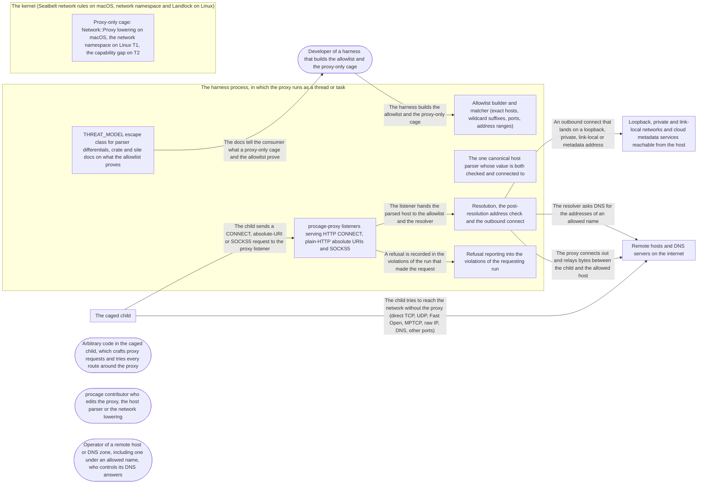

# Threat Model: Egress proxy with a domain allowlist

**Feature**: `016-proxy` · **Generated**: 2026-11-01T21:13:14Z · **Profiles**: stride, llm, agent · **Canonical**: `threat-model.yaml`

> Rendered by ThreatSpec. Edit `threat-model.yaml`, not this file.

## Summary

| Threats | Critical | High | Medium | Low | Needs clarification | Not applicable | Mitigations | Requirements | Decisions |
|---|---|---|---|---|---|---|---|---|---|
| 13 | 0 | 5 | 7 | 1 | 1 | 24 | 11 | 13 | 0 |

### Needs clarification

- `threat.run-identity-unspecified` — [NEEDS CLARIFICATION: how does the proxy tell which run a connection came from (a listener per run, a token, the peer process), and can a child of one run connect to another run's listener?] (spec.md#Key-Entities)

## Actors

| ID | Name | Trust | Description |
|---|---|---|---|
| `actor.caged-code` | Arbitrary code in the caged child, which crafts proxy requests and tries every route around the proxy | untrusted |  |
| `actor.consumer` | Developer of a harness that builds the allowlist and the proxy-only cage | trusted |  |
| `actor.contributor` | procage contributor who edits the proxy, the host parser or the network lowering | semi-trusted |  |
| `actor.remote` | Operator of a remote host or DNS zone, including one under an allowed name, who controls its DNS answers | untrusted |  |

## Trust Zones

| ID | Name | Trust rating | Description |
|---|---|---|---|
| `tz.cage` | The caged child | 5 |  |
| `tz.harness` | The harness process, in which the proxy runs as a thread or task | 90 |  |
| `tz.internet` | Remote hosts and DNS servers on the internet | 10 |  |
| `tz.kernel` | The kernel (Seatbelt network rules on macOS, network namespace and Landlock on Linux) | 95 |  |
| `tz.local-network` | Loopback, private and link-local networks and cloud metadata services reachable from the host | 40 |  |

## Assets

| ID | Name | Type | Classification | C / I / A | Source |
|---|---|---|---|---|---|
| `asset.allowlist` | The allowlist: exact hosts, wildcard suffixes, optional ports and address ranges, and the decision it yields | capability | internal | 10 / 95 / 50 | spec.md#Key-Entities |
| `asset.harness` | The harness process: threads, descriptors and memory the in-process proxy uses | capability | internal | 0 / 50 / 70 | spec.md#Clarifications |
| `asset.host-data` | The user's files, secrets and workspace content the child can read and could send out | credential | secret | 100 / 30 / 10 | spec.md#Input |
| `asset.local-services` | Services on loopback, private and link-local addresses and the cloud metadata endpoint (credentials, admin APIs) | capability | secret | 90 / 80 / 40 | spec.md#FR-004 |
| `asset.payload` | The bytes relayed between the child and an allowed host, usually TLS | capability | confidential | 70 / 80 / 30 | spec.md#FR-007 |
| `asset.record` | The violations of the run, including refused host names, which the harness shows its user and may act on | capability | internal | 30 / 80 / 30 | spec.md#FR-005 |

## Components

| ID | Name | Type | Trust zone | Source |
|---|---|---|---|---|
| `component.allowlist` | Allowlist builder and matcher (exact hosts, wildcard suffixes, ports, address ranges) | library | `tz.harness` | spec.md#FR-003 |
| `component.cage-net` | Proxy-only cage: Network::Proxy lowering on macOS, the network namespace on Linux T1, the capability gap on T2 | library | `tz.kernel` | spec.md#FR-006 |
| `component.docs` | THREAT_MODEL escape class for parser differentials, crate and site docs on what the allowlist proves | document | `tz.harness` | spec.md#FR-008 |
| `component.listener` | procage-proxy listeners serving HTTP CONNECT, plain-HTTP absolute URIs and SOCKS5 | service | `tz.harness` | spec.md#FR-001 |
| `component.parser` | The one canonical host parser whose value is both checked and connected to | library | `tz.harness` | spec.md#FR-002 |
| `component.reporting` | Refusal reporting into the violations of the requesting run | library | `tz.harness` | spec.md#FR-005 |
| `component.resolver` | Resolution, the post-resolution address check and the outbound connect | library | `tz.harness` | spec.md#FR-004 |

## Data Flows

| ID | Name | From | To | Assets | Crosses |
|---|---|---|---|---|---|
| `flow.check` | The listener hands the parsed host to the allowlist and the resolver | `component.listener` | `component.resolver` | `asset.allowlist` |  |
| `flow.claims` | The docs tell the consumer what a proxy-only cage and the allowlist prove | `component.docs` | `actor.consumer` | `asset.host-data` |  |
| `flow.config` | The harness builds the allowlist and the proxy-only cage | `actor.consumer` | `component.allowlist` | `asset.allowlist` |  |
| `flow.direct` | The child tries to reach the network without the proxy (direct TCP, UDP, Fast Open, MPTCP, raw IP, DNS, other ports) | `tz.cage` | `tz.internet` | `asset.host-data`, `asset.local-services` | `tz.cage`, `tz.kernel`, `tz.internet` |
| `flow.local` | An outbound connect that lands on a loopback, private, link-local or metadata address | `component.resolver` | `tz.local-network` | `asset.local-services` | `tz.harness`, `tz.local-network` |
| `flow.refusal` | A refusal is recorded in the violations of the run that made the request | `component.listener` | `component.reporting` | `asset.record` |  |
| `flow.request` | The child sends a CONNECT, absolute-URI or SOCKS5 request to the proxy listener | `tz.cage` | `component.listener` | `asset.allowlist`, `asset.host-data` | `tz.cage`, `tz.harness` |
| `flow.resolve` | The resolver asks DNS for the addresses of an allowed name | `component.resolver` | `tz.internet` | `asset.host-data`, `asset.local-services` | `tz.harness`, `tz.internet` |
| `flow.upstream` | The proxy connects out and relays bytes between the child and the allowed host | `component.resolver` | `tz.internet` | `asset.payload`, `asset.host-data` | `tz.harness`, `tz.internet` |

## Threats

| ID | Threat | Category | Technique | Severity | Status | Mitigations | Mappings | Source |
|---|---|---|---|---|---|---|---|---|
| `threat.allowlist-fail-open` | An empty allowlist, a bare wildcard or a single-label wildcard suffix (*.com) builds a proxy that allows everything | Elevation of Privilege | privilege-escalation-via-config | **high** | open | `mitigation.no-allow-all` |  | spec.md#US3 |
| `threat.direct-egress` | Caged code bypasses the proxy (ignoring the proxy variables, UDP, TCP Fast Open, MPTCP, raw IP, IPv6, the system DNS resolver, other loopback ports) because the cage relies on Landlock port rules or misses a route | Elevation of Privilege, Information Disclosure | broken-access-control | **high** | open | `mitigation.kernel-boundary` |  | spec.md#FR-006 |
| `threat.dns-rebinding` | An allowed name resolves to a loopback, private, link-local or metadata address, directly, through an IPv4-mapped or translated IPv6 form, or on a second lookup after the check, and the proxy connects there | Elevation of Privilege, Information Disclosure | sensitive-data-exposure | **high** | open | `mitigation.check-resolved-connect-checked` |  | spec.md#FR-004 |
| `threat.ip-literal-bypass` | Caged code names an IP literal in some notation (decimal, octal, hex, short IPv4, IPv6, IPv4-mapped, zone id) that a domain allowlist does not recognise as an address, or that matches an allowed range only after a different parse | Elevation of Privilege | broken-access-control | **high** | open | `mitigation.literal-as-address` |  | spec.md#Clarifications |
| `threat.parser-differential` | Caged code spells a host so that the allow check and the connect read it differently (NUL byte in SOCKS5, percent-encoding, userinfo, Unicode or punycode, trailing dot, a plain-HTTP Host header unlike the URI) and reaches a host not on the list | Elevation of Privilege, Tampering | injection | **high** | open | `mitigation.honest-claims`, `mitigation.one-canonical-host` |  | spec.md#US2 |
| `threat.allowlist-overclaim` | The docs present the allowlist as preventing exfiltration, although an allowed host on shared infrastructure (a CDN, a registry with user content) still carries data out | Information Disclosure, Repudiation | sensitive-data-exposure | **medium** | open | `mitigation.honest-claims` |  | spec.md#Out-of-Scope |
| `threat.dns-exfil` | The proxy resolves a requested name before checking it, so a refused request still carries data out in the DNS query (secret.attacker.example) | Information Disclosure | sensitive-data-exposure | **medium** | open | `mitigation.check-resolved-connect-checked` |  | spec.md#Edge-Cases |
| `threat.payload-tampering` | The proxy terminates TLS, alters payloads or forwards changed request bytes after the check | Tampering, Information Disclosure | data-tampering-in-transit | **medium** | open | `mitigation.opaque-relay` |  | spec.md#FR-007 |
| `threat.proxy-down-fallback` | With the proxy stopped, crashed or never started, a connection or a spawn falls back to a direct route instead of failing | Elevation of Privilege | broken-access-control | **medium** | open | `mitigation.kernel-boundary` |  | spec.md#US3 |
| `threat.proxy-exhaustion` | Caged code opens many or slow connections, or keeps them open past the run, and exhausts the harness's threads, descriptors or memory | Denial of Service | resource-exhaustion | **medium** | open | `mitigation.bounded-proxy` |  | spec.md#Edge-Cases |
| `threat.run-confusion` | A child reaches the listener of another run or proxy with a broader allowlist, or a refusal is recorded in the wrong run | Elevation of Privilege, Repudiation | cross-tenant-leak | **medium** | open | `mitigation.run-bound-listener` |  | spec.md#Key-Entities |
| `threat.t2-silent-downgrade` | On Linux T2 a proxy-only cage is lowered to Landlock port rules or to no network rule instead of a capability gap | Elevation of Privilege | privilege-escalation-via-config | **medium** | open | `mitigation.t2-gap` |  | spec.md#FR-006 |
| `threat.record-spoof` | A refused host name with control characters or terminal escapes, or a flood of refusals, misleads the harness user or exhausts the record | Repudiation | missing-audit-trail | **low** | open | `mitigation.escaped-capped-record` |  | spec.md#FR-005 |

### Techniques evaluated without findings

| Technique | Disposition | Reason |
|---|---|---|
| credential-theft | not-applicable | no authentication surface; the proxy authenticates no client, injects no credentials and never terminates TLS |
| identity-spoofing | no-threat-detected | checked flow.request: the only identity that matters is which run a connection belongs to, covered by threat.run-confusion and its open question |
| data-tampering-at-rest | not-applicable | no store; the allowlist lives in memory and the proxy persists nothing |
| prompt-injection-direct | not-applicable | procage-proxy is a library that calls no model and runs no agent; LLM-written code is the adversary inside the child, modelled under STRIDE |
| prompt-injection-indirect | not-applicable | procage-proxy is a library that calls no model and runs no agent; LLM-written code is the adversary inside the child, modelled under STRIDE |
| sensitive-information-disclosure | not-applicable | procage-proxy is a library that calls no model and runs no agent; LLM-written code is the adversary inside the child, modelled under STRIDE |
| excessive-agency | not-applicable | procage-proxy is a library that calls no model and runs no agent; LLM-written code is the adversary inside the child, modelled under STRIDE |
| model-supply-chain | not-applicable | procage-proxy is a library that calls no model and runs no agent; LLM-written code is the adversary inside the child, modelled under STRIDE |
| training-data-poisoning | not-applicable | procage-proxy is a library that calls no model and runs no agent; LLM-written code is the adversary inside the child, modelled under STRIDE |
| unbounded-consumption | not-applicable | procage-proxy is a library that calls no model and runs no agent; LLM-written code is the adversary inside the child, modelled under STRIDE |
| misinformation | not-applicable | procage-proxy is a library that calls no model and runs no agent; LLM-written code is the adversary inside the child, modelled under STRIDE |
| hidden-context-exposure | not-applicable | procage-proxy is a library that calls no model and runs no agent; LLM-written code is the adversary inside the child, modelled under STRIDE |
| vector-embedding-weakness | not-applicable | procage-proxy is a library that calls no model and runs no agent; LLM-written code is the adversary inside the child, modelled under STRIDE |
| improper-output-handling | not-applicable | procage-proxy is a library that calls no model and runs no agent; LLM-written code is the adversary inside the child, modelled under STRIDE |
| model-extraction | not-applicable | procage-proxy is a library that calls no model and runs no agent; LLM-written code is the adversary inside the child, modelled under STRIDE |
| goal-hijack | not-applicable | procage-proxy is a library that calls no model and runs no agent; LLM-written code is the adversary inside the child, modelled under STRIDE |
| tool-misuse | not-applicable | procage-proxy is a library that calls no model and runs no agent; LLM-written code is the adversary inside the child, modelled under STRIDE |
| identity-privilege-abuse | not-applicable | procage-proxy is a library that calls no model and runs no agent; LLM-written code is the adversary inside the child, modelled under STRIDE |
| agentic-supply-chain | not-applicable | procage-proxy is a library that calls no model and runs no agent; LLM-written code is the adversary inside the child, modelled under STRIDE |
| unexpected-code-execution | not-applicable | procage-proxy is a library that calls no model and runs no agent; LLM-written code is the adversary inside the child, modelled under STRIDE |
| memory-context-poisoning | not-applicable | procage-proxy is a library that calls no model and runs no agent; LLM-written code is the adversary inside the child, modelled under STRIDE |
| insecure-inter-agent-communication | not-applicable | procage-proxy is a library that calls no model and runs no agent; LLM-written code is the adversary inside the child, modelled under STRIDE |
| cascading-failure | not-applicable | procage-proxy is a library that calls no model and runs no agent; LLM-written code is the adversary inside the child, modelled under STRIDE |
| human-agent-trust-exploitation | not-applicable | procage-proxy is a library that calls no model and runs no agent; LLM-written code is the adversary inside the child, modelled under STRIDE |
| rogue-agent | not-applicable | procage-proxy is a library that calls no model and runs no agent; LLM-written code is the adversary inside the child, modelled under STRIDE |

## Mitigations

| ID | Mitigation | Kind | Threats | Requirements | Touchpoints | Status |
|---|---|---|---|---|---|---|
| `mitigation.bounded-proxy` | Per-run connection cap, handshake timeout, and every connection of a run closed when the run ends | preventive | `threat.proxy-exhaustion` | SR-011 | `component.listener` | required |
| `mitigation.check-resolved-connect-checked` | Resolve once after the name check; refuse any non-public address (including mapped and translated IPv6 forms) unless allowlisted; connect only to a checked address, never re-resolving | preventive | `threat.dns-rebinding`, `threat.dns-exfil` | SR-003, SR-004 | `component.resolver` | required |
| `mitigation.escaped-capped-record` | Refused hosts are recorded escaped (no control bytes) and within the run's violation cap, the rest counted | detective | `threat.record-spoof` | SR-012 | `component.reporting` | required |
| `mitigation.honest-claims` | THREAT_MODEL gains the parser-differential escape class with the suite as evidence; docs say the allowlist binds host names, not content, and name shared-hosting and fronting residue | detective | `threat.allowlist-overclaim`, `threat.parser-differential` | SR-013 | `component.docs` | required |
| `mitigation.kernel-boundary` | macOS allows outbound to the proxy ports only; Linux T1 runs the child in a network namespace whose only endpoint is the proxy listener; Landlock is never the sole boundary; direct-egress canaries on every proxy tier | preventive | `threat.direct-egress`, `threat.proxy-down-fallback` | SR-006, SR-007 | `component.cage-net`, `flow.direct` | required |
| `mitigation.literal-as-address` | Every IP literal notation parses to one address; literals are refused unless an allowlisted range contains that address | preventive | `threat.ip-literal-bypass` | SR-002 | `component.parser`, `component.allowlist` | required |
| `mitigation.no-allow-all` | Construction fails on an empty allowlist, a bare wildcard or a single-label wildcard suffix; no allow-all mode exists | preventive | `threat.allowlist-fail-open` | SR-005 | `component.allowlist` | required |
| `mitigation.one-canonical-host` | One parser yields a canonical host (lower case, trailing dot stripped, IDNA to A-labels) and refuses NUL and control bytes, percent-encoding, userinfo and invalid labels; the same value is checked and connected; a plain-HTTP Host header must equal the URI host; table-driven suite plus fuzz target | preventive | `threat.parser-differential` | SR-001 | `component.parser`, `component.listener` | required |
| `mitigation.opaque-relay` | After CONNECT or the SOCKS5 reply the proxy relays bytes unchanged in both directions; no TLS code in the crate | preventive | `threat.payload-tampering` | SR-010 | `component.listener` | required |
| `mitigation.run-bound-listener` | Each connection belongs to exactly one run, whose allowlist decides it and whose violations record its refusals; a child cannot reach another run's listener | preventive | `threat.run-confusion` | SR-009 | `component.listener`, `component.cage-net`, `component.reporting` | required |
| `mitigation.t2-gap` | Proxy-only on T2 is a CapabilityGap at build time | preventive | `threat.t2-silent-downgrade` | SR-008 | `component.cage-net` | required |

## Security Requirements

### SR-001 (P1) — unverified

The proxy MUST derive one canonical host per request and use that same value for the allowlist check and the connect; it MUST refuse hosts with NUL or control bytes, percent-encoding, userinfo or invalid labels, and a plain-HTTP request whose Host header differs from its URI host.

- **Given** allowed.com on the list and the SOCKS5 host allowed.com\0.evil.com, **when** the child requests it, **then** the proxy refuses it and opens no connection
- **Given** allowed.com on the list, **when** the child requests ALLOWED.COM. through CONNECT, **then** it is treated as allowed.com and connects there
- **Given** the table-driven spelling suite and the fuzz target, **when** they run in CI, **then** for every input the checked host equals the host connected to, with zero disagreements
- Mitigations: `mitigation.one-canonical-host`
- Tasks: — none —

### SR-002 (P1) — unverified

The proxy MUST parse every IP literal notation to one address and MUST refuse a literal unless an explicitly allowlisted address range contains that address.

- **Given** a domain-only allowlist, **when** the child requests 2130706433, 0x7f.1, 017700000001, [::ffff:127.0.0.1] and 127.1, **then** every request is refused
- **Given** an allowlisted range 192.0.2.0/24, **when** the child requests 192.0.2.10 in decimal and dotted form, **then** both connect to 192.0.2.10
- Mitigations: `mitigation.literal-as-address`
- Tasks: — none —

### SR-003 (P1) — unverified

The proxy MUST resolve an allowed name once, MUST refuse loopback, private, link-local, unspecified and metadata addresses (also in IPv4-mapped and translated IPv6 forms) unless allowlisted, and MUST connect only to an address it checked.

- **Given** an allowed name resolving to 127.0.0.1, 169.254.169.254 or ::ffff:10.0.0.1, **when** the child requests it, **then** the proxy refuses it and the violation names the host and the address
- **Given** a test resolver answering a public address first and 127.0.0.1 on any later query, **when** the child requests the name, **then** the proxy connects to the first, checked address and issues no second query
- Mitigations: `mitigation.check-resolved-connect-checked`
- Tasks: — none —

### SR-004 (P2) — unverified

The proxy MUST NOT send a DNS query for a name the allowlist refuses.

- **Given** a counting test resolver, **when** the child requests a host not on the list, **then** the request is refused and the resolver saw no query
- Mitigations: `mitigation.check-resolved-connect-checked`
- Tasks: — none —

### SR-005 (P1) — unverified

Building a proxy MUST fail on an empty allowlist, a bare wildcard or a wildcard whose suffix is a single label; there MUST be no allow-all mode.

- **Given** an empty allowlist, '*' or '*.com', **when** the proxy is built, **then** construction returns a typed error
- Mitigations: `mitigation.no-allow-all`
- Tasks: — none —

### SR-006 (P1) — unverified

When the proxy is stopped or was never started, a connection from a proxy-only child MUST fail; no code path MAY fall back to a direct connection.

- **Given** a proxy-only cage on macOS and Linux T1 whose proxy has been stopped, **when** the child connects to the proxy and to an allowed host directly, **then** both fail
- Mitigations: `mitigation.kernel-boundary`
- Tasks: — none —

### SR-007 (P1) — unverified

A proxy-only cage MUST block every direct route on macOS and Linux T1 by a kernel boundary (macOS outbound to the proxy ports only; on T1 a network namespace whose only endpoint is the proxy listener); Landlock port rules MUST NOT be the only boundary.

- **Given** a proxy-only cage on macOS and on Linux T1, **when** the child tries direct TCP, UDP, TCP Fast Open, MPTCP, raw IP, IPv6, a DNS query and another loopback port, **then** every attempt fails, one escape-suite canary per route
- Mitigations: `mitigation.kernel-boundary`
- Tasks: — none —

### SR-008 (P1) — unverified

On Linux T2 building a proxy-only cage MUST return a CapabilityGap; it MUST NOT be lowered to Landlock port rules alone.

- **Given** Linux T2, **when** a proxy-only cage is built, **then** it fails with CapabilityGap naming proxy-only networking
- Mitigations: `mitigation.t2-gap`
- Tasks: — none —

### SR-009 (P2) — unverified

Every proxy connection MUST be decided by the allowlist of exactly one run and its refusals recorded in that run's violations; a child MUST NOT reach the listener of another run.

- **Given** two concurrent runs with different allowlists, **when** the child of run A requests a host only run B allows, also by connecting to run B's listener, **then** the request fails and only run A's violations record it
- Mitigations: `mitigation.run-bound-listener`
- Tasks: — none —

### SR-010 (P2) — unverified

The proxy MUST NOT terminate TLS or alter payloads; after the CONNECT or SOCKS5 reply it MUST relay bytes unchanged.

- **Given** an allowed local test host that echoes and hashes what it receives, **when** the child sends random bytes through CONNECT and SOCKS5, **then** the hashes on both ends match
- Mitigations: `mitigation.opaque-relay`
- Tasks: — none —

### SR-011 (P2) — unverified

The proxy MUST bound each run's concurrent connections and handshake time, and MUST close every connection of a run when the run ends.

- **Given** a child opening connections beyond the cap and one that never finishes its handshake, **when** the run continues, **then** excess connections are refused, the stalled one is closed after the timeout, and other runs keep working
- **Given** an open long-lived connection, **when** the run ends, **then** the connection is closed
- Mitigations: `mitigation.bounded-proxy`
- Tasks: — none —

### SR-012 (P2) — unverified

A refusal MUST record the host escaped, without raw control bytes, and within the run's violation cap with the rest counted.

- **Given** a refused host containing an escape sequence and a newline, **when** the violation is read, **then** the host is shown escaped
- **Given** a child making more refused requests than the cap, **when** the record is read, **then** it holds the cap and counts the rest
- Mitigations: `mitigation.escaped-capped-record`
- Tasks: — none —

### SR-013 (P2) — unverified

THREAT_MODEL MUST list the allowlist parser-differential escape class with the parser suite as evidence and direct-egress canaries per proxy tier, and the docs MUST state that the allowlist binds host names, not content.

- **Given** THREAT_MODEL.md and the proxy docs, **when** they are reviewed, **then** the class has evidence entries for the suite and canaries, and the docs name shared hosting and fronting as residual risk
- Mitigations: `mitigation.honest-claims`
- Tasks: — none —
