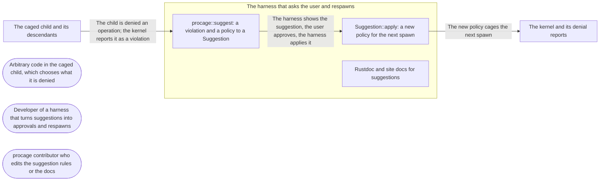

# Threat Model: Grant on denial

**Feature**: `017-grant-on-denial` · **Generated**: 2026-11-03T15:26:25Z · **Profiles**: stride, llm, agent · **Canonical**: `threat-model.yaml`

> Rendered by ThreatSpec. Edit `threat-model.yaml`, not this file.

## Summary

| Threats | Critical | High | Medium | Low | Needs clarification | Not applicable | Mitigations | Requirements | Decisions |
|---|---|---|---|---|---|---|---|---|---|
| 6 | 0 | 4 | 1 | 1 | 0 | 27 | 5 | 5 | 0 |

## Actors

| ID | Name | Trust | Description |
|---|---|---|---|
| `actor.caged-code` | Arbitrary code in the caged child, which chooses what it is denied | untrusted |  |
| `actor.consumer` | Developer of a harness that turns suggestions into approvals and respawns | trusted |  |
| `actor.contributor` | procage contributor who edits the suggestion rules or the docs | semi-trusted |  |

## Trust Zones

| ID | Name | Trust rating | Description |
|---|---|---|---|
| `tz.cage` | The caged child and its descendants | 5 |  |
| `tz.harness` | The harness that asks the user and respawns | 90 |  |
| `tz.os` | The kernel and its denial reports | 95 |  |

## Assets

| ID | Name | Type | Classification | C / I / A | Source |
|---|---|---|---|---|---|
| `asset.host` | The user's files, secrets and processes outside the policy | credential | secret | 100 / 90 / 50 | spec.md#Context |
| `asset.policy-change` | A suggested policy change and the policy it produces | configuration | internal | 0 / 95 / 20 | spec.md#Key-Entities |
| `asset.record` | The receipt and diff that show what an approval changed | log | internal | 0 / 70 / 10 | spec.md#FR-004 |

## Components

| ID | Name | Type | Trust zone | Source |
|---|---|---|---|---|
| `component.apply` | Suggestion::apply: a new policy for the next spawn | library | `tz.harness` | spec.md#FR-003 |
| `component.docs` | Rustdoc and site docs for suggestions | document | `tz.harness` | spec.md#Edge-Cases |
| `component.suggest` | procage::suggest: a violation and a policy to a Suggestion | library | `tz.harness` | spec.md#FR-001 |

## Data Flows

| ID | Name | From | To | Assets | Crosses |
|---|---|---|---|---|---|
| `flow.approval` | The harness shows the suggestion, the user approves, the harness applies it | `component.suggest` | `component.apply` | `asset.policy-change` |  |
| `flow.denial` | The child is denied an operation; the kernel reports it as a violation | `tz.cage` | `component.suggest` | `asset.policy-change` | `tz.cage`, `tz.harness` |
| `flow.respawn` | The new policy cages the next spawn | `component.apply` | `tz.os` | `asset.host`, `asset.record` | `tz.harness`, `tz.os` |

## Threats

| ID | Threat | Category | Technique | Severity | Status | Mitigations | Mappings | Source |
|---|---|---|---|---|---|---|---|---|
| `threat.overbroad` | A suggestion grants more than the denied operation: a subpath, a parent directory, a glob or a wider access than the one denied, so an approval exposes files the child never touched | Elevation of Privilege | broken-access-control | **high** | mitigated | `mitigation.exact-literal` |  | spec.md#FR-002 |
| `threat.provoked-prompt` | The caged code provokes denials chosen to make the harness ask for a dangerous grant (a shell start-up file, a trust-handoff path), counting on the user to approve | Tampering | injection | **high** | mitigated | `mitigation.mark-weakening` |  | spec.md#Context |
| `threat.secret-suggested` | A denial of the secrets class, or of a path under a hidden one, yields a suggestion, so one approval exposes credentials | Information Disclosure | sensitive-data-exposure | **high** | mitigated | `mitigation.never-secrets` |  | spec.md#US1 |
| `threat.unmarked-weakening` | A waiver, the removal of a protect or hide rule, or wider signals is suggested without being marked, so the harness shows it like an ordinary grant | Elevation of Privilege | privilege-escalation-via-config | **high** | mitigated | `mitigation.mark-weakening` |  | spec.md#FR-002 |
| `threat.midrun-widening` | Applying a suggestion widens the running child's sandbox, against the spec and the kernels' limits | Elevation of Privilege | broken-access-control | **medium** | mitigated | `mitigation.respawn-only` |  | spec.md#FR-003 |
| `threat.unrecorded` | An applied suggestion changes more than it says, or does not show in the receipt and diff, so an approval cannot be audited | Repudiation | missing-audit-trail | **low** | mitigated | `mitigation.exact-apply` |  | spec.md#FR-004 |

### Techniques evaluated without findings

| Technique | Disposition | Reason |
|---|---|---|
| credential-theft | not-applicable | no authentication surface |
| identity-spoofing | not-applicable | no authentication or network boundary |
| data-tampering-in-transit | not-applicable | no network transit; suggestions are values in the caller |
| data-tampering-at-rest | not-applicable | no store; procage never persists approvals (spec Clarifications) |
| cross-tenant-leak | not-applicable | single user; a suggestion only changes the policy the caller passes in |
| resource-exhaustion | no-threat-detected | checked suggest and apply: each is one pass over one violation and the policy rules, with no loop the child controls and no allocation beyond one policy clone |
| prompt-injection-direct | not-applicable | procage is a library that calls no model and runs no agent; LLM-written code is the adversary inside the child, modelled under STRIDE |
| prompt-injection-indirect | not-applicable | procage is a library that calls no model and runs no agent; LLM-written code is the adversary inside the child, modelled under STRIDE |
| sensitive-information-disclosure | not-applicable | procage is a library that calls no model and runs no agent; LLM-written code is the adversary inside the child, modelled under STRIDE |
| excessive-agency | not-applicable | procage is a library that calls no model and runs no agent; LLM-written code is the adversary inside the child, modelled under STRIDE |
| model-supply-chain | not-applicable | procage is a library that calls no model and runs no agent; LLM-written code is the adversary inside the child, modelled under STRIDE |
| training-data-poisoning | not-applicable | procage is a library that calls no model and runs no agent; LLM-written code is the adversary inside the child, modelled under STRIDE |
| unbounded-consumption | not-applicable | procage is a library that calls no model and runs no agent; LLM-written code is the adversary inside the child, modelled under STRIDE |
| misinformation | not-applicable | procage is a library that calls no model and runs no agent; LLM-written code is the adversary inside the child, modelled under STRIDE |
| hidden-context-exposure | not-applicable | procage is a library that calls no model and runs no agent; LLM-written code is the adversary inside the child, modelled under STRIDE |
| vector-embedding-weakness | not-applicable | procage is a library that calls no model and runs no agent; LLM-written code is the adversary inside the child, modelled under STRIDE |
| improper-output-handling | not-applicable | procage is a library that calls no model and runs no agent; LLM-written code is the adversary inside the child, modelled under STRIDE |
| model-extraction | not-applicable | procage is a library that calls no model and runs no agent; LLM-written code is the adversary inside the child, modelled under STRIDE |
| goal-hijack | not-applicable | procage is a library that calls no model and runs no agent; LLM-written code is the adversary inside the child, modelled under STRIDE |
| tool-misuse | not-applicable | procage is a library that calls no model and runs no agent; LLM-written code is the adversary inside the child, modelled under STRIDE |
| identity-privilege-abuse | not-applicable | procage is a library that calls no model and runs no agent; LLM-written code is the adversary inside the child, modelled under STRIDE |
| agentic-supply-chain | not-applicable | procage is a library that calls no model and runs no agent; LLM-written code is the adversary inside the child, modelled under STRIDE |
| unexpected-code-execution | not-applicable | procage is a library that calls no model and runs no agent; LLM-written code is the adversary inside the child, modelled under STRIDE |
| memory-context-poisoning | not-applicable | procage is a library that calls no model and runs no agent; LLM-written code is the adversary inside the child, modelled under STRIDE |
| insecure-inter-agent-communication | not-applicable | procage is a library that calls no model and runs no agent; LLM-written code is the adversary inside the child, modelled under STRIDE |
| cascading-failure | not-applicable | procage is a library that calls no model and runs no agent; LLM-written code is the adversary inside the child, modelled under STRIDE |
| human-agent-trust-exploitation | not-applicable | procage is a library that calls no model and runs no agent; LLM-written code is the adversary inside the child, modelled under STRIDE |
| rogue-agent | not-applicable | procage is a library that calls no model and runs no agent; LLM-written code is the adversary inside the child, modelled under STRIDE |

## Mitigations

| ID | Mitigation | Kind | Threats | Requirements | Touchpoints | Status |
|---|---|---|---|---|---|---|
| `mitigation.exact-apply` | apply changes exactly the suggested rule or setting; the diff of old and new shows only it and the receipt lists it | detective | `threat.unrecorded` | SR-005 | `crates/procage-policy/src/suggest.rs`, `crates/procage/tests/suggest_macos.rs` | verified |
| `mitigation.exact-literal` | A file suggestion is a literal rule on the denied path with exactly the denied access kind; never a subpath, parent or glob | preventive | `threat.overbroad` | SR-001 | `crates/procage/src/suggest.rs`, `crates/procage/tests/suggest_macos.rs` | verified |
| `mitigation.mark-weakening` | Every waiver, protect or hide removal and signal widening carries the weakening mark; plain grants do not | preventive | `threat.unmarked-weakening`, `threat.provoked-prompt` | SR-003 | `crates/procage/src/suggest.rs`, `crates/procage-policy/src/suggest.rs`, `site/content/docs/violations.md` | verified |
| `mitigation.never-secrets` | No suggestion for the secrets class, the raw layer, the lifetime guard, the older-kernel guard or the proxy | preventive | `threat.secret-suggested` | SR-002 | `crates/procage/src/suggest.rs`, `crates/procage/tests/suggest_macos.rs`, `crates/procage/tests/spawn_linux.rs` | verified |
| `mitigation.respawn-only` | apply returns a new policy; nothing changes a running child | preventive | `threat.midrun-widening` | SR-004 | `crates/procage-policy/src/suggest.rs` | verified |

## Security Requirements

### SR-001 (P1) — verified

A suggestion for a denied file operation MUST be a literal rule on the denied path with the access kind of that operation (read, write or exec), or a Unix socket path for a denied connect; it MUST NOT be a subpath, parent or glob.

- **Given** a caged child denied writing a file outside the policy, **when** the harness asks for the suggestion, **then** it is a literal write rule on that file
- **Given** the suggestion applied and the run respawned, **when** the child writes the file and a sibling file, **then** the file write succeeds and the sibling write is still denied
- Mitigations: `mitigation.exact-literal`
- Tasks: T002 ✓, T003 ✓
- Verification `verification.sr-001.2026-11-03`: test → pass (verified) — `crates/procage/tests/suggest_macos.rs::a_denied_file_operation_suggests_exactly_that_path`

### SR-002 (P1) — verified

A denial by the secrets class, the raw layer, Lifetime::Run, the older-kernel guard or the proxy MUST yield no suggestion.

- **Given** a caged child denied reading a file of the secrets class, **when** the harness asks for the suggestion, **then** there is none
- Mitigations: `mitigation.never-secrets`
- Tasks: T002 ✓, T003 ✓, T004 ✓
- Verification `verification.sr-002.2026-11-03`: test → pass (verified) — `crates/procage/tests/suggest_macos.rs::a_secret_suggests_nothing`

### SR-003 (P1) — verified

A suggestion that waives a hard-deny class, leaves out a protect or hide rule, or widens signals MUST be marked as weakening; grants MUST NOT be.

- **Given** a caged child denied writing under a protected path, **when** the harness asks for the suggestion, **then** it leaves out that protect rule and is marked as weakening
- **Given** a denial by a hard-deny class other than secrets, **when** the harness asks for the suggestion, **then** it waives that class by name and is marked as weakening
- Mitigations: `mitigation.mark-weakening`
- Tasks: T002 ✓, T003 ✓, T004 ✓
- Verification `verification.sr-003.2026-11-03`: test → pass (verified) — `crates/procage/tests/suggest_macos.rs::a_protection_suggests_its_removal_marked_as_weakening`

### SR-004 (P1) — verified

Applying a suggestion MUST return a new policy and MUST NOT change the running child's sandbox.

- **Given** a running child and an applied suggestion, **when** the child retries the operation, **then** it is still denied until a new spawn
- Mitigations: `mitigation.respawn-only`
- Tasks: T001 ✓, T003 ✓
- Verification `verification.sr-004.2026-11-03`: test → pass (verified) — `crates/procage/tests/suggest_macos.rs::a_denied_file_operation_suggests_exactly_that_path`

### SR-005 (P2) — verified

The policy a suggestion produces MUST differ from the old one only by the suggested change: explain::diff shows that change alone, and the new run's receipt records an added waiver.

- **Given** an applied grant, **when** the harness diffs the old and new policy, **then** only the granted path and access differ
- **Given** an applied waiver, **when** the respawned run ends, **then** its receipt lists the waiver
- Mitigations: `mitigation.exact-apply`
- Tasks: T001 ✓, T003 ✓
- Verification `verification.sr-005.2026-11-03`: test → pass (verified) — `crates/procage/tests/suggest_macos.rs::a_protection_suggests_its_removal_marked_as_weakening`
