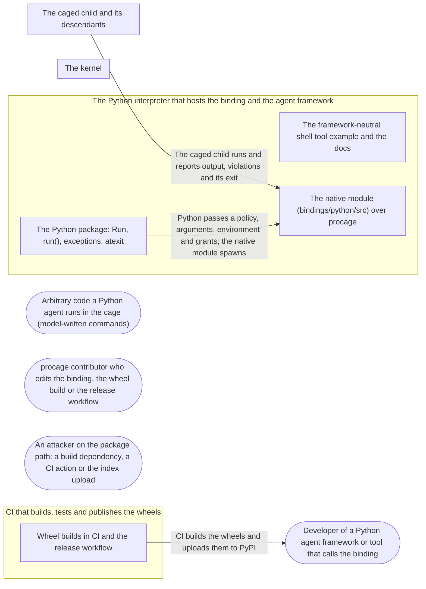

# Threat Model: Python bindings

**Feature**: `020-python` · **Generated**: 2026-11-03T19:00:34Z · **Profiles**: stride, llm, agent · **Canonical**: `threat-model.yaml`

> Rendered by ThreatSpec. Edit `threat-model.yaml`, not this file.

## Summary

| Threats | Critical | High | Medium | Low | Needs clarification | Not applicable | Mitigations | Requirements | Decisions |
|---|---|---|---|---|---|---|---|---|---|
| 7 | 0 | 2 | 4 | 1 | 0 | 27 | 7 | 7 | 0 |

## Actors

| ID | Name | Trust | Description |
|---|---|---|---|
| `actor.caged-code` | Arbitrary code a Python agent runs in the cage (model-written commands) | untrusted |  |
| `actor.consumer` | Developer of a Python agent framework or tool that calls the binding | trusted |  |
| `actor.contributor` | procage contributor who edits the binding, the wheel build or the release workflow | semi-trusted |  |
| `actor.supply-chain` | An attacker on the package path: a build dependency, a CI action or the index upload | untrusted |  |

## Trust Zones

| ID | Name | Trust rating | Description |
|---|---|---|---|
| `tz.build` | CI that builds, tests and publishes the wheels | 70 |  |
| `tz.cage` | The caged child and its descendants | 5 |  |
| `tz.os` | The kernel | 95 |  |
| `tz.python` | The Python interpreter that hosts the binding and the agent framework | 85 |  |

## Assets

| ID | Name | Type | Classification | C / I / A | Source |
|---|---|---|---|---|---|
| `asset.host` | The user's files, secrets, environment and processes outside the policy | credential | secret | 100 / 90 / 50 | spec.md#Context |
| `asset.policy` | The policy a Python caller passes, and its enforcement | configuration | internal | 0 / 95 / 20 | spec.md#FR-001 |
| `asset.wheel` | The published wheels on PyPI | source-code | public | 0 / 100 / 40 | spec.md#FR-004 |

## Components

| ID | Name | Type | Trust zone | Source |
|---|---|---|---|---|
| `component.example` | The framework-neutral shell tool example and the docs | document | `tz.python` | spec.md#US2 |
| `component.native` | The native module (bindings/python/src) over procage | library | `tz.python` | spec.md#FR-001 |
| `component.release` | Wheel builds in CI and the release workflow | pipeline | `tz.build` | spec.md#FR-004 |
| `component.wrapper` | The Python package: Run, run(), exceptions, atexit | library | `tz.python` | spec.md#FR-002 |

## Data Flows

| ID | Name | From | To | Assets | Crosses |
|---|---|---|---|---|---|
| `flow.child` | The caged child runs and reports output, violations and its exit | `tz.cage` | `component.native` | `asset.host` | `tz.cage`, `tz.python` |
| `flow.publish` | CI builds the wheels and uploads them to PyPI | `component.release` | `actor.consumer` | `asset.wheel` | `tz.build`, `tz.python` |
| `flow.spawn` | Python passes a policy, arguments, environment and grants; the native module spawns | `component.wrapper` | `component.native` | `asset.policy`, `asset.host` |  |

## Threats

| ID | Threat | Category | Technique | Severity | Status | Mitigations | Mappings | Source |
|---|---|---|---|---|---|---|---|---|
| `threat.env-leak` | The binding copies os.environ (or the caller's whole environment) into the command as explicit variables, which procage always keeps, so secrets in the environment reach the cage past the allowlist | Information Disclosure | sensitive-data-exposure | **high** | mitigated | `mitigation.explicit-env` |  | spec.md#FR-001 |
| `threat.silent-weakening` | The binding loosens what the caller asked: an unknown or misspelt field is dropped, a gap is ignored, or a default policy allows more than the Rust default | Elevation of Privilege | broken-access-control | **high** | mitigated | `mitigation.same-semantics` |  | spec.md#FR-002 |
| `threat.orphaned-run` | A run outlives its Python object or the interpreter (garbage collection deferred, interpreter exit skipping finalisers), so caged processes keep running unowned | Elevation of Privilege | broken-access-control | **medium** | mitigated | `mitigation.end-on-release` |  | spec.md#US1 |
| `threat.python-in-child` | Python code runs in the child between fork and exec (a preexec hook, at-fork handlers, a callback), deadlocking on the interpreter lock or running before the sandbox applies | Elevation of Privilege | privilege-escalation-via-config | **medium** | mitigated | `mitigation.rust-spawn` |  | spec.md#FR-003 |
| `threat.untested-wheel` | A wheel is published for a platform where the binding was never run against the kernel, or the docs claim more than the binding tests show | Repudiation | missing-audit-trail | **medium** | open | `mitigation.tested-wheels` |  | spec.md#SC-001 |
| `threat.wheel-tampering` | An attacker on the package path (a build dependency, a mutable CI action, a stored upload token) publishes a wheel that does not cage, under the procage name | Tampering | injection | **medium** | open | `mitigation.trusted-publishing` |  | spec.md#FR-004 |
| `threat.gil-starvation` | A blocking spawn, wait or read holds the interpreter lock, so a framework that runs tools on threads stalls while one command runs | Denial of Service | resource-exhaustion | **low** | mitigated | `mitigation.release-gil` |  | spec.md#FR-005 |

### Techniques evaluated without findings

| Technique | Disposition | Reason |
|---|---|---|
| credential-theft | not-applicable | no authentication surface in the binding; publishing credentials are modelled as threat.wheel-tampering |
| identity-spoofing | not-applicable | no authentication or network boundary |
| data-tampering-in-transit | not-applicable | no network transit at run time; the package download is modelled as threat.wheel-tampering |
| data-tampering-at-rest | not-applicable | no store |
| cross-tenant-leak | not-applicable | single user; one interpreter owns its runs |
| prompt-injection-direct | not-applicable | procage is a library that calls no model and runs no agent; LLM-written code is the adversary inside the child, modelled under STRIDE |
| prompt-injection-indirect | not-applicable | procage is a library that calls no model and runs no agent; LLM-written code is the adversary inside the child, modelled under STRIDE |
| sensitive-information-disclosure | not-applicable | procage is a library that calls no model and runs no agent; LLM-written code is the adversary inside the child, modelled under STRIDE |
| excessive-agency | not-applicable | procage is a library that calls no model and runs no agent; LLM-written code is the adversary inside the child, modelled under STRIDE |
| model-supply-chain | not-applicable | procage is a library that calls no model and runs no agent; LLM-written code is the adversary inside the child, modelled under STRIDE |
| training-data-poisoning | not-applicable | procage is a library that calls no model and runs no agent; LLM-written code is the adversary inside the child, modelled under STRIDE |
| unbounded-consumption | not-applicable | procage is a library that calls no model and runs no agent; LLM-written code is the adversary inside the child, modelled under STRIDE |
| misinformation | not-applicable | procage is a library that calls no model and runs no agent; LLM-written code is the adversary inside the child, modelled under STRIDE |
| hidden-context-exposure | not-applicable | procage is a library that calls no model and runs no agent; LLM-written code is the adversary inside the child, modelled under STRIDE |
| vector-embedding-weakness | not-applicable | procage is a library that calls no model and runs no agent; LLM-written code is the adversary inside the child, modelled under STRIDE |
| improper-output-handling | not-applicable | procage is a library that calls no model and runs no agent; LLM-written code is the adversary inside the child, modelled under STRIDE |
| model-extraction | not-applicable | procage is a library that calls no model and runs no agent; LLM-written code is the adversary inside the child, modelled under STRIDE |
| goal-hijack | not-applicable | procage is a library that calls no model and runs no agent; LLM-written code is the adversary inside the child, modelled under STRIDE |
| tool-misuse | not-applicable | procage is a library that calls no model and runs no agent; LLM-written code is the adversary inside the child, modelled under STRIDE |
| identity-privilege-abuse | not-applicable | procage is a library that calls no model and runs no agent; LLM-written code is the adversary inside the child, modelled under STRIDE |
| agentic-supply-chain | not-applicable | procage is a library that calls no model and runs no agent; LLM-written code is the adversary inside the child, modelled under STRIDE |
| unexpected-code-execution | not-applicable | procage is a library that calls no model and runs no agent; LLM-written code is the adversary inside the child, modelled under STRIDE |
| memory-context-poisoning | not-applicable | procage is a library that calls no model and runs no agent; LLM-written code is the adversary inside the child, modelled under STRIDE |
| insecure-inter-agent-communication | not-applicable | procage is a library that calls no model and runs no agent; LLM-written code is the adversary inside the child, modelled under STRIDE |
| cascading-failure | not-applicable | procage is a library that calls no model and runs no agent; LLM-written code is the adversary inside the child, modelled under STRIDE |
| human-agent-trust-exploitation | not-applicable | procage is a library that calls no model and runs no agent; LLM-written code is the adversary inside the child, modelled under STRIDE |
| rogue-agent | not-applicable | procage is a library that calls no model and runs no agent; LLM-written code is the adversary inside the child, modelled under STRIDE |

## Mitigations

| ID | Mitigation | Kind | Threats | Requirements | Touchpoints | Status |
|---|---|---|---|---|---|---|
| `mitigation.end-on-release` | Dropping a Run ends it; an atexit hook ends every live run | preventive | `threat.orphaned-run` | SR-004 | `bindings/python/src/lib.rs`, `bindings/python/python/procage/__init__.py` | verified |
| `mitigation.explicit-env` | The binding passes only the variables the caller names in env=; the policy decides the rest, as in Rust | preventive | `threat.env-leak` | SR-001 | `bindings/python/src/lib.rs`, `bindings/python/python/procage/__init__.py` | verified |
| `mitigation.release-gil` | Spawn, wait and reads run with the interpreter lock released | preventive | `threat.gil-starvation` | SR-007 | `bindings/python/src/lib.rs` | verified |
| `mitigation.rust-spawn` | Spawning is the Rust child sequence only; the binding exposes no hook that runs in the child | preventive | `threat.python-in-child` | SR-002 | `bindings/python/src/lib.rs` | verified |
| `mitigation.same-semantics` | Policies come only through the Rust presets and the versioned format, which refuses unknown fields; every Rust error becomes a typed exception; no binding default differs from Rust | preventive | `threat.silent-weakening` | SR-003 | `bindings/python/src/lib.rs`, `bindings/python/python/procage/__init__.py` | verified |
| `mitigation.tested-wheels` | Each published platform runs the binding escape subset and the example from the wheel it ships, on the kernel, in CI | detective | `threat.untested-wheel` | SR-006 | `bindings/python/wheel.sh`, `bindings/python/tests/test_procage.py`, `.github/workflows/ci.yml` | required |
| `mitigation.trusted-publishing` | Wheels are built from the tag by pinned actions and uploaded with PyPI Trusted Publishing in a protected environment; no stored token | preventive | `threat.wheel-tampering` | SR-005 | `.github/workflows/release.yml` | required |

## Security Requirements

### SR-001 (P1) — verified

The binding MUST NOT copy the caller environment into the command; only variables passed in env= are set explicitly, and the policy environment rules decide the rest.

- **Given** a secret variable in os.environ and a preset policy, **when** a caged command prints its environment, **then** the secret is absent
- **Given** the same and env= naming one variable, **when** the command prints its environment, **then** that variable is present and the secret absent
- Mitigations: `mitigation.explicit-env`
- Tasks: T004 ✓, T005 ✓
- Verification `verification.sr-001.2026-11-03`: test → pass (verified) — `bindings/python/tests/test_procage.py::EscapeSubset::test_the_callers_environment_is_not_copied`
- Verification `verification.sr-001.2026-11-03-2`: test → pass (verified) — `bindings/python/tests/test_procage.py::EscapeSubset::test_the_callers_environment_is_not_copied`

### SR-002 (P1) — verified

The binding MUST NOT run Python code in the child between fork and exec.

- **Given** Python threads holding locks while the binding spawns, **when** many commands are spawned from several threads, **then** every spawn completes
- Mitigations: `mitigation.rust-spawn`
- Tasks: T003 ✓, T005 ✓
- Verification `verification.sr-002.2026-11-03`: test → pass (verified) — `bindings/python/tests/test_procage.py::Concurrency::test_spawns_from_several_threads_complete`
- Verification `verification.sr-002.2026-11-03-2`: test → pass (verified) — `bindings/python/tests/test_procage.py::Concurrency::test_spawns_from_several_threads_complete`

### SR-003 (P1) — verified

A policy MUST reach the cage only through the presets or the versioned format, an unknown field or invalid value MUST raise PolicyError, a gap MUST raise CapabilityGapError with the gaps, and the binding MUST add no default the Rust API does not have.

- **Given** a JSON policy with an unknown field, **when** Policy.from_json is called, **then** PolicyError is raised
- **Given** a policy the host cannot enforce, **when** a Cage is made, **then** CapabilityGapError is raised with the gaps
- Mitigations: `mitigation.same-semantics`
- Tasks: T002 ✓, T003 ✓, T005 ✓
- Verification `verification.sr-003.2026-11-03`: test → pass (verified) — `bindings/python/tests/test_procage.py::Policies::test_a_gap_raises_with_the_gaps`
- Verification `verification.sr-003.2026-11-03-2`: test → pass (verified) — `bindings/python/tests/test_procage.py::Policies::test_a_gap_raises_with_the_gaps`

### SR-004 (P1) — verified

Every process of a run MUST be killed when the Run object is collected or the interpreter exits.

- **Given** a running command whose Run is deleted, **when** the object is collected, **then** its processes are dead
- **Given** a running command when the interpreter exits, **when** the interpreter exits, **then** its processes are dead
- Mitigations: `mitigation.end-on-release`
- Tasks: T004 ✓, T005 ✓
- Verification `verification.sr-004.2026-11-03`: test → pass (verified) — `bindings/python/tests/test_procage.py::Lifetime::test_interpreter_exit_kills_live_runs`
- Verification `verification.sr-004.2026-11-03-2`: test → pass (verified) — `bindings/python/tests/test_procage.py::Lifetime::test_interpreter_exit_kills_live_runs`

### SR-005 (P1) — has-evidence

Wheels MUST be built from the tagged commit by actions pinned to full SHAs and published with PyPI Trusted Publishing from a protected environment, with no stored token.

- **Given** the release workflow, **when** the workflows gate runs, **then** every action is SHA-pinned and the publish job uses OIDC in the pypi environment
- Mitigations: `mitigation.trusted-publishing`
- Tasks: T008 ✓, T011
- Verification `verification.sr-005.2026-11-03`: review → inconclusive (implemented-unverified) — `.github/workflows/release.yml:73`
- Verification `verification.sr-005.2026-11-03-2`: review → inconclusive (implemented-unverified) — `.github/workflows/release.yml:73`

### SR-006 (P2) — has-evidence

Every published wheel platform MUST run the binding escape subset and the shell tool example from the built wheel on its CI lane, and the docs MUST claim no platform beyond them.

- **Given** each wheel platform lane, **when** the Python tests run against the installed wheel, **then** reads and writes outside the workspace, secrets and the network are refused and the example runs
- Mitigations: `mitigation.tested-wheels`
- Tasks: T005 ✓, T006 ✓, T007 ✓, T012
- Verification `verification.sr-006.2026-11-03`: review → inconclusive (implemented-unverified) — `.github/workflows/ci.yml:106`
- Verification `verification.sr-006.2026-11-03-2`: review → inconclusive (implemented-unverified) — `.github/workflows/ci.yml:106`

### SR-007 (P3) — verified

Spawn, wait and the reading of output MUST release the interpreter lock.

- **Given** one thread waiting on a long command, **when** another Python thread runs, **then** it makes progress
- Mitigations: `mitigation.release-gil`
- Tasks: T003 ✓, T004 ✓, T005 ✓
- Verification `verification.sr-007.2026-11-03`: test → pass (verified) — `bindings/python/tests/test_procage.py::Concurrency::test_waiting_releases_the_interpreter`
- Verification `verification.sr-007.2026-11-03-2`: test → pass (verified) — `bindings/python/tests/test_procage.py::Concurrency::test_waiting_releases_the_interpreter`
