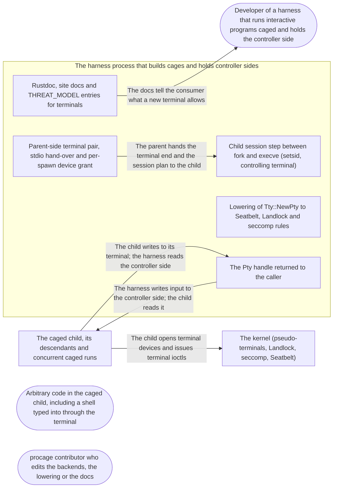

# Threat Model: A fresh pseudo-terminal for interactive runs

**Feature**: `022-pty` · **Generated**: 2026-11-03T18:00:53Z · **Profiles**: stride, llm, agent · **Canonical**: `threat-model.yaml`

> Rendered by ThreatSpec. Edit `threat-model.yaml`, not this file.

## Summary

| Threats | Critical | High | Medium | Low | Needs clarification | Not applicable | Mitigations | Requirements | Decisions |
|---|---|---|---|---|---|---|---|---|---|
| 8 | 0 | 2 | 4 | 2 | 0 | 27 | 8 | 8 | 0 |

## Actors

| ID | Name | Trust | Description |
|---|---|---|---|
| `actor.caged-code` | Arbitrary code in the caged child, including a shell typed into through the terminal | untrusted |  |
| `actor.consumer` | Developer of a harness that runs interactive programs caged and holds the controller side | trusted |  |
| `actor.contributor` | procage contributor who edits the backends, the lowering or the docs | semi-trusted |  |

## Trust Zones

| ID | Name | Trust rating | Description |
|---|---|---|---|
| `tz.cage` | The caged child, its descendants and concurrent caged runs | 5 |  |
| `tz.harness` | The harness process that builds cages and holds controller sides | 90 |  |
| `tz.os` | The kernel (pseudo-terminals, Landlock, seccomp, Seatbelt) | 95 |  |

## Assets

| ID | Name | Type | Classification | C / I / A | Source |
|---|---|---|---|---|---|
| `asset.claim` | The published claim that interactive programs run caged, and the escape-class evidence | configuration | public | 0 / 70 / 10 | spec.md#SC-001 |
| `asset.controller` | The controller side of a run's terminal and the harness that reads it | capability | internal | 50 / 70 / 40 | spec.md#FR-003 |
| `asset.host` | The user's files, secrets and processes outside the policy | credential | secret | 100 / 90 / 50 | spec.md#Context |
| `asset.terminals` | Terminals other than the child's own: the caller's, the user's and other runs' | capability | internal | 80 / 95 / 30 | spec.md#FR-002 |

## Components

| ID | Name | Type | Trust zone | Source |
|---|---|---|---|---|
| `component.child-session` | Child session step between fork and execve (setsid, controlling terminal) | library | `tz.harness` | spec.md#FR-004 |
| `component.docs` | Rustdoc, site docs and THREAT_MODEL entries for terminals | document | `tz.harness` | spec.md#SC-001 |
| `component.lowering` | Lowering of Tty::NewPty to Seatbelt, Landlock and seccomp rules | library | `tz.harness` | spec.md#FR-002 |
| `component.pty-handle` | The Pty handle returned to the caller | library | `tz.harness` | spec.md#FR-003 |
| `component.pty-setup` | Parent-side terminal pair, stdio hand-over and per-spawn device grant | library | `tz.harness` | spec.md#FR-001 |

## Data Flows

| ID | Name | From | To | Assets | Crosses |
|---|---|---|---|---|---|
| `flow.claims` | The docs tell the consumer what a new terminal allows | `component.docs` | `actor.consumer` | `asset.claim` |  |
| `flow.device` | The child opens terminal devices and issues terminal ioctls | `tz.cage` | `tz.os` | `asset.terminals`, `asset.host` | `tz.cage`, `tz.os` |
| `flow.handover` | The parent hands the terminal end and the session plan to the child | `component.pty-setup` | `component.child-session` | `asset.controller` |  |
| `flow.input` | The harness writes input to the controller side; the child reads it | `component.pty-handle` | `tz.cage` | `asset.controller` | `tz.harness`, `tz.cage` |
| `flow.output` | The child writes to its terminal; the harness reads the controller side | `tz.cage` | `component.pty-handle` | `asset.controller` | `tz.cage`, `tz.harness` |

## Threats

| ID | Threat | Category | Technique | Severity | Status | Mitigations | Mappings | Source |
|---|---|---|---|---|---|---|---|---|
| `threat.descriptor-leak` | The controller side or the parent's copy of the terminal end stays open in the child, or in a child spawned concurrently by another thread, so a run reads or writes another run's terminal | Information Disclosure | cross-tenant-leak | **high** | mitigated | `mitigation.cloexec-handover` |  | spec.md#FR-001 |
| `threat.other-terminal` | A caged child opens another terminal device (the caller's, the user's or another run's) through a terminal grant broader than its own device, and reads it or pushes input that a shell runs outside the sandbox | Elevation of Privilege | broken-access-control | **high** | mitigated | `mitigation.exact-device` |  | spec.md#FR-002 |
| `threat.claim-overstates` | The docs claim interactive shells, REPLs and full-screen programs run caged, or that other terminals are out of reach, without a caged test on every lane | Repudiation | missing-audit-trail | **medium** | mitigated | `mitigation.lane-tests` |  | spec.md#SC-001 |
| `threat.escape-sequences` | A caged child writes terminal escape sequences that a harness forwards unfiltered to the user's own terminal (clipboard writes, title reports, answerback) | Tampering | injection | **medium** | mitigated | `mitigation.untrusted-output` |  | spec.md#Out-of-Scope |
| `threat.exec-fallback` | Cage::exec or Cage::exec_session given Tty::NewPty silently runs with the caller's terminal, the injection-prone mode the caller did not ask for | Elevation of Privilege | privilege-escalation-via-config | **medium** | mitigated | `mitigation.exec-refuses` |  | spec.md#FR-005 |
| `threat.outlive` | A descendant keeps the terminal open, or job control moves it to another session, so it survives the run's end and keeps reading or writing the controller side | Elevation of Privilege | broken-access-control | **medium** | mitigated | `mitigation.run-end` |  | spec.md#US1 |
| `threat.child-unsafe` | Acquiring the controlling terminal in the child allocates, takes a lock or calls a library function between fork and execve, so a multithreaded parent deadlocks | Denial of Service | resource-exhaustion | **low** | mitigated | `mitigation.syscall-session` |  | spec.md#FR-004 |
| `threat.sti-own` | A caged child pushes input into its own new terminal (TIOCSTI), which a harness that echoes or replays the controller side could act on | Tampering | injection | **low** | mitigated | `mitigation.sti-denied` |  | spec.md#US1 |

### Techniques evaluated without findings

| Technique | Disposition | Reason |
|---|---|---|
| credential-theft | not-applicable | no authentication surface |
| identity-spoofing | not-applicable | no authentication or network boundary; the terminal is a local device pair |
| data-tampering-in-transit | not-applicable | no network transit; the terminal stream stays between two descriptors of one host |
| data-tampering-at-rest | not-applicable | no store; the terminal holds no data beyond its kernel buffers |
| privilege-escalation-via-config | not-applicable | no configuration added; the silent-fallback risk of Cage::exec is threat.exec-fallback |
| prompt-injection-direct | not-applicable | procage is a library that calls no model and runs no agent; LLM-written code is the adversary inside the child, modelled under STRIDE |
| prompt-injection-indirect | not-applicable | procage is a library that calls no model and runs no agent; LLM-written code is the adversary inside the child, modelled under STRIDE |
| sensitive-information-disclosure | not-applicable | procage is a library that calls no model and runs no agent; LLM-written code is the adversary inside the child, modelled under STRIDE |
| excessive-agency | not-applicable | procage is a library that calls no model and runs no agent; LLM-written code is the adversary inside the child, modelled under STRIDE |
| model-supply-chain | not-applicable | procage is a library that calls no model and runs no agent; LLM-written code is the adversary inside the child, modelled under STRIDE |
| training-data-poisoning | not-applicable | procage is a library that calls no model and runs no agent; LLM-written code is the adversary inside the child, modelled under STRIDE |
| unbounded-consumption | not-applicable | procage is a library that calls no model and runs no agent; LLM-written code is the adversary inside the child, modelled under STRIDE |
| misinformation | not-applicable | procage is a library that calls no model and runs no agent; LLM-written code is the adversary inside the child, modelled under STRIDE |
| hidden-context-exposure | not-applicable | procage is a library that calls no model and runs no agent; LLM-written code is the adversary inside the child, modelled under STRIDE |
| vector-embedding-weakness | not-applicable | procage is a library that calls no model and runs no agent; LLM-written code is the adversary inside the child, modelled under STRIDE |
| improper-output-handling | not-applicable | procage is a library that calls no model and runs no agent; LLM-written code is the adversary inside the child, modelled under STRIDE |
| model-extraction | not-applicable | procage is a library that calls no model and runs no agent; LLM-written code is the adversary inside the child, modelled under STRIDE |
| goal-hijack | not-applicable | procage is a library that calls no model and runs no agent; LLM-written code is the adversary inside the child, modelled under STRIDE |
| tool-misuse | not-applicable | procage is a library that calls no model and runs no agent; LLM-written code is the adversary inside the child, modelled under STRIDE |
| identity-privilege-abuse | not-applicable | procage is a library that calls no model and runs no agent; LLM-written code is the adversary inside the child, modelled under STRIDE |
| agentic-supply-chain | not-applicable | procage is a library that calls no model and runs no agent; LLM-written code is the adversary inside the child, modelled under STRIDE |
| unexpected-code-execution | not-applicable | procage is a library that calls no model and runs no agent; LLM-written code is the adversary inside the child, modelled under STRIDE |
| memory-context-poisoning | not-applicable | procage is a library that calls no model and runs no agent; LLM-written code is the adversary inside the child, modelled under STRIDE |
| insecure-inter-agent-communication | not-applicable | procage is a library that calls no model and runs no agent; LLM-written code is the adversary inside the child, modelled under STRIDE |
| cascading-failure | not-applicable | procage is a library that calls no model and runs no agent; LLM-written code is the adversary inside the child, modelled under STRIDE |
| human-agent-trust-exploitation | not-applicable | procage is a library that calls no model and runs no agent; LLM-written code is the adversary inside the child, modelled under STRIDE |
| rogue-agent | not-applicable | procage is a library that calls no model and runs no agent; LLM-written code is the adversary inside the child, modelled under STRIDE |

## Mitigations

| ID | Mitigation | Kind | Threats | Requirements | Touchpoints | Status |
|---|---|---|---|---|---|---|
| `mitigation.cloexec-handover` | The pair is opened close-on-exec atomically, the fd sweep closes anything else, and the parent drops its copies of the terminal end once the child runs | preventive | `threat.descriptor-leak` | SR-003 | `crates/procage/src/macos/sys.rs`, `crates/procage/src/linux/sys.rs`, `crates/procage/src/pty.rs` | verified |
| `mitigation.exact-device` | The terminal grant names exactly the spawn's device and /dev/tty, independent of the base profile; Tty::Inherit's rules are not reused | preventive | `threat.other-terminal` | SR-001 | `crates/procage-policy/src/lower/macos.rs`, `crates/procage-policy/src/lower/linux.rs`, `crates/procage/src/macos/mod.rs`, `crates/procage/src/linux/spawn.rs` | verified |
| `mitigation.exec-refuses` | Cage::exec and Cage::exec_session refuse Tty::NewPty with a typed error | preventive | `threat.exec-fallback` | SR-006 | `crates/procage/src/macos/mod.rs`, `crates/procage/src/linux/mod.rs` | verified |
| `mitigation.lane-tests` | A shell, a REPL and a full-screen program run caged through the terminal on every lane; the docs claim only that | detective | `threat.claim-overstates` | SR-008 | `crates/procage/tests/pty.rs`, `crates/procage/THREAT_MODEL.md`, `README.md` | verified |
| `mitigation.run-end` | Ending the run kills every process of it as before; the child leads its terminal's session, so job control stays in it | preventive | `threat.outlive` | SR-005 | `crates/procage/src/macos/child.rs`, `crates/procage/src/linux/child.rs` | verified |
| `mitigation.sti-denied` | The terminal-injection hard-deny class stays in force with Tty::NewPty, so TIOCSTI on the own terminal fails too unless waived by name | preventive | `threat.sti-own` | SR-002 | `crates/procage-policy/src/lower/macos.rs`, `crates/procage-policy/src/lower/linux.rs`, `crates/procage/tests/escape_macos.rs`, `crates/procage/tests/escape_linux.rs` | verified |
| `mitigation.syscall-session` | The session step is setsid then ioctl(TIOCSCTTY) on descriptor 0, both system calls; a multithreaded spawn test covers it | preventive | `threat.child-unsafe` | SR-004 | `crates/procage/src/macos/sys.rs`, `crates/procage/src/linux/sys.rs` | verified |
| `mitigation.untrusted-output` | The Pty documentation states that its output is the cage's untrusted bytes and must not reach a terminal unfiltered | deterrent | `threat.escape-sequences` | SR-007 | `crates/procage/src/pty.rs` | verified |

## Security Requirements

### SR-001 (P1) — verified

With Tty::NewPty the child MUST reach only its own terminal device and /dev/tty, under every base version including none; opening any other terminal device MUST fail.

- **Given** a caged child with Tty::NewPty and a second terminal the test opened, **when** the child opens the second terminal's device for reading and writing, **then** both opens fail
- **Given** a policy without a base profile and Tty::NewPty, **when** the child reads and writes its terminal and sets its attributes, **then** all succeed
- Mitigations: `mitigation.exact-device`
- Tasks: T004 ✓, T005 ✓, T006 ✓, T008 ✓, T009 ✓
- Verification `verification.sr-001.2026-11-03`: test → pass (verified) — `crates/procage/tests/escape_macos.rs::r22_a_new_terminal_keeps_input_injection_inside_the_run`
- Verification `verification.sr-001.2026-11-03-2`: test → pass (verified) — `crates/procage/tests/escape_macos.rs::r22_a_new_terminal_keeps_input_injection_inside_the_run`
- Verification `verification.sr-001.2026-11-03-3`: test → pass (verified) — `crates/procage/tests/escape_macos.rs::r22_a_new_terminal_keeps_input_injection_inside_the_run`

### SR-002 (P2) — verified

With Tty::NewPty, TIOCSTI on the child's own terminal MUST fail unless the terminal-injection class is waived by name.

- **Given** a caged child with Tty::NewPty, **when** it pushes a byte into its own terminal, **then** the call fails with EPERM
- **Given** the same policy with the terminal-injection class waived, **when** it pushes a byte, **then** the byte reaches only the controller side
- Mitigations: `mitigation.sti-denied`
- Tasks: T004 ✓, T009 ✓
- Verification `verification.sr-002.2026-11-03`: test → pass (verified) — `crates/procage/tests/escape_linux.rs::r22_a_new_terminal_keeps_input_injection_inside_the_run`
- Verification `verification.sr-002.2026-11-03-2`: test → pass (verified) — `crates/procage/tests/escape_linux.rs::r22_a_new_terminal_keeps_input_injection_inside_the_run`
- Verification `verification.sr-002.2026-11-03-3`: test → pass (verified) — `crates/procage/tests/escape_linux.rs::r22_a_new_terminal_keeps_input_injection_inside_the_run`

### SR-003 (P1) — verified

The controller side and the parent's copy of the terminal end MUST NOT be open in any caged child; the parent MUST hold no copy of the terminal end after the spawn.

- **Given** two runs with Tty::NewPty spawned concurrently from different threads, **when** each child lists its open descriptors, **then** none is either run's controller or the other run's terminal
- **Given** a run whose child exited, **when** the caller reads the controller side, **then** the read ends (EOF or EIO) instead of blocking
- Mitigations: `mitigation.cloexec-handover`
- Tasks: T001 ✓, T005 ✓, T006 ✓, T010 ✓
- Verification `verification.sr-003.2026-11-03`: test → pass (verified) — `crates/procage/tests/pty.rs::concurrent_runs_from_a_busy_parent_get_only_their_own_terminal`
- Verification `verification.sr-003.2026-11-03-2`: test → pass (verified) — `crates/procage/tests/pty.rs::concurrent_runs_from_a_busy_parent_get_only_their_own_terminal`
- Verification `verification.sr-003.2026-11-03-3`: test → pass (verified) — `crates/procage/tests/pty.rs::concurrent_runs_from_a_busy_parent_get_only_their_own_terminal`

### SR-004 (P2) — verified

The child MUST acquire its controlling terminal with system calls only (setsid, ioctl TIOCSCTTY), and spawns with Tty::NewPty from a multithreaded parent MUST succeed.

- **Given** a parent with several threads allocating and locking, **when** it spawns many children with Tty::NewPty, **then** every child starts with its terminal as controlling terminal
- Mitigations: `mitigation.syscall-session`
- Tasks: T003 ✓, T010 ✓
- Verification `verification.sr-004.2026-11-03`: test → pass (verified) — `crates/procage/tests/pty.rs::concurrent_runs_from_a_busy_parent_get_only_their_own_terminal`
- Verification `verification.sr-004.2026-11-03-2`: test → pass (verified) — `crates/procage/tests/pty.rs::concurrent_runs_from_a_busy_parent_get_only_their_own_terminal`
- Verification `verification.sr-004.2026-11-03-3`: test → pass (verified) — `crates/procage/tests/pty.rs::concurrent_runs_from_a_busy_parent_get_only_their_own_terminal`

### SR-005 (P1) — verified

When a run with Tty::NewPty ends, every process of the run, including background jobs a shell started in the terminal, MUST be dead.

- **Given** a shell in a new terminal that started a background job, **when** the run ends, **then** the shell and the job are dead
- Mitigations: `mitigation.run-end`
- Tasks: T008 ✓
- Verification `verification.sr-005.2026-11-03`: test → pass (verified) — `crates/procage/tests/pty.rs::the_run_end_closes_the_terminal_and_kills_its_jobs`
- Verification `verification.sr-005.2026-11-03-2`: test → pass (verified) — `crates/procage/tests/pty.rs::the_run_end_closes_the_terminal_and_kills_its_jobs`
- Verification `verification.sr-005.2026-11-03-3`: test → pass (verified) — `crates/procage/tests/pty.rs::the_run_end_closes_the_terminal_and_kills_its_jobs`

### SR-006 (P1) — verified

Cage::exec and Cage::exec_session MUST refuse Tty::NewPty with a typed error before anything is changed.

- **Given** a cage with Tty::NewPty, **when** exec or exec_session is called, **then** it returns the unsupported-setting error and the process is unchanged
- Mitigations: `mitigation.exec-refuses`
- Tasks: T005 ✓, T006 ✓, T008 ✓
- Verification `verification.sr-006.2026-11-03`: test → pass (verified) — `crates/procage/tests/pty.rs::exec_refuses_a_new_terminal`
- Verification `verification.sr-006.2026-11-03-2`: test → pass (verified) — `crates/procage/tests/pty.rs::exec_refuses_a_new_terminal`
- Verification `verification.sr-006.2026-11-03-3`: test → pass (verified) — `crates/procage/tests/pty.rs::exec_refuses_a_new_terminal`

### SR-007 (P3) — verified

The Pty documentation MUST state that the controller side carries the cage's untrusted bytes, including escape sequences, and that procage does not filter them.

- **Given** the rustdoc of Pty, **when** a reader looks for how to treat output, **then** it says the bytes are untrusted and unfiltered
- Mitigations: `mitigation.untrusted-output`
- Tasks: T002 ✓
- Verification `verification.sr-007.2026-11-03`: review → pass (verified) — `crates/procage/src/pty.rs:16`
- Verification `verification.sr-007.2026-11-03-2`: review → pass (verified) — `crates/procage/src/pty.rs:16`
- Verification `verification.sr-007.2026-11-03-3`: review → pass (verified) — `crates/procage/src/pty.rs:16`

### SR-008 (P2) — verified

An interactive shell, a REPL and a full-screen program MUST run caged through Tty::NewPty in tests on every macOS and Linux lane, and the docs MUST claim no more than those tests show.

- **Given** each CI lane, **when** the terminal tests run, **then** the shell answers a command, the REPL evaluates an expression and the full-screen program draws and quits
- Mitigations: `mitigation.lane-tests`
- Tasks: T008 ✓, T011 ✓, T013 ✓
- Verification `verification.sr-008.2026-11-03`: review → inconclusive (implemented-unverified) — `crates/procage/tests/pty.rs:1`
- Verification `verification.sr-008.2026-11-03-2`: test → pass (verified) — `crates/procage/tests/pty.rs::a_full_screen_program_runs_through_its_terminal`
- Verification `verification.sr-008.2026-11-03-3`: test → pass (verified) — `crates/procage/tests/pty.rs::a_full_screen_program_runs_through_its_terminal`
