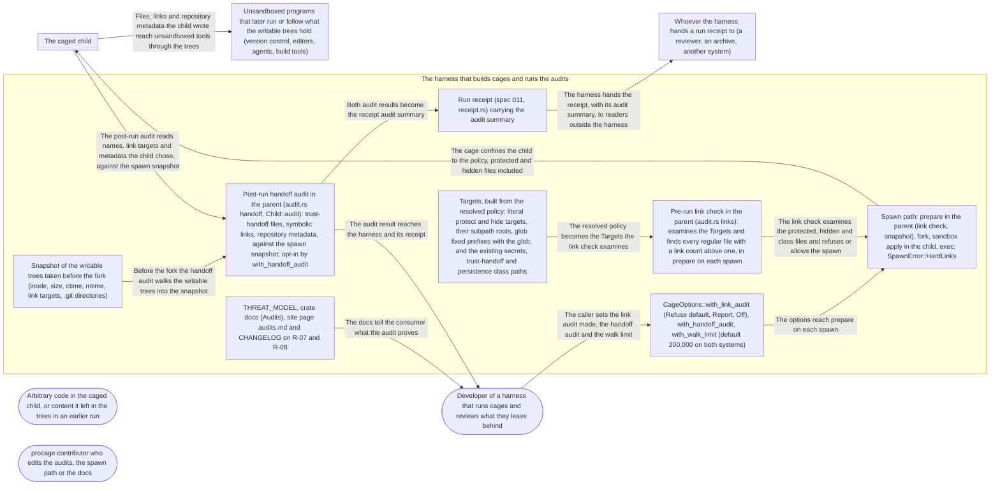

# Threat Model: Audit of the writable trees, before and after a run

**Feature**: `023-tree-audit` · **Generated**: 2026-11-02T06:33:34Z · **Profiles**: stride, llm, agent · **Canonical**: `threat-model.yaml`

> Rendered by ThreatSpec. Edit `threat-model.yaml`, not this file.

## Summary

| Threats | Critical | High | Medium | Low | Needs clarification | Not applicable | Mitigations | Requirements | Decisions |
|---|---|---|---|---|---|---|---|---|---|
| 15 | 0 | 3 | 10 | 2 | 0 | 26 | 15 | 15 | 0 |

## Actors

| ID | Name | Trust | Description |
|---|---|---|---|
| `actor.caged-code` | Arbitrary code in the caged child, or content it left in the trees in an earlier run | untrusted |  |
| `actor.consumer` | Developer of a harness that runs cages and reviews what they leave behind | trusted |  |
| `actor.contributor` | procage contributor who edits the audits, the spawn path or the docs | semi-trusted |  |

## Trust Zones

| ID | Name | Trust rating | Description |
|---|---|---|---|
| `tz.cage` | The caged child | 5 |  |
| `tz.harness` | The harness that builds cages and runs the audits | 90 |  |
| `tz.host-tools` | Unsandboxed programs that later run or follow what the writable trees hold (version control, editors, agents, build tools) | 60 |  |
| `tz.receipt-readers` | Whoever the harness hands a run receipt to (a reviewer, an archive, another system) | 40 |  |

## Assets

| ID | Name | Type | Classification | C / I / A | Source |
|---|---|---|---|---|---|
| `asset.findings` | The audit result the harness reviews before trusting the trees: each link finding and handoff finding, the link audit mode (refuse, report, off) and completeness | capability | internal | 30 / 90 / 40 | spec.md#Key-Entities; data-model.md |
| `asset.harness` | The harness process: memory, threads and the time the audits take | capability | internal | 0 / 50 / 60 | spec.md#SC-003 |
| `asset.protected` | Protected and hidden files the policy names, and the existing secrets, trust-handoff and persistence class files (for example .git/config, an SSH key) | credential | secret | 100 / 90 / 30 | spec.md#FR-001; plan.md#Summary (Targets) |
| `asset.receipt-audit` | The audit summary in the run receipt: counts and completeness, paths only when the policy is included | capability | internal | 50 / 70 / 20 | plan.md#Summary; data-model.md (Receipt audit) |
| `asset.trees` | The writable trees, whose trust-handoff files, symbolic links and repository metadata unsandboxed tools later run or follow | capability | internal | 50 / 90 / 40 | spec.md#Context |

## Components

| ID | Name | Type | Trust zone | Source |
|---|---|---|---|---|
| `component.docs` | THREAT_MODEL, crate docs (Audits), site page audits.md and CHANGELOG on R-07 and R-08 | document | `tz.harness` | spec.md#FR-005 |
| `component.options` | CageOptions::with_link_audit (Refuse default, Report, Off), with_handoff_audit, with_walk_limit (default 200,000 on both systems) | library | `tz.harness` | contracts/api.md; plan.md#Summary |
| `component.postrun` | Post-run handoff audit in the parent (audit.rs handoff, Child::audit): trust-handoff files, symbolic links, repository metadata, against the spawn snapshot; opt-in by with_handoff_audit | library | `tz.harness` | spec.md#FR-002; plan.md#Summary; contracts/api.md |
| `component.prerun` | Pre-run link check in the parent (audit.rs links): examines the Targets and finds every regular file with a link count above one, in prepare on each spawn | library | `tz.harness` | spec.md#FR-001; plan.md#Summary; contracts/api.md |
| `component.receipt` | Run receipt (spec 011, receipt.rs) carrying the audit summary | library | `tz.harness` | spec.md#FR-006; plan.md#Summary; data-model.md |
| `component.snapshot` | Snapshot of the writable trees taken before the fork (inode, size, ctime, mtime, link targets, .git directories) | library | `tz.harness` | spec.md#Assumptions; plan.md#Summary |
| `component.spawn` | Spawn path: prepare in the parent (link check, snapshot), fork, sandbox apply in the child, exec; SpawnError::HardLinks | library | `tz.harness` | spec.md#FR-004; plan.md#Summary; contracts/api.md |
| `component.targets` | Targets, built from the resolved policy: literal protect and hide targets, their subpath roots, glob fixed prefixes with the glob, and the existing secrets, trust-handoff and persistence class paths | library | `tz.harness` | plan.md#Summary; spec.md#Clarifications |

## Data Flows

| ID | Name | From | To | Assets | Crosses |
|---|---|---|---|---|---|
| `flow.audit-receipt` | Both audit results become the receipt audit summary | `component.postrun` | `component.receipt` | `asset.findings`, `asset.receipt-audit` |  |
| `flow.claims` | The docs tell the consumer what the audit proves | `component.docs` | `actor.consumer` | `asset.findings` |  |
| `flow.confine` | The cage confines the child to the policy, protected and hidden files included | `component.spawn` | `tz.cage` | `asset.protected` | `tz.harness`, `tz.cage` |
| `flow.findings` | The audit result reaches the harness and its receipt | `component.postrun` | `actor.consumer` | `asset.findings` |  |
| `flow.handoff` | Files, links and repository metadata the child wrote reach unsandboxed tools through the trees | `tz.cage` | `tz.host-tools` | `asset.trees` | `tz.cage`, `tz.host-tools` |
| `flow.mode` | The caller sets the link audit mode, the handoff audit and the walk limit | `actor.consumer` | `component.options` | `asset.findings` |  |
| `flow.options` | The options reach prepare on each spawn | `component.options` | `component.spawn` | `asset.findings` |  |
| `flow.prewalk` | The link check examines the protected, hidden and class files and refuses or allows the spawn | `component.prerun` | `component.spawn` | `asset.protected`, `asset.findings` |  |
| `flow.receipt-out` | The harness hands the receipt, with its audit summary, to readers outside the harness | `component.receipt` | `tz.receipt-readers` | `asset.receipt-audit` | `tz.harness`, `tz.receipt-readers` |
| `flow.snapshot` | Before the fork the handoff audit walks the writable trees into the snapshot | `component.snapshot` | `component.postrun` | `asset.trees`, `asset.harness` |  |
| `flow.targets` | The resolved policy becomes the Targets the link check examines | `component.targets` | `component.prerun` | `asset.protected` |  |
| `flow.walk` | The post-run audit reads names, link targets and metadata the child chose, against the spawn snapshot | `tz.cage` | `component.postrun` | `asset.trees`, `asset.harness` | `tz.cage`, `tz.harness` |

## Threats

| ID | Threat | Category | Technique | Severity | Status | Mitigations | Mappings | Source |
|---|---|---|---|---|---|---|---|---|
| `threat.alias-missed` | A protected, hidden or class file with a second name (a hard link left by an earlier run, an unpacked archive or another program, anywhere: writable, readable or unreachable tree) is not examined (a subpath or glob not expanded into the Targets, a class path skipped) or its link count is not checked, so the child reads or writes it through the other name | Elevation of Privilege, Information Disclosure | broken-access-control | **high** | mitigated | `mitigation.inode-match` |  | spec.md#FR-001; spec.md#Clarifications; plan.md#Complexity-Tracking |
| `threat.mtime-reset` | The child changes a trust-handoff file in place and resets its modification time (or keeps size and inode), so the post-run audit compares equal to the snapshot and lists nothing | Tampering, Repudiation | data-tampering-at-rest | **high** | mitigated | `mitigation.ctime-snapshot` |  | spec.md#Assumptions |
| `threat.silent-partial` | A tree or a protect subpath floods past the walk limit, or a directory is unreadable, and the audit returns a partial result that reads as complete (an incomplete link check lets the spawn proceed by design), or the walk exhausts the harness | Repudiation, Denial of Service | missing-audit-trail | **high** | mitigated | `mitigation.typed-incomplete` |  | spec.md#FR-003; spec.md#Clarifications; data-model.md (links_complete, handoff_complete) |
| `threat.audit-cost` | The link check, on by default, walks a large protect or hide subpath (or class paths in every home) on every spawn, and the handoff audit walks the writable trees twice per run, so spawns slow down or the harness stalls | Denial of Service | resource-exhaustion | **medium** | mitigated | `mitigation.bounded-cost` |  | spec.md#SC-003; spec.md#Clarifications (cost); plan.md#Complexity-Tracking |
| `threat.audit-too-early` | The post-run audit runs while a process of the run still writes (detached run, a descendant not yet killed), so an artefact written after the walk is never listed | Repudiation | missing-audit-trail | **medium** | mitigated | `mitigation.after-run-only` |  | spec.md#FR-002; contracts/api.md (Child::audit returns None while running) |
| `threat.check-spawn-race` | Between the link check in prepare and the exec, or between two spawns of the same cage, a process outside the cage gives a protected file a second name, so the child starts with an alias the check did not see | Elevation of Privilege | broken-access-control | **medium** | mitigated | `mitigation.check-last` |  | plan.md#Summary (prepare, each spawn) |
| `threat.finding-injection` | File names and link targets the child chose carry control characters or invalid UTF-8, so a lossy finding names the wrong path or the harness display and log are injected | Tampering | injection | **medium** | mitigated | `mitigation.byte-paths` |  | spec.md#Key-Entities |
| `threat.in-run-link` | The claim that a caged child cannot hard link a protected or hidden file during the run fails on one lane (a Seatbelt or Landlock change, a T1 mount gap), and no audit lists links made during the run | Elevation of Privilege | broken-access-control | **medium** | mitigated | `mitigation.in-run-canary` |  | spec.md#Clarifications (hard links made during the run) |
| `threat.receipt-paths-leak` | The receipt audit summary carries finding paths (secret file names, home layout, workspace names) to readers who were not given the policy | Information Disclosure | sensitive-data-exposure | **medium** | mitigated | `mitigation.receipt-counts` |  | plan.md#Summary (paths only with the policy included); data-model.md |
| `threat.report-mode-silent` | Report or Off applies by default, or without being recorded in the audit result and the receipt, so a cage is silently weaker than its policy | Elevation of Privilege | privilege-escalation-via-config | **medium** | mitigated | `mitigation.refuse-default` |  | spec.md#Clarifications; contracts/api.md (LinkAudit) |
| `threat.status-overclaim` | The threat model moves R-08 to mitigated or detected, or presents the post-run audit as preventing trust handoff, without canaries on every lane, so a consumer stops reviewing what the run left | Repudiation | missing-audit-trail | **medium** | mitigated | `mitigation.measured-status` |  | spec.md#FR-005 |
| `threat.target-replaced-by-link` | A protected or hidden target is replaced by a symbolic link (where its directory is writable, as on Linux T2) to a file with a second name; the check uses lstat, sees a link with one name and no finding, while the rule or the child follows the link | Elevation of Privilege, Tampering | broken-access-control | **medium** | mitigated | `mitigation.target-link-finding` |  | plan.md#Summary (a regular file with st_nlink > 1 is a finding); spec.md#Context |
| `threat.walk-follows-link` | A symbolic link the child planted makes an audit walk leave the tree (into the home directory) or loop, so the parent reads outside the trees, reports foreign files or never finishes | Information Disclosure, Denial of Service | sensitive-data-exposure | **medium** | mitigated | `mitigation.nofollow-walk` |  | spec.md#FR-004 |
| `threat.audit-in-child` | The audit walk is placed between fork and exec, allocating or locking in the child of a multithreaded parent, so spawns deadlock | Denial of Service | resource-exhaustion | **low** | mitigated | `mitigation.parent-only` |  | spec.md#FR-004; plan.md#Summary (prepare) |
| `threat.benign-links-block` | A protected, hidden or class file has a second name for a benign reason (a backup or package tool, a deliberate hard link), so the default refuse blocks every spawn and pushes the caller to Off | Denial of Service | resource-exhaustion | **low** | mitigated | `mitigation.actionable-refusal` |  | spec.md#FR-001 (refuse is the default); contracts/api.md (SpawnError::HardLinks) |

### Techniques evaluated without findings

| Technique | Disposition | Reason |
|---|---|---|
| credential-theft | not-applicable | no authentication surface |
| identity-spoofing | not-applicable | no authentication or network boundary |
| data-tampering-in-transit | not-applicable | no data in transit; both audits read the local file system in the parent |
| cross-tenant-leak | not-applicable | single user; runs that share a writable tree belong to one principal, and the audit lists changes by any writer (documented edge case) |
| prompt-injection-direct | not-applicable | procage is a library that calls no model and runs no agent; LLM-written code is the adversary inside the child, modelled under STRIDE |
| prompt-injection-indirect | not-applicable | procage is a library that calls no model and runs no agent; LLM-written code is the adversary inside the child, modelled under STRIDE |
| sensitive-information-disclosure | not-applicable | procage is a library that calls no model and runs no agent; LLM-written code is the adversary inside the child, modelled under STRIDE |
| excessive-agency | not-applicable | procage is a library that calls no model and runs no agent; LLM-written code is the adversary inside the child, modelled under STRIDE |
| model-supply-chain | not-applicable | procage is a library that calls no model and runs no agent; LLM-written code is the adversary inside the child, modelled under STRIDE |
| training-data-poisoning | not-applicable | procage is a library that calls no model and runs no agent; LLM-written code is the adversary inside the child, modelled under STRIDE |
| unbounded-consumption | not-applicable | procage is a library that calls no model and runs no agent; LLM-written code is the adversary inside the child, modelled under STRIDE |
| misinformation | not-applicable | procage is a library that calls no model and runs no agent; LLM-written code is the adversary inside the child, modelled under STRIDE |
| hidden-context-exposure | not-applicable | procage is a library that calls no model and runs no agent; LLM-written code is the adversary inside the child, modelled under STRIDE |
| vector-embedding-weakness | not-applicable | procage is a library that calls no model and runs no agent; LLM-written code is the adversary inside the child, modelled under STRIDE |
| improper-output-handling | not-applicable | procage is a library that calls no model and runs no agent; LLM-written code is the adversary inside the child, modelled under STRIDE |
| model-extraction | not-applicable | procage is a library that calls no model and runs no agent; LLM-written code is the adversary inside the child, modelled under STRIDE |
| goal-hijack | not-applicable | procage is a library that calls no model and runs no agent; LLM-written code is the adversary inside the child, modelled under STRIDE |
| tool-misuse | not-applicable | procage is a library that calls no model and runs no agent; LLM-written code is the adversary inside the child, modelled under STRIDE |
| identity-privilege-abuse | not-applicable | procage is a library that calls no model and runs no agent; LLM-written code is the adversary inside the child, modelled under STRIDE |
| agentic-supply-chain | not-applicable | procage is a library that calls no model and runs no agent; LLM-written code is the adversary inside the child, modelled under STRIDE |
| unexpected-code-execution | not-applicable | procage is a library that calls no model and runs no agent; LLM-written code is the adversary inside the child, modelled under STRIDE |
| memory-context-poisoning | not-applicable | procage is a library that calls no model and runs no agent; LLM-written code is the adversary inside the child, modelled under STRIDE |
| insecure-inter-agent-communication | not-applicable | procage is a library that calls no model and runs no agent; LLM-written code is the adversary inside the child, modelled under STRIDE |
| cascading-failure | not-applicable | procage is a library that calls no model and runs no agent; LLM-written code is the adversary inside the child, modelled under STRIDE |
| human-agent-trust-exploitation | not-applicable | procage is a library that calls no model and runs no agent; LLM-written code is the adversary inside the child, modelled under STRIDE |
| rogue-agent | not-applicable | procage is a library that calls no model and runs no agent; LLM-written code is the adversary inside the child, modelled under STRIDE |

## Mitigations

| ID | Mitigation | Kind | Threats | Requirements | Touchpoints | Status |
|---|---|---|---|---|---|---|
| `mitigation.actionable-refusal` | SpawnError::HardLinks names every file with its link count, and its message says how to proceed (remove the extra name, or choose Report or Off by name) | corrective | `threat.benign-links-block` | SR-015 | `crates/procage/src/macos/mod.rs`, `crates/procage/src/linux/mod.rs`, `crates/procage/src/audit.rs` | verified |
| `mitigation.after-run-only` | The post-run audit is available only once the run is over (child reaped, the run's processes killed); otherwise it is incomplete with that reason | preventive | `threat.audit-too-early` | SR-006 | `crates/procage/src/macos/child.rs`, `crates/procage/src/linux/child.rs` | verified |
| `mitigation.bounded-cost` | The walk limit bounds both walks (default 200,000 on both systems); the handoff audit is off unless with_handoff_audit; the link check examines only the Targets; SC-003 is measured | preventive | `threat.audit-cost` | SR-014 | `crates/procage/src/audit.rs`, `crates/procage/src/macos/mod.rs`, `crates/procage/src/linux/mod.rs`, `crates/procage/tests/audit.rs` | verified |
| `mitigation.byte-paths` | Findings keep paths and link targets as bytes; the serialised form round-trips them and the display escapes control characters | preventive | `threat.finding-injection` | SR-007 | `crates/procage/src/audit.rs`, `crates/procage/src/receipt.rs`, `crates/procage/tests/audit.rs` | verified |
| `mitigation.check-last` | The link check runs in prepare on every spawn, from the Targets roots, as the last parent step before the fork; no result is cached across spawns; the docs name the window left to unsandboxed writers | preventive | `threat.check-spawn-race` | SR-010 | `crates/procage/src/macos/mod.rs`, `crates/procage/src/linux/mod.rs`, `crates/procage/src/audit.rs` | verified |
| `mitigation.ctime-snapshot` | The spawn snapshot records inode, size, modification and status-change time; a file differs when any of them differs, and the status-change time cannot be set by the child | detective | `threat.mtime-reset` | SR-003 | `crates/procage/src/audit.rs`, `crates/procage/tests/audit.rs` | verified |
| `mitigation.in-run-canary` | Non-ignored canaries on every lane assert that a caged child cannot hard link a protected or hidden file into a writable tree | detective | `threat.in-run-link` | SR-012 | `crates/procage/tests/escape_macos.rs`, `crates/procage/tests/escape_linux.rs` | verified |
| `mitigation.inode-match` | Targets cover the literal protect and hide targets, every file under their subpath roots, glob fixed prefixes filtered by the glob, and the existing class files; each is examined with lstat and a regular file with a link count above one is a finding, wherever its other name lies; R-08 canaries on every lane | preventive | `threat.alias-missed` | SR-001 | `crates/procage/src/audit.rs`, `crates/procage/src/macos/mod.rs`, `crates/procage/src/linux/mod.rs`, `crates/procage/tests/escape_macos.rs`, `crates/procage/tests/escape_linux.rs` | verified |
| `mitigation.measured-status` | R-08 changes status only with non-ignored canaries on every lane; the docs say the post-run audit detects and never prevents, that it lists changes by any writer, and that the harness still reviews the trees | preventive | `threat.status-overclaim` | SR-009 | `crates/procage/THREAT_MODEL.md`, `crates/procage/src/lib.rs`, `site/content/docs/audits.md`, `crates/procage/tests/threat_model.rs` | verified |
| `mitigation.nofollow-walk` | Walks use lstat and directory descriptors opened without following links, stay on the tree's device, and read link targets with readlink only | preventive | `threat.walk-follows-link` | SR-005 | `crates/procage/src/audit.rs` | verified |
| `mitigation.parent-only` | Both audits run in the parent before the fork and after the reap; the multithreaded spawn tests run with the audit on | preventive | `threat.audit-in-child` | SR-008 | `crates/procage/src/macos/mod.rs`, `crates/procage/src/linux/mod.rs` | verified |
| `mitigation.receipt-counts` | The receipt audit summary holds counts and completeness only; finding paths appear only when the receipt includes the policy | preventive | `threat.receipt-paths-leak` | SR-013 | `crates/procage/src/receipt.rs`, `crates/procage/tests/receipts.rs` | verified |
| `mitigation.refuse-default` | LinkAudit::Refuse is the Default whatever the policy; Report and Off only when the caller names them; the mode is recorded in the audit result and the receipt | preventive | `threat.report-mode-silent` | SR-002 | `crates/procage/src/audit.rs`, `crates/procage/src/macos/mod.rs`, `crates/procage/src/linux/mod.rs`, `crates/procage/src/receipt.rs` | verified |
| `mitigation.target-link-finding` | A literal protect or hide target that is a symbolic link is itself a link finding, so refuse fails the spawn | preventive | `threat.target-replaced-by-link` | SR-011 | `crates/procage/src/audit.rs`, `crates/procage/tests/escape_linux.rs`, `crates/procage/tests/escape_macos.rs` | verified |
| `mitigation.typed-incomplete` | Both walks count entries against the walk limit and treat any walk error as loss; the result carries links_complete and handoff_complete with visited, the receipt says incomplete, and an incomplete link check runs the spawn but is never shown as clean | detective | `threat.silent-partial` | SR-004 | `crates/procage/src/audit.rs`, `crates/procage/src/receipt.rs`, `crates/procage/tests/audit.rs` | verified |

## Security Requirements

### SR-001 (P1) — verified

Before every spawn, procage MUST examine, in the parent, every literal protect and hide target, every file under protect and hide subpaths and under the fixed prefix of protect and hide globs, and the existing files of the secrets, trust-handoff and persistence classes in every home; a regular file with a link count above one MUST be a link finding unless every one of its names was found among the targets and, for a file found in a hidden target, every name lies in a hidden target. Globs are matched exactly for *, ? and **; a glob with classes or alternatives is matched conservatively and its matches never count as accounted names. Cache directories inside class paths and the large application data and privacy-guarded folders named in the threat model are not examined. In Refuse mode a finding MUST fail the spawn with SpawnError::HardLinks.

- **Given** a file in a writable tree hard-linked to a protected .git/config, **when** the cage spawns with Refuse on macOS, Linux T1 and T2, **then** the spawn fails with HardLinks naming .git/config and its link count, and the target never runs
- **Given** a hidden file whose second name lies in a readable-only tree, and a secrets class file whose second name lies outside every granted tree, **when** the cage spawns with Refuse, **then** the spawn fails naming both files
- **Given** a protect or hide glob, a file it matches with a second name outside the glob, and a multi-link file under the glob's prefix that the glob does not match, **when** the link check runs, **then** the matched file is a finding and the unmatched one is not
- **Given** hard links only between unprotected files in a writable tree, **when** the cage spawns, **then** it runs and the audit has no link finding
- Mitigations: `mitigation.inode-match`
- Tasks: T002 ✓, T004 ✓, T005 ✓, T012 ✓, T022 ✓
- Verification `verification.sr-001.2026-11-01`: review → partial (partial) — `crates/procage/src/audit.rs:245`
- Verification `verification.sr-001.2026-11-01-2`: review → partial (partial) — `crates/procage/src/audit.rs:256`
- Verification `verification.sr-001.2026-11-02-3`: test → pass (verified) — `crates/procage/src/audit.rs::tests::class_files_and_globs_are_examined_and_nothing_else`

### SR-002 (P1) — verified

LinkAudit::Refuse MUST be the default for every cage; Report and Off MUST take effect only when the caller names them, and the mode and every link finding MUST be in the audit result and in the receipt when receipts exist.

- **Given** CageOptions with no link audit option, **when** a cage whose protected file has a second name spawns, **then** the spawn is refused with HardLinks
- **Given** with_link_audit(Report), **when** the same cage spawns, **then** the child runs, and the audit result and the receipt record Report and list the file
- **Given** with_link_audit(Off), **when** the same cage spawns, **then** the child runs and the audit result and the receipt record Off, never an empty complete link check
- Mitigations: `mitigation.refuse-default`
- Tasks: T004 ✓, T005 ✓, T013 ✓, T023 ✓
- Verification `verification.sr-002.2026-11-01`: review → partial (partial) — `crates/procage/src/audit.rs:512`
- Verification `verification.sr-002.2026-11-01-2`: review → inconclusive (implemented-unverified) — `crates/procage/src/receipt.rs:436`
- Verification `verification.sr-002.2026-11-02-3`: test → pass (verified) — `crates/procage/tests/audit.rs::the_receipt_says_the_link_check_mode`

### SR-003 (P1) — verified

The post-run audit MUST list each trust-handoff file created or modified, each symbolic link created (with its target) and each repository metadata directory created in the writable trees exactly once, and MUST detect a change by inode, size and status-change time, never by modification time alone.

- **Given** a waived trust-handoff class and an existing .git/hooks/pre-commit, **when** the child rewrites it with the same size and resets its modification time, **then** the audit lists it as modified
- **Given** Linux T1 and a .vscode/settings.json that did not exist at spawn, **when** the child creates it, **then** the audit lists it as created
- **Given** a child that creates a symbolic link build pointing to the home directory and a nested .git directory, **when** the audit runs, **then** it lists the link with its target and the repository metadata, each once
- **Given** a run that touched nothing of these kinds, **when** the audit runs, **then** it is empty and complete
- Mitigations: `mitigation.ctime-snapshot`
- Tasks: T003 ✓, T006 ✓, T007 ✓, T014 ✓
- Verification `verification.sr-003.2026-11-01`: review → inconclusive (implemented-unverified) — `crates/procage/src/audit.rs:427`
- Verification `verification.sr-003.2026-11-01-2`: test → pass (verified) — `crates/procage/src/audit.rs::a_disguised_rewrite_is_modified; crates/procage/tests/audit.rs::what_a_run_left_behind_is_listed_once; crates/procage/tests/audit.rs::a_quiet_run_is_complete_and_empty`

### SR-004 (P1) — verified

Both audits MUST stop at the walk limit and MUST mark their result incomplete, with the entries visited, past the limit or when any entry cannot be read (a directory another user owns that the caller cannot search is skipped: the caller cannot have linked into it, and the child cannot reach it); an incomplete link check MUST NOT refuse the spawn, and an incomplete result MUST NOT be presentable as an empty complete one, in the audit result or in the receipt.

- **Given** a protect subpath with more files than a small walk limit, **when** the cage spawns with Refuse, **then** the child runs, links_complete is false with the visited count, and the receipt says the audit is incomplete
- **Given** a child that creates more files than the walk limit, **when** the post-run audit runs, **then** handoff_complete is false with the count reached, within the time bound of SC-003 scaled to the limit
- **Given** a child that makes a directory in a tree unreadable, **when** either audit runs, **then** the result is incomplete
- **Given** a root-owned directory the caller cannot search among the class paths (such as /var/spool/cron/crontabs), **when** the link check runs, **then** the result stays complete, while a closed directory the caller owns makes it incomplete
- Mitigations: `mitigation.typed-incomplete`
- Tasks: T002 ✓, T003 ✓, T007 ✓, T015 ✓, T024 ✓
- Verification `verification.sr-004.2026-11-01`: review → inconclusive (implemented-unverified) — `crates/procage/src/audit.rs:347`
- Verification `verification.sr-004.2026-11-01-2`: review → partial (partial) — `crates/procage/src/audit.rs:112`
- Verification `verification.sr-004.2026-11-02`: test → pass (verified) — `crates/procage/src/audit.rs::tests::walks_stay_put_and_say_what_they_could_not_read`
- Verification `verification.sr-004.2026-11-02-2`: test → pass (verified) — `crates/procage/src/audit.rs::tests::walks_stay_put_and_say_what_they_could_not_read`
- Verification `verification.sr-004.2026-11-02-3`: test → pass (verified) — `crates/procage/src/audit.rs::tests::incomplete_is_never_clean_and_never_a_refusal`

### SR-005 (P1) — verified

Audit walks MUST NOT follow symbolic links or cross to another device, and MUST read link targets without resolving them.

- **Given** a child that creates a link loop pointing to its own directory and a link out pointing to the home directory, **when** the post-run audit runs, **then** it terminates, lists both links with their targets, and lists nothing from the home directory
- **Given** a protect subpath containing a symbolic link to a directory outside it, **when** the pre-run link check runs, **then** the link is not traversed and no file outside the subpath is examined through it
- Mitigations: `mitigation.nofollow-walk`
- Tasks: T001 ✓, T016 ✓
- Verification `verification.sr-005.2026-11-01`: review → inconclusive (implemented-unverified) — `crates/procage/src/audit.rs:353`
- Verification `verification.sr-005.2026-11-01-2`: test → pass (verified) — `crates/procage/src/audit.rs::walks_stay_put_and_say_what_they_could_not_read; crates/procage/tests/audit.rs::what_a_run_left_behind_is_listed_once`

### SR-006 (P2) — verified

The post-run audit MUST run only after the run is over (child reaped, every process of the run gone); before that it MUST return incomplete with that reason.

- **Given** a detached run whose descendant still runs, **when** the harness asks for the post-run audit, **then** it is incomplete because the run has not ended
- **Given** a run with Lifetime::Run whose descendant writes a hook after the child exits, **when** the run ends and the audit runs, **then** the descendant is gone and the hook is listed
- Mitigations: `mitigation.after-run-only`
- Tasks: T006 ✓, T017 ✓, T025 ✓
- Verification `verification.sr-006.2026-11-01`: review → partial (partial) — `crates/procage/src/macos/child.rs:77`
- Verification `verification.sr-006.2026-11-01-2`: review → partial (partial) — `crates/procage/src/macos/child.rs:79`
- Verification `verification.sr-006.2026-11-02-3`: test → pass (verified) — `crates/procage/src/macos/child.rs, crates/procage/src/linux/child.rs`

### SR-007 (P2) — verified

Findings MUST keep paths and link targets as exact bytes; their serialised form MUST round-trip them and their display MUST escape control characters.

- **Given** a created file whose name holds a newline, an escape character and invalid UTF-8, **when** the finding is serialised, read back and displayed, **then** the bytes are equal and the display shows the characters escaped
- Mitigations: `mitigation.byte-paths`
- Tasks: T001 ✓, T007 ✓, T018 ✓, T026 ✓
- Verification `verification.sr-007.2026-11-01`: review → partial (partial) — `crates/procage/src/receipt.rs:430`
- Verification `verification.sr-007.2026-11-01-2`: review → inconclusive (implemented-unverified) — `crates/procage/src/receipt.rs:156`
- Verification `verification.sr-007.2026-11-02-3`: test → pass (verified) — `crates/procage/tests/audit.rs::paths_round_trip_exactly`

### SR-008 (P3) — verified

Both audits MUST run in the parent, never between fork and exec in the child.

- **Given** a multithreaded parent spawning many cages with both audits on, **when** the spawn tests run, **then** no spawn deadlocks and the child-side call sequence is unchanged
- Mitigations: `mitigation.parent-only`
- Tasks: T004 ✓
- Verification `verification.sr-008.2026-11-01`: review → pass (verified) — `crates/procage/src/macos/mod.rs:693; crates/procage/src/linux/mod.rs:859; crates/procage/tests/spawn_macos.rs::one_cage_spawns_from_several_threads`
- Verification `verification.sr-008.2026-11-01-2`: review → pass (verified) — `crates/procage/src/macos/mod.rs:693; crates/procage/src/linux/mod.rs:859; crates/procage/tests/spawn_macos.rs::one_cage_spawns_from_several_threads`

### SR-009 (P2) — verified

The threat model MUST change R-08's status only with non-ignored canaries on every lane, MUST record R-07 as detected by the post-run audit and still a harness responsibility, and the docs MUST NOT present an empty audit as proof that the trees are safe.

- **Given** THREAT_MODEL, the crate docs and the site, **when** they describe R-07, R-08 and the audit, **then** R-08 names its canaries per lane, R-07 says the harness still reviews the trees, and no text calls an empty audit proof
- Mitigations: `mitigation.measured-status`
- Tasks: T009 ✓
- Verification `verification.sr-009.2026-11-01`: test → pass (verified) — `crates/procage/tests/threat_model.rs::gate`
- Verification `verification.sr-009.2026-11-01-2`: test → pass (verified) — `crates/procage/tests/threat_model.rs::gate`

### SR-010 (P2) — verified

The link check MUST run in the parent on every spawn as the last step before the fork, re-examining the Targets each time, and MUST NOT reuse a result from an earlier spawn.

- **Given** a cage that spawned cleanly once, **when** a second name is given to its protected file and the same cage spawns again, **then** the second spawn is refused
- **Given** a protect subpath, **when** an aliased file is created under it after the cage was built and the cage spawns, **then** the spawn is refused naming that file
- Mitigations: `mitigation.check-last`
- Tasks: T004 ✓
- Verification `verification.sr-010.2026-11-01`: test → pass (verified) — `crates/procage/tests/escape_macos.rs::r08_a_hard_link_to_a_protected_file_is_refused`
- Verification `verification.sr-010.2026-11-01-2`: test → pass (verified) — `crates/procage/tests/escape_macos.rs::r08_a_hard_link_to_a_protected_file_is_refused; crates/procage/tests/escape_linux.rs::r08_a_hard_link_to_a_protected_file_is_refused`

### SR-011 (P1) — verified

A literal protect or hide target that is a symbolic link MUST be a link finding, so that Refuse fails the spawn, without the check following the link.

- **Given** a protected .git/config replaced by a symbolic link to a file with a second name, **when** the cage spawns with Refuse on macOS, Linux T1 and T2, **then** the spawn fails naming .git/config
- Mitigations: `mitigation.target-link-finding`
- Tasks: T002 ✓, T005 ✓, T019 ✓
- Verification `verification.sr-011.2026-11-01`: review → inconclusive (implemented-unverified) — `crates/procage/src/audit.rs:254`
- Verification `verification.sr-011.2026-11-01-2`: test → pass (verified) — `crates/procage/tests/escape_macos.rs::r08_a_hard_link_to_a_protected_file_is_refused; crates/procage/tests/escape_linux.rs::r08_a_hard_link_to_a_hidden_file_is_refused; crates/procage/src/audit.rs::a_literal_target_that_became_a_link_is_a_finding`

### SR-012 (P2) — verified

Every lane MUST have a non-ignored canary in which a caged child tries to hard link a protected and a hidden file into a writable tree and the kernel refuses it.

- **Given** the escape suites on macOS, Linux T1 and T2, **when** the child calls link on a protected and on a hidden file, **then** both calls fail and no second name exists after the run
- Mitigations: `mitigation.in-run-canary`
- Tasks: T005 ✓, T020 ✓, T027 ✓
- Verification `verification.sr-012.2026-11-01`: test → partial (partial) — `crates/procage/tests/escape_macos.rs::r08_no_hard_link_can_be_made_during_the_run`
- Verification `verification.sr-012.2026-11-01-2`: test → partial (partial) — `crates/procage/tests/escape_linux.rs::r08_no_hard_link_can_be_made_during_the_run`
- Verification `verification.sr-012.2026-11-02-3`: test → pass (verified) — `crates/procage/tests/escape_linux.rs::r08_no_hard_link_can_be_made_during_the_run`

### SR-013 (P2) — verified

The receipt audit summary MUST hold only counts, mode and completeness unless the receipt includes the policy; finding paths MUST NOT appear otherwise.

- **Given** a Report run with a link finding and a handoff finding, **when** the receipt is built without the policy, **then** it holds the counts, the mode and completeness, and no finding path bytes
- **Given** the same run, **when** the receipt is built with the policy, **then** the finding paths are present
- Mitigations: `mitigation.receipt-counts`
- Tasks: T008 ✓
- Verification `verification.sr-013.2026-11-01`: test → pass (verified) — `crates/procage/tests/audit.rs::the_receipt_counts_the_findings`
- Verification `verification.sr-013.2026-11-01-2`: test → pass (verified) — `crates/procage/tests/audit.rs::the_receipt_counts_the_findings`

### SR-014 (P2) — verified

Both walks MUST honour the walk limit (default 200,000 on both systems); the handoff audit MUST NOT walk unless with_handoff_audit is set; the link check MUST stay within SC-003.

- **Given** a cage without with_handoff_audit, **when** it spawns and the run ends, **then** no snapshot is taken and the audit has no handoff part
- **Given** the default policy and a 10,000-file workspace on the reference machine, **when** the link check runs, **then** it adds under 10 ms to the spawn
- Mitigations: `mitigation.bounded-cost`
- Tasks: T002 ✓, T006 ✓, T010 ✓
- Verification `verification.sr-014.2026-11-01`: test → pass (verified) — `crates/procage/tests/audit.rs::without_the_option_nothing_is_walked; specs/023-tree-audit/quickstart.md`
- Verification `verification.sr-014.2026-11-01-2`: test → pass (verified) — `crates/procage/tests/audit.rs::without_the_option_nothing_is_walked; specs/023-tree-audit/quickstart.md`

### SR-015 (P3) — verified

SpawnError::HardLinks MUST name every refused file with its link count, and its message MUST say that removing the extra name, or choosing Report or Off by name, lets the spawn proceed.

- **Given** two protected files with second names, **when** the spawn is refused, **then** the error lists both files with their link counts and the message names the remedies
- Mitigations: `mitigation.actionable-refusal`
- Tasks: T004 ✓, T021 ✓
- Verification `verification.sr-015.2026-11-01`: review → inconclusive (implemented-unverified) — `crates/procage/src/audit.rs:565`
- Verification `verification.sr-015.2026-11-01-2`: test → pass (verified) — `crates/procage/src/audit.rs::the_refusal_names_every_file_and_the_way_out`
