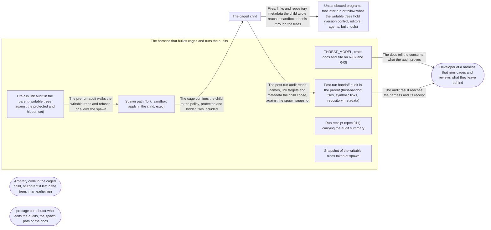

# Threat Model: Audit of the writable trees, before and after a run

**Feature**: `023-tree-audit` · **Generated**: 2026-11-01T21:14:20Z · **Profiles**: stride, llm, agent · **Canonical**: `threat-model.yaml`

> Rendered by ThreatSpec. Edit `threat-model.yaml`, not this file.

## Summary

| Threats | Critical | High | Medium | Low | Needs clarification | Not applicable | Mitigations | Requirements | Decisions |
|---|---|---|---|---|---|---|---|---|---|
| 9 | 0 | 3 | 5 | 1 | 3 | 26 | 9 | 9 | 0 |

### Needs clarification

- `threat.nc-links-during-run` — [NEEDS CLARIFICATION: does the post-run audit list hard links created during the run that alias a protected or hidden file, or does only the next spawn's pre-run audit catch them?] (spec.md#FR-002)
- `threat.nc-protected-set` — [NEEDS CLARIFICATION: how does the pre-run audit turn subpath and glob protect or hide rules into the inode set it compares against (walk them too, under the same limit), and what happens when that set is incomplete?] (spec.md#FR-001)
- `threat.nc-readable-trees` — [NEEDS CLARIFICATION: does the pre-run audit also check readable (not writable) trees, since a hard link to a hidden file inside a read-only grant reveals it just the same?] (spec.md#FR-001)

## Actors

| ID | Name | Trust | Description |
|---|---|---|---|
| `actor.caged-code` | Arbitrary code in the caged child, or content it left in the trees in an earlier run | untrusted |  |
| `actor.consumer` | Developer of a harness that runs cages and reviews what they leave behind | trusted |  |
| `actor.contributor` | procage contributor who edits the audits, the spawn path or the docs | semi-trusted |  |

## Trust Zones

| ID | Name | Trust rating | Description |
|---|---|---|---|
| `tz.cage` | The caged child | 5 |  |
| `tz.harness` | The harness that builds cages and runs the audits | 90 |  |
| `tz.host-tools` | Unsandboxed programs that later run or follow what the writable trees hold (version control, editors, agents, build tools) | 60 |  |

## Assets

| ID | Name | Type | Classification | C / I / A | Source |
|---|---|---|---|---|---|
| `asset.findings` | The audit result the harness reviews before trusting the trees: link and handoff findings, mode and completeness | capability | internal | 30 / 90 / 40 | spec.md#Key-Entities |
| `asset.harness` | The harness process: memory, threads and the time the audits take | capability | internal | 0 / 50 / 60 | spec.md#SC-003 |
| `asset.protected` | Protected and hidden files the policy names (for example .git/config, an SSH key) | credential | secret | 100 / 90 / 30 | spec.md#FR-001 |
| `asset.trees` | The writable trees, whose trust-handoff files, symbolic links and repository metadata unsandboxed tools later run or follow | capability | internal | 50 / 90 / 40 | spec.md#Context |

## Components

| ID | Name | Type | Trust zone | Source |
|---|---|---|---|---|
| `component.docs` | THREAT_MODEL, crate docs and site on R-07 and R-08 | document | `tz.harness` | spec.md#FR-005 |
| `component.postrun` | Post-run handoff audit in the parent (trust-handoff files, symbolic links, repository metadata) | library | `tz.harness` | spec.md#FR-002 |
| `component.prerun` | Pre-run link audit in the parent (writable trees against the protected and hidden set) | library | `tz.harness` | spec.md#FR-001 |
| `component.receipt` | Run receipt (spec 011) carrying the audit summary | library | `tz.harness` | spec.md#FR-006 |
| `component.snapshot` | Snapshot of the writable trees taken at spawn | library | `tz.harness` | spec.md#Assumptions |
| `component.spawn` | Spawn path (fork, sandbox apply in the child, exec) | library | `tz.harness` | spec.md#FR-004 |

## Data Flows

| ID | Name | From | To | Assets | Crosses |
|---|---|---|---|---|---|
| `flow.claims` | The docs tell the consumer what the audit proves | `component.docs` | `actor.consumer` | `asset.findings` |  |
| `flow.confine` | The cage confines the child to the policy, protected and hidden files included | `component.spawn` | `tz.cage` | `asset.protected` | `tz.harness`, `tz.cage` |
| `flow.findings` | The audit result reaches the harness and its receipt | `component.postrun` | `actor.consumer` | `asset.findings` |  |
| `flow.handoff` | Files, links and repository metadata the child wrote reach unsandboxed tools through the trees | `tz.cage` | `tz.host-tools` | `asset.trees` | `tz.cage`, `tz.host-tools` |
| `flow.prewalk` | The pre-run audit walks the writable trees and refuses or allows the spawn | `component.prerun` | `component.spawn` | `asset.protected`, `asset.findings` |  |
| `flow.walk` | The post-run audit reads names, link targets and metadata the child chose, against the spawn snapshot | `tz.cage` | `component.postrun` | `asset.trees`, `asset.harness` | `tz.cage`, `tz.harness` |

## Threats

| ID | Threat | Category | Technique | Severity | Status | Mitigations | Mappings | Source |
|---|---|---|---|---|---|---|---|---|
| `threat.alias-missed` | A hard link in a writable tree to a protected or hidden file (left by an earlier run or an unpacked archive) escapes the pre-run audit (wrong inode set, other device, unread directory), so the child reads or writes the file through its second name | Elevation of Privilege, Information Disclosure | broken-access-control | **high** | open | `mitigation.inode-match` |  | spec.md#FR-001 |
| `threat.mtime-reset` | The child changes a trust-handoff file in place and resets its modification time (or keeps size and inode), so the post-run audit compares equal to the snapshot and lists nothing | Tampering, Repudiation | data-tampering-at-rest | **high** | open | `mitigation.ctime-snapshot` |  | spec.md#Assumptions |
| `threat.silent-partial` | The child floods a tree past the walk limit or makes a directory unreadable, and the audit returns a partial list that reads as complete, or exhausts the harness | Repudiation, Denial of Service | missing-audit-trail | **high** | open | `mitigation.typed-incomplete` |  | spec.md#FR-003 |
| `threat.audit-too-early` | The post-run audit runs while a process of the run still writes (detached run, a descendant not yet killed), so an artefact written after the walk is never listed | Repudiation | missing-audit-trail | **medium** | open | `mitigation.after-run-only` |  | spec.md#FR-002 |
| `threat.finding-injection` | File names and link targets the child chose carry control characters or invalid UTF-8, so a lossy finding names the wrong path or the harness display and log are injected | Tampering | injection | **medium** | open | `mitigation.byte-paths` |  | spec.md#Key-Entities |
| `threat.report-mode-silent` | Report mode (the child runs with the alias reachable) applies by default, or without being recorded, so a cage is silently weaker than its policy | Elevation of Privilege | privilege-escalation-via-config | **medium** | open | `mitigation.refuse-default` |  | spec.md#Clarifications |
| `threat.status-overclaim` | The threat model moves R-08 to mitigated or detected, or presents the post-run audit as preventing trust handoff, without canaries on every lane, so a consumer stops reviewing what the run left | Repudiation | missing-audit-trail | **medium** | open | `mitigation.measured-status` |  | spec.md#FR-005 |
| `threat.walk-follows-link` | A symbolic link the child planted makes an audit walk leave the tree (into the home directory) or loop, so the parent reads outside the trees, reports foreign files or never finishes | Information Disclosure, Denial of Service | sensitive-data-exposure | **medium** | open | `mitigation.nofollow-walk` |  | spec.md#FR-004 |
| `threat.audit-in-child` | The audit walk is placed between fork and exec, allocating or locking in the child of a multithreaded parent, so spawns deadlock | Denial of Service | resource-exhaustion | **low** | open | `mitigation.parent-only` |  | spec.md#FR-004 |

### Techniques evaluated without findings

| Technique | Disposition | Reason |
|---|---|---|
| credential-theft | not-applicable | no authentication surface |
| identity-spoofing | not-applicable | no authentication or network boundary |
| data-tampering-in-transit | not-applicable | no data in transit; both audits read the local file system in the parent |
| cross-tenant-leak | not-applicable | single user; runs that share a writable tree belong to one principal, and the audit lists changes by any writer (documented edge case) |
| prompt-injection-direct | not-applicable | procage is a library that calls no model and runs no agent; LLM-written code is the adversary inside the child, modelled under STRIDE |
| prompt-injection-indirect | not-applicable | procage is a library that calls no model and runs no agent; LLM-written code is the adversary inside the child, modelled under STRIDE |
| sensitive-information-disclosure | not-applicable | procage is a library that calls no model and runs no agent; LLM-written code is the adversary inside the child, modelled under STRIDE |
| excessive-agency | not-applicable | procage is a library that calls no model and runs no agent; LLM-written code is the adversary inside the child, modelled under STRIDE |
| model-supply-chain | not-applicable | procage is a library that calls no model and runs no agent; LLM-written code is the adversary inside the child, modelled under STRIDE |
| training-data-poisoning | not-applicable | procage is a library that calls no model and runs no agent; LLM-written code is the adversary inside the child, modelled under STRIDE |
| unbounded-consumption | not-applicable | procage is a library that calls no model and runs no agent; LLM-written code is the adversary inside the child, modelled under STRIDE |
| misinformation | not-applicable | procage is a library that calls no model and runs no agent; LLM-written code is the adversary inside the child, modelled under STRIDE |
| hidden-context-exposure | not-applicable | procage is a library that calls no model and runs no agent; LLM-written code is the adversary inside the child, modelled under STRIDE |
| vector-embedding-weakness | not-applicable | procage is a library that calls no model and runs no agent; LLM-written code is the adversary inside the child, modelled under STRIDE |
| improper-output-handling | not-applicable | procage is a library that calls no model and runs no agent; LLM-written code is the adversary inside the child, modelled under STRIDE |
| model-extraction | not-applicable | procage is a library that calls no model and runs no agent; LLM-written code is the adversary inside the child, modelled under STRIDE |
| goal-hijack | not-applicable | procage is a library that calls no model and runs no agent; LLM-written code is the adversary inside the child, modelled under STRIDE |
| tool-misuse | not-applicable | procage is a library that calls no model and runs no agent; LLM-written code is the adversary inside the child, modelled under STRIDE |
| identity-privilege-abuse | not-applicable | procage is a library that calls no model and runs no agent; LLM-written code is the adversary inside the child, modelled under STRIDE |
| agentic-supply-chain | not-applicable | procage is a library that calls no model and runs no agent; LLM-written code is the adversary inside the child, modelled under STRIDE |
| unexpected-code-execution | not-applicable | procage is a library that calls no model and runs no agent; LLM-written code is the adversary inside the child, modelled under STRIDE |
| memory-context-poisoning | not-applicable | procage is a library that calls no model and runs no agent; LLM-written code is the adversary inside the child, modelled under STRIDE |
| insecure-inter-agent-communication | not-applicable | procage is a library that calls no model and runs no agent; LLM-written code is the adversary inside the child, modelled under STRIDE |
| cascading-failure | not-applicable | procage is a library that calls no model and runs no agent; LLM-written code is the adversary inside the child, modelled under STRIDE |
| human-agent-trust-exploitation | not-applicable | procage is a library that calls no model and runs no agent; LLM-written code is the adversary inside the child, modelled under STRIDE |
| rogue-agent | not-applicable | procage is a library that calls no model and runs no agent; LLM-written code is the adversary inside the child, modelled under STRIDE |

## Mitigations

| ID | Mitigation | Kind | Threats | Requirements | Touchpoints | Status |
|---|---|---|---|---|---|---|
| `mitigation.after-run-only` | The post-run audit is available only once the run is over (child reaped, the run's processes killed); otherwise it is incomplete with that reason | preventive | `threat.audit-too-early` | SR-006 | `component.postrun` | required |
| `mitigation.byte-paths` | Findings keep paths and link targets as bytes; the serialised form round-trips them and the display escapes control characters | preventive | `threat.finding-injection` | SR-007 | `component.postrun`, `component.receipt` | required |
| `mitigation.ctime-snapshot` | The spawn snapshot records inode, size, modification and status-change time; a file differs when any of them differs, and the status-change time cannot be set by the child | detective | `threat.mtime-reset` | SR-003 | `component.snapshot`, `component.postrun` | required |
| `mitigation.inode-match` | The pre-run audit collects (device, inode) of every protected and hidden file and, in every writable tree, every file with more than one link; a match is a finding naming both paths; R-08 canaries on every lane | preventive | `threat.alias-missed` | SR-001 | `component.prerun`, `component.spawn` | required |
| `mitigation.measured-status` | R-08 changes status only with non-ignored canaries on every lane; the docs say the post-run audit detects and never prevents, that it lists changes by any writer, and that the harness still reviews the trees | preventive | `threat.status-overclaim` | SR-009 | `component.docs` | required |
| `mitigation.nofollow-walk` | Walks use lstat and directory descriptors opened without following links, stay on the tree's device, and read link targets with readlink only | preventive | `threat.walk-follows-link` | SR-005 | `component.prerun`, `component.postrun` | required |
| `mitigation.parent-only` | Both audits run in the parent before the fork and after the reap; the multithreaded spawn tests run with the audit on | preventive | `threat.audit-in-child` | SR-008 | `component.spawn`, `component.prerun` | required |
| `mitigation.refuse-default` | Refuse is the default when the policy protects or hides files; report only when the caller chooses it by name, recorded in the result and the receipt | preventive | `threat.report-mode-silent` | SR-002 | `component.prerun`, `component.receipt` | required |
| `mitigation.typed-incomplete` | Both walks count entries against a limit and treat any walk error as loss; past the limit or on loss the result is a typed incomplete with how far it got, never a plain list | detective | `threat.silent-partial` | SR-004 | `component.prerun`, `component.postrun` | required |

## Security Requirements

### SR-001 (P1) — unverified

Before spawning, procage MUST find every file in a writable tree whose device and inode equal those of a protected or hidden file, and in refuse mode the spawn MUST fail before the child runs, naming both paths.

- **Given** a file in a writable tree hard-linked to a protected .git/config, **when** the cage spawns in refuse mode, on macOS, Linux T1 and T2, **then** the spawn fails naming the alias and the protected path, and the target never runs
- **Given** a hard link to a hidden file, **when** the cage spawns in refuse mode, **then** the spawn fails the same way
- **Given** a writable tree with hard links only between unprotected files, **when** the cage spawns, **then** it runs and the audit has no link finding
- Mitigations: `mitigation.inode-match`
- Tasks: — none —

### SR-002 (P1) — unverified

Refuse MUST be the default whenever the policy protects or hides files; report mode MUST be chosen by the caller by name, and the mode and every link finding MUST be in the audit result and in the receipt when receipts exist.

- **Given** a policy that protects files and no audit option set, **when** a cage with an aliasing hard link spawns, **then** the spawn is refused
- **Given** report mode chosen by the caller, **when** the same cage spawns, **then** the child runs, and the audit result and the receipt record report mode and list the link
- Mitigations: `mitigation.refuse-default`
- Tasks: — none —

### SR-003 (P1) — unverified

The post-run audit MUST list each trust-handoff file created or modified, each symbolic link created (with its target) and each repository metadata directory created in the writable trees exactly once, and MUST detect a change by inode, size and status-change time, never by modification time alone.

- **Given** a waived trust-handoff class and an existing .git/hooks/pre-commit, **when** the child rewrites it with the same size and resets its modification time, **then** the audit lists it as modified
- **Given** Linux T1 and a .vscode/settings.json that did not exist at spawn, **when** the child creates it, **then** the audit lists it as created
- **Given** a child that creates a symbolic link build pointing to the home directory and a nested .git directory, **when** the audit runs, **then** it lists the link with its target and the repository metadata, each once
- **Given** a run that touched nothing of these kinds, **when** the audit runs, **then** it is empty and complete
- Mitigations: `mitigation.ctime-snapshot`
- Tasks: — none —

### SR-004 (P1) — unverified

Both audits MUST stop at a walk limit and MUST return a typed incomplete result, with how far they got, past the limit or when any entry cannot be read; an incomplete result MUST NOT be presentable as an empty list.

- **Given** a child that creates more files than the walk limit, **when** the post-run audit runs, **then** it returns incomplete with the count reached, within the time bound of SC-003 scaled to the limit
- **Given** a child that makes a directory in the tree unreadable, **when** either audit runs, **then** the result is incomplete and names the directory
- Mitigations: `mitigation.typed-incomplete`
- Tasks: — none —

### SR-005 (P1) — unverified

Audit walks MUST NOT follow symbolic links or cross to another device, and MUST read link targets without resolving them.

- **Given** a child that creates a link loop pointing to its own directory and a link out pointing to the home directory, **when** the post-run audit runs, **then** it terminates, lists both links with their targets, and lists nothing from the home directory
- **Given** a protected file reachable only through a symbolic link in a writable tree, **when** the pre-run audit runs, **then** the link is not traversed and no file outside the tree is examined through it
- Mitigations: `mitigation.nofollow-walk`
- Tasks: — none —

### SR-006 (P2) — unverified

The post-run audit MUST run only after the run is over (child reaped, every process of the run gone); before that it MUST return incomplete with that reason.

- **Given** a detached run whose descendant still runs, **when** the harness asks for the post-run audit, **then** it is incomplete because the run has not ended
- **Given** a run with Lifetime::Run whose descendant writes a hook after the child exits, **when** the run ends and the audit runs, **then** the descendant is gone and the hook is listed
- Mitigations: `mitigation.after-run-only`
- Tasks: — none —

### SR-007 (P2) — unverified

Findings MUST keep paths and link targets as exact bytes; their serialised form MUST round-trip them and their display MUST escape control characters.

- **Given** a created file whose name holds a newline, an escape character and invalid UTF-8, **when** the finding is serialised, read back and displayed, **then** the bytes are equal and the display shows the characters escaped
- Mitigations: `mitigation.byte-paths`
- Tasks: — none —

### SR-008 (P3) — unverified

Both audits MUST run in the parent, never between fork and exec in the child.

- **Given** a multithreaded parent spawning many cages with both audits on, **when** the spawn tests run, **then** no spawn deadlocks and the child-side call sequence is unchanged
- Mitigations: `mitigation.parent-only`
- Tasks: — none —

### SR-009 (P2) — unverified

The threat model MUST change R-08's status only with non-ignored canaries on every lane, MUST record R-07 as detected by the post-run audit and still a harness responsibility, and the docs MUST NOT present an empty audit as proof that the trees are safe.

- **Given** THREAT_MODEL, the crate docs and the site, **when** they describe R-07, R-08 and the audit, **then** R-08 names its canaries per lane, R-07 says the harness still reviews the trees, and no text calls an empty audit proof
- Mitigations: `mitigation.measured-status`
- Tasks: — none —
