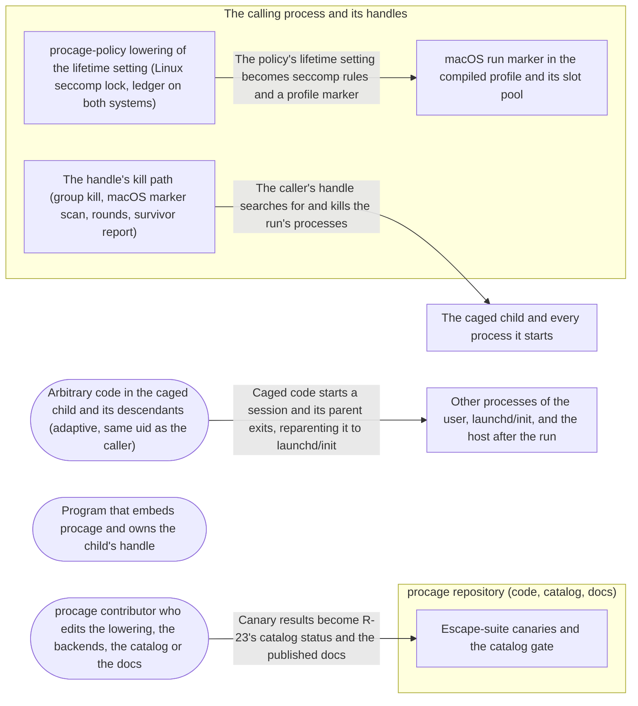

# Threat Model: Lifetime - nothing a run starts outlives it

**Feature**: `024-lifetime` · **Generated**: 2026-11-01T17:26:10Z · **Profiles**: stride, llm, agent · **Canonical**: `threat-model.yaml`

> Rendered by ThreatSpec. Edit `threat-model.yaml`, not this file.

## Summary

| Threats | Critical | High | Medium | Low | Needs clarification | Not applicable | Mitigations | Requirements | Decisions |
|---|---|---|---|---|---|---|---|---|---|
| 7 | 2 | 4 | 1 | 0 | 0 | 26 | 7 | 8 | 0 |

## Actors

| ID | Name | Trust | Description |
|---|---|---|---|
| `actor.caged-code` | Arbitrary code in the caged child and its descendants (adaptive, same uid as the caller) | untrusted |  |
| `actor.caller` | Program that embeds procage and owns the child's handle | trusted |  |
| `actor.contributor` | procage contributor who edits the lowering, the backends, the catalog or the docs | semi-trusted |  |

## Trust Zones

| ID | Name | Trust rating | Description |
|---|---|---|---|
| `tz.cage` | The caged child and every process it starts | 5 |  |
| `tz.caller` | The calling process and its handles | 90 |  |
| `tz.host` | Other processes of the user, launchd/init, and the host after the run | 80 |  |
| `tz.repo` | procage repository (code, catalog, docs) | 70 |  |

## Assets

| ID | Name | Type | Classification | C / I / A | Source |
|---|---|---|---|---|---|
| `asset.catalog-truth` | R-23's catalog status, its evidence and the published claims about lifetime | configuration | public | 0 / 90 / 20 | spec.md#FR-010 |
| `asset.lifetime-policy` | The lifetime setting, its default in policies and frozen presets, and the ledger entry that reports it | configuration | public | 0 / 90 / 30 | spec.md#FR-001 |
| `asset.other-processes` | The caller's other runs and the user's unrelated processes | capability | internal | 20 / 80 / 90 | spec.md#US2 |
| `asset.run-boundary` | The promise that no process of a run lives after its handle is dropped or kill_all returns | capability | confidential | 30 / 100 / 60 | spec.md#Context |

## Components

| ID | Name | Type | Trust zone | Source |
|---|---|---|---|---|
| `component.lowering` | procage-policy lowering of the lifetime setting (Linux seccomp lock, ledger on both systems) | library | `tz.caller` | spec.md#FR-009 |
| `component.marker` | macOS run marker in the compiled profile and its slot pool | library | `tz.caller` | spec.md#FR-004 |
| `component.reaper` | The handle's kill path (group kill, macOS marker scan, rounds, survivor report) | library | `tz.caller` | spec.md#FR-006 |
| `component.suite` | Escape-suite canaries and the catalog gate | test-suite | `tz.repo` | spec.md#FR-010 |

## Data Flows

| ID | Name | From | To | Assets | Crosses |
|---|---|---|---|---|---|
| `flow.claim` | Canary results become R-23's catalog status and the published docs | `actor.contributor` | `component.suite` | `asset.catalog-truth` | `tz.repo` |
| `flow.escape` | Caged code starts a session and its parent exits, reparenting it to launchd/init | `actor.caged-code` | `tz.host` | `asset.run-boundary` | `tz.cage`, `tz.host` |
| `flow.lower` | The policy's lifetime setting becomes seccomp rules and a profile marker | `component.lowering` | `component.marker` | `asset.lifetime-policy` | `tz.caller` |
| `flow.reap` | The caller's handle searches for and kills the run's processes | `component.reaper` | `tz.cage` | `asset.run-boundary`, `asset.other-processes` | `tz.caller`, `tz.cage`, `tz.host` |

## Threats

| ID | Threat | Category | Technique | Severity | Status | Mitigations | Mappings | Source |
|---|---|---|---|---|---|---|---|---|
| `threat.daemon-outlives-run` | Caged code double-forks a descendant into its own session, the intermediate exits, and the descendant keeps running after the handle is dropped | Elevation of Privilege | broken-access-control | **critical** | mitigated | `mitigation.canary-evidence`, `mitigation.linux-group-lock`, `mitigation.macos-marker-scan` |  | spec.md#US1 |
| `threat.orphan-after-exit` | The child exits and is reaped before the run ends, so its descendants (in or out of its group) are no longer found from it and survive | Elevation of Privilege | broken-access-control | **critical** | mitigated | `mitigation.linux-group-lock`, `mitigation.macos-marker-scan` |  | spec.md#US2 |
| `threat.cross-run-kill` | Ending one run kills another run's processes or unrelated processes (a marker shared by two live runs, reused while its processes live, matched by another sandbox, or a reused pid) | Denial of Service | resource-exhaustion | **high** | mitigated | `mitigation.immutable-marker`, `mitigation.slot-discipline` |  | spec.md#Edge-Cases |
| `threat.kill-false-success` | kill_all reports success although a process of the run survived (forking faster than the kill, another uid, a scan that stopped early) | Repudiation | missing-audit-trail | **high** | mitigated | `mitigation.bounded-rounds` |  | spec.md#FR-006 |
| `threat.marker-evasion` | Caged code drops, changes or hides its run marker (an extension release, a forged lookup, a profile change), or the marker grants it access to something that exists | Elevation of Privilege | privilege-escalation-via-config | **high** | mitigated | `mitigation.immutable-marker` |  | spec.md#FR-005 |
| `threat.silent-lifetime-weakening` | A policy, a frozen preset or a lowering path ends up with the tree setting or without the lock (a missing tier, architecture or syscall) without the ledger, the docs or a test saying so | Tampering | privilege-escalation-via-config | **high** | mitigated | `mitigation.ledger-and-pins` |  | spec.md#FR-009 |
| `threat.overclaimed-lifetime` | R-23 is marked mitigated, or the docs drop the open variant, without passing kernel canaries on every system and tier | Repudiation | missing-audit-trail | **medium** | mitigated | `mitigation.canary-evidence` |  | spec.md#FR-010 |

### Techniques evaluated without findings

| Technique | Disposition | Reason |
|---|---|---|
| identity-spoofing | not-applicable | no authentication surface |
| data-tampering-in-transit | not-applicable | no network-boundary surface: the marker and the kill happen inside one host between the caller and its own children |
| cross-tenant-leak | not-applicable | no multi-tenant surface; runs of one caller are separated by threat.cross-run-kill |
| credential-theft | no-threat-detected | checked component.marker: the marker is a mach-lookup name of no existing service and grants no file, so it exposes no credential; R-24 (environment) is unchanged |
| sensitive-data-exposure | no-threat-detected | checked component.reaper: the scan reads only sandbox verdicts and process status of same-user processes from the caller, outside the cage; nothing is returned to the child |
| data-tampering-at-rest | not-applicable | no stored data is introduced; the marker lives only in the compiled profile in memory |
| injection | no-threat-detected | checked component.marker: the marker is built from a process-random number and a slot index (hex digits and dots), never from caller or child input |
| prompt-injection-direct | not-applicable | procage is a library that calls no model and runs no agent; LLM-written code is the adversary inside the child, modelled under STRIDE |
| prompt-injection-indirect | not-applicable | procage is a library that calls no model and runs no agent; LLM-written code is the adversary inside the child, modelled under STRIDE |
| sensitive-information-disclosure | not-applicable | procage is a library that calls no model and runs no agent; LLM-written code is the adversary inside the child, modelled under STRIDE |
| excessive-agency | not-applicable | procage is a library that calls no model and runs no agent; LLM-written code is the adversary inside the child, modelled under STRIDE |
| model-supply-chain | not-applicable | procage is a library that calls no model and runs no agent; LLM-written code is the adversary inside the child, modelled under STRIDE |
| training-data-poisoning | not-applicable | procage is a library that calls no model and runs no agent; LLM-written code is the adversary inside the child, modelled under STRIDE |
| unbounded-consumption | not-applicable | procage is a library that calls no model and runs no agent; LLM-written code is the adversary inside the child, modelled under STRIDE |
| misinformation | not-applicable | procage is a library that calls no model and runs no agent; LLM-written code is the adversary inside the child, modelled under STRIDE |
| hidden-context-exposure | not-applicable | procage is a library that calls no model and runs no agent; LLM-written code is the adversary inside the child, modelled under STRIDE |
| vector-embedding-weakness | not-applicable | procage is a library that calls no model and runs no agent; LLM-written code is the adversary inside the child, modelled under STRIDE |
| improper-output-handling | not-applicable | procage is a library that calls no model and runs no agent; LLM-written code is the adversary inside the child, modelled under STRIDE |
| model-extraction | not-applicable | procage is a library that calls no model and runs no agent; LLM-written code is the adversary inside the child, modelled under STRIDE |
| goal-hijack | not-applicable | procage is a library that calls no model and runs no agent; LLM-written code is the adversary inside the child, modelled under STRIDE |
| tool-misuse | not-applicable | procage is a library that calls no model and runs no agent; LLM-written code is the adversary inside the child, modelled under STRIDE |
| identity-privilege-abuse | not-applicable | procage is a library that calls no model and runs no agent; LLM-written code is the adversary inside the child, modelled under STRIDE |
| agentic-supply-chain | not-applicable | procage is a library that calls no model and runs no agent; LLM-written code is the adversary inside the child, modelled under STRIDE |
| unexpected-code-execution | not-applicable | procage is a library that calls no model and runs no agent; LLM-written code is the adversary inside the child, modelled under STRIDE |
| memory-context-poisoning | not-applicable | procage is a library that calls no model and runs no agent; LLM-written code is the adversary inside the child, modelled under STRIDE |
| insecure-inter-agent-communication | not-applicable | procage is a library that calls no model and runs no agent; LLM-written code is the adversary inside the child, modelled under STRIDE |
| cascading-failure | not-applicable | procage is a library that calls no model and runs no agent; LLM-written code is the adversary inside the child, modelled under STRIDE |
| human-agent-trust-exploitation | not-applicable | procage is a library that calls no model and runs no agent; LLM-written code is the adversary inside the child, modelled under STRIDE |
| rogue-agent | not-applicable | procage is a library that calls no model and runs no agent; LLM-written code is the adversary inside the child, modelled under STRIDE |

## Mitigations

| ID | Mitigation | Kind | Threats | Requirements | Touchpoints | Status |
|---|---|---|---|---|---|---|
| `mitigation.bounded-rounds` | kill_all repeats search and kill until none is found or a round limit is hit, skips zombies, and returns an error naming survivors | detective | `threat.kill-false-success` | SR-006 | `src/macos/lifetime.rs`, `src/macos/child.rs` | verified |
| `mitigation.canary-evidence` | R-23 becomes mitigated only with the double-fork and exited-child canaries passing on macOS and Linux T1/T2, named as evidence and enforced by the catalog gate | detective | `threat.overclaimed-lifetime`, `threat.daemon-outlives-run` | SR-008 | `tests/escape_macos.rs`, `tests/escape_linux.rs`, `tests/threat_model.rs`, `THREAT_MODEL.md` | verified |
| `mitigation.immutable-marker` | The marker is a literal in the compiled profile (no extension filter), a deny-prefix plus allow-literal pair on a mach-lookup name that no service registers; a probe name the run denies separates it from allow-all sandboxes | preventive | `threat.marker-evasion`, `threat.cross-run-kill` | SR-004 | `crates/procage-policy/src/lower/macos.rs`, `src/macos/lifetime.rs` | verified |
| `mitigation.ledger-and-pins` | The lifetime setting is reported in the ledger on both systems, pinned in the lowering table and seccomp tests per architecture, and presets keep the default under a test | detective | `threat.silent-lifetime-weakening` | SR-007 | `crates/procage-policy/src/lower/mod.rs`, `crates/procage-policy/src/lowering.md`, `src/linux/seccomp.rs`, `crates/procage-policy/src/presets.rs` | verified |
| `mitigation.linux-group-lock` | Under the default lifetime the Linux seccomp program denies setsid and setpgid with EPERM on both tiers, installed after procage's own setsid; the handle kills the group | preventive | `threat.daemon-outlives-run`, `threat.orphan-after-exit` | SR-001, SR-003 | `crates/procage-policy/src/lower/linux.rs`, `src/linux/seccomp.rs`, `src/linux/child.rs` | verified |
| `mitigation.macos-marker-scan` | Every forking macOS spawn carries a per-run marker in its compiled profile; ending the run scans all processes and kills those whose sandbox carries the marker | preventive | `threat.daemon-outlives-run`, `threat.orphan-after-exit` | SR-002, SR-003 | `crates/procage-policy/src/lower/macos.rs`, `src/macos/lifetime.rs`, `src/macos/child.rs`, `src/macos/sys.rs` | verified |
| `mitigation.slot-discipline` | Markers come from a process-random prefix and a slot pool; a slot is freed only after a kill that found no survivor; detach and a failed kill retire it | preventive | `threat.cross-run-kill` | SR-005 | `src/macos/lifetime.rs`, `src/macos/mod.rs`, `src/macos/child.rs` | verified |

## Security Requirements

### SR-001 (P1) — verified

Under the default lifetime on Linux, setsid and setpgid MUST fail with EPERM in every caged process on tiers T1 and T2, and dropping the handle MUST kill a double-forked descendant.

- **Given** the default lifetime on T1 and on T2, **when** a caged process calls setsid and setpgid, **then** both fail with EPERM
- **Given** a double-forked descendant on T1 and on T2, **when** the handle is dropped, **then** the descendant is dead within two seconds
- Mitigations: `mitigation.linux-group-lock`
- Tasks: T004 ✓, T011 ✓, T012 ✓, T015 ✓
- Verification `verification.sr-001.2026-10-31`: test → pass (verified) — `tests/escape_linux.rs::r23_sessions_are_locked, tests/escape_linux.rs::r23_a_double_forked_descendant_dies_with_the_run`
- Verification `verification.sr-001.2026-10-31-2`: test → pass (verified) — `tests/escape_linux.rs::r23_sessions_are_locked, tests/escape_linux.rs::r23_a_double_forked_descendant_dies_with_the_run`

### SR-002 (P1) — verified

On macOS, ending a forking run MUST kill every process whose sandbox carries the run's marker, including a double-forked descendant in its own session reparented to launchd.

- **Given** a double-forked descendant in its own session on macOS, **when** the handle is dropped, **then** the descendant is dead within two seconds
- Mitigations: `mitigation.macos-marker-scan`
- Tasks: T008 ✓, T010 ✓, T012 ✓
- Verification `verification.sr-002.2026-10-31`: test → pass (verified) — `tests/escape_macos.rs::r23_a_double_forked_descendant_dies_with_the_run`
- Verification `verification.sr-002.2026-10-31-2`: test → pass (verified) — `tests/escape_macos.rs::r23_a_double_forked_descendant_dies_with_the_run`

### SR-003 (P1) — verified

Descendants of a child that exited and was reaped before the run ended MUST be killed when the handle is dropped, on macOS and on Linux T1 and T2.

- **Given** a child that started a background descendant and exited, **when** the caller waits for it and drops the handle, **then** the descendant is dead within two seconds
- Mitigations: `mitigation.linux-group-lock`, `mitigation.macos-marker-scan`
- Tasks: T010 ✓, T011 ✓
- Verification `verification.sr-003.2026-10-31`: test → pass (verified) — `tests/escape_macos.rs::r23_descendants_of_an_exited_child_die_with_the_run, tests/escape_linux.rs::r23_descendants_of_an_exited_child_die_with_the_run`
- Verification `verification.sr-003.2026-10-31-2`: test → pass (verified) — `tests/escape_macos.rs::r23_descendants_of_an_exited_child_die_with_the_run, tests/escape_linux.rs::r23_descendants_of_an_exited_child_die_with_the_run`

### SR-004 (P1) — verified

The macOS marker MUST be part of the compiled profile, MUST grant no access to an existing resource, and MUST NOT match the caller, unsandboxed processes, or a sandbox that allows all lookups.

- **Given** a running cage and an allow-all sandbox and the caller, **when** each is checked for the run's marker, **then** only the cage's processes match
- **Given** the lowered profile, **when** its marker rules are inspected, **then** they use a literal name and no extension filter
- Mitigations: `mitigation.immutable-marker`
- Tasks: T005 ✓, T007 ✓, T009 ✓, T014 ✓
- Verification `verification.sr-004.2026-10-31`: test → pass (verified) — `tests/spawn_macos.rs::the_run_marker_matches_only_its_run, crates/procage-policy/tests/precedence.rs::a_forking_policy_ends_with_the_run_marker`
- Verification `verification.sr-004.2026-10-31-2`: test → pass (verified) — `tests/spawn_macos.rs::the_run_marker_matches_only_its_run, crates/procage-policy/tests/precedence.rs::a_forking_policy_ends_with_the_run_marker`

### SR-005 (P1) — verified

Two live runs of one caller MUST NOT share a marker; dropping one run's handle MUST leave the other run's processes alive; a marker MUST be reused only after a kill that found no survivor, and never after detach.

- **Given** two concurrent runs from the same cage with descendants in their own sessions, **when** one handle is dropped, **then** the other run's descendants are still alive
- **Given** a detached child, **when** another child is spawned, **then** it gets a different marker
- Mitigations: `mitigation.slot-discipline`
- Tasks: T007 ✓, T009 ✓, T013 ✓
- Verification `verification.sr-005.2026-10-31`: test → pass (verified) — `tests/escape_macos.rs::r23_concurrent_runs_are_separate, tests/escape_macos.rs::r23_a_detached_run_keeps_its_marker, src/macos/lifetime.rs::tests::slots_are_reused_only_when_freed`
- Verification `verification.sr-005.2026-10-31-2`: test → pass (verified) — `tests/escape_macos.rs::r23_concurrent_runs_are_separate, tests/escape_macos.rs::r23_a_detached_run_keeps_its_marker, src/macos/lifetime.rs::tests::slots_are_reused_only_when_freed`

### SR-006 (P2) — verified

kill_all MUST NOT return Ok while a process of the run is known to live; after the round limit it MUST return an error naming the survivors.

- **Given** a search that keeps finding a live process of the run, **when** the round limit is reached, **then** kill_all returns an error with its pid
- Mitigations: `mitigation.bounded-rounds`
- Tasks: T008 ✓, T010 ✓
- Verification `verification.sr-006.2026-10-31`: test → pass (verified) — `src/macos/lifetime.rs::tests::a_run_that_keeps_living_is_reported, src/macos/child.rs:93`
- Verification `verification.sr-006.2026-10-31-2`: test → pass (verified) — `src/macos/lifetime.rs::tests::a_run_that_keeps_living_is_reported, src/macos/child.rs:83`

### SR-007 (P2) — verified

The lifetime setting MUST appear in the lowering ledger on both systems and in the lowering table; the Linux lock MUST be pinned per architecture; the frozen presets MUST carry the default lifetime.

- **Given** a policy with each lifetime value, **when** it is lowered for Linux and macOS, **then** the ledger reports the setting and the Linux seccomp rules contain the lock only for the default
- **Given** every frozen preset, **when** it is built, **then** its lifetime is the default
- Mitigations: `mitigation.ledger-and-pins`
- Tasks: T002 ✓, T003 ✓, T004 ✓, T005 ✓, T006 ✓
- Verification `verification.sr-007.2026-10-31`: test → pass (verified) — `crates/procage-policy/tests/gaps.rs::the_linux_lifetime_lock_follows_the_setting, crates/procage-policy/tests/lowering_table.rs, crates/procage-policy/tests/presets.rs::presets_keep_descendants_in_the_run`
- Verification `verification.sr-007.2026-10-31-2`: test → pass (verified) — `crates/procage-policy/tests/gaps.rs::the_linux_lifetime_lock_follows_the_setting, crates/procage-policy/tests/lowering_table.rs, crates/procage-policy/tests/presets.rs::presets_keep_descendants_in_the_run`

### SR-008 (P1) — verified

R-23 MUST be marked mitigated only with the double-fork and exited-child canaries as evidence, passing on macOS and Linux T1 and T2, and the catalog gate MUST pass.

- **Given** the catalog, **when** the gate runs, **then** R-23 is mitigated with existing canary tests as evidence
- **Given** the escape suite on macOS, T1 and T2, **when** it runs, **then** the R-23 canaries pass and none is ignored
- Mitigations: `mitigation.canary-evidence`
- Tasks: T012 ✓, T016 ✓
- Verification `verification.sr-008.2026-10-31`: test → pass (verified) — `tests/threat_model.rs::statuses_are_parsed`
- Verification `verification.sr-008.2026-10-31-2`: test → pass (verified) — `tests/threat_model.rs::statuses_are_parsed`
