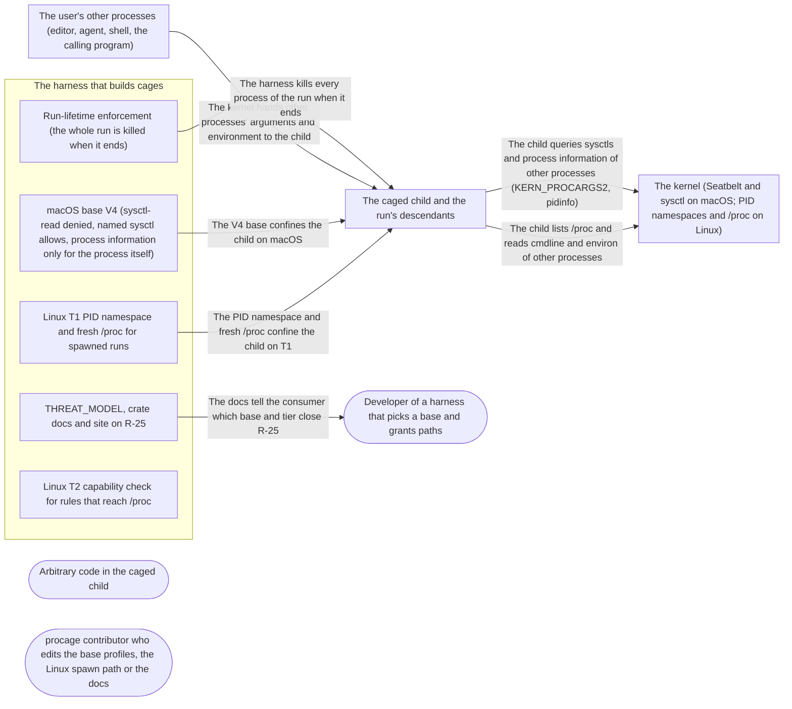

# Threat Model: Other processes stay opaque

**Feature**: `025-introspection` · **Generated**: 2026-11-01T21:15:30Z · **Profiles**: stride, llm, agent · **Canonical**: `threat-model.yaml`

> Rendered by ThreatSpec. Edit `threat-model.yaml`, not this file.

## Summary

| Threats | Critical | High | Medium | Low | Needs clarification | Not applicable | Mitigations | Requirements | Decisions |
|---|---|---|---|---|---|---|---|---|---|
| 7 | 0 | 3 | 4 | 0 | 2 | 28 | 7 | 7 | 0 |

### Needs clarification

- `threat.nc-default-base` — [NEEDS CLARIFICATION: do the default presets move to the V4 base, or must callers opt in to it, leaving R-25 open on macOS for every cage that does not?] (spec.md#Clarifications)
- `threat.nc-pid-one` — [NEEDS CLARIFICATION: who is PID 1 of the new T1 namespace (the target or a minimal init prepared in the parent), and how are orphans reaped and termination signals delivered to it?] (spec.md#Clarifications)

## Actors

| ID | Name | Trust | Description |
|---|---|---|---|
| `actor.caged-code` | Arbitrary code in the caged child | untrusted |  |
| `actor.consumer` | Developer of a harness that picks a base and grants paths | trusted |  |
| `actor.contributor` | procage contributor who edits the base profiles, the Linux spawn path or the docs | semi-trusted |  |

## Trust Zones

| ID | Name | Trust rating | Description |
|---|---|---|---|
| `tz.cage` | The caged child and the run's descendants | 5 |  |
| `tz.harness` | The harness that builds cages | 90 |  |
| `tz.os` | The kernel (Seatbelt and sysctl on macOS; PID namespaces and /proc on Linux) | 95 |  |
| `tz.others` | The user's other processes (editor, agent, shell, the calling program) | 70 |  |

## Assets

| ID | Name | Type | Classification | C / I / A | Source |
|---|---|---|---|---|---|
| `asset.base` | The frozen macOS base profiles (V1 to V3 and the new V4) and the V4 sysctl allowlist | capability | internal | 0 / 90 / 50 | spec.md#Key-Entities |
| `asset.lifetime` | The run-lifetime guarantee: no process of the run outlives it | capability | internal | 0 / 90 / 50 | spec.md#FR-003 |
| `asset.process-secrets` | Command lines and environments of the user's other processes, which routinely hold tokens | credential | secret | 100 / 0 / 0 | spec.md#Input |

## Components

| ID | Name | Type | Trust zone | Source |
|---|---|---|---|---|
| `component.base-v4` | macOS base V4 (sysctl-read denied, named sysctl allows, process information only for the process itself) | library | `tz.harness` | spec.md#FR-001 |
| `component.docs` | THREAT_MODEL, crate docs and site on R-25 | document | `tz.harness` | spec.md#FR-005 |
| `component.lifetime` | Run-lifetime enforcement (the whole run is killed when it ends) | library | `tz.harness` | spec.md#FR-003 |
| `component.pidns` | Linux T1 PID namespace and fresh /proc for spawned runs | library | `tz.harness` | spec.md#FR-003 |
| `component.t2-gate` | Linux T2 capability check for rules that reach /proc | library | `tz.harness` | spec.md#FR-004 |

## Data Flows

| ID | Name | From | To | Assets | Crosses |
|---|---|---|---|---|---|
| `flow.claims` | The docs tell the consumer which base and tier close R-25 | `component.docs` | `actor.consumer` | `asset.process-secrets` |  |
| `flow.confine-ns` | The PID namespace and fresh /proc confine the child on T1 | `component.pidns` | `tz.cage` | `asset.process-secrets` | `tz.harness`, `tz.cage` |
| `flow.confine-v4` | The V4 base confines the child on macOS | `component.base-v4` | `tz.cage` | `asset.base`, `asset.process-secrets` | `tz.harness`, `tz.cage` |
| `flow.exposure` | The kernel hands other processes' arguments and environment to the child | `tz.others` | `tz.cage` | `asset.process-secrets` | `tz.others`, `tz.cage` |
| `flow.kill` | The harness kills every process of the run when it ends | `component.lifetime` | `tz.cage` | `asset.lifetime` | `tz.harness`, `tz.cage` |
| `flow.procfs` | The child lists /proc and reads cmdline and environ of other processes | `tz.cage` | `tz.os` | `asset.process-secrets` | `tz.cage`, `tz.os` |
| `flow.sysctl` | The child queries sysctls and process information of other processes (KERN_PROCARGS2, pidinfo) | `tz.cage` | `tz.os` | `asset.process-secrets` | `tz.cage`, `tz.os` |

## Threats

| ID | Threat | Category | Technique | Severity | Status | Mitigations | Mappings | Source |
|---|---|---|---|---|---|---|---|---|
| `threat.procargs-variant` | On the V4 base the child reads another process's arguments or environment through a query the rule does not cover (KERN_PROCARGS, a numeric MIB, a pidinfo flavour), stealing tokens | Information Disclosure | sensitive-data-exposure | **high** | open | `mitigation.deny-then-name` |  | spec.md#FR-001 |
| `threat.stale-proc-view` | On T1 the child still sees other processes: the target runs outside the new PID namespace (unshare without a fork), /proc is mounted from the old namespace, or another proc mount stays reachable | Information Disclosure | sensitive-data-exposure | **high** | open | `mitigation.fresh-proc` |  | spec.md#FR-003 |
| `threat.t2-silent-proc` | On T2 a policy whose rules reach /proc (literally or through an ancestor such as /) runs without the caller accepting the approximation, so other processes' command lines are readable silently | Information Disclosure, Elevation of Privilege | privilege-escalation-via-config | **high** | open | `mitigation.proc-gap` |  | spec.md#FR-004 |
| `threat.allowlist-widening` | A sysctl allow added by prefix or regular expression (or a broad process-info allow) to make a program work re-admits KERN_PROCARGS2 on V4 | Elevation of Privilege, Information Disclosure | privilege-escalation-via-config | **medium** | open | `mitigation.literal-allowlist` |  | spec.md#Edge-Cases |
| `threat.pidns-lifetime` | The PID namespace changes how the run is tracked and killed (namespace-relative pids, orphans reparented inside it, signals to its init ignored), so a descendant outlives the run (R-23) or zombies pile up | Elevation of Privilege, Denial of Service | broken-access-control | **medium** | open | `mitigation.lifetime-suite` |  | spec.md#FR-003 |
| `threat.status-overclaim` | The docs or the threat model present R-25 as closed for the older bases, for T2, or for Cage::exec (no PID namespace), so a consumer passes secrets in arguments it believes hidden | Repudiation | missing-audit-trail | **medium** | open | `mitigation.per-platform-status` |  | spec.md#FR-005 |
| `threat.unmeasured-release` | The rule measured on macOS 26.6.2 does not hold on macOS 27, and V4 is frozen with the read still open there | Information Disclosure | sensitive-data-exposure | **medium** | open | `mitigation.measure-before-freeze` |  | spec.md#Assumptions |

### Techniques evaluated without findings

| Technique | Disposition | Reason |
|---|---|---|
| credential-theft | not-applicable | no authentication surface |
| identity-spoofing | not-applicable | no authentication or network boundary |
| data-tampering-in-transit | not-applicable | no data in transit; the feature changes rules, a namespace and a mount |
| data-tampering-at-rest | no-threat-detected | checked the stored profiles: V1 to V3 stay frozen and byte-identical (SR-002); changes to V4 are threat.allowlist-widening |
| injection | not-applicable | no external-input surface; the feature parses no data the child provides |
| resource-exhaustion | not-applicable | no external-input surface; orphan reaping inside the namespace is part of threat.pidns-lifetime |
| cross-tenant-leak | not-applicable | single user; other users' processes are already refused by the kernel (out of scope) |
| prompt-injection-direct | not-applicable | procage is a library that calls no model and runs no agent; LLM-written code is the adversary inside the child, modelled under STRIDE |
| prompt-injection-indirect | not-applicable | procage is a library that calls no model and runs no agent; LLM-written code is the adversary inside the child, modelled under STRIDE |
| sensitive-information-disclosure | not-applicable | procage is a library that calls no model and runs no agent; LLM-written code is the adversary inside the child, modelled under STRIDE |
| excessive-agency | not-applicable | procage is a library that calls no model and runs no agent; LLM-written code is the adversary inside the child, modelled under STRIDE |
| model-supply-chain | not-applicable | procage is a library that calls no model and runs no agent; LLM-written code is the adversary inside the child, modelled under STRIDE |
| training-data-poisoning | not-applicable | procage is a library that calls no model and runs no agent; LLM-written code is the adversary inside the child, modelled under STRIDE |
| unbounded-consumption | not-applicable | procage is a library that calls no model and runs no agent; LLM-written code is the adversary inside the child, modelled under STRIDE |
| misinformation | not-applicable | procage is a library that calls no model and runs no agent; LLM-written code is the adversary inside the child, modelled under STRIDE |
| hidden-context-exposure | not-applicable | procage is a library that calls no model and runs no agent; LLM-written code is the adversary inside the child, modelled under STRIDE |
| vector-embedding-weakness | not-applicable | procage is a library that calls no model and runs no agent; LLM-written code is the adversary inside the child, modelled under STRIDE |
| improper-output-handling | not-applicable | procage is a library that calls no model and runs no agent; LLM-written code is the adversary inside the child, modelled under STRIDE |
| model-extraction | not-applicable | procage is a library that calls no model and runs no agent; LLM-written code is the adversary inside the child, modelled under STRIDE |
| goal-hijack | not-applicable | procage is a library that calls no model and runs no agent; LLM-written code is the adversary inside the child, modelled under STRIDE |
| tool-misuse | not-applicable | procage is a library that calls no model and runs no agent; LLM-written code is the adversary inside the child, modelled under STRIDE |
| identity-privilege-abuse | not-applicable | procage is a library that calls no model and runs no agent; LLM-written code is the adversary inside the child, modelled under STRIDE |
| agentic-supply-chain | not-applicable | procage is a library that calls no model and runs no agent; LLM-written code is the adversary inside the child, modelled under STRIDE |
| unexpected-code-execution | not-applicable | procage is a library that calls no model and runs no agent; LLM-written code is the adversary inside the child, modelled under STRIDE |
| memory-context-poisoning | not-applicable | procage is a library that calls no model and runs no agent; LLM-written code is the adversary inside the child, modelled under STRIDE |
| insecure-inter-agent-communication | not-applicable | procage is a library that calls no model and runs no agent; LLM-written code is the adversary inside the child, modelled under STRIDE |
| cascading-failure | not-applicable | procage is a library that calls no model and runs no agent; LLM-written code is the adversary inside the child, modelled under STRIDE |
| human-agent-trust-exploitation | not-applicable | procage is a library that calls no model and runs no agent; LLM-written code is the adversary inside the child, modelled under STRIDE |
| rogue-agent | not-applicable | procage is a library that calls no model and runs no agent; LLM-written code is the adversary inside the child, modelled under STRIDE |

## Mitigations

| ID | Mitigation | Kind | Threats | Requirements | Touchpoints | Status |
|---|---|---|---|---|---|---|
| `mitigation.deny-then-name` | V4 denies sysctl-read and process-info-pidinfo explicitly, then allows named sysctls and the process's own information; R-25 canaries read KERN_PROCARGS2, KERN_PROCARGS and pidinfo of another process, with a positive control on the process itself | preventive | `threat.procargs-variant` | SR-001 | `component.base-v4` | required |
| `mitigation.fresh-proc` | The target runs inside the new PID namespace and /proc is mounted fresh from inside it, over the old one; the T1 canary checks /proc, a known outside pid and every proc mount in mountinfo | preventive | `threat.stale-proc-view` | SR-004 | `component.pidns` | required |
| `mitigation.lifetime-suite` | The R-23 escape suite runs unchanged on T1 with the PID namespace, and a test checks that orphans are reaped and that no process of the run survives its end | preventive | `threat.pidns-lifetime` | SR-005 | `component.pidns`, `component.lifetime` | required |
| `mitigation.literal-allowlist` | The V4 allowlist holds literal sysctl names only, each with the program that needed it; a lowering test rejects prefix and regex forms; V1 to V3 fixtures stay byte-identical | preventive | `threat.allowlist-widening` | SR-002 | `component.base-v4` | required |
| `mitigation.measure-before-freeze` | V4 is frozen only after the R-25 canaries and the base program set pass on the macOS 26 and 27 lanes; the canaries fail, never skip | preventive | `threat.unmeasured-release` | SR-003 | `component.base-v4` | required |
| `mitigation.per-platform-status` | THREAT_MODEL and docs give R-25 per platform, base and tier, with the T2 residual and the Cage::exec limit | preventive | `threat.status-overclaim` | SR-007 | `component.docs` | required |
| `mitigation.proc-gap` | On T2 any rule whose reach includes /proc is a capability gap unless the caller accepts the approximation by name, recorded in the receipt | preventive | `threat.t2-silent-proc` | SR-006 | `component.t2-gate` | required |

## Security Requirements

### SR-001 (P1) — unverified

On the V4 base, reading the arguments, environment or process information of any process outside the run (KERN_PROCARGS2, KERN_PROCARGS, pidinfo) MUST fail with EPERM, while the child's reads of its own MUST succeed.

- **Given** a same-user process holding a token in its arguments and a child on the V4 base, **when** the child reads that process's KERN_PROCARGS2, KERN_PROCARGS and pidinfo, **then** each read fails with EPERM
- **Given** the same child, **when** it reads its own KERN_PROCARGS2 and pidinfo, **then** both succeed
- Mitigations: `mitigation.deny-then-name`
- Tasks: — none —

### SR-002 (P1) — unverified

The V4 sysctl allowlist MUST name each sysctl literally, with the program that needed it, and MUST NOT contain a prefix or regular-expression form; V1 to V3 MUST compile byte-identical to before.

- **Given** the V4 base, **when** its sysctl rules are lowered, **then** every allow is a literal name with a recorded program, and a prefix or regex form fails the test
- **Given** the V1, V2 and V3 fixtures, **when** they are compiled, **then** they equal the frozen fixtures
- Mitigations: `mitigation.literal-allowlist`
- Tasks: — none —

### SR-003 (P1) — unverified

V4 MUST NOT be frozen until the R-25 canaries and the base program set pass on the macOS 26 and 27 lanes, and the canaries MUST fail, never skip, when the read succeeds or the child is already sandboxed.

- **Given** the macOS 26 and 27 lanes, **when** the R-25 canaries and the base program set run on V4, **then** the canaries are refused and every program works as on V3
- **Given** a lane where the read succeeds, **when** the canary runs, **then** it fails the lane
- Mitigations: `mitigation.measure-before-freeze`
- Tasks: — none —

### SR-004 (P1) — unverified

On Linux T1 every spawned run MUST run inside a new PID namespace with a /proc mounted from inside it, and no proc mount showing processes outside the run MUST be reachable.

- **Given** T1 and a same-user process outside the run, **when** the child lists /proc and reads that process's cmdline by its outside pid, **then** it sees only the run's processes and the read fails
- **Given** the same child, **when** it lists the proc mounts in /proc/self/mountinfo, **then** every proc mount shows only the run's processes
- Mitigations: `mitigation.fresh-proc`
- Tasks: — none —

### SR-005 (P1) — unverified

With the PID namespace, Lifetime::Run MUST still end every process of the run, orphans MUST be reaped, and the R-23 escape suite MUST pass unchanged on T1.

- **Given** T1 and a double-forked descendant, **when** the run ends, **then** the descendant is gone
- **Given** a child that orphans many short-lived processes, **when** the run proceeds, **then** no zombie of the run remains
- **Given** the R-23 canaries, **when** they run on T1 with the namespace, **then** every canary holds
- Mitigations: `mitigation.lifetime-suite`
- Tasks: — none —

### SR-006 (P1) — unverified

On Linux T2 a policy whose rules reach /proc, literally or through an ancestor, MUST be refused as a capability gap unless the caller accepts the approximation by name, and the acceptance MUST be recorded in the receipt; other processes' environ MUST stay unreadable.

- **Given** T2 and a policy that grants read on /, **when** the cage spawns without the approximation, **then** it is refused with a capability gap naming /proc
- **Given** the approximation accepted by name, **when** the child reads another process's cmdline and environ, **then** cmdline is readable, environ is refused, and the receipt records the approximation
- Mitigations: `mitigation.proc-gap`
- Tasks: — none —

### SR-007 (P2) — unverified

THREAT_MODEL and the docs MUST give R-25's status per platform, base and tier, MUST state that V1 to V3 and T2 leave command lines readable, and MUST state that Cage::exec gets no PID namespace.

- **Given** THREAT_MODEL, the crate docs and the site, **when** they describe R-25, **then** they name the closing base on macOS, T1's canary, the T2 residual and the Cage::exec limit
- Mitigations: `mitigation.per-platform-status`
- Tasks: — none —
