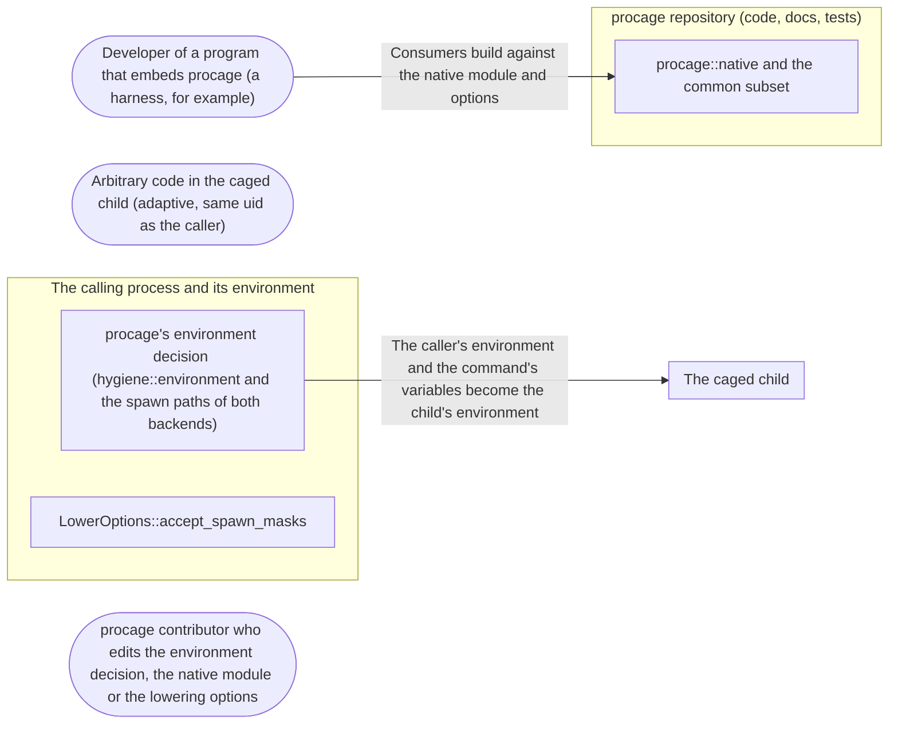

# Threat Model: Consumer API before the freeze

**Feature**: `026-consumer-api` · **Generated**: 2026-11-01T17:28:34Z · **Profiles**: stride, llm, agent · **Canonical**: `threat-model.yaml`

> Rendered by ThreatSpec. Edit `threat-model.yaml`, not this file.

## Summary

| Threats | Critical | High | Medium | Low | Needs clarification | Not applicable | Mitigations | Requirements | Decisions |
|---|---|---|---|---|---|---|---|---|---|
| 4 | 1 | 1 | 2 | 0 | 0 | 26 | 4 | 5 | 0 |

## Actors

| ID | Name | Trust | Description |
|---|---|---|---|
| `actor.caged-code` | Arbitrary code in the caged child (adaptive, same uid as the caller) | untrusted |  |
| `actor.consumer` | Developer of a program that embeds procage (a harness, for example) | trusted |  |
| `actor.contributor` | procage contributor who edits the environment decision, the native module or the lowering options | semi-trusted |  |

## Trust Zones

| ID | Name | Trust rating | Description |
|---|---|---|---|
| `tz.cage` | The caged child | 5 |  |
| `tz.caller` | The calling process and its environment | 90 |  |
| `tz.repo` | procage repository (code, docs, tests) | 70 |  |

## Assets

| ID | Name | Type | Classification | C / I / A | Source |
|---|---|---|---|---|---|
| `asset.api-contract` | The portable surface and lowering options consumers write against before the freeze | configuration | public | 0 / 80 / 40 | spec.md#US2 |
| `asset.caller-env` | Secrets in the calling process's environment (tokens, keys, agent sockets) | credential | secret | 100 / 30 / 10 | spec.md#Context |

## Components

| ID | Name | Type | Trust zone | Source |
|---|---|---|---|---|
| `component.env-decision` | procage's environment decision (hygiene::environment and the spawn paths of both backends) | library | `tz.caller` | spec.md#FR-001 |
| `component.lower-options` | LowerOptions::accept_spawn_masks | library | `tz.caller` | spec.md#FR-007 |
| `component.native` | procage::native and the common subset | library | `tz.repo` | spec.md#FR-005 |

## Data Flows

| ID | Name | From | To | Assets | Crosses |
|---|---|---|---|---|---|
| `flow.contract` | Consumers build against the native module and options | `actor.consumer` | `component.native` | `asset.api-contract` | `tz.repo` |
| `flow.env` | The caller's environment and the command's variables become the child's environment | `component.env-decision` | `tz.cage` | `asset.caller-env` | `tz.caller`, `tz.cage` |

## Threats

| ID | Threat | Category | Technique | Severity | Status | Mitigations | Mappings | Source |
|---|---|---|---|---|---|---|---|---|
| `threat.env-clear-ignored` | A consumer calls env_clear and sets its own variables under a passthrough policy, and procage passes the caller's whole environment, secrets included, to caged code | Information Disclosure | sensitive-data-exposure | **critical** | mitigated | `mitigation.honour-env-clear` |  | spec.md#Context |
| `threat.env-observer-unreliable` | The env_clear observation silently stops working (std changes its formatting) or is fooled by argument or variable values, so passthrough leaks again or an environment is wrongly cleared | Information Disclosure | sensitive-data-exposure | **high** | mitigated | `mitigation.checked-observer` |  | spec.md#FR-002 |
| `threat.native-drift` | The native module's common subset diverges between systems, so portable consumer code fails to build on one system or behaves differently | Tampering | broken-access-control | **medium** | mitigated | `mitigation.portable-test` |  | spec.md#FR-006 |
| `threat.overbroad-acceptance` | accept_spawn_masks accepts more than the data-driven class approximations (a glob rule, hide on T2), silently weakening a cage | Elevation of Privilege | privilege-escalation-via-config | **medium** | mitigated | `mitigation.exact-acceptance` |  | spec.md#FR-007 |

### Techniques evaluated without findings

| Technique | Disposition | Reason |
|---|---|---|
| identity-spoofing | not-applicable | no authentication surface |
| data-tampering-in-transit | not-applicable | no network-boundary surface; the environment is handed from the caller to its own child |
| cross-tenant-leak | not-applicable | no multi-tenant surface |
| credential-theft | no-threat-detected | checked component.env-decision: credential exposure through the environment is threat.env-clear-ignored; the native module and lowering option carry no credentials |
| data-tampering-at-rest | not-applicable | no stored data |
| resource-exhaustion | no-threat-detected | checked component.env-decision: the format check runs once per process on a fixed probe command |
| prompt-injection-direct | not-applicable | procage is a library that calls no model and runs no agent; LLM-written code is the adversary inside the child, modelled under STRIDE |
| prompt-injection-indirect | not-applicable | procage is a library that calls no model and runs no agent; LLM-written code is the adversary inside the child, modelled under STRIDE |
| sensitive-information-disclosure | not-applicable | procage is a library that calls no model and runs no agent; LLM-written code is the adversary inside the child, modelled under STRIDE |
| excessive-agency | not-applicable | procage is a library that calls no model and runs no agent; LLM-written code is the adversary inside the child, modelled under STRIDE |
| model-supply-chain | not-applicable | procage is a library that calls no model and runs no agent; LLM-written code is the adversary inside the child, modelled under STRIDE |
| training-data-poisoning | not-applicable | procage is a library that calls no model and runs no agent; LLM-written code is the adversary inside the child, modelled under STRIDE |
| unbounded-consumption | not-applicable | procage is a library that calls no model and runs no agent; LLM-written code is the adversary inside the child, modelled under STRIDE |
| misinformation | not-applicable | procage is a library that calls no model and runs no agent; LLM-written code is the adversary inside the child, modelled under STRIDE |
| hidden-context-exposure | not-applicable | procage is a library that calls no model and runs no agent; LLM-written code is the adversary inside the child, modelled under STRIDE |
| vector-embedding-weakness | not-applicable | procage is a library that calls no model and runs no agent; LLM-written code is the adversary inside the child, modelled under STRIDE |
| improper-output-handling | not-applicable | procage is a library that calls no model and runs no agent; LLM-written code is the adversary inside the child, modelled under STRIDE |
| model-extraction | not-applicable | procage is a library that calls no model and runs no agent; LLM-written code is the adversary inside the child, modelled under STRIDE |
| goal-hijack | not-applicable | procage is a library that calls no model and runs no agent; LLM-written code is the adversary inside the child, modelled under STRIDE |
| tool-misuse | not-applicable | procage is a library that calls no model and runs no agent; LLM-written code is the adversary inside the child, modelled under STRIDE |
| identity-privilege-abuse | not-applicable | procage is a library that calls no model and runs no agent; LLM-written code is the adversary inside the child, modelled under STRIDE |
| agentic-supply-chain | not-applicable | procage is a library that calls no model and runs no agent; LLM-written code is the adversary inside the child, modelled under STRIDE |
| unexpected-code-execution | not-applicable | procage is a library that calls no model and runs no agent; LLM-written code is the adversary inside the child, modelled under STRIDE |
| memory-context-poisoning | not-applicable | procage is a library that calls no model and runs no agent; LLM-written code is the adversary inside the child, modelled under STRIDE |
| insecure-inter-agent-communication | not-applicable | procage is a library that calls no model and runs no agent; LLM-written code is the adversary inside the child, modelled under STRIDE |
| cascading-failure | not-applicable | procage is a library that calls no model and runs no agent; LLM-written code is the adversary inside the child, modelled under STRIDE |
| human-agent-trust-exploitation | not-applicable | procage is a library that calls no model and runs no agent; LLM-written code is the adversary inside the child, modelled under STRIDE |
| rogue-agent | not-applicable | procage is a library that calls no model and runs no agent; LLM-written code is the adversary inside the child, modelled under STRIDE |

## Mitigations

| ID | Mitigation | Kind | Threats | Requirements | Touchpoints | Status |
|---|---|---|---|---|---|---|
| `mitigation.checked-observer` | The observer parses only the structured env field line, is self-checked once per process, and a failed check refuses passthrough spawns | preventive | `threat.env-observer-unreliable` | SR-002, SR-003 | `src/unix.rs` | verified |
| `mitigation.exact-acceptance` | accept_spawn_masks inserts exactly three constructs, pinned by a test, and degradations still list them | preventive | `threat.overbroad-acceptance` | SR-005 | `crates/procage-policy/src/lower/mod.rs` | verified |
| `mitigation.honour-env-clear` | The spawn paths observe env_clear and then pass no caller variable under any policy | preventive | `threat.env-clear-ignored` | SR-001 | `src/hygiene.rs`, `src/unix.rs` | verified |
| `mitigation.portable-test` | A test uses only procage::native on both systems | detective | `threat.native-drift` | SR-004 | `src/lib.rs`, `tests/native.rs` | verified |

## Security Requirements

### SR-001 (P1) — verified

When a command called env_clear, no variable of the caller MUST reach the child under passthrough or allowlist policies, on macOS and Linux T1 and T2.

- **Given** a secret in the caller's environment and a passthrough policy, **when** the command calls env_clear and sets A=1, **then** the child's environment holds A and no caller variable
- **Given** an allowlist naming PATH, **when** the command calls env_clear, **then** the child does not get the caller's PATH
- Mitigations: `mitigation.honour-env-clear`
- Tasks: T003 ✓, T005 ✓
- Verification `verification.sr-001.2026-10-31`: test → pass (verified) — `tests/spawn_macos.rs::env_clear_keeps_the_caller_environment_out, tests/spawn_linux.rs::env_clear_keeps_the_caller_environment_out`

### SR-002 (P1) — verified

If procage cannot observe env_clear, a passthrough spawn MUST fail before forking with a typed error.

- **Given** an observer whose self-check fails, **when** a passthrough policy spawns, **then** the spawn fails with the typed error and no child runs
- Mitigations: `mitigation.checked-observer`
- Tasks: T003 ✓, T004 ✓
- Verification `verification.sr-002.2026-10-31`: test → pass (verified) — `src/unix.rs::tests::the_decision_fails_closed_only_for_passthrough, src/macos/mod.rs:614, src/linux/mod.rs:644`

### SR-003 (P1) — verified

The observer MUST NOT report a clear because of argument or variable values that contain its marker text, and MUST report clear exactly when env_clear was called.

- **Given** commands with and without env_clear whose arguments and values contain the marker text, **when** they are observed, **then** only the cleared ones are reported as cleared
- Mitigations: `mitigation.checked-observer`
- Tasks: T002 ✓
- Verification `verification.sr-003.2026-10-31`: test → pass (verified) — `src/unix.rs::tests::values_cannot_fake_a_clear, src/unix.rs::tests::the_observer_works_with_this_std, src/unix.rs::tests::an_unexpected_shape_is_unknown`

### SR-004 (P2) — verified

Code using only procage::native and the common subset MUST compile and run a caged command on macOS and Linux.

- **Given** the portable test, **when** it runs on macOS, T1 and T2, **then** it passes without cfg in its body
- Mitigations: `mitigation.portable-test`
- Tasks: T007 ✓
- Verification `verification.sr-004.2026-10-31`: test → pass (verified) — `tests/native.rs::a_granted_file_is_read_through_the_common_subset, tests/native.rs::kill_all_and_detach_have_the_same_meaning, tests/native.rs::errors_explain_themselves`

### SR-005 (P2) — verified

accept_spawn_masks MUST accept exactly the secrets, trust-handoff and persistence approximations, and they MUST appear in the plan's degradations.

- **Given** a policy reading / on T1, **when** lowered with accept_spawn_masks, **then** it lowers and its degradations name the classes
- **Given** a policy with a glob rule on Linux, **when** lowered with accept_spawn_masks, **then** it is still refused
- Mitigations: `mitigation.exact-acceptance`
- Tasks: T008 ✓
- Verification `verification.sr-005.2026-10-31`: test → pass (verified) — `crates/procage-policy/tests/gaps.rs::reading_everything_on_t1_needs_exactly_the_spawn_masks`
