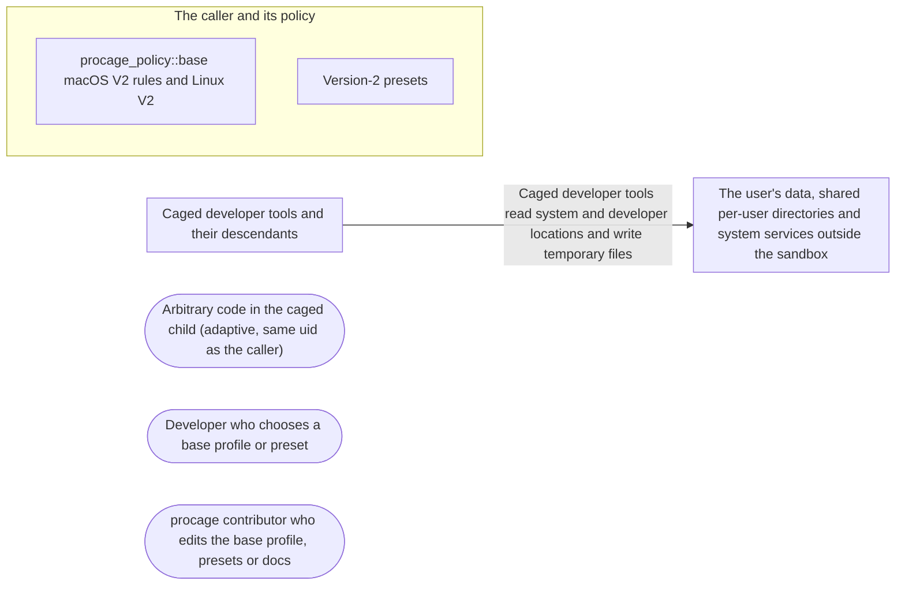

# Threat Model: Base profile V2

**Feature**: `027-base-v2` · **Generated**: 2026-11-01T17:28:34Z · **Profiles**: stride, llm, agent · **Canonical**: `threat-model.yaml`

> Rendered by ThreatSpec. Edit `threat-model.yaml`, not this file.

## Summary

| Threats | Critical | High | Medium | Low | Needs clarification | Not applicable | Mitigations | Requirements | Decisions |
|---|---|---|---|---|---|---|---|---|---|
| 4 | 0 | 2 | 2 | 0 | 0 | 26 | 3 | 3 | 0 |

## Actors

| ID | Name | Trust | Description |
|---|---|---|---|
| `actor.caged-code` | Arbitrary code in the caged child (adaptive, same uid as the caller) | untrusted |  |
| `actor.consumer` | Developer who chooses a base profile or preset | trusted |  |
| `actor.contributor` | procage contributor who edits the base profile, presets or docs | semi-trusted |  |

## Trust Zones

| ID | Name | Trust rating | Description |
|---|---|---|---|
| `tz.cage` | Caged developer tools and their descendants | 5 |  |
| `tz.caller` | The caller and its policy | 90 |  |
| `tz.host` | The user's data, shared per-user directories and system services outside the sandbox | 80 |  |

## Assets

| ID | Name | Type | Classification | C / I / A | Source |
|---|---|---|---|---|---|
| `asset.shared-state` | Per-user shared temporary and cache directories read later by unsandboxed tools (xcrun's tool cache) | configuration | internal | 50 / 100 / 30 | spec.md#Context |
| `asset.user-data` | The user's files and preferences in the home directory | pii | confidential | 90 / 80 / 20 | spec.md#US2 |

## Components

| ID | Name | Type | Trust zone | Source |
|---|---|---|---|---|
| `component.base` | procage_policy::base macOS V2 rules and Linux V2 | library | `tz.caller` | spec.md#FR-001 |
| `component.presets` | Version-2 presets | library | `tz.caller` | spec.md#FR-005 |

## Data Flows

| ID | Name | From | To | Assets | Crosses |
|---|---|---|---|---|---|
| `flow.tools` | Caged developer tools read system and developer locations and write temporary files | `tz.cage` | `tz.host` | `asset.user-data`, `asset.shared-state` | `tz.cage`, `tz.host` |

## Threats

| ID | Threat | Category | Technique | Severity | Status | Mitigations | Mappings | Source |
|---|---|---|---|---|---|---|---|---|
| `threat.personal-data-in-base` | A V2 addition reads user data (preferences, files in the home, Homebrew etc with credentials) | Information Disclosure | sensitive-data-exposure | **high** | mitigated | `mitigation.personal-checks` |  | spec.md#US2 |
| `threat.shared-temp-poisoning` | A base addition (dirhelper, membership) points tools at the user's shared temporary or cache directory, so caged code writes xcrun's cache or temp files that unsandboxed tools trust | Tampering | data-tampering-at-rest | **high** | mitigated | `mitigation.no-dirhelper` |  | spec.md#Context |
| `threat.frozen-drift` | V1 or the version-1 presets change while V2 is added, silently loosening frozen policies | Tampering | privilege-escalation-via-config | **medium** | mitigated | `mitigation.pins` |  | spec.md#FR-001 |
| `threat.unfiltered-rule` | A base rule is emitted with an empty filter list and so allows an operation everywhere (observed during research for mach-lookup) | Elevation of Privilege | privilege-escalation-via-config | **medium** | mitigated | `mitigation.pins` |  | spec.md#Edge-Cases |

### Techniques evaluated without findings

| Technique | Disposition | Reason |
|---|---|---|
| identity-spoofing | not-applicable | no authentication surface |
| data-tampering-in-transit | not-applicable | no network-boundary surface; the environment is handed from the caller to its own child |
| cross-tenant-leak | not-applicable | no multi-tenant surface |
| credential-theft | no-threat-detected | checked component.base: credential exposure through base additions is threat.personal-data-in-base |
| data-tampering-at-rest | not-applicable | no stored data |
| resource-exhaustion | no-threat-detected | checked component.base: the base adds static rules only |
| prompt-injection-direct | not-applicable | procage is a library that calls no model and runs no agent; LLM-written code is the adversary inside the child, modelled under STRIDE |
| prompt-injection-indirect | not-applicable | procage is a library that calls no model and runs no agent; LLM-written code is the adversary inside the child, modelled under STRIDE |
| sensitive-information-disclosure | not-applicable | procage is a library that calls no model and runs no agent; LLM-written code is the adversary inside the child, modelled under STRIDE |
| excessive-agency | not-applicable | procage is a library that calls no model and runs no agent; LLM-written code is the adversary inside the child, modelled under STRIDE |
| model-supply-chain | not-applicable | procage is a library that calls no model and runs no agent; LLM-written code is the adversary inside the child, modelled under STRIDE |
| training-data-poisoning | not-applicable | procage is a library that calls no model and runs no agent; LLM-written code is the adversary inside the child, modelled under STRIDE |
| unbounded-consumption | not-applicable | procage is a library that calls no model and runs no agent; LLM-written code is the adversary inside the child, modelled under STRIDE |
| misinformation | not-applicable | procage is a library that calls no model and runs no agent; LLM-written code is the adversary inside the child, modelled under STRIDE |
| hidden-context-exposure | not-applicable | procage is a library that calls no model and runs no agent; LLM-written code is the adversary inside the child, modelled under STRIDE |
| vector-embedding-weakness | not-applicable | procage is a library that calls no model and runs no agent; LLM-written code is the adversary inside the child, modelled under STRIDE |
| improper-output-handling | not-applicable | procage is a library that calls no model and runs no agent; LLM-written code is the adversary inside the child, modelled under STRIDE |
| model-extraction | not-applicable | procage is a library that calls no model and runs no agent; LLM-written code is the adversary inside the child, modelled under STRIDE |
| goal-hijack | not-applicable | procage is a library that calls no model and runs no agent; LLM-written code is the adversary inside the child, modelled under STRIDE |
| tool-misuse | not-applicable | procage is a library that calls no model and runs no agent; LLM-written code is the adversary inside the child, modelled under STRIDE |
| identity-privilege-abuse | not-applicable | procage is a library that calls no model and runs no agent; LLM-written code is the adversary inside the child, modelled under STRIDE |
| agentic-supply-chain | not-applicable | procage is a library that calls no model and runs no agent; LLM-written code is the adversary inside the child, modelled under STRIDE |
| unexpected-code-execution | not-applicable | procage is a library that calls no model and runs no agent; LLM-written code is the adversary inside the child, modelled under STRIDE |
| memory-context-poisoning | not-applicable | procage is a library that calls no model and runs no agent; LLM-written code is the adversary inside the child, modelled under STRIDE |
| insecure-inter-agent-communication | not-applicable | procage is a library that calls no model and runs no agent; LLM-written code is the adversary inside the child, modelled under STRIDE |
| cascading-failure | not-applicable | procage is a library that calls no model and runs no agent; LLM-written code is the adversary inside the child, modelled under STRIDE |
| human-agent-trust-exploitation | not-applicable | procage is a library that calls no model and runs no agent; LLM-written code is the adversary inside the child, modelled under STRIDE |
| rogue-agent | not-applicable | procage is a library that calls no model and runs no agent; LLM-written code is the adversary inside the child, modelled under STRIDE |

## Mitigations

| ID | Mitigation | Kind | Threats | Requirements | Touchpoints | Status |
|---|---|---|---|---|---|---|
| `mitigation.no-dirhelper` | V2 omits dirhelper and membership; a caged test checks that the per-user temporary directory resolves to the private TMPDIR | preventive | `threat.shared-temp-poisoning` | SR-001 | `crates/procage-policy/src/base.rs`, `tests/spawn_macos.rs` | verified |
| `mitigation.personal-checks` | V2 additions are code, system data and two named personal entries; caged tests check home listing, home preferences, Homebrew etc, writes and network stay refused | preventive | `threat.personal-data-in-base` | SR-002 | `crates/procage-policy/src/base.rs`, `tests/spawn_macos.rs` | verified |
| `mitigation.pins` | V1, V2 and the presets' profiles are pinned; every base rule carries a filter | detective | `threat.unfiltered-rule`, `threat.frozen-drift` | SR-003 | `crates/procage-policy/tests/base.rs`, `crates/procage-policy/tests/presets.rs` | verified |

## Security Requirements

### SR-001 (P1) — verified

Under base V2 the child's per-user temporary directory MUST resolve to its private TMPDIR, and V2 MUST NOT allow com.apple.bsd.dirhelper or com.apple.system.opendirectoryd.membership.

- **Given** base V2 with the tmpdir grant, **when** the child asks getconf DARWIN_USER_TEMP_DIR and runs mktemp, **then** both are inside its private TMPDIR
- Mitigations: `mitigation.no-dirhelper`
- Tasks: T002 ✓, T004 ✓
- Verification `verification.sr-001.2026-10-31`: test → pass (verified) — `tests/spawn_macos.rs::base_v2_runs_developer_tools, crates/procage-policy/tests/base.rs::v2_adds_no_service`

### SR-002 (P1) — verified

Base V2 MUST NOT let the child list the home directory, read home preferences or ~/.ssh, read Homebrew etc files other than OpenSSL's configuration, write system or Homebrew locations, or reach the network.

- **Given** base V2, **when** the child tries each of these, **then** each fails
- Mitigations: `mitigation.personal-checks`
- Tasks: T002 ✓, T005 ✓
- Verification `verification.sr-002.2026-10-31`: test → pass (verified) — `tests/spawn_macos.rs::base_v2_grants_nothing_personal`

### SR-003 (P1) — verified

V1, V2 and every preset's profile MUST be pinned, and every base rule MUST carry at least one filter except V1's sysctl-read.

- **Given** the policy crate tests, **when** they run, **then** the pinned contents match and no base rule is unfiltered
- Mitigations: `mitigation.pins`
- Tasks: T001 ✓, T003 ✓, T006 ✓
- Verification `verification.sr-003.2026-10-31`: test → pass (verified) — `crates/procage-policy/tests/base.rs::macos_v2_is_v1_plus_its_pinned_additions, crates/procage-policy/tests/base.rs::every_base_rule_has_a_filter, crates/procage-policy/tests/presets.rs::every_v2_preset_is_pinned, crates/procage-policy/tests/presets.rs::every_preset_is_pinned`
