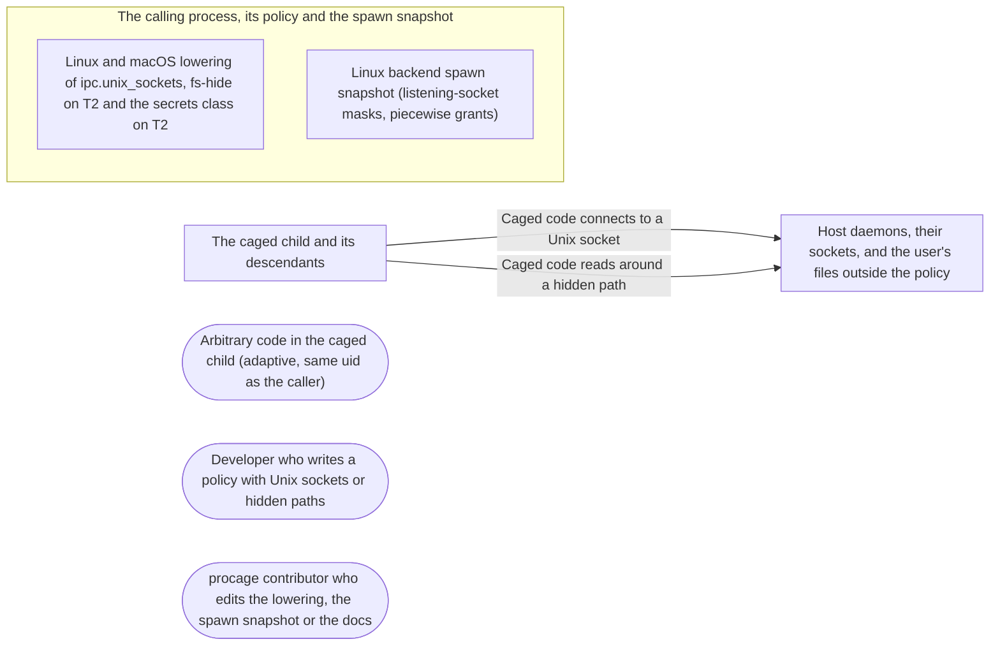

# Threat Model: Unix sockets under trees and hiding on Linux T2

**Feature**: `028-linux-gaps` · **Generated**: 2026-11-01T17:28:35Z · **Profiles**: stride, llm, agent · **Canonical**: `threat-model.yaml`

> Rendered by ThreatSpec. Edit `threat-model.yaml`, not this file.

## Summary

| Threats | Critical | High | Medium | Low | Needs clarification | Not applicable | Mitigations | Requirements | Decisions |
|---|---|---|---|---|---|---|---|---|---|
| 4 | 1 | 2 | 1 | 0 | 0 | 26 | 4 | 4 | 0 |

## Actors

| ID | Name | Trust | Description |
|---|---|---|---|
| `actor.caged-code` | Arbitrary code in the caged child (adaptive, same uid as the caller) | untrusted |  |
| `actor.consumer` | Developer who writes a policy with Unix sockets or hidden paths | trusted |  |
| `actor.contributor` | procage contributor who edits the lowering, the spawn snapshot or the docs | semi-trusted |  |

## Trust Zones

| ID | Name | Trust rating | Description |
|---|---|---|---|
| `tz.cage` | The caged child and its descendants | 5 |  |
| `tz.caller` | The calling process, its policy and the spawn snapshot | 90 |  |
| `tz.host` | Host daemons, their sockets, and the user's files outside the policy | 80 |  |

## Assets

| ID | Name | Type | Classification | C / I / A | Source |
|---|---|---|---|---|---|
| `asset.daemons` | Local daemons reachable over Unix sockets (container engine, agents, databases) | capability | confidential | 80 / 100 / 60 | spec.md#US1 |
| `asset.hidden` | Hidden paths and credentials inside readable trees | credential | secret | 100 / 60 / 20 | spec.md#US2 |
| `asset.policy-intent` | What the policy says, as enforced on each tier and reported in the ledger | configuration | public | 0 / 90 / 30 | spec.md#FR-007 |

## Components

| ID | Name | Type | Trust zone | Source |
|---|---|---|---|---|
| `component.lowering` | Linux and macOS lowering of ipc.unix_sockets, fs-hide on T2 and the secrets class on T2 | library | `tz.caller` | spec.md#FR-003 |
| `component.snapshot` | Linux backend spawn snapshot (listening-socket masks, piecewise grants) | library | `tz.caller` | spec.md#FR-004 |

## Data Flows

| ID | Name | From | To | Assets | Crosses |
|---|---|---|---|---|---|
| `flow.connect` | Caged code connects to a Unix socket | `tz.cage` | `tz.host` | `asset.daemons` | `tz.cage`, `tz.host` |
| `flow.read` | Caged code reads around a hidden path | `tz.cage` | `tz.host` | `asset.hidden` | `tz.cage`, `tz.host` |

## Threats

| ID | Threat | Category | Technique | Severity | Status | Mitigations | Mappings | Source |
|---|---|---|---|---|---|---|---|---|
| `threat.daemon-socket-reached` | Allowing AF_UNIX for workspace sockets lets caged code connect to a daemon socket outside the paths (container engine, ssh-agent), on Linux where nothing filters pathname connects below ABI 9 | Elevation of Privilege | broken-access-control | **critical** | mitigated | `mitigation.macos-path-filters`, `mitigation.socket-masks` |  | spec.md#Context |
| `threat.abstract-socket-reached` | Caged code connects to a host abstract socket (D-Bus, X11) once AF_UNIX is allowed | Elevation of Privilege | broken-access-control | **high** | mitigated | `mitigation.socket-masks` |  | spec.md#FR-003 |
| `threat.sibling-leak` | Piecewise grants on T2 reach the hidden path (a symbolic link sibling, a write grant around it, a rule under it, a grant bound into it) | Information Disclosure | sensitive-data-exposure | **high** | mitigated | `mitigation.safe-siblings` |  | spec.md#FR-004 |
| `threat.silent-approximation` | An approximation (socket masks, piecewise grants) is applied without the caller accepting it, or the option accepts more than it says | Tampering | privilege-escalation-via-config | **medium** | mitigated | `mitigation.named-acceptance` |  | spec.md#FR-007 |

### Techniques evaluated without findings

| Technique | Disposition | Reason |
|---|---|---|
| identity-spoofing | not-applicable | no authentication surface |
| data-tampering-in-transit | not-applicable | no network-boundary surface; the environment is handed from the caller to its own child |
| cross-tenant-leak | not-applicable | no multi-tenant surface |
| credential-theft | no-threat-detected | checked component.snapshot: credential exposure through a hidden path is threat.sibling-leak; the socket list holds paths only |
| data-tampering-at-rest | not-applicable | no stored data |
| resource-exhaustion | no-threat-detected | checked component.snapshot: the sibling walk is bounded by the walk limit and the socket list by the kernel listing |
| prompt-injection-direct | not-applicable | procage is a library that calls no model and runs no agent; LLM-written code is the adversary inside the child, modelled under STRIDE |
| prompt-injection-indirect | not-applicable | procage is a library that calls no model and runs no agent; LLM-written code is the adversary inside the child, modelled under STRIDE |
| sensitive-information-disclosure | not-applicable | procage is a library that calls no model and runs no agent; LLM-written code is the adversary inside the child, modelled under STRIDE |
| excessive-agency | not-applicable | procage is a library that calls no model and runs no agent; LLM-written code is the adversary inside the child, modelled under STRIDE |
| model-supply-chain | not-applicable | procage is a library that calls no model and runs no agent; LLM-written code is the adversary inside the child, modelled under STRIDE |
| training-data-poisoning | not-applicable | procage is a library that calls no model and runs no agent; LLM-written code is the adversary inside the child, modelled under STRIDE |
| unbounded-consumption | not-applicable | procage is a library that calls no model and runs no agent; LLM-written code is the adversary inside the child, modelled under STRIDE |
| misinformation | not-applicable | procage is a library that calls no model and runs no agent; LLM-written code is the adversary inside the child, modelled under STRIDE |
| hidden-context-exposure | not-applicable | procage is a library that calls no model and runs no agent; LLM-written code is the adversary inside the child, modelled under STRIDE |
| vector-embedding-weakness | not-applicable | procage is a library that calls no model and runs no agent; LLM-written code is the adversary inside the child, modelled under STRIDE |
| improper-output-handling | not-applicable | procage is a library that calls no model and runs no agent; LLM-written code is the adversary inside the child, modelled under STRIDE |
| model-extraction | not-applicable | procage is a library that calls no model and runs no agent; LLM-written code is the adversary inside the child, modelled under STRIDE |
| goal-hijack | not-applicable | procage is a library that calls no model and runs no agent; LLM-written code is the adversary inside the child, modelled under STRIDE |
| tool-misuse | not-applicable | procage is a library that calls no model and runs no agent; LLM-written code is the adversary inside the child, modelled under STRIDE |
| identity-privilege-abuse | not-applicable | procage is a library that calls no model and runs no agent; LLM-written code is the adversary inside the child, modelled under STRIDE |
| agentic-supply-chain | not-applicable | procage is a library that calls no model and runs no agent; LLM-written code is the adversary inside the child, modelled under STRIDE |
| unexpected-code-execution | not-applicable | procage is a library that calls no model and runs no agent; LLM-written code is the adversary inside the child, modelled under STRIDE |
| memory-context-poisoning | not-applicable | procage is a library that calls no model and runs no agent; LLM-written code is the adversary inside the child, modelled under STRIDE |
| insecure-inter-agent-communication | not-applicable | procage is a library that calls no model and runs no agent; LLM-written code is the adversary inside the child, modelled under STRIDE |
| cascading-failure | not-applicable | procage is a library that calls no model and runs no agent; LLM-written code is the adversary inside the child, modelled under STRIDE |
| human-agent-trust-exploitation | not-applicable | procage is a library that calls no model and runs no agent; LLM-written code is the adversary inside the child, modelled under STRIDE |
| rogue-agent | not-applicable | procage is a library that calls no model and runs no agent; LLM-written code is the adversary inside the child, modelled under STRIDE |

## Mitigations

| ID | Mitigation | Kind | Threats | Requirements | Touchpoints | Status |
|---|---|---|---|---|---|---|
| `mitigation.macos-path-filters` | macOS allows the network operations only with subpath filters on the socket paths, and denies them under hidden paths | preventive | `threat.daemon-socket-reached` | SR-001 | `crates/procage-policy/src/lower/macos.rs` | verified |
| `mitigation.named-acceptance` | Every snapshot approximation needs accept_spawn_snapshot (pinned set), errors name the construct and the option, degradations list them | preventive | `threat.silent-approximation` | SR-004 | `crates/procage-policy/src/lower/mod.rs` | verified |
| `mitigation.safe-siblings` | Piecewise grants skip symbolic links and everything under a hidden path; a write rule around a hidden path is refused at lowering, a write grant around one at spawn | preventive | `threat.sibling-leak` | SR-003 | `src/linux/spawn.rs`, `crates/procage-policy/src/lower/linux.rs` | verified |
| `mitigation.socket-masks` | T1 allows only AF_UNIX, keeps abstract sockets in the cage's network namespace (plus the Landlock abstract scope where available), and masks every listening socket outside the paths at spawn; T2 refuses | preventive | `threat.daemon-socket-reached`, `threat.abstract-socket-reached` | SR-001, SR-002 | `crates/procage-policy/src/lower/linux.rs`, `src/linux/spawn.rs`, `src/linux/mod.rs` | verified |

## Security Requirements

### SR-001 (P1) — verified

With ipc.unix_sockets covering the workspace and no network, a caged child MUST bind and connect to a socket in the workspace and MUST NOT connect to a listening socket outside it, nor open a TCP connection, on macOS and Linux T1.

- **Given** a daemon socket outside and ipc.unix_sockets on the workspace, **when** the child binds and connects inside, connects to the daemon and opens TCP, **then** inside works, the daemon and TCP fail
- Mitigations: `mitigation.socket-masks`, `mitigation.macos-path-filters`
- Tasks: T002 ✓, T003 ✓, T006 ✓, T007 ✓
- Verification `verification.sr-001.2026-10-31`: test → pass (verified) — `tests/escape_macos.rs::r09_unix_sockets_reach_only_their_paths, tests/escape_linux.rs::r09_unix_sockets_reach_only_their_paths`

### SR-002 (P1) — verified

On Linux the child MUST NOT reach a host abstract socket under ipc.unix_sockets, and T2 below ABI 9 MUST refuse the setting.

- **Given** a host abstract socket and T1 with ipc.unix_sockets, **when** the child connects to it, **then** it fails
- **Given** T2, **when** the policy is prepared, **then** it is refused naming ipc-unix-sockets
- Mitigations: `mitigation.socket-masks`
- Tasks: T003 ✓, T006 ✓, T007 ✓
- Verification `verification.sr-002.2026-10-31`: test → pass (verified) — `tests/escape_linux.rs::r09_unix_sockets_reach_only_their_paths, crates/procage-policy/tests/gaps.rs::unix_sockets_by_tier_and_abi`

### SR-003 (P1) — verified

On T2 a hidden path's contents MUST stay unreadable with piecewise grants - also through a symbolic link sibling - and a write rule or write grant around a hidden path MUST be refused.

- **Given** T2, read on a tree, hide on a subdirectory and a symlink sibling pointing into it, **when** the child reads the hidden file directly and through the link, **then** both fail and a sibling file reads
- **Given** a write rule on the tree, or a write grant bound around the hidden path, **when** preparing or spawning, **then** it is refused naming the construct or the grant and the hidden path
- Mitigations: `mitigation.safe-siblings`
- Tasks: T004 ✓, T008 ✓, T009 ✓
- Verification `verification.sr-003.2026-10-31`: test → pass (verified) — `tests/spawn_linux.rs::t2_hide_is_piecewise, tests/spawn_linux.rs::t2_hide_inside_a_writable_tree_is_refused, tests/spawn_linux.rs::t2_a_write_grant_around_a_hidden_path_fails_the_spawn, tests/spawn_linux.rs::t2_reading_everything_except_secrets`

### SR-004 (P2) — verified

accept_spawn_snapshot MUST accept exactly the data-driven classes, fs-hide and ipc-unix-sockets; without it these approximations MUST be refused with an error naming the construct and the option.

- **Given** each snapshot approximation, **when** lowered without and with the option, **then** refused naming the option, then accepted and listed in degradations
- Mitigations: `mitigation.named-acceptance`
- Tasks: T001 ✓, T005 ✓
- Verification `verification.sr-004.2026-10-31`: test → pass (verified) — `crates/procage-policy/tests/gaps.rs::reading_everything_needs_exactly_the_spawn_snapshot, tests/spawn_linux.rs::t2_hide_is_piecewise`
