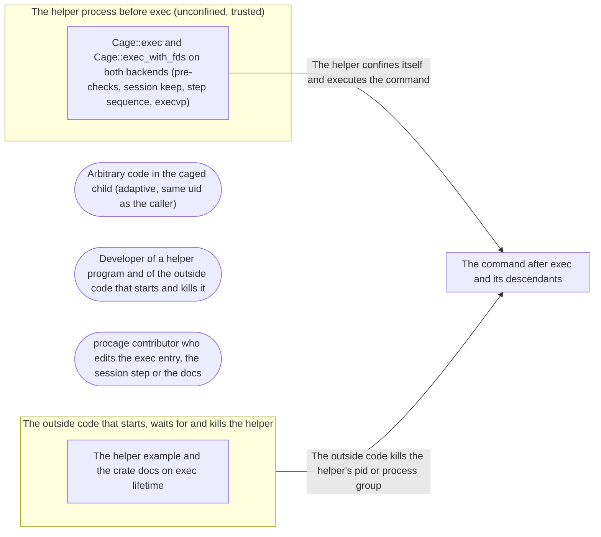

# Threat Model: Exec entry - a helper becomes the caged command

**Feature**: `029-exec-entry` · **Generated**: 2026-11-01T17:28:35Z · **Profiles**: stride, llm, agent · **Canonical**: `threat-model.yaml`

> Rendered by ThreatSpec. Edit `threat-model.yaml`, not this file.

## Summary

| Threats | Critical | High | Medium | Low | Needs clarification | Not applicable | Mitigations | Requirements | Decisions |
|---|---|---|---|---|---|---|---|---|---|
| 4 | 0 | 3 | 0 | 1 | 0 | 26 | 4 | 4 | 0 |

## Actors

| ID | Name | Trust | Description |
|---|---|---|---|
| `actor.caged-code` | Arbitrary code in the caged child (adaptive, same uid as the caller) | untrusted |  |
| `actor.consumer` | Developer of a helper program and of the outside code that starts and kills it | trusted |  |
| `actor.contributor` | procage contributor who edits the exec entry, the session step or the docs | semi-trusted |  |

## Trust Zones

| ID | Name | Trust rating | Description |
|---|---|---|---|
| `tz.cage` | The command after exec and its descendants | 5 |  |
| `tz.helper` | The helper process before exec (unconfined, trusted) | 80 |  |
| `tz.outside` | The outside code that starts, waits for and kills the helper | 90 |  |

## Assets

| ID | Name | Type | Classification | C / I / A | Source |
|---|---|---|---|---|---|
| `asset.host` | The user's files, secrets and processes outside the policy | credential | secret | 100 / 90 / 50 | spec.md#Context |
| `asset.lifetime` | The outside code's ability to end the command and everything it started | capability | internal | 0 / 90 / 70 | spec.md#US2 |

## Components

| ID | Name | Type | Trust zone | Source |
|---|---|---|---|---|
| `component.docs` | The helper example and the crate docs on exec lifetime | document | `tz.outside` | spec.md#FR-008 |
| `component.exec` | Cage::exec and Cage::exec_with_fds on both backends (pre-checks, session keep, step sequence, execvp) | library | `tz.helper` | spec.md#FR-001 |

## Data Flows

| ID | Name | From | To | Assets | Crosses |
|---|---|---|---|---|---|
| `flow.become` | The helper confines itself and executes the command | `component.exec` | `tz.cage` | `asset.host` | `tz.helper`, `tz.cage` |
| `flow.kill` | The outside code kills the helper's pid or process group | `tz.outside` | `tz.cage` | `asset.lifetime` | `tz.outside`, `tz.cage` |

## Threats

| ID | Threat | Category | Technique | Severity | Status | Mitigations | Mappings | Source |
|---|---|---|---|---|---|---|---|---|
| `threat.exec-weaker-than-spawn` | The exec path applies less than spawn for the same policy (a skipped step, the lifetime lock, the descriptor sweep or the environment rules), so caged code reaches host state | Elevation of Privilege | privilege-escalation-via-config | **high** | mitigated | `mitigation.shared-sequence` |  | spec.md#FR-002 |
| `threat.helper-outlived` | The outside code kills the helper but the command or its descendants keep running (a new session, a lost group, a dead parent) | Denial of Service | resource-exhaustion | **high** | mitigated | `mitigation.same-process` |  | spec.md#US2 |
| `threat.partial-confinement` | exec fails after the process has changed and the helper carries on partly confined or, worse, runs the command or other code with only some restrictions | Elevation of Privilege | broken-access-control | **high** | mitigated | `mitigation.checks-first` |  | spec.md#FR-004 |
| `threat.lifetime-overclaimed` | The docs claim that killing the helper ends every descendant on macOS, where a descendant in its own session is not reached | Repudiation | missing-audit-trail | **low** | mitigated | `mitigation.honest-lifetime-docs` |  | spec.md#FR-007 |

### Techniques evaluated without findings

| Technique | Disposition | Reason |
|---|---|---|
| identity-spoofing | not-applicable | no authentication surface |
| data-tampering-in-transit | not-applicable | no network-boundary surface; the environment is handed from the caller to its own child |
| cross-tenant-leak | not-applicable | no multi-tenant surface |
| credential-theft | no-threat-detected | checked component.exec: the environment rules are the spawn path's (spec 026); exposure through a partly confined helper is threat.partial-confinement |
| data-tampering-at-rest | not-applicable | no stored data |
| resource-exhaustion | no-threat-detected | checked component.exec: exec adds no loop or allocation beyond spawn |
| prompt-injection-direct | not-applicable | procage is a library that calls no model and runs no agent; LLM-written code is the adversary inside the child, modelled under STRIDE |
| prompt-injection-indirect | not-applicable | procage is a library that calls no model and runs no agent; LLM-written code is the adversary inside the child, modelled under STRIDE |
| sensitive-information-disclosure | not-applicable | procage is a library that calls no model and runs no agent; LLM-written code is the adversary inside the child, modelled under STRIDE |
| excessive-agency | not-applicable | procage is a library that calls no model and runs no agent; LLM-written code is the adversary inside the child, modelled under STRIDE |
| model-supply-chain | not-applicable | procage is a library that calls no model and runs no agent; LLM-written code is the adversary inside the child, modelled under STRIDE |
| training-data-poisoning | not-applicable | procage is a library that calls no model and runs no agent; LLM-written code is the adversary inside the child, modelled under STRIDE |
| unbounded-consumption | not-applicable | procage is a library that calls no model and runs no agent; LLM-written code is the adversary inside the child, modelled under STRIDE |
| misinformation | not-applicable | procage is a library that calls no model and runs no agent; LLM-written code is the adversary inside the child, modelled under STRIDE |
| hidden-context-exposure | not-applicable | procage is a library that calls no model and runs no agent; LLM-written code is the adversary inside the child, modelled under STRIDE |
| vector-embedding-weakness | not-applicable | procage is a library that calls no model and runs no agent; LLM-written code is the adversary inside the child, modelled under STRIDE |
| improper-output-handling | not-applicable | procage is a library that calls no model and runs no agent; LLM-written code is the adversary inside the child, modelled under STRIDE |
| model-extraction | not-applicable | procage is a library that calls no model and runs no agent; LLM-written code is the adversary inside the child, modelled under STRIDE |
| goal-hijack | not-applicable | procage is a library that calls no model and runs no agent; LLM-written code is the adversary inside the child, modelled under STRIDE |
| tool-misuse | not-applicable | procage is a library that calls no model and runs no agent; LLM-written code is the adversary inside the child, modelled under STRIDE |
| identity-privilege-abuse | not-applicable | procage is a library that calls no model and runs no agent; LLM-written code is the adversary inside the child, modelled under STRIDE |
| agentic-supply-chain | not-applicable | procage is a library that calls no model and runs no agent; LLM-written code is the adversary inside the child, modelled under STRIDE |
| unexpected-code-execution | not-applicable | procage is a library that calls no model and runs no agent; LLM-written code is the adversary inside the child, modelled under STRIDE |
| memory-context-poisoning | not-applicable | procage is a library that calls no model and runs no agent; LLM-written code is the adversary inside the child, modelled under STRIDE |
| insecure-inter-agent-communication | not-applicable | procage is a library that calls no model and runs no agent; LLM-written code is the adversary inside the child, modelled under STRIDE |
| cascading-failure | not-applicable | procage is a library that calls no model and runs no agent; LLM-written code is the adversary inside the child, modelled under STRIDE |
| human-agent-trust-exploitation | not-applicable | procage is a library that calls no model and runs no agent; LLM-written code is the adversary inside the child, modelled under STRIDE |
| rogue-agent | not-applicable | procage is a library that calls no model and runs no agent; LLM-written code is the adversary inside the child, modelled under STRIDE |

## Mitigations

| ID | Mitigation | Kind | Threats | Requirements | Touchpoints | Status |
|---|---|---|---|---|---|---|
| `mitigation.checks-first` | All refusals happen before the first change; later failures are documented as fatal for the helper | preventive | `threat.partial-confinement` | SR-002 | `src/macos/mod.rs`, `src/linux/mod.rs`, `src/unix.rs` | verified |
| `mitigation.honest-lifetime-docs` | Docs and threat model state the exec lifetime per system | detective | `threat.lifetime-overclaimed` | SR-004 | `src/lib.rs`, `THREAT_MODEL.md` | verified |
| `mitigation.same-process` | The command keeps the helper's pid and group; Linux keeps the lock and the parent-death signal | preventive | `threat.helper-outlived` | SR-003 | `src/macos/sys.rs`, `src/linux/sys.rs` | verified |
| `mitigation.shared-sequence` | exec and spawn share one preparation and the same child step sequence; only the session step differs (keep) | preventive | `threat.exec-weaker-than-spawn` | SR-001 | `src/macos/mod.rs`, `src/linux/mod.rs`, `src/macos/sys.rs`, `src/linux/sys.rs` | verified |

## Security Requirements

### SR-001 (P1) — verified

A command run with exec MUST be confined like a spawned one for the same policy - writes outside the grant and the environment rules are enforced - on macOS and Linux T1 and T2.

- **Given** a helper that execs a shell in a cage with a write grant, **when** the shell writes inside and outside the grant, **then** the inside write succeeds and the outside one fails
- **Given** a secret in the helper's environment and env_clear on the command, **when** the command prints its environment, **then** the secret is absent
- Mitigations: `mitigation.shared-sequence`
- Tasks: T002 ✓, T004 ✓, T005 ✓, T006 ✓
- Verification `verification.sr-001.2026-10-31`: test → pass (verified) — `tests/exec.rs::becomes_the_command, tests/exec.rs::env_clear_keeps_secrets_out`

### SR-002 (P1) — verified

Each refusal that can be known before the first change (tmpdir grant, missing program, multithreaded caller on Linux T1, environment decision) MUST return an error and leave the helper unconfined.

- **Given** each misuse, **when** exec is called, **then** it returns its typed error and an outside write by the helper still succeeds
- Mitigations: `mitigation.checks-first`
- Tasks: T003 ✓, T004 ✓, T005 ✓, T007 ✓
- Verification `verification.sr-002.2026-10-31`: test → pass (verified) — `tests/exec.rs::the_tmpdir_grant_is_refused, tests/exec.rs::a_missing_program_is_refused, tests/exec.rs::a_threaded_caller_is_refused_on_t1`

### SR-003 (P1) — verified

The exec'd command MUST keep the helper's pid and process group, and a kill of that group MUST end the command and a background descendant on macOS and Linux; on Linux a descendant MUST NOT be able to start its own session.

- **Given** a helper started in its own process group whose command starts a background sleeper, **when** the outside code kills the group, **then** the command and the sleeper are gone
- **Given** the exec'd command, **when** it prints its pid, **then** the pid is the helper's
- Mitigations: `mitigation.same-process`
- Tasks: T006 ✓
- Verification `verification.sr-003.2026-10-31`: test → pass (verified) — `tests/exec.rs::becomes_the_command, tests/exec.rs::a_group_kill_ends_everything, tests/exec.rs::descendants_cannot_leave_the_group`

### SR-004 (P2) — verified

The docs MUST state the lifetime of an exec'd command on each system, including that macOS does not reach a descendant in its own session.

- **Given** the crate docs and the threat model, **when** read for exec, **then** both state the per-system lifetime and the macOS limit
- Mitigations: `mitigation.honest-lifetime-docs`
- Tasks: T008 ✓, T009 ✓
- Verification `verification.sr-004.2026-10-31`: review → pass (verified) — `src/lib.rs:45, THREAT_MODEL.md:34, src/macos/mod.rs:629`
