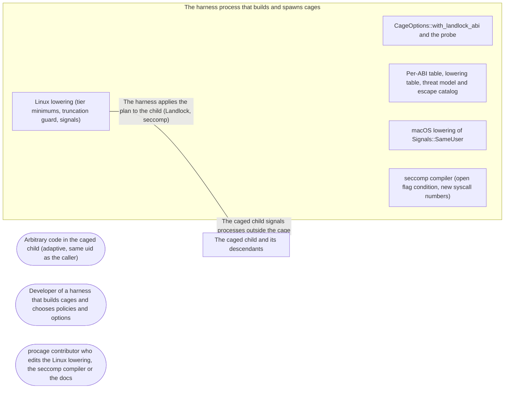

# Threat Model: Older Linux kernels - honest confinement from Landlock ABI 1

**Feature**: `030-older-kernels` · **Generated**: 2026-11-01T17:26:13Z · **Profiles**: stride, llm, agent · **Canonical**: `threat-model.yaml`

> Rendered by ThreatSpec. Edit `threat-model.yaml`, not this file.

## Summary

| Threats | Critical | High | Medium | Low | Needs clarification | Not applicable | Mitigations | Requirements | Decisions |
|---|---|---|---|---|---|---|---|---|---|
| 5 | 1 | 2 | 1 | 1 | 0 | 25 | 5 | 5 | 0 |

## Actors

| ID | Name | Trust | Description |
|---|---|---|---|
| `actor.caged-code` | Arbitrary code in the caged child (adaptive, same uid as the caller) | untrusted |  |
| `actor.consumer` | Developer of a harness that builds cages and chooses policies and options | trusted |  |
| `actor.contributor` | procage contributor who edits the Linux lowering, the seccomp compiler or the docs | semi-trusted |  |

## Trust Zones

| ID | Name | Trust rating | Description |
|---|---|---|---|
| `tz.cage` | The caged child and its descendants | 5 |  |
| `tz.harness` | The harness process that builds and spawns cages | 90 |  |

## Assets

| ID | Name | Type | Classification | C / I / A | Source |
|---|---|---|---|---|---|
| `asset.files` | The user's files outside the policy's writable paths | pii | confidential | 60 / 100 / 80 | spec.md#Context |
| `asset.network` | The outside network with the network off | capability | internal | 90 / 50 / 10 | spec.md#US2 |
| `asset.processes` | The user's other processes (editor, agent, shells) outside the cage | capability | internal | 0 / 60 / 80 | spec.md#US3 |

## Components

| ID | Name | Type | Trust zone | Source |
|---|---|---|---|---|
| `component.cage-options` | CageOptions::with_landlock_abi and the probe | library | `tz.harness` | spec.md#FR-004 |
| `component.docs` | Per-ABI table, lowering table, threat model and escape catalog | document | `tz.harness` | spec.md#FR-006 |
| `component.lowering-linux` | Linux lowering (tier minimums, truncation guard, signals) | library | `tz.harness` | spec.md#FR-001 |
| `component.lowering-macos` | macOS lowering of Signals::SameUser | library | `tz.harness` | spec.md#FR-003 |
| `component.seccomp` | seccomp compiler (open flag condition, new syscall numbers) | library | `tz.harness` | spec.md#FR-001 |

## Data Flows

| ID | Name | From | To | Assets | Crosses |
|---|---|---|---|---|---|
| `flow.confine` | The harness applies the plan to the child (Landlock, seccomp) | `component.lowering-linux` | `tz.cage` | `asset.files`, `asset.network` | `tz.harness`, `tz.cage` |
| `flow.signal` | The caged child signals processes outside the cage | `tz.cage` | `tz.harness` | `asset.processes` | `tz.cage`, `tz.harness` |

## Threats

| ID | Threat | Category | Technique | Severity | Status | Mitigations | Mappings | Source |
|---|---|---|---|---|---|---|---|---|
| `threat.truncation-below-abi3` | On a kernel below Landlock ABI 3 caged code truncates readable files outside the writable paths (truncate, open with O_TRUNC and no write access, openat2), emptying them | Tampering | data-tampering-at-rest | **critical** | mitigated | `mitigation.truncation-guard` |  | spec.md#Context |
| `threat.t2-weaker-on-old-abi` | Tier T2 on ABI 1-3 lets caged code create IP sockets or write outside the writable paths because a rule assumed ABI 4 | Elevation of Privilege | privilege-escalation-via-config | **high** | mitigated | `mitigation.abi-matrix` |  | spec.md#FR-002 |
| `threat.unscoped-signals` | procage widens SelfAndChildren to unscoped signals on its own below ABI 6, so caged code kills the user's other processes without the harness knowing | Denial of Service | resource-exhaustion | **high** | mitigated | `mitigation.explicit-same-user` |  | spec.md#FR-003 |
| `threat.cap-raises-abi` | The ABI cap uses rights the kernel lacks (a cap above the kernel) or lowers for one ABI and enforces another, so gaps understate what is missing | Elevation of Privilege | broken-access-control | **medium** | mitigated | `mitigation.cap-is-min` |  | spec.md#FR-004 |
| `threat.overclaimed-old-kernels` | The docs claim confinement on older kernels that the tests do not show (truncation, signals, passed sockets) | Repudiation | missing-audit-trail | **low** | mitigated | `mitigation.abi-docs` |  | spec.md#FR-006 |

### Techniques evaluated without findings

| Technique | Disposition | Reason |
|---|---|---|
| identity-spoofing | not-applicable | no authentication surface |
| data-tampering-in-transit | not-applicable | no network-boundary surface |
| cross-tenant-leak | not-applicable | no multi-tenant surface |
| credential-theft | no-threat-detected | checked component.lowering-linux: no change to reading files or the environment; truncation and signal rules do not disclose data |
| data-tampering-at-rest | no-threat-detected | evaluated: files at rest emptied through truncation are threat.truncation-below-abi3 |
| resource-exhaustion | no-threat-detected | checked component.seccomp: three fixed seccomp blocks; signals to other processes are threat.unscoped-signals |
| prompt-injection-direct | not-applicable | procage is a library that calls no model and runs no agent; LLM-written code is the adversary inside the child, modelled under STRIDE |
| prompt-injection-indirect | not-applicable | procage is a library that calls no model and runs no agent; LLM-written code is the adversary inside the child, modelled under STRIDE |
| sensitive-information-disclosure | not-applicable | procage is a library that calls no model and runs no agent; LLM-written code is the adversary inside the child, modelled under STRIDE |
| excessive-agency | not-applicable | procage is a library that calls no model and runs no agent; LLM-written code is the adversary inside the child, modelled under STRIDE |
| model-supply-chain | not-applicable | procage is a library that calls no model and runs no agent; LLM-written code is the adversary inside the child, modelled under STRIDE |
| training-data-poisoning | not-applicable | procage is a library that calls no model and runs no agent; LLM-written code is the adversary inside the child, modelled under STRIDE |
| unbounded-consumption | not-applicable | procage is a library that calls no model and runs no agent; LLM-written code is the adversary inside the child, modelled under STRIDE |
| misinformation | not-applicable | procage is a library that calls no model and runs no agent; LLM-written code is the adversary inside the child, modelled under STRIDE |
| hidden-context-exposure | not-applicable | procage is a library that calls no model and runs no agent; LLM-written code is the adversary inside the child, modelled under STRIDE |
| vector-embedding-weakness | not-applicable | procage is a library that calls no model and runs no agent; LLM-written code is the adversary inside the child, modelled under STRIDE |
| improper-output-handling | not-applicable | procage is a library that calls no model and runs no agent; LLM-written code is the adversary inside the child, modelled under STRIDE |
| model-extraction | not-applicable | procage is a library that calls no model and runs no agent; LLM-written code is the adversary inside the child, modelled under STRIDE |
| goal-hijack | not-applicable | procage is a library that calls no model and runs no agent; LLM-written code is the adversary inside the child, modelled under STRIDE |
| tool-misuse | not-applicable | procage is a library that calls no model and runs no agent; LLM-written code is the adversary inside the child, modelled under STRIDE |
| identity-privilege-abuse | not-applicable | procage is a library that calls no model and runs no agent; LLM-written code is the adversary inside the child, modelled under STRIDE |
| agentic-supply-chain | not-applicable | procage is a library that calls no model and runs no agent; LLM-written code is the adversary inside the child, modelled under STRIDE |
| unexpected-code-execution | not-applicable | procage is a library that calls no model and runs no agent; LLM-written code is the adversary inside the child, modelled under STRIDE |
| memory-context-poisoning | not-applicable | procage is a library that calls no model and runs no agent; LLM-written code is the adversary inside the child, modelled under STRIDE |
| insecure-inter-agent-communication | not-applicable | procage is a library that calls no model and runs no agent; LLM-written code is the adversary inside the child, modelled under STRIDE |
| cascading-failure | not-applicable | procage is a library that calls no model and runs no agent; LLM-written code is the adversary inside the child, modelled under STRIDE |
| human-agent-trust-exploitation | not-applicable | procage is a library that calls no model and runs no agent; LLM-written code is the adversary inside the child, modelled under STRIDE |
| rogue-agent | not-applicable | procage is a library that calls no model and runs no agent; LLM-written code is the adversary inside the child, modelled under STRIDE |

## Mitigations

| ID | Mitigation | Kind | Threats | Requirements | Touchpoints | Status |
|---|---|---|---|---|---|---|
| `mitigation.abi-docs` | Per-ABI table and limits in the Linux docs, lowering table, threat model and catalog | detective | `threat.overclaimed-old-kernels` | SR-005 | `src/linux/mod.rs`, `crates/procage-policy/src/lowering.md`, `THREAT_MODEL.md` | verified |
| `mitigation.abi-matrix` | Caged tests at capped ABIs 1, 2, 3, 5 and the kernel's own on T1 and T2 check writes, sockets, hard-deny syscalls and truncation | detective | `threat.t2-weaker-on-old-abi` | SR-002 | `tests/spawn_linux.rs`, `crates/procage-policy/src/lower/mod.rs`, `src/linux/probe.rs` | verified |
| `mitigation.cap-is-min` | The cap is min(cap, kernel ABI) and the same value drives lowering and enforcement; the cage reports it | preventive | `threat.cap-raises-abi` | SR-004 | `src/linux/mod.rs` | verified |
| `mitigation.explicit-same-user` | SameUser is a separate policy value chosen by the caller; SelfAndChildren below ABI 6 stays unsupported | preventive | `threat.unscoped-signals` | SR-003 | `crates/procage-policy/src/policy.rs`, `crates/procage-policy/src/lower/linux.rs`, `crates/procage-policy/src/lower/macos.rs` | verified |
| `mitigation.truncation-guard` | Below ABI 3 the plan denies truncate, open/openat with O_TRUNC unless write-only or read-write, and openat2 (ENOSYS), on both tiers | preventive | `threat.truncation-below-abi3` | SR-001 | `crates/procage-policy/src/lower/linux.rs`, `crates/procage-policy/src/linux.rs`, `src/linux/seccomp.rs` | verified |

## Security Requirements

### SR-001 (P1) — verified

Below Landlock ABI 3, on both tiers, caged code MUST NOT be able to truncate a file outside the writable paths by truncate(2), open or openat with O_TRUNC, or openat2.

- **Given** T1 or T2 with the ABI capped at 1 or 2 and / readable, **when** the child tries each truncation route on a file outside the writable paths, **then** each fails and the file keeps its size
- **Given** the same cage, **when** the child writes a workspace file with > and truncates it through a write descriptor, **then** both succeed
- Mitigations: `mitigation.truncation-guard`
- Tasks: T003 ✓, T004 ✓, T005 ✓, T006 ✓
- Verification `verification.sr-001.2026-10-31`: test → pass (verified) — `tests/escape_linux.rs::r31_files_outside_the_writable_paths_cannot_be_truncated`

### SR-002 (P1) — verified

Tier T2 at Landlock ABI 1 to 3 MUST keep writes inside the writable paths, refuse IP sockets with the network off and refuse the hard-deny syscalls.

- **Given** T2 with the ABI capped at 1, 2, 3 and 5 and a writable workspace, **when** the child writes outside, opens an AF_INET socket and calls ptrace, **then** each fails
- Mitigations: `mitigation.abi-matrix`
- Tasks: T007 ✓, T008 ✓
- Verification `verification.sr-002.2026-10-31`: test → pass (verified) — `tests/spawn_linux.rs::older_kernels_keep_writes_the_network_and_hard_denies`

### SR-003 (P1) — verified

procage MUST NOT widen Signals::SelfAndChildren on its own: below ABI 6 it MUST be a capability gap; only Signals::SameUser, chosen by the caller, lets signals reach the user's other processes.

- **Given** the ABI capped at 5 and SelfAndChildren, **when** the cage is built, **then** it fails with a gap naming signals-self-and-children
- **Given** the kernel ABI (6 or later) and SelfAndChildren, **when** the child signals a process outside the cage, **then** the signal is refused
- Mitigations: `mitigation.explicit-same-user`
- Tasks: T009 ✓, T010 ✓
- Verification `verification.sr-003.2026-10-31`: test → pass (verified) — `tests/spawn_linux.rs::signals_reach_outside_processes_only_when_the_policy_says_so`

### SR-004 (P1) — verified

The Landlock ABI cap MUST NOT raise the ABI above the kernel's, and lowering and enforcement MUST use the same capped ABI, reported by the cage.

- **Given** a cap above the kernel ABI, **when** the cage is built, **then** it reports the kernel ABI
- **Given** a cap of 0, **when** the cage is built, **then** it is refused as a kernel without Landlock
- Mitigations: `mitigation.cap-is-min`
- Tasks: T002 ✓, T011 ✓
- Verification `verification.sr-004.2026-10-31`: test → pass (verified) — `tests/spawn_linux.rs::the_abi_cap_only_lowers`

### SR-005 (P2) — verified

The docs MUST state, per Landlock ABI, what a policy gets, including the truncation guard's side effect, unscoped signals below ABI 6 and passed IP sockets on T2 below ABI 4.

- **Given** the Linux docs, the lowering table and the threat model, **when** read for a kernel below ABI 6, **then** each limit is stated
- Mitigations: `mitigation.abi-docs`
- Tasks: T012 ✓
- Verification `verification.sr-005.2026-10-31`: review → pass (verified) — `src/linux/mod.rs (Kernels section), crates/procage-policy/src/lowering.md, THREAT_MODEL.md`
