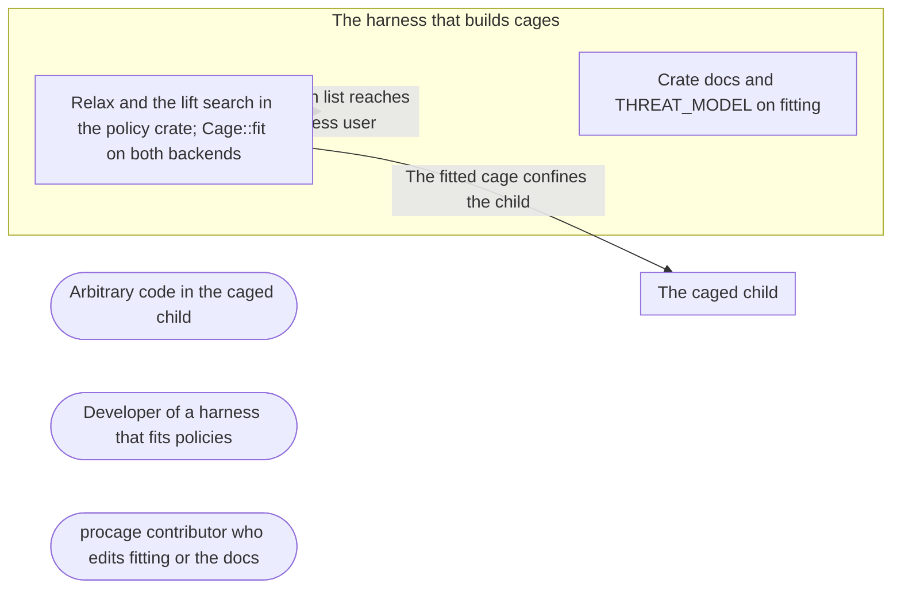

# Threat Model: Fitting a policy to the host

**Feature**: `032-fit` · **Generated**: 2026-11-01T17:26:13Z · **Profiles**: stride, llm, agent · **Canonical**: `threat-model.yaml`

> Rendered by ThreatSpec. Edit `threat-model.yaml`, not this file.

## Summary

| Threats | Critical | High | Medium | Low | Needs clarification | Not applicable | Mitigations | Requirements | Decisions |
|---|---|---|---|---|---|---|---|---|---|
| 4 | 0 | 1 | 3 | 0 | 0 | 25 | 3 | 4 | 0 |

## Actors

| ID | Name | Trust | Description |
|---|---|---|---|
| `actor.caged-code` | Arbitrary code in the caged child | untrusted |  |
| `actor.consumer` | Developer of a harness that fits policies | trusted |  |
| `actor.contributor` | procage contributor who edits fitting or the docs | semi-trusted |  |

## Trust Zones

| ID | Name | Trust rating | Description |
|---|---|---|---|
| `tz.cage` | The caged child | 5 |  |
| `tz.harness` | The harness that builds cages | 90 |  |

## Assets

| ID | Name | Type | Classification | C / I / A | Source |
|---|---|---|---|---|---|
| `asset.host` | The user's files, secrets and processes outside the policy | credential | secret | 100 / 90 / 50 | spec.md#Context |
| `asset.report` | The list of relaxations and their lifts the harness shows its user | capability | internal | 0 / 80 / 0 | spec.md#US2 |

## Components

| ID | Name | Type | Trust zone | Source |
|---|---|---|---|---|
| `component.docs` | Crate docs and THREAT_MODEL on fitting | document | `tz.harness` | spec.md#FR-006 |
| `component.fit` | Relax and the lift search in the policy crate; Cage::fit on both backends | library | `tz.harness` | spec.md#FR-001 |

## Data Flows

| ID | Name | From | To | Assets | Crosses |
|---|---|---|---|---|---|
| `flow.confine` | The fitted cage confines the child | `component.fit` | `tz.cage` | `asset.host` | `tz.harness`, `tz.cage` |
| `flow.report` | The relaxation list reaches the harness user | `component.fit` | `tz.harness` | `asset.report` |  |

## Threats

| ID | Threat | Category | Technique | Severity | Status | Mitigations | Mappings | Source |
|---|---|---|---|---|---|---|---|---|
| `threat.silent-relaxation` | Fitting relaxes a construct the caller did not name, or an approximation, or more rules than the gap names, so the cage is weaker than the caller believes | Elevation of Privilege | broken-access-control | **high** | mitigated | `mitigation.named-only` |  | spec.md#FR-001 |
| `threat.fit-escape` | A fitted cage fails to confine what was not relaxed (writes outside, network) because a relaxed policy lowers differently than expected | Elevation of Privilege | privilege-escalation-via-config | **medium** | mitigated | `mitigation.caged-fit-tests` |  | spec.md#US1 |
| `threat.unreported-relaxation` | A relaxation is applied but missing from the list, so the harness user is not told | Repudiation | missing-audit-trail | **medium** | mitigated | `mitigation.named-only` |  | spec.md#FR-004 |
| `threat.wrong-lift` | The lift names the wrong fix (T1 for an ABI limit or the reverse), so users apply a fix that changes nothing and trust the result | Repudiation | missing-audit-trail | **medium** | mitigated | `mitigation.relower-lift` |  | spec.md#FR-003 |

### Techniques evaluated without findings

| Technique | Disposition | Reason |
|---|---|---|
| identity-spoofing | not-applicable | no authentication surface |
| data-tampering-in-transit | not-applicable | no network-boundary surface |
| cross-tenant-leak | not-applicable | no multi-tenant surface |
| credential-theft | no-threat-detected | evaluated: waiving the secrets class is a named relaxation the caller must choose; covered by threat.silent-relaxation |
| data-tampering-at-rest | no-threat-detected | evaluated: fitting changes only the policy the caller passes, by named relaxations; weaker results are threat.silent-relaxation |
| resource-exhaustion | no-threat-detected | checked component.fit: bounded rounds; lift search lowers at most a dozen targets |
| prompt-injection-direct | not-applicable | procage is a library that calls no model and runs no agent; LLM-written code is the adversary inside the child, modelled under STRIDE |
| prompt-injection-indirect | not-applicable | procage is a library that calls no model and runs no agent; LLM-written code is the adversary inside the child, modelled under STRIDE |
| sensitive-information-disclosure | not-applicable | procage is a library that calls no model and runs no agent; LLM-written code is the adversary inside the child, modelled under STRIDE |
| excessive-agency | not-applicable | procage is a library that calls no model and runs no agent; LLM-written code is the adversary inside the child, modelled under STRIDE |
| model-supply-chain | not-applicable | procage is a library that calls no model and runs no agent; LLM-written code is the adversary inside the child, modelled under STRIDE |
| training-data-poisoning | not-applicable | procage is a library that calls no model and runs no agent; LLM-written code is the adversary inside the child, modelled under STRIDE |
| unbounded-consumption | not-applicable | procage is a library that calls no model and runs no agent; LLM-written code is the adversary inside the child, modelled under STRIDE |
| misinformation | not-applicable | procage is a library that calls no model and runs no agent; LLM-written code is the adversary inside the child, modelled under STRIDE |
| hidden-context-exposure | not-applicable | procage is a library that calls no model and runs no agent; LLM-written code is the adversary inside the child, modelled under STRIDE |
| vector-embedding-weakness | not-applicable | procage is a library that calls no model and runs no agent; LLM-written code is the adversary inside the child, modelled under STRIDE |
| improper-output-handling | not-applicable | procage is a library that calls no model and runs no agent; LLM-written code is the adversary inside the child, modelled under STRIDE |
| model-extraction | not-applicable | procage is a library that calls no model and runs no agent; LLM-written code is the adversary inside the child, modelled under STRIDE |
| goal-hijack | not-applicable | procage is a library that calls no model and runs no agent; LLM-written code is the adversary inside the child, modelled under STRIDE |
| tool-misuse | not-applicable | procage is a library that calls no model and runs no agent; LLM-written code is the adversary inside the child, modelled under STRIDE |
| identity-privilege-abuse | not-applicable | procage is a library that calls no model and runs no agent; LLM-written code is the adversary inside the child, modelled under STRIDE |
| agentic-supply-chain | not-applicable | procage is a library that calls no model and runs no agent; LLM-written code is the adversary inside the child, modelled under STRIDE |
| unexpected-code-execution | not-applicable | procage is a library that calls no model and runs no agent; LLM-written code is the adversary inside the child, modelled under STRIDE |
| memory-context-poisoning | not-applicable | procage is a library that calls no model and runs no agent; LLM-written code is the adversary inside the child, modelled under STRIDE |
| insecure-inter-agent-communication | not-applicable | procage is a library that calls no model and runs no agent; LLM-written code is the adversary inside the child, modelled under STRIDE |
| cascading-failure | not-applicable | procage is a library that calls no model and runs no agent; LLM-written code is the adversary inside the child, modelled under STRIDE |
| human-agent-trust-exploitation | not-applicable | procage is a library that calls no model and runs no agent; LLM-written code is the adversary inside the child, modelled under STRIDE |
| rogue-agent | not-applicable | procage is a library that calls no model and runs no agent; LLM-written code is the adversary inside the child, modelled under STRIDE |

## Mitigations

| ID | Mitigation | Kind | Threats | Requirements | Touchpoints | Status |
|---|---|---|---|---|---|---|
| `mitigation.caged-fit-tests` | Caged tests spawn fitted cages and check the unrelaxed rules on T1/T2 | detective | `threat.fit-escape` | SR-004 | `tests/spawn_linux.rs`, `tests/spawn_macos.rs` | verified |
| `mitigation.named-only` | Only unsupported gaps whose relaxation the caller named are relaxed, by the gap subject; otherwise nothing is applied and all remaining gaps are returned | preventive | `threat.silent-relaxation`, `threat.unreported-relaxation` | SR-001, SR-002 | `crates/procage-policy/src/fit.rs`, `src/linux/mod.rs`, `src/macos/mod.rs` | verified |
| `mitigation.relower-lift` | Lifts come from lowering the original policy for T1 and newer ABIs, capped at the backend maximum | preventive | `threat.wrong-lift` | SR-003 | `crates/procage-policy/src/fit.rs` | verified |

## Security Requirements

### SR-001 (P1) — verified

Fitting MUST relax only unsupported gaps whose relaxation the caller named, and only the rule the gap names; any other gap MUST fail the cage with every remaining gap and no change applied.

- **Given** gaps of which one has no named relaxation, **when** the relaxation is applied, **then** it returns the unrelaxable gaps and the policy is unchanged
- **Given** an approximation gap of a relaxable construct, **when** the relaxation is applied, **then** it is not relaxed
- **Given** two protect rules and a gap for one, **when** the relaxation is applied, **then** only that rule is removed
- Mitigations: `mitigation.named-only`
- Tasks: T001 ✓, T003 ✓
- Verification `verification.sr-001.2026-11-01`: test → pass (verified) — `crates/procage-policy/tests/fit.rs::a_gap_without_a_named_relaxation_changes_nothing`

### SR-002 (P1) — verified

Every relaxation applied MUST appear in the returned list with its gap and effect.

- **Given** T2 and four relaxations, **when** Cage::fit runs, **then** the list has exactly the four entries
- Mitigations: `mitigation.named-only`
- Tasks: T004 ✓, T005 ✓
- Verification `verification.sr-002.2026-11-01`: test → pass (verified) — `tests/spawn_linux.rs::a_fitted_cage_gives_up_only_what_was_named`

### SR-003 (P2) — verified

The lift of each relaxed gap MUST be derived by lowering the original policy for tier T1 and for newer Landlock ABIs up to the backend maximum, and be unknown when neither lifts it.

- **Given** the signal gap at ABI 5 on T2, **when** the lift is computed, **then** it is ABI 6 without T1
- **Given** a protect gap on T2, **when** the lift is computed, **then** it is T1
- **Given** unix sockets on T2 with maximum ABI 8, **when** the lift is computed, **then** it is T1 only
- Mitigations: `mitigation.relower-lift`
- Tasks: T002 ✓, T003 ✓
- Verification `verification.sr-003.2026-11-01`: test → pass (verified) — `crates/procage-policy/tests/fit.rs::lifts_come_from_lowering`

### SR-004 (P1) — verified

A fitted cage MUST still enforce every part of the policy that was not relaxed.

- **Given** a cage fitted on T2, **when** the child writes outside the workspace and opens an IP socket, **then** both fail
- Mitigations: `mitigation.caged-fit-tests`
- Tasks: T005 ✓
- Verification `verification.sr-004.2026-11-01`: test → pass (verified) — `tests/spawn_linux.rs::a_fitted_cage_gives_up_only_what_was_named`
