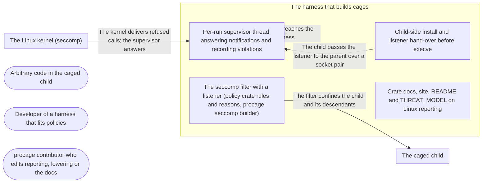

# Threat Model: Linux violations: exact reports of refused system calls

**Feature**: `034-linux-violations` · **Generated**: 2026-11-01T17:26:14Z · **Profiles**: stride, llm, agent · **Canonical**: `threat-model.yaml`

> Rendered by ThreatSpec. Edit `threat-model.yaml`, not this file.

## Summary

| Threats | Critical | High | Medium | Low | Needs clarification | Not applicable | Mitigations | Requirements | Decisions |
|---|---|---|---|---|---|---|---|---|---|
| 8 | 0 | 0 | 5 | 3 | 0 | 24 | 7 | 7 | 0 |

## Actors

| ID | Name | Trust | Description |
|---|---|---|---|
| `actor.caged-code` | Arbitrary code in the caged child | untrusted |  |
| `actor.consumer` | Developer of a harness that fits policies | trusted |  |
| `actor.contributor` | procage contributor who edits reporting, lowering or the docs | semi-trusted |  |

## Trust Zones

| ID | Name | Trust rating | Description |
|---|---|---|---|
| `tz.cage` | The caged child | 5 |  |
| `tz.harness` | The harness that builds cages | 90 |  |
| `tz.kernel` | The Linux kernel (seccomp) | 95 |  |

## Assets

| ID | Name | Type | Classification | C / I / A | Source |
|---|---|---|---|---|---|
| `asset.harness` | The harness process: memory, threads, the time wait and violations() take | capability | internal | 0 / 50 / 70 | spec.md#FR-005 |
| `asset.host` | The user's files, secrets and processes outside the policy | credential | secret | 100 / 90 / 50 | spec.md#Context |
| `asset.record` | The violation record the harness shows its user and may act on (e.g. ask for a grant) | capability | internal | 30 / 80 / 30 | spec.md#US1 |

## Components

| ID | Name | Type | Trust zone | Source |
|---|---|---|---|---|
| `component.child` | Child-side install and listener hand-over before execve | library | `tz.harness` | spec.md#FR-002 |
| `component.docs` | Crate docs, site, README and THREAT_MODEL on Linux reporting | document | `tz.harness` | spec.md#FR-007 |
| `component.filter` | The seccomp filter with a listener (policy crate rules and reasons, procage seccomp builder) | library | `tz.harness` | spec.md#FR-001 |
| `component.supervisor` | Per-run supervisor thread answering notifications and recording violations | library | `tz.harness` | spec.md#FR-003 |

## Data Flows

| ID | Name | From | To | Assets | Crosses |
|---|---|---|---|---|---|
| `flow.confine` | The filter confines the child and its descendants | `component.filter` | `tz.cage` | `asset.host` | `tz.harness`, `tz.cage` |
| `flow.listener` | The child passes the listener to the parent over a socket pair | `component.child` | `component.supervisor` | `asset.host` | `tz.cage`, `tz.harness` |
| `flow.notify` | The kernel delivers refused calls; the supervisor answers | `tz.kernel` | `component.supervisor` | `asset.record`, `asset.host` | `tz.kernel`, `tz.harness` |
| `flow.record` | The record reaches the harness | `component.supervisor` | `tz.harness` | `asset.record` |  |

## Threats

| ID | Threat | Category | Technique | Severity | Status | Mitigations | Mappings | Source |
|---|---|---|---|---|---|---|---|---|
| `threat.continue-answer` | The supervisor answers with anything but EPERM (CONTINUE flag, success), letting a refused call run or appear to succeed | Elevation of Privilege | broken-access-control | **medium** | mitigated | `mitigation.eperm-only` |  | spec.md#FR-003 |
| `threat.filter-drift` | The notifying filter differs from the plain one in more than the verdict of EPERM rules (a rule lost, ENOSYS rules notified), or the plain filter changes | Elevation of Privilege | privilege-escalation-via-config | **medium** | mitigated | `mitigation.verdict-only` |  | spec.md#FR-001 |
| `threat.listener-hijack` | Caged code obtains the listener (an inherited copy, /proc reopen, pidfd_getfd) and answers its own refused call with CONTINUE, so the refused system call runs | Elevation of Privilege | privilege-escalation-via-config | **medium** | mitigated | `mitigation.no-copy` |  | spec.md#FR-002 |
| `threat.record-flood` | Caged code makes millions of refused calls and exhausts the harness memory or blocks answers | Denial of Service | resource-exhaustion | **medium** | mitigated | `mitigation.cap-answer-first` |  | spec.md#Edge-Cases |
| `threat.unfiltered-fallback` | Listener creation fails and the child execs with no filter, or the failure is silent | Elevation of Privilege | broken-access-control | **medium** | mitigated | `mitigation.plain-fallback` |  | spec.md#FR-002 |
| `threat.blocked-run` | The supervisor stops answering (lock, panic, harness stop), so caged processes hang in refused calls, or a detached run blocks forever | Denial of Service | resource-exhaustion | **low** | mitigated | `mitigation.cap-answer-first`, `mitigation.eperm-only` |  | spec.md#Edge-Cases |
| `threat.false-complete` | The record says complete while processes of the run still make calls, or claims file and network denials are covered | Repudiation | missing-audit-trail | **low** | mitigated | `mitigation.hup-complete` |  | spec.md#FR-005 |
| `threat.wrong-reason` | A violation names the wrong rule (condition evaluated differently from the filter), or a recycled pid gives the wrong process name | Repudiation | missing-audit-trail | **low** | mitigated | `mitigation.same-oracle` |  | spec.md#FR-004 |

### Techniques evaluated without findings

| Technique | Disposition | Reason |
|---|---|---|
| identity-spoofing | not-applicable | no authentication surface |
| data-tampering-in-transit | no-threat-detected | checked flow.listener: the listener travels over a socket pair created close-on-exec by the parent before the fork; no network |
| cross-tenant-leak | not-applicable | no multi-tenant surface |
| credential-theft | no-threat-detected | evaluated: the supervisor reads only the notification (pid, number, arguments) and /proc/<pid>/comm; it never reads the caged process memory |
| data-tampering-at-rest | no-threat-detected | evaluated: the only filter change is the verdict of EPERM rules; a changed rule is threat.filter-drift |
| prompt-injection-direct | not-applicable | procage is a library that calls no model and runs no agent; LLM-written code is the adversary inside the child, modelled under STRIDE |
| prompt-injection-indirect | not-applicable | procage is a library that calls no model and runs no agent; LLM-written code is the adversary inside the child, modelled under STRIDE |
| sensitive-information-disclosure | not-applicable | procage is a library that calls no model and runs no agent; LLM-written code is the adversary inside the child, modelled under STRIDE |
| excessive-agency | not-applicable | procage is a library that calls no model and runs no agent; LLM-written code is the adversary inside the child, modelled under STRIDE |
| model-supply-chain | not-applicable | procage is a library that calls no model and runs no agent; LLM-written code is the adversary inside the child, modelled under STRIDE |
| training-data-poisoning | not-applicable | procage is a library that calls no model and runs no agent; LLM-written code is the adversary inside the child, modelled under STRIDE |
| unbounded-consumption | not-applicable | procage is a library that calls no model and runs no agent; LLM-written code is the adversary inside the child, modelled under STRIDE |
| misinformation | not-applicable | procage is a library that calls no model and runs no agent; LLM-written code is the adversary inside the child, modelled under STRIDE |
| hidden-context-exposure | not-applicable | procage is a library that calls no model and runs no agent; LLM-written code is the adversary inside the child, modelled under STRIDE |
| vector-embedding-weakness | not-applicable | procage is a library that calls no model and runs no agent; LLM-written code is the adversary inside the child, modelled under STRIDE |
| improper-output-handling | not-applicable | procage is a library that calls no model and runs no agent; LLM-written code is the adversary inside the child, modelled under STRIDE |
| model-extraction | not-applicable | procage is a library that calls no model and runs no agent; LLM-written code is the adversary inside the child, modelled under STRIDE |
| goal-hijack | not-applicable | procage is a library that calls no model and runs no agent; LLM-written code is the adversary inside the child, modelled under STRIDE |
| tool-misuse | not-applicable | procage is a library that calls no model and runs no agent; LLM-written code is the adversary inside the child, modelled under STRIDE |
| identity-privilege-abuse | not-applicable | procage is a library that calls no model and runs no agent; LLM-written code is the adversary inside the child, modelled under STRIDE |
| agentic-supply-chain | not-applicable | procage is a library that calls no model and runs no agent; LLM-written code is the adversary inside the child, modelled under STRIDE |
| unexpected-code-execution | not-applicable | procage is a library that calls no model and runs no agent; LLM-written code is the adversary inside the child, modelled under STRIDE |
| memory-context-poisoning | not-applicable | procage is a library that calls no model and runs no agent; LLM-written code is the adversary inside the child, modelled under STRIDE |
| insecure-inter-agent-communication | not-applicable | procage is a library that calls no model and runs no agent; LLM-written code is the adversary inside the child, modelled under STRIDE |
| cascading-failure | not-applicable | procage is a library that calls no model and runs no agent; LLM-written code is the adversary inside the child, modelled under STRIDE |
| human-agent-trust-exploitation | not-applicable | procage is a library that calls no model and runs no agent; LLM-written code is the adversary inside the child, modelled under STRIDE |
| rogue-agent | not-applicable | procage is a library that calls no model and runs no agent; LLM-written code is the adversary inside the child, modelled under STRIDE |

## Mitigations

| ID | Mitigation | Kind | Threats | Requirements | Touchpoints | Status |
|---|---|---|---|---|---|---|
| `mitigation.cap-answer-first` | Answer first, then record into the capped record (10,000) and bounded receiver; detached runs keep being answered until POLLHUP | preventive | `threat.record-flood`, `threat.blocked-run` | SR-002, SR-006 | `crates/procage/src/linux/violations.rs`, `crates/procage/src/violation.rs` | verified |
| `mitigation.eperm-only` | The answer is built in one place: error -EPERM, value 0, flags 0, sent before recording | preventive | `threat.continue-answer`, `threat.blocked-run` | SR-002 | `crates/procage/src/linux/violations.rs` | verified |
| `mitigation.hup-complete` | Complete only after POLLHUP and the child reaped; coverage SystemCalls documents that Landlock denials are not reported | detective | `threat.false-complete` | SR-007 | `crates/procage/src/linux/violations.rs`, `crates/procage/src/lib.rs`, `crates/procage/THREAT_MODEL.md` | verified |
| `mitigation.no-copy` | The listener is created close-on-exec, sent before execve and closed in the child; /proc reopen is refused by the kernel (measured ENXIO/EACCES); pidfd_getfd and ptrace stay refused by the process-access class, whose waiver already hands the parent to the child | preventive | `threat.listener-hijack` | SR-001 | `crates/procage/src/linux/sys.rs`, `crates/procage/tests/escape_linux.rs` | verified |
| `mitigation.plain-fallback` | On listener failure the child installs the plain filter in the same step and reports the errno; any other failure aborts the spawn as today | preventive | `threat.unfiltered-fallback` | SR-004 | `crates/procage/src/linux/sys.rs` | verified |
| `mitigation.same-oracle` | Condition::matches checked against the BPF interpreter on generated arguments; process name read before answering and dropped unless the notification is still valid | detective | `threat.wrong-reason` | SR-005 | `crates/procage-policy/src/linux.rs`, `crates/procage/src/linux/seccomp.rs`, `crates/procage/src/linux/violations.rs` | verified |
| `mitigation.verdict-only` | Both filters come from one builder; only EPERM verdicts differ; reference-policy filters byte-identical without reporting; Linux escape suite with reporting on | preventive | `threat.filter-drift` | SR-003 | `crates/procage/src/linux/seccomp.rs`, `crates/procage/tests/escape_linux.rs` | verified |

## Security Requirements

### SR-001 (P1) — verified

No process of the run MUST hold or be able to open the seccomp listener: the child closes it before execve, and a caged process scanning its descriptors and the parent's /proc entries MUST find none it can use.

- **Given** a reporting run on T1 and T2, **when** the caged process lists its descriptors and tries to open the parent's listener through /proc, **then** it holds no seccomp listener and the open fails
- Mitigations: `mitigation.no-copy`
- Tasks: T005 ✓, T009 ✓
- Verification `verification.sr-001.2026-11-01`: test → pass (verified) — `crates/procage/tests/escape_linux.rs::r32_the_seccomp_listener_stays_out_of_reach`
- Verification `verification.sr-001.2026-11-01-2`: test → pass (verified) — `crates/procage/tests/escape_linux.rs::r32_the_seccomp_listener_stays_out_of_reach`

### SR-002 (P1) — verified

The supervisor MUST answer every notification with EPERM (value 0, no flags) before recording it, and MUST keep answering until the listener hangs up, also after detach.

- **Given** a reporting run, **when** the child makes a refused call, **then** it fails with EPERM and the record lists it
- **Given** a detached run, **when** its process makes a refused call, **then** the call returns EPERM instead of blocking
- Mitigations: `mitigation.eperm-only`, `mitigation.cap-answer-first`
- Tasks: T006 ✓, T008 ✓
- Verification `verification.sr-002.2026-11-01`: test → pass (verified) — `crates/procage/tests/spawn_linux.rs::refused_calls_are_reported_with_their_reason; crates/procage/tests/spawn_linux.rs::a_detached_run_is_still_answered`
- Verification `verification.sr-002.2026-11-01-2`: test → pass (verified) — `crates/procage/tests/spawn_linux.rs::refused_calls_are_reported_with_their_reason; crates/procage/tests/spawn_linux.rs::a_detached_run_is_still_answered`

### SR-003 (P1) — verified

Without reporting the filter MUST be byte-identical to today's; with it only the verdict of EPERM rules MUST differ, and the Linux escape suite MUST pass with reporting on.

- **Given** every reference policy and target, **when** the filter is built with and without notification, **then** they differ only in EPERM verdicts, and without it equals the plain builder
- **Given** the Linux escape suite, **when** run with reporting on, T1 and T2, **then** every canary holds
- Mitigations: `mitigation.verdict-only`
- Tasks: T004 ✓, T009 ✓
- Verification `verification.sr-003.2026-11-01`: test → pass (verified) — `crates/procage/src/linux/seccomp.rs::notifying_changes_only_eperm_verdicts; crates/procage/tests/escape_linux.rs (PROCAGE_ESCAPE_VIOLATIONS=1, T1 and T2)`
- Verification `verification.sr-003.2026-11-01-2`: test → pass (verified) — `crates/procage/src/linux/seccomp.rs::notifying_changes_only_eperm_verdicts; crates/procage/tests/escape_linux.rs (PROCAGE_ESCAPE_VIOLATIONS=1, T1 and T2)`

### SR-004 (P1) — verified

If the listener cannot be created the child MUST install the plain filter before execve and the record MUST say Unavailable with the reason; no run MUST exec without a filter.

- **Given** an outer filter that already has a listener, **when** a reporting cage spawns, **then** the child is confined, its refused calls fail with EPERM, and coverage is Unavailable naming EBUSY
- Mitigations: `mitigation.plain-fallback`
- Tasks: T005 ✓, T011 ✓
- Verification `verification.sr-004.2026-11-01`: test → pass (verified) — `crates/procage/tests/spawn_linux.rs::without_a_listener_the_run_is_still_confined`
- Verification `verification.sr-004.2026-11-01-2`: test → pass (verified) — `crates/procage/tests/spawn_linux.rs::without_a_listener_the_run_is_still_confined`

### SR-005 (P2) — verified

A violation's reason MUST be the reason of the first rule whose condition matches, evaluated as the filter does, and its process name MUST be dropped if the notification is no longer valid.

- **Given** generated arguments for every condition, **when** matches() and the BPF interpreter evaluate them, **then** they agree
- **Given** a refused socket, setsid and ptrace, **when** they are recorded, **then** the reasons are not granted, lifetime and the process-access class
- Mitigations: `mitigation.same-oracle`
- Tasks: T001 ✓, T002 ✓, T003 ✓, T004 ✓, T008 ✓
- Verification `verification.sr-005.2026-11-01`: test → pass (verified) — `crates/procage/src/linux/seccomp.rs::matches_agrees_with_the_filter; crates/procage-policy/tests/seccomp_reasons.rs::each_origin_names_its_reason; crates/procage/tests/spawn_linux.rs::refused_calls_are_reported_with_their_reason`
- Verification `verification.sr-005.2026-11-01-2`: test → pass (verified) — `crates/procage/src/linux/seccomp.rs::matches_agrees_with_the_filter; crates/procage-policy/tests/seccomp_reasons.rs::each_origin_names_its_reason; crates/procage/tests/spawn_linux.rs::refused_calls_are_reported_with_their_reason`

### SR-006 (P2) — verified

The record MUST keep at most 10,000 violations and count the rest; answering MUST NOT wait on the harness.

- **Given** a child making 20,000 refused calls, **when** it runs, **then** every call returns EPERM promptly and the record holds the cap with the rest counted
- Mitigations: `mitigation.cap-answer-first`
- Tasks: T006 ✓, T011 ✓
- Verification `verification.sr-006.2026-11-01`: test → pass (verified) — `crates/procage/tests/spawn_linux.rs::a_flood_is_answered_and_capped`
- Verification `verification.sr-006.2026-11-01-2`: test → pass (verified) — `crates/procage/tests/spawn_linux.rs::a_flood_is_answered_and_capped`

### SR-007 (P1) — verified

A Linux record MUST be complete only after the listener hung up and the child was reaped, and its coverage MUST be SystemCalls, Unavailable or Off; docs MUST say Landlock denials are not reported.

- **Given** a running child or a surviving descendant, **when** the record is read, **then** it is not complete
- **Given** the run ended by kill_all, **when** the record is read, **then** it is complete with coverage SystemCalls
- Mitigations: `mitigation.hup-complete`
- Tasks: T006 ✓, T007 ✓, T008 ✓, T012 ✓, T013 ✓
- Verification `verification.sr-007.2026-11-01`: test → pass (verified) — `crates/procage/tests/spawn_linux.rs::a_record_completes_when_the_run_ends; crates/procage/tests/spawn_linux.rs::a_surviving_descendant_keeps_the_record_open`
- Verification `verification.sr-007.2026-11-01-2`: test → pass (verified) — `crates/procage/tests/spawn_linux.rs::a_record_completes_when_the_run_ends; crates/procage/tests/spawn_linux.rs::a_surviving_descendant_keeps_the_record_open`
