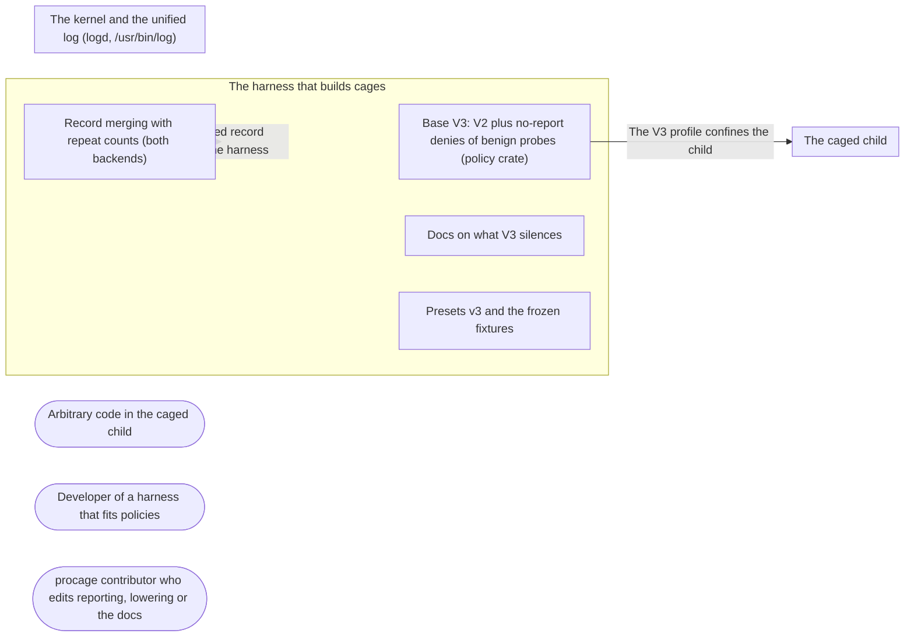

# Threat Model: Base V3 and quiet records

**Feature**: `036-base-v3` · **Generated**: 2026-11-01T17:26:14Z · **Profiles**: stride, llm, agent · **Canonical**: `threat-model.yaml`

> Rendered by ThreatSpec. Edit `threat-model.yaml`, not this file.

## Summary

| Threats | Critical | High | Medium | Low | Needs clarification | Not applicable | Mitigations | Requirements | Decisions |
|---|---|---|---|---|---|---|---|---|---|
| 4 | 0 | 0 | 1 | 3 | 0 | 24 | 4 | 4 | 0 |

## Actors

| ID | Name | Trust | Description |
|---|---|---|---|
| `actor.caged-code` | Arbitrary code in the caged child | untrusted |  |
| `actor.consumer` | Developer of a harness that fits policies | trusted |  |
| `actor.contributor` | procage contributor who edits reporting, lowering or the docs | semi-trusted |  |

## Trust Zones

| ID | Name | Trust rating | Description |
|---|---|---|---|
| `tz.cage` | The caged child | 5 |  |
| `tz.harness` | The harness that builds cages | 90 |  |
| `tz.os` | The kernel and the unified log (logd, /usr/bin/log) | 95 |  |

## Assets

| ID | Name | Type | Classification | C / I / A | Source |
|---|---|---|---|---|---|
| `asset.harness` | The harness process: memory, threads, the time wait and violations() take | capability | internal | 0 / 50 / 70 | spec.md#FR-005 |
| `asset.host` | The user's files, secrets and processes outside the policy | credential | secret | 100 / 90 / 50 | spec.md#Context |
| `asset.record` | The violation record the harness shows its user and may act on (e.g. ask for a grant) | capability | internal | 30 / 80 / 30 | spec.md#US1 |

## Components

| ID | Name | Type | Trust zone | Source |
|---|---|---|---|---|
| `component.base` | Base V3: V2 plus no-report denies of benign probes (policy crate) | library | `tz.harness` | spec.md#FR-001 |
| `component.docs` | Docs on what V3 silences | document | `tz.harness` | spec.md#FR-005 |
| `component.presets` | Presets v3 and the frozen fixtures | library | `tz.harness` | spec.md#FR-002 |
| `component.record` | Record merging with repeat counts (both backends) | library | `tz.harness` | spec.md#FR-003 |

## Data Flows

| ID | Name | From | To | Assets | Crosses |
|---|---|---|---|---|---|
| `flow.confine` | The V3 profile confines the child | `component.base` | `tz.cage` | `asset.host` | `tz.harness`, `tz.cage` |
| `flow.record` | The merged record reaches the harness | `component.record` | `tz.harness` | `asset.record` |  |

## Threats

| ID | Threat | Category | Technique | Severity | Status | Mitigations | Mappings | Source |
|---|---|---|---|---|---|---|---|---|
| `threat.v3-loosens` | V3 allows something V2 denies (a quiet rule written as allow, a changed V2 rule), or V1/V2/presets change silently | Elevation of Privilege | privilege-escalation-via-config | **medium** | mitigated | `mitigation.strip-equals-v2` |  | spec.md#FR-002 |
| `threat.merge-misreports` | Merging collapses violations that differ (another target, process or rule), or a count overflows, so the record misstates what was denied | Repudiation | missing-audit-trail | **low** | mitigated | `mitigation.exact-key` |  | spec.md#FR-003 |
| `threat.quiet-hides-attack` | A quiet probe covers a security-relevant target (a hard-deny service, secrets, persistence), so attempts on it go unreported | Repudiation | missing-audit-trail | **low** | mitigated | `mitigation.quiet-list` |  | spec.md#Clarifications |
| `threat.quiet-overrides-allow` | A quiet deny placed after the allows refuses access the policy grants (Tty::Inherit /dev/tty, a layer allow) | Denial of Service | resource-exhaustion | **low** | mitigated | `mitigation.first` |  | spec.md#FR-001 |

### Techniques evaluated without findings

| Technique | Disposition | Reason |
|---|---|---|
| identity-spoofing | not-applicable | no authentication surface |
| data-tampering-in-transit | no-threat-detected | checked flow.log: the helper reads the local unified log over a pipe from /usr/bin/log; forged lines are threat.forged-attribution |
| cross-tenant-leak | not-applicable | no multi-tenant surface |
| credential-theft | no-threat-detected | evaluated: the record holds paths the caged code tried, which the harness already passed or the code chose; no secret content is read |
| data-tampering-at-rest | no-threat-detected | evaluated: the only profile change is messages on deny rules; a changed allow/deny is threat.profile-drift |
| prompt-injection-direct | not-applicable | procage is a library that calls no model and runs no agent; LLM-written code is the adversary inside the child, modelled under STRIDE |
| prompt-injection-indirect | not-applicable | procage is a library that calls no model and runs no agent; LLM-written code is the adversary inside the child, modelled under STRIDE |
| sensitive-information-disclosure | not-applicable | procage is a library that calls no model and runs no agent; LLM-written code is the adversary inside the child, modelled under STRIDE |
| excessive-agency | not-applicable | procage is a library that calls no model and runs no agent; LLM-written code is the adversary inside the child, modelled under STRIDE |
| model-supply-chain | not-applicable | procage is a library that calls no model and runs no agent; LLM-written code is the adversary inside the child, modelled under STRIDE |
| training-data-poisoning | not-applicable | procage is a library that calls no model and runs no agent; LLM-written code is the adversary inside the child, modelled under STRIDE |
| unbounded-consumption | not-applicable | procage is a library that calls no model and runs no agent; LLM-written code is the adversary inside the child, modelled under STRIDE |
| misinformation | not-applicable | procage is a library that calls no model and runs no agent; LLM-written code is the adversary inside the child, modelled under STRIDE |
| hidden-context-exposure | not-applicable | procage is a library that calls no model and runs no agent; LLM-written code is the adversary inside the child, modelled under STRIDE |
| vector-embedding-weakness | not-applicable | procage is a library that calls no model and runs no agent; LLM-written code is the adversary inside the child, modelled under STRIDE |
| improper-output-handling | not-applicable | procage is a library that calls no model and runs no agent; LLM-written code is the adversary inside the child, modelled under STRIDE |
| model-extraction | not-applicable | procage is a library that calls no model and runs no agent; LLM-written code is the adversary inside the child, modelled under STRIDE |
| goal-hijack | not-applicable | procage is a library that calls no model and runs no agent; LLM-written code is the adversary inside the child, modelled under STRIDE |
| tool-misuse | not-applicable | procage is a library that calls no model and runs no agent; LLM-written code is the adversary inside the child, modelled under STRIDE |
| identity-privilege-abuse | not-applicable | procage is a library that calls no model and runs no agent; LLM-written code is the adversary inside the child, modelled under STRIDE |
| agentic-supply-chain | not-applicable | procage is a library that calls no model and runs no agent; LLM-written code is the adversary inside the child, modelled under STRIDE |
| unexpected-code-execution | not-applicable | procage is a library that calls no model and runs no agent; LLM-written code is the adversary inside the child, modelled under STRIDE |
| memory-context-poisoning | not-applicable | procage is a library that calls no model and runs no agent; LLM-written code is the adversary inside the child, modelled under STRIDE |
| insecure-inter-agent-communication | not-applicable | procage is a library that calls no model and runs no agent; LLM-written code is the adversary inside the child, modelled under STRIDE |
| cascading-failure | not-applicable | procage is a library that calls no model and runs no agent; LLM-written code is the adversary inside the child, modelled under STRIDE |
| human-agent-trust-exploitation | not-applicable | procage is a library that calls no model and runs no agent; LLM-written code is the adversary inside the child, modelled under STRIDE |
| rogue-agent | not-applicable | procage is a library that calls no model and runs no agent; LLM-written code is the adversary inside the child, modelled under STRIDE |

## Mitigations

| ID | Mitigation | Kind | Threats | Requirements | Touchpoints | Status |
|---|---|---|---|---|---|---|
| `mitigation.exact-key` | Merge key is (pid, process, operation, target, denied_by) exactly; repeats saturate | preventive | `threat.merge-misreports` | SR-004 | `crates/procage/src/violation.rs` | verified |
| `mitigation.first` | Quiet denies directly after (deny default); caged test that Tty::Inherit keeps /dev/tty | preventive | `threat.quiet-overrides-allow` | SR-003 | `crates/procage-policy/src/lower/macos.rs`, `crates/procage/tests/spawn_macos.rs` | verified |
| `mitigation.quiet-list` | A fixed list of five probes; a test proves none is the target of a hard-deny rule or a data class | preventive | `threat.quiet-hides-attack` | SR-002 | `crates/procage-policy/src/base.rs`, `crates/procage-policy/tests/base.rs` | verified |
| `mitigation.strip-equals-v2` | Stripping the no-report rules from every V3 profile gives the V2 profile; V1/V2 and presets v1/v2 fixtures unchanged; presets v3 fixtures; escape suite with presets v3 | preventive | `threat.v3-loosens` | SR-001 | `crates/procage-policy/src/base.rs`, `crates/procage-policy/src/lower/macos.rs`, `crates/procage-policy/tests/presets.rs` | verified |

## Security Requirements

### SR-001 (P1) — verified

Every V3 profile with its no-report rules removed MUST equal the V2 profile of the same policy, and V1, V2 and presets v1/v2 MUST stay byte-identical; the escape suite MUST pass with presets v3.

- **Given** every reference policy on V3, **when** its profile is rendered, **then** removing the no-report lines gives its V2 profile
- **Given** the frozen fixtures, **when** the tests run, **then** V1, V2 and presets v1/v2 match unchanged
- Mitigations: `mitigation.strip-equals-v2`
- Tasks: T001 ✓, T002 ✓, T003 ✓, T008 ✓
- Verification `verification.sr-001.2026-11-01`: test → pass (verified) — `crates/procage-policy/tests/base.rs::v3_is_v2_plus_quiet_denies; crates/procage-policy/tests/presets.rs::every_v3_preset_is_pinned; crates/procage/tests/escape_macos.rs (PROCAGE_ESCAPE_BASE=v3)`

### SR-002 (P2) — verified

The quiet probes MUST be a fixed list, none of which is a target of a hard-deny rule or a data class.

- **Given** the quiet list, **when** compared with every hard-deny and data-class rule, **then** no target is shared
- Mitigations: `mitigation.quiet-list`
- Tasks: T003 ✓
- Verification `verification.sr-002.2026-11-01`: test → pass (verified) — `crates/procage-policy/tests/base.rs::quiet_targets_are_not_hard_deny_targets`

### SR-003 (P2) — verified

Quiet denies MUST come before every allow, so access a policy grants is never refused by them.

- **Given** base V3 with Tty::Inherit, **when** the child opens /dev/tty, **then** it succeeds
- Mitigations: `mitigation.first`
- Tasks: T001 ✓, T006 ✓
- Verification `verification.sr-003.2026-11-01`: test → pass (verified) — `crates/procage/tests/spawn_macos.rs::v3_keeps_a_granted_terminal; crates/procage-policy/tests/precedence.rs::blocks_are_in_fixed_order_and_the_tier_is_last`

### SR-004 (P2) — verified

Violations MUST merge only when pid, process, operation, target and rule are all equal; the repeat count MUST saturate.

- **Given** violations differing in any one field, **when** pushed, **then** they stay separate
- **Given** the same violation pushed repeatedly, **when** read, **then** one entry with that count
- Mitigations: `mitigation.exact-key`
- Tasks: T005 ✓, T007 ✓
- Verification `verification.sr-004.2026-11-01`: test → pass (verified) — `crates/procage/src/violation.rs::only_equal_denials_merge; crates/procage/src/violation.rs::the_record_keeps_the_cap_and_counts_the_rest`
