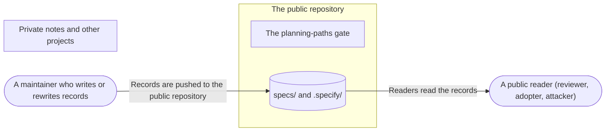

# Threat Model: Public design records

**Feature**: `037-public-design-records` · **Generated**: 2026-11-01T17:29:58Z · **Profiles**: stride · **Canonical**: `threat-model.yaml`

> Rendered by ThreatSpec. Edit `threat-model.yaml`, not this file.

## Summary

| Threats | Critical | High | Medium | Low | Needs clarification | Not applicable | Mitigations | Requirements | Decisions |
|---|---|---|---|---|---|---|---|---|---|
| 3 | 0 | 0 | 2 | 1 | 0 | 7 | 3 | 3 | 0 |

## Actors

| ID | Name | Trust | Description |
|---|---|---|---|
| `actor.maintainer` | A maintainer who writes or rewrites records | trusted |  |
| `actor.reader` | A public reader (reviewer, adopter, attacker) | untrusted |  |

## Trust Zones

| ID | Name | Trust rating | Description |
|---|---|---|---|
| `tz.private` | Private notes and other projects | 100 |  |
| `tz.public` | The public repository | 0 |  |

## Assets

| ID | Name | Type | Classification | C / I / A | Source |
|---|---|---|---|---|---|
| `asset.private-notes` | Private notes, other projects, the maintainer's machine |  | confidential | 80 / 30 / 10 | spec.md#Context |
| `asset.trust` | What readers conclude about procage from the records |  | public | 0 / 80 / 20 | spec.md#User-Story-1 |

## Components

| ID | Name | Type | Trust zone | Source |
|---|---|---|---|---|
| `component.gate` | The planning-paths gate | process | `tz.public` | spec.md#FR-006 |
| `component.records` | specs/ and .specify/ | datastore | `tz.public` | spec.md#FR-001 |

## Data Flows

| ID | Name | From | To | Assets | Crosses |
|---|---|---|---|---|---|
| `flow.publish` | Records are pushed to the public repository | `actor.maintainer` | `component.records` | `asset.private-notes` | `tz.private`, `tz.public` |
| `flow.read` | Readers read the records | `component.records` | `actor.reader` | `asset.trust` |  |

## Threats

| ID | Threat | Category | Technique | Severity | Status | Mitigations | Mappings | Source |
|---|---|---|---|---|---|---|---|---|
| `threat.private-leak` | A record carries private details to the public: a reference to private notes, a consumer project's name, a local path or user name, another project, a secret | Information Disclosure | sensitive-data-exposure | **medium** | mitigated | `mitigation.rewrite-and-scan` |  | spec.md#FR-002 |
| `threat.stale-claims` | A reader takes a historical record (an old state, a draft row, a superseded number) as procage's current claim | Repudiation | missing-audit-trail | **medium** | mitigated | `mitigation.history-readme` |  | spec.md#Clarifications |
| `threat.gate-drift` | The gate misses a reference form (a new id scheme, a path outside the checked set), so private references return unnoticed | Information Disclosure | sensitive-data-exposure | **low** | mitigated | `mitigation.gate` |  | spec.md#FR-006 |

### Techniques evaluated without findings

| Technique | Disposition | Reason |
|---|---|---|
| credential-theft | not-applicable | no authentication |
| identity-spoofing | not-applicable | no authentication or network boundary |
| data-tampering-in-transit | not-applicable | files in a git repository; integrity is git's |
| data-tampering-at-rest | no-threat-detected | records change only through commits on main, reviewed like code |
| injection | not-applicable | no input is interpreted |
| missing-audit-trail | no-threat-detected | git history keeps every change to the records |
| cross-tenant-leak | not-applicable | one project |
| broken-access-control | not-applicable | public by intent |
| privilege-escalation-via-config | no-threat-detected | checked the published .specify configuration: it configures planning tools only and grants nothing to procage or its users |
| resource-exhaustion | not-applicable | static files |

## Mitigations

| ID | Mitigation | Kind | Threats | Requirements | Touchpoints | Status |
|---|---|---|---|---|---|---|
| `mitigation.gate` | The gate checks specs/ and .specify/ for the forbidden patterns, and a planted reference fails it | detective | `threat.gate-drift` | SR-003 | `justfile (planning-paths)` | verified |
| `mitigation.history-readme` | specs/README.md says records are history and names the authoritative documents | preventive | `threat.stale-claims` | SR-002 | `specs/README.md` | verified |
| `mitigation.rewrite-and-scan` | Every record rewritten to stand alone; a scan for private references, consumer names, local paths, e-mail addresses and token patterns before publishing | preventive | `threat.private-leak` | SR-001 | `specs/`, `.specify/` | verified |

## Security Requirements

### SR-001 (P1) — verified

No public record MUST contain a reference to private notes, a consumer project's name, a local path, an e-mail address or a secret.

- **Given** specs/ and .specify/, **when** scanned for private-note directories and ids, research notes, planning references, consumer names, home-directory paths, e-mail and token patterns, **then** nothing is found
- Mitigations: `mitigation.rewrite-and-scan`
- Tasks: T004 ✓, T005 ✓, T006 ✓, T007 ✓, T008 ✓
- Verification `verification.sr-001.2026-11-01`: scan → pass (verified) — `just planning-paths (specs/ and .specify/memory/); a scan of specs/ and .specify/ for token patterns, e-mail addresses and home-directory paths`

### SR-002 (P2) — verified

specs/README.md MUST state that records describe each change as made and name the authoritative documents.

- **Given** specs/README.md, **when** read, **then** it says records are history and links the README, the threat model and the site
- Mitigations: `mitigation.history-readme`
- Tasks: T009 ✓
- Verification `verification.sr-002.2026-11-01`: review → pass (verified) — `specs/README.md`

### SR-003 (P1) — verified

just ci MUST fail when a public record contains a forbidden pattern.

- **Given** a planted decision id in a record, **when** just planning-paths runs, **then** it fails and names the file
- Mitigations: `mitigation.gate`
- Tasks: T001 ✓
- Verification `verification.sr-003.2026-11-01`: test → pass (verified) — `just planning-paths with a planted decision id in specs/README.md`
