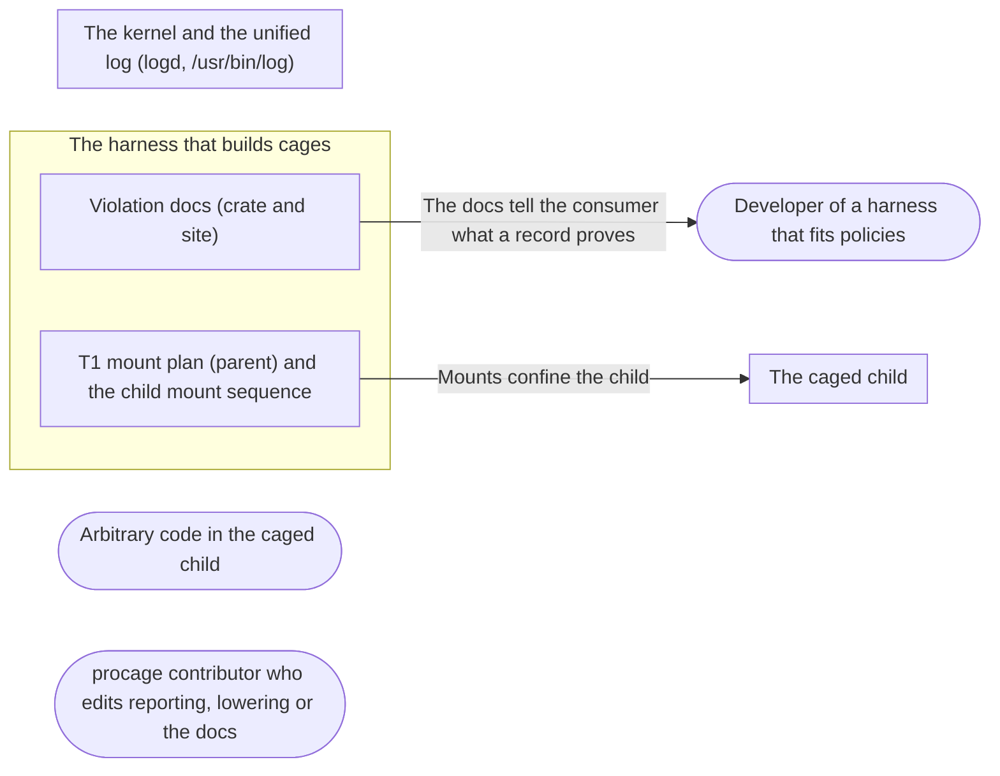

# Threat Model: Vanished snapshot covers and honest report loss

**Feature**: `038-snapshot-covers-and-report-loss` · **Generated**: 2026-11-01T17:26:15Z · **Profiles**: stride · **Canonical**: `threat-model.yaml`

> Rendered by ThreatSpec. Edit `threat-model.yaml`, not this file.

## Summary

| Threats | Critical | High | Medium | Low | Needs clarification | Not applicable | Mitigations | Requirements | Decisions |
|---|---|---|---|---|---|---|---|---|---|
| 2 | 0 | 0 | 2 | 0 | 0 | 7 | 2 | 2 | 0 |

## Actors

| ID | Name | Trust | Description |
|---|---|---|---|
| `actor.caged-code` | Arbitrary code in the caged child | untrusted |  |
| `actor.consumer` | Developer of a harness that fits policies | trusted |  |
| `actor.contributor` | procage contributor who edits reporting, lowering or the docs | semi-trusted |  |

## Trust Zones

| ID | Name | Trust rating | Description |
|---|---|---|---|
| `tz.cage` | The caged child | 5 |  |
| `tz.harness` | The harness that builds cages | 90 |  |
| `tz.os` | The kernel and the unified log (logd, /usr/bin/log) | 95 |  |

## Assets

| ID | Name | Type | Classification | C / I / A | Source |
|---|---|---|---|---|---|
| `asset.harness` | The harness process: memory, threads, the time wait and violations() take | capability | internal | 0 / 50 / 70 | spec.md#FR-005 |
| `asset.host` | The user's files, secrets and processes outside the policy | credential | secret | 100 / 90 / 50 | spec.md#Context |
| `asset.record` | The violation record the harness shows its user and may act on (e.g. ask for a grant) | capability | internal | 30 / 80 / 30 | spec.md#US1 |

## Components

| ID | Name | Type | Trust zone | Source |
|---|---|---|---|---|
| `component.docs` | Violation docs (crate and site) | document | `tz.harness` | spec.md#FR-002 |
| `component.mounts` | T1 mount plan (parent) and the child mount sequence | library | `tz.harness` | spec.md#FR-001 |

## Data Flows

| ID | Name | From | To | Assets | Crosses |
|---|---|---|---|---|---|
| `flow.claims` | The docs tell the consumer what a record proves | `component.docs` | `actor.consumer` | `asset.record` |  |
| `flow.confine` | Mounts confine the child | `component.mounts` | `tz.cage` | `asset.host` | `tz.harness`, `tz.cage` |

## Threats

| ID | Threat | Category | Technique | Severity | Status | Mitigations | Mappings | Source |
|---|---|---|---|---|---|---|---|---|
| `threat.cover-skip-exposes` | Skipping a cover exposes a file or socket the cage should not reach: a declared mount skipped, a non-ENOENT failure ignored, or a remount landing on the containing mount | Elevation of Privilege | sensitive-data-exposure | **medium** | mitigated | `mitigation.optional-covers` |  | spec.md#FR-001 |
| `threat.record-overclaim` | The docs present an empty, complete macOS record as proof that nothing was denied, so a consumer rules the sandbox out wrongly | Repudiation | missing-audit-trail | **medium** | mitigated | `mitigation.measured-docs` |  | spec.md#FR-002 |

### Techniques evaluated without findings

| Technique | Disposition | Reason |
|---|---|---|
| credential-theft | not-applicable | no authentication surface |
| identity-spoofing | not-applicable | no authentication or network boundary |
| data-tampering-in-transit | not-applicable | no data in transit |
| data-tampering-at-rest | not-applicable | no store |
| injection | no-threat-detected | checked the inputs: paths come from /proc/net/unix and directory walks, as before; only the handling of a vanished path changes |
| sensitive-data-exposure | no-threat-detected | covered by threat.cover-skip-exposes: a skipped cover is a path that no longer exists |
| cross-tenant-leak | not-applicable | single user |
| broken-access-control | not-applicable | no principals |
| privilege-escalation-via-config | not-applicable | no configuration added |
| resource-exhaustion | no-threat-detected | no new loop or allocation; the child loop stays linear in the mounts |

## Mitigations

| ID | Mitigation | Kind | Threats | Requirements | Touchpoints | Status |
|---|---|---|---|---|---|---|
| `mitigation.measured-docs` | The docs state the measured loss and that an empty record never proves nothing was denied | preventive | `threat.record-overclaim` | SR-002 | `crates/procage/src/violation.rs`, `site/content/docs/violations.md` | verified |
| `mitigation.optional-covers` | Only snapshot covers are optional, only on ENOENT, the remount of a skipped target skipped with it; declared mounts strict; churn test plus the existing mask and escape tests on T1 | preventive | `threat.cover-skip-exposes` | SR-001 | `crates/procage/src/linux/sys.rs`, `crates/procage/src/linux/spawn.rs`, `crates/procage/tests/spawn_linux.rs` | verified |

## Security Requirements

### SR-001 (P2) — verified

On Linux T1, only covers made from the file system at spawn MAY be skipped, and only when their file no longer exists; mounts the policy declares MUST stay strict, and a skipped cover MUST NOT leave a remount behind.

- **Given** a thread binding and removing a foreign socket, **when** 300 T1 spawns run, **then** all succeed
- **Given** the T1 escape suite and mask tests, **when** they run with the change, **then** they pass unchanged
- Mitigations: `mitigation.optional-covers`
- Tasks: T001 ✓, T002 ✓
- Verification `verification.sr-001.2026-11-01`: test → pass (verified) — `crates/procage/tests/spawn_linux.rs::a_socket_removed_during_the_spawn_does_not_fail_it; crates/procage/src/linux/spawn.rs (mounts, optional); crates/procage/src/linux/sys.rs (ChildMount optional, child loop); just linux-t1 (spawn 47/47, escape 22/22 with and without reporting)`
- Verification `verification.sr-001.2026-11-01-2`: test → pass (verified) — `crates/procage/tests/spawn_linux.rs::a_socket_removed_during_the_spawn_does_not_fail_it; crates/procage/src/linux/spawn.rs (mounts, optional); crates/procage/src/linux/sys.rs (ChildMount optional, child loop); just linux-t1 (spawn 47/47, escape 22/22 with and without reporting)`

### SR-002 (P2) — verified

procage MUST NOT present a complete macOS record as proof that nothing was denied; its docs MUST state the measured report loss under load.

- **Given** the crate docs and the site page, **when** they describe Observed and complete, **then** neither calls an empty record proof, and both name the measured loss
- Mitigations: `mitigation.measured-docs`
- Tasks: T003 ✓
- Verification `verification.sr-002.2026-11-01`: review → pass (verified) — `crates/procage/src/violation.rs (module docs, Coverage::Observed, Violations::complete); site/content/docs/violations.md (Live, complete and honest)`
- Verification `verification.sr-002.2026-11-01-2`: review → pass (verified) — `crates/procage/src/violation.rs (module docs, Coverage::Observed, Violations::complete); site/content/docs/violations.md (Live, complete and honest)`
