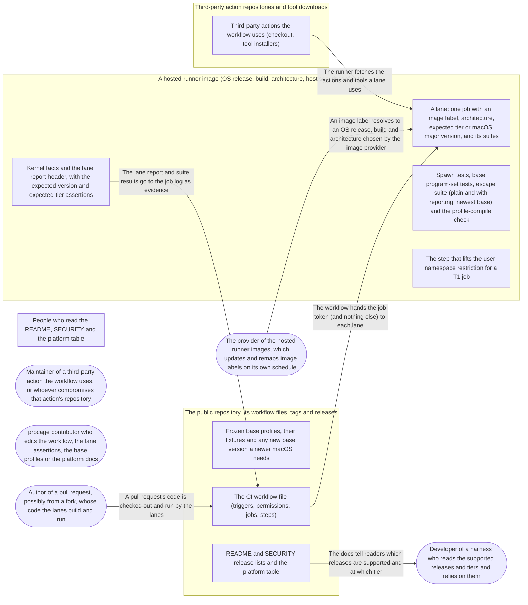

# Threat Model: CI lanes for the releases people run

**Feature**: `039-ci-lanes` · **Generated**: 2026-11-03T11:22:27Z · **Profiles**: stride, llm, agent · **Canonical**: `threat-model.yaml`

> Rendered by ThreatSpec. Edit `threat-model.yaml`, not this file.

## Summary

| Threats | Critical | High | Medium | Low | Needs clarification | Not applicable | Mitigations | Requirements | Decisions |
|---|---|---|---|---|---|---|---|---|---|
| 11 | 0 | 5 | 4 | 2 | 0 | 23 | 7 | 8 | 0 |

## Actors

| ID | Name | Trust | Description |
|---|---|---|---|
| `actor.action-author` | Maintainer of a third-party action the workflow uses, or whoever compromises that action's repository | untrusted |  |
| `actor.consumer` | Developer of a harness who reads the supported releases and tiers and relies on them | trusted |  |
| `actor.contributor` | procage contributor who edits the workflow, the lane assertions, the base profiles or the platform docs | semi-trusted |  |
| `actor.image-provider` | The provider of the hosted runner images, which updates and remaps image labels on its own schedule | semi-trusted |  |
| `actor.pr-author` | Author of a pull request, possibly from a fork, whose code the lanes build and run | untrusted |  |

## Trust Zones

| ID | Name | Trust rating | Description |
|---|---|---|---|
| `tz.readers` | People who read the README, SECURITY and the platform table | 50 |  |
| `tz.repo` | The public repository, its workflow files, tags and releases | 90 |  |
| `tz.runner` | A hosted runner image (OS release, build, architecture, host security defaults) | 60 |  |
| `tz.third-party` | Third-party action repositories and tool downloads | 30 |  |

## Assets

| ID | Name | Type | Classification | C / I / A | Source |
|---|---|---|---|---|---|
| `asset.claims` | The supported-release list and platform table: which releases, which Linux tier, measured when | capability | public | 0 / 90 / 30 | spec.md#FR-005 |
| `asset.evidence` | The lane report and test results that back each claim (OS, build, arch, sandboxed, tier, ABI, errata) | log | public | 0 / 85 / 60 | spec.md#Key-Entities |
| `asset.frozen-bases` | The frozen base profiles V1 to V3 and their fixtures | source-code | internal | 0 / 95 / 20 | spec.md#FR-006 |
| `asset.repo` | Integrity of the repository, its branches, tags, releases and published pages | source-code | internal | 0 / 100 / 50 | spec.md#FR-007 |
| `asset.token` | The job token and any secret a job could see | credential | secret | 90 / 90 / 10 | spec.md#FR-007 |

## Components

| ID | Name | Type | Trust zone | Source |
|---|---|---|---|---|
| `component.actions` | Third-party actions the workflow uses (checkout, tool installers) | library | `tz.third-party` | spec.md#FR-007 |
| `component.bases` | Frozen base profiles, their fixtures and any new base version a newer macOS needs | library | `tz.repo` | spec.md#FR-006 |
| `component.docs` | README and SECURITY release lists and the platform table | document | `tz.repo` | spec.md#FR-005 |
| `component.lane` | A lane: one job with an image label, architecture, expected tier or macOS major version, and its suites | pipeline | `tz.runner` | spec.md#Key-Entities |
| `component.lane-report` | Kernel facts and the lane report header, with the expected-version and expected-tier assertions | library | `tz.runner` | spec.md#FR-004 |
| `component.suites` | Spawn tests, base program-set tests, escape suite (plain and with reporting, newest base) and the profile-compile check | library | `tz.runner` | spec.md#FR-001 |
| `component.t1-step` | The step that lifts the user-namespace restriction for a T1 job | pipeline | `tz.runner` | spec.md#Clarifications |
| `component.workflow` | The CI workflow file (triggers, permissions, jobs, steps) | pipeline | `tz.repo` | spec.md#FR-007 |

## Data Flows

| ID | Name | From | To | Assets | Crosses |
|---|---|---|---|---|---|
| `flow.actions` | The runner fetches the actions and tools a lane uses | `component.actions` | `component.lane` | `asset.token`, `asset.repo` | `tz.third-party`, `tz.runner` |
| `flow.claims` | The docs tell readers which releases are supported and at which tier | `component.docs` | `actor.consumer` | `asset.claims` | `tz.repo`, `tz.readers` |
| `flow.image` | An image label resolves to an OS release, build and architecture chosen by the image provider | `actor.image-provider` | `component.lane` | `asset.evidence` | `tz.runner` |
| `flow.pr` | A pull request's code is checked out and run by the lanes | `actor.pr-author` | `component.workflow` | `asset.repo`, `asset.token` | `tz.repo` |
| `flow.report` | The lane report and suite results go to the job log as evidence | `component.lane-report` | `component.workflow` | `asset.evidence` | `tz.runner`, `tz.repo` |
| `flow.token` | The workflow hands the job token (and nothing else) to each lane | `component.workflow` | `component.lane` | `asset.token` | `tz.repo`, `tz.runner` |

## Threats

| ID | Threat | Category | Technique | Severity | Status | Mitigations | Mappings | Source |
|---|---|---|---|---|---|---|---|---|
| `threat.action-supply-chain` | A third-party action referenced by a tag or branch, or re-pinned to a malicious commit, runs attacker code in a lane with the job token | Tampering, Elevation of Privilege | privilege-escalation-via-config | **high** | mitigated | `mitigation.sha-pins` |  | spec.md#FR-007 |
| `threat.pass-without-evidence` | A lane is green without evidence because enforcement tests skip (AlreadySandboxed, no administrator, a feature missing) or the job is marked continue-on-error or unavailable | Repudiation | missing-audit-trail | **high** | mitigated | `mitigation.no-skip-green` |  | spec.md#FR-001 |
| `threat.silent-image-change` | An image label moves to another OS release, build or architecture (ubuntu-latest to 26.04, xcode-27 to a later macOS, an arm label on x86_64) and the lane stays green while the docs name the old release | Repudiation, Spoofing | missing-audit-trail | **high** | mitigated | `mitigation.assert-expected` |  | spec.md#Edge-Cases |
| `threat.silent-tier-change` | A Linux lane gets a different tier than it states (T1 expected, T2 observed after an AppArmor default change, or the reverse) and the tier-specific tests pass vacuously | Repudiation | missing-audit-trail | **high** | mitigated | `mitigation.assert-expected` |  | spec.md#Clarifications |
| `threat.token-overreach` | A lane gets a writable token or a secret, so pull-request code, a caged test program or a compromised action writes to the repository, releases or pages | Elevation of Privilege, Information Disclosure | credential-theft | **high** | mitigated | `mitigation.least-privilege-workflow` |  | spec.md#FR-007 |
| `threat.expression-injection` | A run step interpolates pull-request text (title, branch name, commit message) into a shell script, which then runs as the workflow | Tampering | injection | **medium** | mitigated | `mitigation.least-privilege-workflow` |  | spec.md#FR-007 |
| `threat.frozen-base-drift` | An allowance macOS 27 needs is edited into a frozen base V1 to V3 instead of a new base version, silently loosening every cage built on it | Elevation of Privilege, Tampering | privilege-escalation-via-config | **medium** | mitigated | `mitigation.new-base-version` |  | spec.md#FR-006 |
| `threat.stale-claims` | README or SECURITY still name a release supported after its lane was removed, turned red or its image retired (macOS 14 on 2026-11-02), or state a tier that was not measured, without a date | Repudiation | missing-audit-trail | **medium** | mitigated | `mitigation.docs-from-lanes` |  | spec.md#FR-005 |
| `threat.t1-unrepresentative` | A T1 job reaches T1 by weakening the host beyond what users would do (AppArmor off, tests as root), so the T1 claim and the docs' advice overstate what users get | Repudiation, Elevation of Privilege | missing-audit-trail | **medium** | mitigated | `mitigation.representative-t1` |  | spec.md#Clarifications |
| `threat.cache-poisoning` | A pull-request job saves a build cache that a main-branch lane restores, so pull-request code alters what main measures | Tampering | data-tampering-at-rest | **low** | mitigated | `mitigation.least-privilege-workflow` |  | spec.md#Context |
| `threat.evidence-expiry` | The lane report lives only in job logs that expire, so a dated claim later cites evidence nobody can see | Repudiation | missing-audit-trail | **low** | mitigated | `mitigation.docs-from-lanes` |  | spec.md#Key-Entities |

### Techniques evaluated without findings

| Technique | Disposition | Reason |
|---|---|---|
| identity-spoofing | no-threat-detected | checked flow.image: the identity that matters is which OS a lane really runs, covered by threat.silent-image-change |
| data-tampering-in-transit | no-threat-detected | checked flow.actions: actions and toolchains are fetched over TLS by the runner; integrity of what is fetched is threat.action-supply-chain |
| cross-tenant-leak | not-applicable | no shared-tenant surface; hosted runners are ephemeral per job and the repository is the only tenant |
| resource-exhaustion | no-threat-detected | checked component.lane: a hung caged test turns the lane red at the job timeout; it delays the signal and grants nothing |
| sensitive-data-exposure | no-threat-detected | checked flow.report: the lane report prints OS, build, architecture, tier, Landlock ABI and errata, all public; tokens are threat.token-overreach |
| prompt-injection-direct | not-applicable | the CI lanes call no model and run no agent; programs run in caged tests are the adversary inside the child, modelled under STRIDE |
| prompt-injection-indirect | not-applicable | the CI lanes call no model and run no agent; programs run in caged tests are the adversary inside the child, modelled under STRIDE |
| sensitive-information-disclosure | not-applicable | the CI lanes call no model and run no agent; programs run in caged tests are the adversary inside the child, modelled under STRIDE |
| excessive-agency | not-applicable | the CI lanes call no model and run no agent; programs run in caged tests are the adversary inside the child, modelled under STRIDE |
| model-supply-chain | not-applicable | the CI lanes call no model and run no agent; programs run in caged tests are the adversary inside the child, modelled under STRIDE |
| training-data-poisoning | not-applicable | the CI lanes call no model and run no agent; programs run in caged tests are the adversary inside the child, modelled under STRIDE |
| unbounded-consumption | not-applicable | the CI lanes call no model and run no agent; programs run in caged tests are the adversary inside the child, modelled under STRIDE |
| misinformation | not-applicable | the CI lanes call no model and run no agent; programs run in caged tests are the adversary inside the child, modelled under STRIDE |
| hidden-context-exposure | not-applicable | the CI lanes call no model and run no agent; programs run in caged tests are the adversary inside the child, modelled under STRIDE |
| vector-embedding-weakness | not-applicable | the CI lanes call no model and run no agent; programs run in caged tests are the adversary inside the child, modelled under STRIDE |
| improper-output-handling | not-applicable | the CI lanes call no model and run no agent; programs run in caged tests are the adversary inside the child, modelled under STRIDE |
| model-extraction | not-applicable | the CI lanes call no model and run no agent; programs run in caged tests are the adversary inside the child, modelled under STRIDE |
| goal-hijack | not-applicable | the CI lanes call no model and run no agent; programs run in caged tests are the adversary inside the child, modelled under STRIDE |
| tool-misuse | not-applicable | the CI lanes call no model and run no agent; programs run in caged tests are the adversary inside the child, modelled under STRIDE |
| identity-privilege-abuse | not-applicable | the CI lanes call no model and run no agent; programs run in caged tests are the adversary inside the child, modelled under STRIDE |
| agentic-supply-chain | not-applicable | the CI lanes call no model and run no agent; programs run in caged tests are the adversary inside the child, modelled under STRIDE |
| unexpected-code-execution | not-applicable | the CI lanes call no model and run no agent; programs run in caged tests are the adversary inside the child, modelled under STRIDE |
| memory-context-poisoning | not-applicable | the CI lanes call no model and run no agent; programs run in caged tests are the adversary inside the child, modelled under STRIDE |
| insecure-inter-agent-communication | not-applicable | the CI lanes call no model and run no agent; programs run in caged tests are the adversary inside the child, modelled under STRIDE |
| cascading-failure | not-applicable | the CI lanes call no model and run no agent; programs run in caged tests are the adversary inside the child, modelled under STRIDE |
| human-agent-trust-exploitation | not-applicable | the CI lanes call no model and run no agent; programs run in caged tests are the adversary inside the child, modelled under STRIDE |
| rogue-agent | not-applicable | the CI lanes call no model and run no agent; programs run in caged tests are the adversary inside the child, modelled under STRIDE |

## Mitigations

| ID | Mitigation | Kind | Threats | Requirements | Touchpoints | Status |
|---|---|---|---|---|---|---|
| `mitigation.assert-expected` | Each lane prints its report header and asserts the expected macOS major version and architecture or Linux tier; any mismatch fails the lane | detective | `threat.silent-image-change`, `threat.silent-tier-change` | SR-004 | `crates/procage-kernel-facts/tests/kernel_facts.rs`, `.github/workflows/ci.yml` | verified |
| `mitigation.docs-from-lanes` | The supported list equals the workflow's green lanes, with tier, build and measurement date copied from the lane report; a gate compares docs and workflow | detective | `threat.stale-claims`, `threat.evidence-expiry` | SR-006 | `README.md`, `SECURITY.md`, `justfile` | verified |
| `mitigation.least-privilege-workflow` | Read-only token at workflow level, no job-level widening in test lanes, no secrets, pull_request trigger only (no pull_request_target or workflow_run running PR code), no PR-saved cache restored on main, untrusted context passed through env only | preventive | `threat.token-overreach`, `threat.expression-injection`, `threat.cache-poisoning` | SR-002, SR-003 | `.github/workflows/ci.yml`, `justfile` | verified |
| `mitigation.new-base-version` | A newer macOS's allowance lands as a new frozen base version with its program-set measurement; fixtures of V1 to V3 stay byte-identical in CI | preventive | `threat.frozen-base-drift` | SR-007 | `crates/procage-policy/tests/presets.rs`, `crates/procage-policy/src/base.rs` | verified |
| `mitigation.no-skip-green` | Enforcement tests fail instead of skipping; no lane whose release is named supported is continue-on-error | preventive | `threat.pass-without-evidence` | SR-005 | `crates/procage-kernel-facts/tests/kernel_facts.rs`, `justfile` | verified |
| `mitigation.representative-t1` | A T1 job applies only the documented step, logs it, runs the tests unprivileged; without such a step T1 is recorded unavailable | preventive | `threat.t1-unrepresentative` | SR-008 | `.github/workflows/ci.yml`, `README.md` | verified |
| `mitigation.sha-pins` | Every action reference is a full commit SHA with its version as a comment; a lint gate rejects tags, branches and short SHAs | preventive | `threat.action-supply-chain` | SR-001 | `.github/workflows/ci.yml`, `justfile` | verified |

## Security Requirements

### SR-001 (P1) — verified

Every action a workflow uses MUST be referenced by a full 40-character commit SHA; a gate MUST fail on any tag, branch or short-SHA reference.

- **Given** a workflow step using an action at a tag such as v4, **when** the workflows gate runs, **then** it fails naming the file and line
- **Given** the workflows on main, **when** the workflows gate runs, **then** it passes and every reference carries its version as a comment
- Mitigations: `mitigation.sha-pins`
- Tasks: T002 ✓
- Verification `verification.sr-001.2026-11-03`: scan → pass (verified) — `justfile::workflows`

### SR-002 (P1) — verified

Every workflow MUST default to a read-only token; test lanes MUST NOT widen permissions or reference secrets, and no workflow MAY run pull-request code under pull_request_target or workflow_run.

- **Given** the CI workflow, **when** the workflows gate parses it, **then** the top-level permissions are contents read, no test job sets permissions, and no step references secrets
- **Given** a pull request from a fork, **when** its lanes run, **then** the token cannot push, and the job has no secrets
- Mitigations: `mitigation.least-privilege-workflow`
- Tasks: T002 ✓
- Verification `verification.sr-002.2026-11-03`: scan → pass (verified) — `justfile::workflows`

### SR-003 (P2) — verified

Run steps MUST NOT interpolate pull-request or commit text into scripts (pass it through environment variables), and the CI workflow MUST NOT use cache steps, so no lane restores a cache a pull-request job saved.

- **Given** the workflows, **when** the workflows gate searches run steps for github.event and github.head_ref expressions, **then** none appear inside a run script
- **Given** a cache step added to the CI workflow, **when** the workflows gate runs, **then** it fails naming the file and line
- Mitigations: `mitigation.least-privilege-workflow`
- Tasks: T002 ✓
- Verification `verification.sr-003.2026-11-03`: scan → pass (verified) — `justfile::workflows`

### SR-004 (P1) — verified

Every lane MUST print its OS release and build (or kernel release), architecture, sandbox status, observed tier, Landlock ABI and errata, and MUST fail when the macOS major version, architecture or Linux tier differs from what it expects.

- **Given** the macOS 27 lane expecting major version 27 on arm64, **when** the image reports another major version or architecture, **then** the lane fails naming expected and observed
- **Given** a Linux lane with PROCAGE_EXPECT_TIER=T1, **when** the probe observes T2, or a T2 lane observes T1, **then** the lane fails
- **Given** any green lane, **when** its log is read, **then** the report header shows release, build, architecture, sandboxed no and tier
- Mitigations: `mitigation.assert-expected`
- Tasks: T001 ✓, T003 ✓, T004 ✓
- Verification `verification.sr-004.2026-11-03`: test → pass (verified) — `crates/procage-kernel-facts/tests/kernel_facts.rs::main`

### SR-005 (P1) — verified

In CI an enforcement test MUST fail, never skip, when it cannot run (AlreadySandboxed, missing administrator rights, a missing feature), and a lane whose release is named supported MUST NOT be continue-on-error.

- **Given** a lane run inside an outer sandbox, **when** the enforcement tests run, **then** they fail with AlreadySandboxed
- **Given** the workflow, **when** the workflows gate reads it, **then** no lane of a supported release has continue-on-error
- Mitigations: `mitigation.no-skip-green`
- Tasks: T002 ✓
- Verification `verification.sr-005.2026-11-03`: review → pass (verified) — `crates/procage-kernel-facts/tests/kernel_facts.rs:1458`

### SR-006 (P2) — verified

The README platform table MUST list as supported exactly the releases with a green lane, each with its runner label, build or kernel, architecture, measured Linux tier and measurement date; SECURITY MUST link that table, and the docs MUST name every other release untested.

- **Given** a lane removed from the workflow while its label stays in the README table, **when** the workflows gate runs, **then** it fails naming the label
- **Given** a runner label in the workflow missing from the README table, **when** the workflows gate runs, **then** it fails naming the label
- **Given** the platform table, **when** it is read, **then** every Linux lane has its measured tier and date, and macOS 14 and any lane removed are named untested
- Mitigations: `mitigation.docs-from-lanes`
- Tasks: T002 ✓, T006 ✓
- Verification `verification.sr-006.2026-11-03`: scan → pass (verified) — `justfile::workflows`

### SR-007 (P1) — verified

Existing base profile versions MUST stay byte-identical; an entry a newer macOS needs MUST be a new frozen base version with its own program-set measurement on that release.

- **Given** the fixtures of base V1 to V3, **when** CI compiles each base, **then** the output equals the fixture byte for byte
- **Given** a base entry added for macOS 27, **when** it is reviewed, **then** it is in a new base version whose program-set test passed on the 27.x lane with the build recorded
- Mitigations: `mitigation.new-base-version`
- Tasks: T003 ✓
- Verification `verification.sr-007.2026-11-03`: test → pass (verified) — `crates/procage-policy/tests/presets.rs::every_preset_is_pinned`

### SR-008 (P2) — verified

A T1 job MUST apply only the documented step that lifts the user-namespace restriction, MUST log that step and run the tests unprivileged; where no such step exists, the docs MUST record T1 as unavailable without host changes.

- **Given** a T1 job, **when** its log is read, **then** it shows the exact step applied and the tests ran as a non-root user
- **Given** Ubuntu 26.04 with no documented step, **when** the docs are read, **then** they state T1 is unavailable there without host changes
- Mitigations: `mitigation.representative-t1`
- Tasks: T004 ✓, T006 ✓
- Verification `verification.sr-008.2026-11-03`: review → pass (verified) — `.github/workflows/ci.yml:133`
