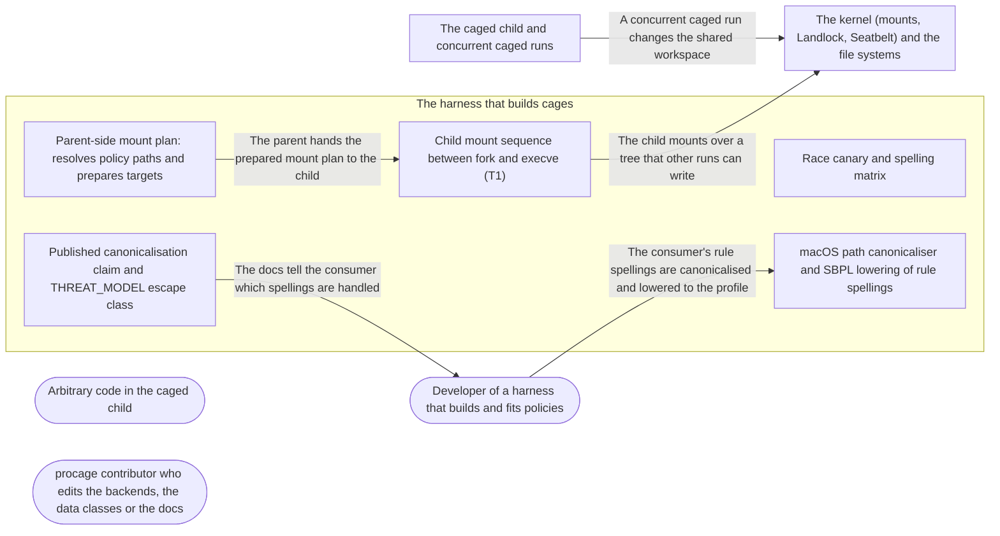

# Threat Model: Path resolution that cannot be redirected or mis-spelled

**Feature**: `040-path-resolution` · **Generated**: 2026-11-01T21:15:44Z · **Profiles**: stride, llm, agent · **Canonical**: `threat-model.yaml`

> Rendered by ThreatSpec. Edit `threat-model.yaml`, not this file.

## Summary

| Threats | Critical | High | Medium | Low | Needs clarification | Not applicable | Mitigations | Requirements | Decisions |
|---|---|---|---|---|---|---|---|---|---|
| 12 | 0 | 6 | 5 | 1 | 3 | 28 | 10 | 10 | 0 |

### Needs clarification

- `threat.q-macos-race` — [NEEDS CLARIFICATION: is a link planted on macOS between canonicalisation and the child's access in scope here, or fully covered by R-02 and R-04 (rules bind targets; protected ancestors cannot be renamed)?] (spec.md#Out-of-Scope)
- `threat.q-missing-leaf-spelling` — [NEEDS CLARIFICATION: on a case-insensitive volume the on-disk spelling of a path that does not exist yet is unknown; is such a rule emitted as written, refused, or matched case-insensitively (FR-005)?] (spec.md#FR-005)
- `threat.q-planned-root` — [NEEDS CLARIFICATION: which ancestor is the planned root that a mount path is resolved beneath, and how are ancestors that are links on the host (resolved at plan time) treated?] (spec.md#FR-002)

## Actors

| ID | Name | Trust | Description |
|---|---|---|---|
| `actor.caged-code` | Arbitrary code in the caged child | untrusted |  |
| `actor.consumer` | Developer of a harness that builds and fits policies | trusted |  |
| `actor.contributor` | procage contributor who edits the backends, the data classes or the docs | semi-trusted |  |

## Trust Zones

| ID | Name | Trust rating | Description |
|---|---|---|---|
| `tz.cage` | The caged child and concurrent caged runs | 5 |  |
| `tz.harness` | The harness that builds cages | 90 |  |
| `tz.os` | The kernel (mounts, Landlock, Seatbelt) and the file systems | 95 |  |

## Assets

| ID | Name | Type | Classification | C / I / A | Source |
|---|---|---|---|---|---|
| `asset.claim` | The published canonicalisation claim and the escape-class evidence | configuration | public | 0 / 70 / 10 | spec.md#SC-004 |
| `asset.harness` | Spawns of concurrent runs on a shared workspace | capability | internal | 0 / 30 / 60 | spec.md#US1 |
| `asset.host` | The user's files, secrets and processes outside the policy | credential | secret | 100 / 90 / 50 | spec.md#Context |
| `asset.plan` | The T1 mount plan: each planned path and the object it resolved to | configuration | internal | 0 / 95 / 40 | spec.md#Key-Entities |

## Components

| ID | Name | Type | Trust zone | Source |
|---|---|---|---|---|
| `component.canaries` | Race canary and spelling matrix | test | `tz.harness` | spec.md#FR-001 |
| `component.canonicaliser` | macOS path canonicaliser and SBPL lowering of rule spellings | library | `tz.harness` | spec.md#FR-004 |
| `component.child-mounts` | Child mount sequence between fork and execve (T1) | library | `tz.harness` | spec.md#FR-003 |
| `component.docs` | Published canonicalisation claim and THREAT_MODEL escape class | document | `tz.harness` | spec.md#FR-007 |
| `component.resolver` | Parent-side mount plan: resolves policy paths and prepares targets | library | `tz.harness` | spec.md#Context |

## Data Flows

| ID | Name | From | To | Assets | Crosses |
|---|---|---|---|---|---|
| `flow.claims` | The docs tell the consumer which spellings are handled | `component.docs` | `actor.consumer` | `asset.claim` |  |
| `flow.lower` | The consumer's rule spellings are canonicalised and lowered to the profile | `actor.consumer` | `component.canonicaliser` | `asset.host` |  |
| `flow.mount` | The child mounts over a tree that other runs can write | `component.child-mounts` | `tz.os` | `asset.plan`, `asset.host` | `tz.harness`, `tz.os` |
| `flow.plan` | The parent hands the prepared mount plan to the child | `component.resolver` | `component.child-mounts` | `asset.plan` |  |
| `flow.plant` | A concurrent caged run changes the shared workspace | `tz.cage` | `tz.os` | `asset.plan` | `tz.cage`, `tz.os` |

## Threats

| ID | Threat | Category | Technique | Severity | Status | Mitigations | Mappings | Source |
|---|---|---|---|---|---|---|---|---|
| `threat.case-miss` | On a case-insensitive macOS volume, a deny spelled in another case than on disk matches nothing in the profile, so the child reads the file through its on-disk spelling | Information Disclosure | sensitive-data-exposure | **high** | open | `mitigation.exact-or-refuse`, `mitigation.spelling-matrix` |  | spec.md#US2 |
| `threat.hide-redirect` | A hidden file's parent directory becomes a link before the child mounts, so the empty file system or /dev/null cover lands on an unrelated path and the secret stays readable | Information Disclosure | sensitive-data-exposure | **high** | open | `mitigation.mount-by-descriptor`, `mitigation.no-follow-resolution`, `mitigation.race-canary` |  | spec.md#US1 |
| `threat.mount-redirect` | A concurrent caged run on the same workspace replaces a component of a protected path with a symbolic link between the parent's plan and the child's mounts, so the read-only bind lands elsewhere and the protected path stays writable | Elevation of Privilege | broken-access-control | **high** | open | `mitigation.mount-by-descriptor`, `mitigation.no-follow-resolution`, `mitigation.race-canary` |  | spec.md#US1 |
| `threat.source-redirect` | A bind source (a grant bind, the source of a protect bind) is redirected through a planted link, so the child sees content chosen by another run at a path it trusts | Tampering | injection | **high** | open | `mitigation.no-follow-resolution`, `mitigation.race-canary` |  | spec.md#Edge-Cases |
| `threat.unicode-miss` | A rule in composed Unicode and a name in decomposed form on disk (or the reverse) do not match, so the rule silently misses the file | Information Disclosure | sensitive-data-exposure | **high** | open | `mitigation.exact-or-refuse`, `mitigation.spelling-matrix` |  | spec.md#US2 |
| `threat.vacuous-canary` | The race canary never wins the race (timing, too few attempts), so zero redirected mounts after the change proves nothing, or the spelling matrix skips when a disk image or case-folding directory is missing | Repudiation | missing-audit-trail | **high** | open | `mitigation.race-canary`, `mitigation.spelling-matrix` |  | spec.md#FR-001 |
| `threat.claim-overstates` | The published canonicalisation claim lists cases (case, Unicode, case-folding) that no caged test covers | Repudiation | missing-audit-trail | **medium** | open | `mitigation.claim-from-matrix` |  | spec.md#Input |
| `threat.fold-overgrant` | Folding case or normalising a rule to make it match widens an allow: on a case-sensitive volume a grant for one name also grants a different file that differs only in case or form | Elevation of Privilege | broken-access-control | **medium** | open | `mitigation.no-widening` |  | spec.md#US2 |
| `threat.kernel-fallback` | On a kernel without the system calls to resolve without following links or to mount by descriptor, the backend falls back to path mounts without an error | Elevation of Privilege | broken-access-control | **medium** | open | `mitigation.no-fallback` |  | spec.md#Assumptions |
| `threat.resolve-then-remount` | The backend checks for links and then mounts by path name again, so a component replaced after the check still redirects the mount | Elevation of Privilege | broken-access-control | **medium** | open | `mitigation.mount-by-descriptor` |  | spec.md#FR-002 |
| `threat.spawn-sabotage` | A caged run plants links in a shared workspace so that every sibling run's spawn fails, now that a link fails the spawn | Denial of Service | resource-exhaustion | **medium** | open | `mitigation.named-failure` |  | spec.md#Clarifications |
| `threat.child-unsafe` | Resolution moved into the child allocates, takes locks or builds paths between fork and execve, so a multithreaded parent deadlocks or the child runs with corrupt state | Denial of Service | resource-exhaustion | **low** | open | `mitigation.syscalls-only` |  | spec.md#FR-003 |

### Techniques evaluated without findings

| Technique | Disposition | Reason |
|---|---|---|
| credential-theft | not-applicable | no authentication surface |
| identity-spoofing | not-applicable | no authentication or network boundary |
| data-tampering-in-transit | not-applicable | no data in transit |
| data-tampering-at-rest | not-applicable | no store; the mount plan lives in memory for one spawn |
| cross-tenant-leak | not-applicable | single user |
| privilege-escalation-via-config | not-applicable | no configuration added; protected tool config is the asset of threat.mount-redirect |
| prompt-injection-direct | not-applicable | procage is a library that calls no model and runs no agent; LLM-written code is the adversary inside the child, modelled under STRIDE |
| prompt-injection-indirect | not-applicable | procage is a library that calls no model and runs no agent; LLM-written code is the adversary inside the child, modelled under STRIDE |
| sensitive-information-disclosure | not-applicable | procage is a library that calls no model and runs no agent; LLM-written code is the adversary inside the child, modelled under STRIDE |
| excessive-agency | not-applicable | procage is a library that calls no model and runs no agent; LLM-written code is the adversary inside the child, modelled under STRIDE |
| model-supply-chain | not-applicable | procage is a library that calls no model and runs no agent; LLM-written code is the adversary inside the child, modelled under STRIDE |
| training-data-poisoning | not-applicable | procage is a library that calls no model and runs no agent; LLM-written code is the adversary inside the child, modelled under STRIDE |
| unbounded-consumption | not-applicable | procage is a library that calls no model and runs no agent; LLM-written code is the adversary inside the child, modelled under STRIDE |
| misinformation | not-applicable | procage is a library that calls no model and runs no agent; LLM-written code is the adversary inside the child, modelled under STRIDE |
| hidden-context-exposure | not-applicable | procage is a library that calls no model and runs no agent; LLM-written code is the adversary inside the child, modelled under STRIDE |
| vector-embedding-weakness | not-applicable | procage is a library that calls no model and runs no agent; LLM-written code is the adversary inside the child, modelled under STRIDE |
| improper-output-handling | not-applicable | procage is a library that calls no model and runs no agent; LLM-written code is the adversary inside the child, modelled under STRIDE |
| model-extraction | not-applicable | procage is a library that calls no model and runs no agent; LLM-written code is the adversary inside the child, modelled under STRIDE |
| goal-hijack | not-applicable | procage is a library that calls no model and runs no agent; LLM-written code is the adversary inside the child, modelled under STRIDE |
| tool-misuse | not-applicable | procage is a library that calls no model and runs no agent; LLM-written code is the adversary inside the child, modelled under STRIDE |
| identity-privilege-abuse | not-applicable | procage is a library that calls no model and runs no agent; LLM-written code is the adversary inside the child, modelled under STRIDE |
| agentic-supply-chain | not-applicable | procage is a library that calls no model and runs no agent; LLM-written code is the adversary inside the child, modelled under STRIDE |
| unexpected-code-execution | not-applicable | procage is a library that calls no model and runs no agent; LLM-written code is the adversary inside the child, modelled under STRIDE |
| memory-context-poisoning | not-applicable | procage is a library that calls no model and runs no agent; LLM-written code is the adversary inside the child, modelled under STRIDE |
| insecure-inter-agent-communication | not-applicable | procage is a library that calls no model and runs no agent; LLM-written code is the adversary inside the child, modelled under STRIDE |
| cascading-failure | not-applicable | procage is a library that calls no model and runs no agent; LLM-written code is the adversary inside the child, modelled under STRIDE |
| human-agent-trust-exploitation | not-applicable | procage is a library that calls no model and runs no agent; LLM-written code is the adversary inside the child, modelled under STRIDE |
| rogue-agent | not-applicable | procage is a library that calls no model and runs no agent; LLM-written code is the adversary inside the child, modelled under STRIDE |

## Mitigations

| ID | Mitigation | Kind | Threats | Requirements | Touchpoints | Status |
|---|---|---|---|---|---|---|
| `mitigation.claim-from-matrix` | The published claim lists exactly the matrix cases, says Linux case-folding is untested where it is, and the threat model gains the escape class with its canary | detective | `threat.claim-overstates` | SR-010 | `component.docs` | required |
| `mitigation.exact-or-refuse` | The matrix measures what Seatbelt does per spelling; the canonicaliser emits the matching spelling or refuses the rule with a typed error | preventive | `threat.case-miss`, `threat.unicode-miss` | SR-007 | `component.canonicaliser` | required |
| `mitigation.mount-by-descriptor` | The mount applies to the descriptor of the resolved object, never to the path name again | preventive | `threat.resolve-then-remount`, `threat.mount-redirect`, `threat.hide-redirect` | SR-003 | `component.child-mounts` | required |
| `mitigation.named-failure` | The spawn error names the path, the component that is a link and the mount kind; vanished snapshot covers keep their skip, declared mounts stay strict | detective | `threat.spawn-sabotage` | SR-006 | `component.child-mounts`, `component.docs` | required |
| `mitigation.no-fallback` | A kernel without the needed calls gives a typed error at cage build; there is no path-mount fallback | preventive | `threat.kernel-fallback` | SR-004 | `component.resolver` | required |
| `mitigation.no-follow-resolution` | The parent prepares and the child resolves every source and target beneath its planned root without following links in any component; a link fails the spawn with a typed error naming the path | preventive | `threat.mount-redirect`, `threat.hide-redirect`, `threat.source-redirect` | SR-002 | `component.resolver`, `component.child-mounts` | required |
| `mitigation.no-widening` | No rule is folded or normalised into a broader match; on a case-sensitive volume a rule covers its exact name | preventive | `threat.fold-overgrant` | SR-008 | `component.canonicaliser` | required |
| `mitigation.race-canary` | Escape canary per mount kind (protect, hide, data-class cover, socket cover, grant bind) with a deterministic link-planting hook as positive control and 10,000 racing attempts, run before and after the change | detective | `threat.vacuous-canary`, `threat.mount-redirect`, `threat.hide-redirect`, `threat.source-redirect` | SR-001 | `component.canaries` | required |
| `mitigation.spelling-matrix` | Caged matrix on case-insensitive and case-sensitive APFS, composed and decomposed names, nested links, missing leaves and firmlinks, and a Linux case-folding directory where the lane has one; fails, never skips | detective | `threat.vacuous-canary`, `threat.case-miss`, `threat.unicode-miss` | SR-009 | `component.canaries` | required |
| `mitigation.syscalls-only` | Every path and buffer is prepared in the parent; the child's sequence is listed in the plan and tested with a multithreaded parent | preventive | `threat.child-unsafe` | SR-005 | `component.child-mounts` | required |

## Security Requirements

### SR-001 (P1) — unverified

An escape canary MUST, for each T1 mount kind (protect, hide, data-class cover, socket cover, grant bind), replace a source or target component with a symbolic link between plan and mount, both at a deterministic hook and in at least 10,000 racing attempts, and MUST record the outcome before and after the change.

- **Given** the build before the change and the deterministic hook, **when** the link is planted for each mount kind, **then** the canary records whether the mount was redirected
- **Given** the build after the change, **when** 10,000 racing attempts run per mount kind, **then** no spawn runs with a redirected mount
- Mitigations: `mitigation.race-canary`
- Tasks: — none —

### SR-002 (P1) — unverified

On T1 every mount source and target MUST be resolved beneath its planned root without following a symbolic link in any component; a link MUST fail the spawn with a typed error naming the path, even when the link points into a path the child may write.

- **Given** a protected directory replaced by a link to another directory before the child mounts, **when** the spawn runs, **then** it fails with an error naming the path and the link target is unchanged
- **Given** a hidden file whose parent directory became a link, **when** the spawn runs, **then** it fails the same way
- **Given** a grant bind whose source became a link into the writable workspace, **when** the spawn runs, **then** it fails the same way
- Mitigations: `mitigation.no-follow-resolution`
- Tasks: — none —

### SR-003 (P1) — unverified

The mount MUST apply to exactly the object resolved; no step MUST resolve the path name again after the no-follow resolution.

- **Given** a hook that replaces a component after resolution and before the mount call, **when** the child mounts, **then** the mount lands on the originally resolved object, or the spawn fails; never on the link target
- Mitigations: `mitigation.mount-by-descriptor`
- Tasks: — none —

### SR-004 (P1) — unverified

If the kernel lacks a call needed to resolve without following links or to mount by descriptor, the cage MUST fail with a typed error at build time and MUST NOT fall back to mounting by path.

- **Given** a T1 test where the needed call returns ENOSYS, **when** the cage is built, **then** it fails with a typed error naming the call, and no child runs
- Mitigations: `mitigation.no-fallback`
- Tasks: — none —

### SR-005 (P2) — unverified

The child's mount sequence MUST issue system calls only, with every path and buffer prepared in the parent, and MUST be covered by the multithreaded spawn test.

- **Given** a parent whose other threads allocate and lock continuously, **when** 1,000 T1 spawns run with the new sequence, **then** all complete and the child sequence contains no allocation (review of the sys module)
- Mitigations: `mitigation.syscalls-only`
- Tasks: — none —

### SR-006 (P2) — unverified

A spawn failed by a link MUST name the path, the component that is a link and the mount kind; vanished snapshot covers MUST keep being skipped and declared mounts MUST stay strict.

- **Given** a planted link, **when** the spawn fails, **then** the error names the path, the linked component and the mount kind
- **Given** the existing spawn and escape suites, **when** they run, **then** they pass unchanged
- Mitigations: `mitigation.named-failure`
- Tasks: — none —

### SR-007 (P1) — unverified

On macOS a rule whose spelling differs from the on-disk name (case on a case-insensitive volume, Unicode form) MUST either enforce on the file under every spelling the volume treats as the same name, or the cage MUST be refused with a typed error naming the rule; it MUST NOT silently match nothing.

- **Given** a case-insensitive APFS volume and a read deny spelled in another case than on disk, **when** the child reads the file by its on-disk spelling, **then** it is denied, or the cage was refused
- **Given** a name decomposed on disk and composed in the rule, **when** the child accesses it, **then** the result equals that of the on-disk spelling, or the cage was refused
- Mitigations: `mitigation.exact-or-refuse`
- Tasks: — none —

### SR-008 (P1) — unverified

No rule MUST be widened by case folding or normalisation; on a case-sensitive volume a rule MUST cover only its exact name.

- **Given** a case-sensitive APFS disk image with files A and a and a write grant for a, **when** the child writes A, **then** the write is denied
- Mitigations: `mitigation.no-widening`
- Tasks: — none —

### SR-009 (P1) — unverified

The spelling matrix MUST run as caged tests on a case-insensitive and a case-sensitive APFS volume with composed and decomposed names, nested links, missing leaves and firmlinks, and on a Linux case-folding directory where the lane supports one; a macOS lane that cannot create the disk image MUST fail, not skip.

- **Given** each macOS lane, **when** the matrix runs, **then** every case enforces as intended or is refused
- **Given** a macOS lane where the disk image cannot be created, **when** the matrix runs, **then** it fails
- Mitigations: `mitigation.spelling-matrix`
- Tasks: — none —

### SR-010 (P2) — unverified

The published canonicalisation claim MUST list exactly the cases the matrix covers and say where Linux case-folding is untested, and the threat model MUST carry the escape class for setup that follows a planted link with the race canary as evidence.

- **Given** the claim and the matrix, **when** they are compared, **then** every claimed case has a test and every test a claim
- **Given** the threat model, **when** it is read, **then** it lists the class with the race canary
- Mitigations: `mitigation.claim-from-matrix`
- Tasks: — none —
