# Threat Model: No service handoff over Unix sockets

**Feature**: `041-service-sockets` · **Generated**: 2026-11-01T22:22:22Z · **Profiles**: stride, llm, agent · **Canonical**: `threat-model.yaml`

> Rendered by ThreatSpec. Edit `threat-model.yaml`, not this file.

## Summary

| Threats | Critical | High | Medium | Low | Needs clarification | Not applicable | Mitigations | Requirements | Decisions |
|---|---|---|---|---|---|---|---|---|---|
| 17 | 2 | 8 | 6 | 1 | 0 | 27 | 16 | 16 | 0 |

## Actors

| ID | Name | Trust | Description |
|---|---|---|---|
| `actor.caged-code` | Arbitrary code in the caged child | untrusted |  |
| `actor.consumer` | Developer of a harness that builds and fits policies | trusted |  |
| `actor.contributor` | procage contributor who edits the backends, the data classes or the docs | semi-trusted |  |

## Trust Zones

| ID | Name | Trust rating | Description |
|---|---|---|---|
| `tz.cage` | The caged child | 5 |  |
| `tz.harness` | The harness that builds cages | 90 |  |
| `tz.host-state` | Host file system and /proc state that discovery reads (runtime directories, /run, /proc/net/unix) | 40 |  |
| `tz.os` | The kernel (Landlock, mounts, Seatbelt) | 95 |  |
| `tz.services` | Unsandboxed services that run code as the user on request | 60 |  |

## Assets

| ID | Name | Type | Classification | C / I / A | Source |
|---|---|---|---|---|---|
| `asset.discovery` | The sockets, class directories and abstract names found at cage creation and at each spawn | configuration | internal | 10 / 90 / 40 | plan.md#Summary |
| `asset.harness` | Runs that legitimately use a project socket or a container engine | capability | internal | 0 / 30 / 70 | spec.md#US2 |
| `asset.host` | The user's files, secrets and processes outside the policy | credential | secret | 100 / 90 / 50 | spec.md#Context |
| `asset.policy` | The hard-deny tier and its waivers, as compiled and recorded | configuration | internal | 0 / 95 / 30 | spec.md#FR-005 |
| `asset.record` | The violation record the harness shows its user and may act on | capability | internal | 30 / 80 / 30 | spec.md#FR-006 |

## Components

| ID | Name | Type | Trust zone | Source |
|---|---|---|---|---|
| `component.cage-options` | CageOptions::with_runtime_dir: adds a runtime directory to the discovery (Linux) | library | `tz.harness` | contracts/api.md |
| `component.canaries` | Escape canaries R-34 with a scratch runtime directory, a private bus and fake engine sockets (crates/procage/tests/escape_macos.rs, escape_linux.rs) | test | `tz.harness` | spec.md#US1 |
| `component.discovery` | Spawn-time discovery in the parent: runtime_dirs and find over the lists, /run/user/*, XDG_RUNTIME_DIR, with_runtime_dir additions and /proc/net/unix (crates/procage/src/linux/services.rs) | library | `tz.harness` | plan.md#Summary |
| `component.docs` | CHANGELOG Security entry, THREAT_MODEL row R-34, crate docs, site pages, README platform notes | document | `tz.harness` | plan.md#Summary |
| `component.fit` | fit: relaxes a class by name on hosts that cannot enforce it | library | `tz.harness` | spec.md#FR-008 |
| `component.fixtures` | Preset fixtures regenerated with the new denies (crates/procage-policy/tests/fixtures/presets/*.sb) | test | `tz.harness` | plan.md#Summary |
| `component.host-state` | Runtime directories, /run, /var/lib engine paths and /proc/net/unix as the host presents them at discovery time | datastore | `tz.host-state` | research.md#R3 |
| `component.linux-lowering` | Linux lowering: both classes Exact; LinuxPlan::service_sockets filled only when the policy can reach Unix sockets (crates/procage-policy/src/lower/linux.rs) | library | `tz.harness` | plan.md#Summary |
| `component.linux-t1` | Linux T1: Cover::Hide for each found socket and class directory, abstract-socket scope (crates/procage/src/linux/spawn.rs) | library | `tz.harness` | spec.md#FR-003 |
| `component.linux-t2` | Linux T2: service_gaps in Cage::with_options and the per-spawn re-check that refuses a spawn (crates/procage/src/linux/mod.rs) | library | `tz.harness` | spec.md#FR-003 |
| `component.macos` | macOS lowering: container-engines as a network-outbound deny of the folded patterns in the hard-deny block (crates/procage-policy/src/lower/macos.rs) | library | `tz.harness` | spec.md#FR-002 |
| `component.policy` | Hard-deny classes service-handoff (extended) and container-engines (new, last in HardDenyClass::ALL), Construct::SPAWN_SNAPSHOT, waivers by name (crates/procage-policy/src/policy.rs) | library | `tz.harness` | spec.md#Key-Entities |
| `component.services` | User and system D-Bus, the user service manager, container engines | service | `tz.services` | spec.md#Context |
| `component.socket-list` | Frozen socket lists per class and system in crates/procage-policy/src/presets.rs (SERVICE_*_LINUX, ENGINE_*_LINUX, ENGINE_HOME, ENGINE_SYSTEM) | library | `tz.harness` | plan.md#Summary |
| `component.violations` | Violation records with the class as reason | library | `tz.harness` | spec.md#FR-006 |

## Data Flows

| ID | Name | From | To | Assets | Crosses |
|---|---|---|---|---|---|
| `flow.child-shapes-host` | A caged child (or another process of the user) binds, links or replaces names in host directories it can write, and binds abstract names | `tz.cage` | `component.host-state` | `asset.discovery` | `tz.cage`, `tz.host-state` |
| `flow.claims` | The docs tell the consumer what changed and how to waive it | `component.docs` | `actor.consumer` | `asset.policy` |  |
| `flow.confine` | The backends confine the child (covers, scope, Seatbelt denies) | `component.linux-t1` | `tz.cage` | `asset.host` | `tz.harness`, `tz.cage` |
| `flow.connect` | The child connects to a service socket | `tz.cage` | `component.services` | `asset.host` | `tz.cage`, `tz.services` |
| `flow.discover-read` | Discovery reads the listed paths, /run/user/* and /proc/net/unix at cage creation and at each spawn | `component.host-state` | `component.discovery` | `asset.discovery` | `tz.host-state`, `tz.harness` |
| `flow.discovery-covers` | Discovery hands found sockets and directories to the T1 covers and abstract names to the scope | `component.discovery` | `component.linux-t1` | `asset.discovery` |  |
| `flow.discovery-gaps` | Discovery hands found sockets to the T2 gaps and the per-spawn re-check | `component.discovery` | `component.linux-t2` | `asset.discovery` |  |
| `flow.fixture-regen` | The lowering regenerates the preset fixtures | `component.policy` | `component.fixtures` | `asset.policy` |  |
| `flow.gap` | T2 reports a capability gap to the consumer | `component.linux-t2` | `actor.consumer` | `asset.policy` |  |
| `flow.lower-plan` | The policy lowers the classes into LinuxPlan::service_sockets | `component.policy` | `component.linux-lowering` | `asset.policy` |  |
| `flow.options-to-discovery` | Added runtime directories reach discovery | `component.cage-options` | `component.discovery` | `asset.policy` |  |
| `flow.plan-to-discovery` | The plan's socket lists reach discovery | `component.linux-lowering` | `component.discovery` | `asset.policy` |  |
| `flow.record` | The record reaches the harness | `component.violations` | `tz.harness` | `asset.record` |  |
| `flow.runtime-dir` | The consumer adds a runtime directory with with_runtime_dir | `actor.consumer` | `component.cage-options` | `asset.policy` |  |
| `flow.waiver` | The consumer waives a class by name | `actor.consumer` | `component.policy` | `asset.policy` |  |

```mermaid
flowchart LR
    actor_caged_code(["Arbitrary code in the caged child"])
    actor_consumer(["Developer of a harness that builds and fits policies"])
    actor_contributor(["procage contributor who edits the backends, the data classes or the docs"])
    subgraph tz_cage["The caged child"]
    end
    subgraph tz_harness["The harness that builds cages"]
        component_cage_options["CageOptions::with_runtime_dir: adds a runtime directory to the discovery (Linux)"]
        component_canaries["Escape canaries R-34 with a scratch runtime directory, a private bus and fake engine sockets (crates/procage/tests/escape_macos.rs, escape_linux.rs)"]
        component_discovery["Spawn-time discovery in the parent: runtime_dirs and find over the lists, /run/user/*, XDG_RUNTIME_DIR, with_runtime_dir additions and /proc/net/unix (crates/procage/src/linux/services.rs)"]
        component_docs["CHANGELOG Security entry, THREAT_MODEL row R-34, crate docs, site pages, README platform notes"]
        component_fit["fit: relaxes a class by name on hosts that cannot enforce it"]
        component_fixtures["Preset fixtures regenerated with the new denies (crates/procage-policy/tests/fixtures/presets/*.sb)"]
        component_linux_lowering["Linux lowering: both classes Exact; LinuxPlan::service_sockets filled only when the policy can reach Unix sockets (crates/procage-policy/src/lower/linux.rs)"]
        component_linux_t1["Linux T1: Cover::Hide for each found socket and class directory, abstract-socket scope (crates/procage/src/linux/spawn.rs)"]
        component_linux_t2["Linux T2: service_gaps in Cage::with_options and the per-spawn re-check that refuses a spawn (crates/procage/src/linux/mod.rs)"]
        component_macos["macOS lowering: container-engines as a network-outbound deny of the folded patterns in the hard-deny block (crates/procage-policy/src/lower/macos.rs)"]
        component_policy["Hard-deny classes service-handoff (extended) and container-engines (new, last in HardDenyClass::ALL), Construct::SPAWN_SNAPSHOT, waivers by name (crates/procage-policy/src/policy.rs)"]
        component_socket_list["Frozen socket lists per class and system in crates/procage-policy/src/presets.rs (SERVICE_*_LINUX, ENGINE_*_LINUX, ENGINE_HOME, ENGINE_SYSTEM)"]
        component_violations["Violation records with the class as reason"]
    end
    subgraph tz_host_state["Host file system and /proc state that discovery reads (runtime directories, /run, /proc/net/unix)"]
        component_host_state[("Runtime directories, /run, /var/lib engine paths and /proc/net/unix as the host presents them at discovery time")]
    end
    subgraph tz_os["The kernel (Landlock, mounts, Seatbelt)"]
    end
    subgraph tz_services["Unsandboxed services that run code as the user on request"]
        component_services["User and system D-Bus, the user service manager, container engines"]
    end
    tz_cage -->|"A caged child (or another process of the user) binds, links or replaces names in host directories it can write, and binds abstract names"| component_host_state
    component_docs -->|"The docs tell the consumer what changed and how to waive it"| actor_consumer
    component_linux_t1 -->|"The backends confine the child (covers, scope, Seatbelt denies)"| tz_cage
    tz_cage -->|"The child connects to a service socket"| component_services
    component_host_state -->|"Discovery reads the listed paths, /run/user/* and /proc/net/unix at cage creation and at each spawn"| component_discovery
    component_discovery -->|"Discovery hands found sockets and directories to the T1 covers and abstract names to the scope"| component_linux_t1
    component_discovery -->|"Discovery hands found sockets to the T2 gaps and the per-spawn re-check"| component_linux_t2
    component_policy -->|"The lowering regenerates the preset fixtures"| component_fixtures
    component_linux_t2 -->|"T2 reports a capability gap to the consumer"| actor_consumer
    component_policy -->|"The policy lowers the classes into LinuxPlan::service_sockets"| component_linux_lowering
    component_cage_options -->|"Added runtime directories reach discovery"| component_discovery
    component_linux_lowering -->|"The plan's socket lists reach discovery"| component_discovery
    component_violations -->|"The record reaches the harness"| tz_harness
    actor_consumer -->|"The consumer adds a runtime directory with with_runtime_dir"| component_cage_options
    actor_consumer -->|"The consumer waives a class by name"| component_policy
```

## Threats

| ID | Threat | Category | Technique | Severity | Status | Mitigations | Mappings | Source |
|---|---|---|---|---|---|---|---|---|
| `threat.engine-handoff` | Caged code connects to a container engine socket (Docker, Podman, containerd, Colima, OrbStack) and starts a container that mounts the home directory, on Linux or macOS | Elevation of Privilege | broken-access-control | **critical** | mitigated | `mitigation.engine-deny`, `mitigation.paired-canaries` |  | spec.md#US2 |
| `threat.user-bus-handoff` | With the network on, caged code connects to the user bus or the user service manager on Linux and starts a transient unit (systemd-run --user, StartTransientUnit) that runs as the user outside the sandbox | Elevation of Privilege | broken-access-control | **critical** | mitigated | `mitigation.linux-bus-deny`, `mitigation.paired-canaries` |  | spec.md#US1 |
| `threat.abstract-bus` | A bus listening on an abstract address (older systems) is reached because path rules and mount covers do not apply to abstract sockets, and the kernel cannot scope them or the scope is not applied | Elevation of Privilege | broken-access-control | **high** | mitigated | `mitigation.abstract-scope` |  | spec.md#FR-004 |
| `threat.discovery-race` | Between discovery and the child's run a socket of an unwaived class appears or is replaced (bound after Cage::new on T2, vanished at find and re-bound before the optional T1 cover, or bound after the child starts at a path no class directory covers), so it stays reachable without a gap | Elevation of Privilege | broken-access-control | **high** | mitigated | `mitigation.per-spawn-recheck` |  | plan.md#Summary |
| `threat.list-gap` | The frozen socket list misses a variant in use (rootless containerd, a Podman machine, Colima or Lima profiles, a new engine), or an engine runs at a path named only by DOCKER_HOST or CONTAINER_HOST, so that engine stays reachable | Elevation of Privilege | broken-access-control | **high** | open | `mitigation.versioned-list` |  | spec.md#Clarifications |
| `threat.post-spawn-socket` | A bus or engine socket created after spawn (an engine started later, a restarted bus) at a listed path outside a covered class directory is not covered on T1, because the covers are made from the file system at spawn | Elevation of Privilege | broken-access-control | **high** | mitigated | `mitigation.cover-directories` |  | spec.md#Clarifications |
| `threat.runtime-dir-expansion` | The runtime or home directory is taken from a variable that is unset or points elsewhere (sudo, a container, a service), or with_runtime_dir replaces instead of adds, so the real bus or engine socket is not found and not covered | Elevation of Privilege | injection | **high** | mitigated | `mitigation.uid-expansion` |  | spec.md#Clarifications |
| `threat.system-bus-handoff` | Caged code reaches the system bus and asks a service for an action that polkit allows for an active local session, so the action runs outside the sandbox | Elevation of Privilege | broken-access-control | **high** | mitigated | `mitigation.linux-bus-deny` |  | spec.md#Context |
| `threat.t2-silent-reach` | On T2, which cannot deny one socket inside an allowed tree, a service socket present at spawn stays reachable and the cage is made without a capability gap | Elevation of Privilege | broken-access-control | **high** | mitigated | `mitigation.t2-gap` |  | spec.md#FR-003 |
| `threat.vacuous-canary` | The canaries pass without proving the deny: the fake service does not listen at the expanded path, the test skips without a user session, or it never runs with the network on | Repudiation | missing-audit-trail | **high** | mitigated | `mitigation.paired-canaries` |  | spec.md#Assumptions |
| `threat.alias-path` | Caged code reaches a listed socket under another name: a symbolic link, /var/run instead of /run, a differently spelled runtime directory, or a hard link it makes to the socket inside a writable tree | Elevation of Privilege | broken-access-control | **medium** | mitigated | `mitigation.resolved-object` |  | spec.md#Clarifications |
| `threat.discovery-shaped` | Host state that a caged child or another process can shape misleads discovery: a listed name replaced by a symbolic link or a non-socket decoy is skipped, a crafted abstract name breaks the /proc/net/unix parse, or an unreadable /proc/net/unix is read as no abstract bus | Tampering | injection | **medium** | open | `mitigation.discovery-fail-closed` |  | plan.md#Summary |
| `threat.over-deny` | A pattern also matches a project's own socket under a granted writable tree, or the abstract-socket scope (accepted, only when an abstract service bus exists at spawn) cuts unrelated abstract sockets such as X11's, so legitimate runs fail and consumers waive whole classes | Denial of Service | resource-exhaustion | **medium** | mitigated | `mitigation.exact-patterns` |  | spec.md#Clarifications |
| `threat.reach-predicate` | The Linux lowering leaves LinuxPlan::service_sockets empty for a policy that still lets the child connect to a Unix socket (a network mode or ipc setting the reachability check does not name), so no discovery, cover or gap happens | Elevation of Privilege | broken-access-control | **medium** | mitigated | `mitigation.reach-table` |  | plan.md#Summary |
| `threat.waiver-broadens` | Waiving container-engines (or service-handoff) drops more than that class's denies, waives the other class too, matches a waiver by a string pattern, or is not recorded | Elevation of Privilege | broken-access-control | **medium** | mitigated | `mitigation.class-scoped-waiver` |  | spec.md#FR-005 |
| `threat.wrong-reason` | A refused connect is recorded as not granted or as network, not as the class, so the harness asks the user for a grant that does not help or opens the network | Repudiation | missing-audit-trail | **medium** | mitigated | `mitigation.class-reason` |  | spec.md#Clarifications |
| `threat.silent-tightening` | Policies and frozen presets become stricter without a Security entry or a fixture review, so harnesses break unexplained, or a fixture diff hides an unrelated loosening | Repudiation | missing-audit-trail | **low** | mitigated | `mitigation.reviewed-fixtures` |  | spec.md#FR-007 |

### Techniques evaluated without findings

| Technique | Disposition | Reason |
|---|---|---|
| credential-theft | not-applicable | procage authenticates no one; the services trust the caged code's uid, which is the threat modelled as handoff |
| identity-spoofing | not-applicable | no authentication surface in procage |
| data-tampering-in-transit | no-threat-detected | checked flow.connect: procage carries no data over these sockets, it only denies the connect |
| data-tampering-at-rest | not-applicable | no store; the socket list is compiled-in data (its gaps are threat.list-gap) and the host state discovery reads is modelled as threat.discovery-shaped |
| sensitive-data-exposure | no-threat-detected | checked flow.discover-read and flow.gap: discovery reads only the listed paths, the /run/user/* directories the caller can already read and /proc/net/unix, and the gap subjects name paths the trusted consumer can already see; the disclosure paths are the handoff threats |
| cross-tenant-leak | not-applicable | single user |
| privilege-escalation-via-config | not-applicable | no configuration store added; planted user units are R-23 |
| prompt-injection-direct | not-applicable | procage is a library that calls no model and runs no agent; LLM-written code is the adversary inside the child, modelled under STRIDE |
| prompt-injection-indirect | not-applicable | procage is a library that calls no model and runs no agent; LLM-written code is the adversary inside the child, modelled under STRIDE |
| sensitive-information-disclosure | not-applicable | procage is a library that calls no model and runs no agent; LLM-written code is the adversary inside the child, modelled under STRIDE |
| excessive-agency | not-applicable | procage is a library that calls no model and runs no agent; LLM-written code is the adversary inside the child, modelled under STRIDE |
| model-supply-chain | not-applicable | procage is a library that calls no model and runs no agent; LLM-written code is the adversary inside the child, modelled under STRIDE |
| training-data-poisoning | not-applicable | procage is a library that calls no model and runs no agent; LLM-written code is the adversary inside the child, modelled under STRIDE |
| unbounded-consumption | not-applicable | procage is a library that calls no model and runs no agent; LLM-written code is the adversary inside the child, modelled under STRIDE |
| misinformation | not-applicable | procage is a library that calls no model and runs no agent; LLM-written code is the adversary inside the child, modelled under STRIDE |
| hidden-context-exposure | not-applicable | procage is a library that calls no model and runs no agent; LLM-written code is the adversary inside the child, modelled under STRIDE |
| vector-embedding-weakness | not-applicable | procage is a library that calls no model and runs no agent; LLM-written code is the adversary inside the child, modelled under STRIDE |
| improper-output-handling | not-applicable | procage is a library that calls no model and runs no agent; LLM-written code is the adversary inside the child, modelled under STRIDE |
| model-extraction | not-applicable | procage is a library that calls no model and runs no agent; LLM-written code is the adversary inside the child, modelled under STRIDE |
| goal-hijack | not-applicable | procage is a library that calls no model and runs no agent; LLM-written code is the adversary inside the child, modelled under STRIDE |
| tool-misuse | not-applicable | procage is a library that calls no model and runs no agent; LLM-written code is the adversary inside the child, modelled under STRIDE |
| identity-privilege-abuse | not-applicable | procage is a library that calls no model and runs no agent; LLM-written code is the adversary inside the child, modelled under STRIDE |
| agentic-supply-chain | not-applicable | procage is a library that calls no model and runs no agent; LLM-written code is the adversary inside the child, modelled under STRIDE |
| unexpected-code-execution | not-applicable | procage is a library that calls no model and runs no agent; LLM-written code is the adversary inside the child, modelled under STRIDE |
| memory-context-poisoning | not-applicable | procage is a library that calls no model and runs no agent; LLM-written code is the adversary inside the child, modelled under STRIDE |
| insecure-inter-agent-communication | not-applicable | procage is a library that calls no model and runs no agent; LLM-written code is the adversary inside the child, modelled under STRIDE |
| cascading-failure | not-applicable | procage is a library that calls no model and runs no agent; LLM-written code is the adversary inside the child, modelled under STRIDE |
| human-agent-trust-exploitation | not-applicable | procage is a library that calls no model and runs no agent; LLM-written code is the adversary inside the child, modelled under STRIDE |
| rogue-agent | not-applicable | procage is a library that calls no model and runs no agent; LLM-written code is the adversary inside the child, modelled under STRIDE |

## Mitigations

| ID | Mitigation | Kind | Threats | Requirements | Touchpoints | Status |
|---|---|---|---|---|---|---|
| `mitigation.abstract-scope` | Abstract service addresses found at spawn are scoped on Landlock ABI 6 and above, otherwise a gap naming the address | preventive | `threat.abstract-bus` | SR-004 | `crates/procage/src/linux/services.rs`, `crates/procage/src/linux/mod.rs`, `crates/procage/src/linux/spawn.rs` | verified |
| `mitigation.class-reason` | On macOS a refused connect to a listed socket is recorded with the class as its reason; on Linux the refusal (a mount cover or the scope) is not reported and the docs say so | detective | `threat.wrong-reason` | SR-011 | `crates/procage-policy/src/lower/macos.rs`, `crates/procage/tests/escape_macos.rs`, `site/content/docs` | verified |
| `mitigation.class-scoped-waiver` | Each class is a typed name; a waiver removes exactly that class's denies and is recorded in the receipt | preventive | `threat.waiver-broadens` | SR-009 | `crates/procage-policy/src/policy.rs`, `crates/procage-policy/src/lower/mod.rs` | verified |
| `mitigation.cover-directories` | On T1 the class directories ($XDG_RUNTIME_DIR/systemd, $XDG_RUNTIME_DIR/podman, /run/podman, /run/containerd, /run/dbus) are covered whole, so later sockets there are unreachable; other found sockets make the class a spawn-snapshot approximation accepted only by the option or by name and recorded | preventive | `threat.post-spawn-socket` | SR-008 | `crates/procage/src/linux/spawn.rs`, `crates/procage/src/linux/services.rs`, `crates/procage-policy/src/policy.rs`, `crates/procage-policy/src/presets.rs`, `crates/procage/THREAT_MODEL.md` | verified |
| `mitigation.discovery-fail-closed` | Discovery treats any existing listed name as found whatever its type (covering the name and its resolved object), parses /proc/net/unix defensively, and turns a read failure into a gap | preventive | `threat.discovery-shaped` | SR-015 | `crates/procage/src/linux/services.rs`, `crates/procage/src/linux/spawn.rs` | required |
| `mitigation.engine-deny` | container-engines denies every listed engine socket on Linux and macOS under every network setting | preventive | `threat.engine-handoff` | SR-002 | `crates/procage-policy/src/lower/macos.rs`, `crates/procage-policy/src/lower/linux.rs`, `crates/procage-policy/src/presets.rs`, `crates/procage/src/linux/spawn.rs` | verified |
| `mitigation.exact-patterns` | Patterns match only listed names under the expanded directories; a granted project socket stays reachable | preventive | `threat.over-deny` | SR-010 | `crates/procage-policy/src/presets.rs`, `crates/procage/src/linux/services.rs` | verified |
| `mitigation.linux-bus-deny` | Linux service-handoff covers the user bus, the system bus and the service-manager sockets on T1 under every network setting | preventive | `threat.user-bus-handoff`, `threat.system-bus-handoff` | SR-001 | `crates/procage-policy/src/presets.rs`, `crates/procage-policy/src/lower/linux.rs`, `crates/procage/src/linux/services.rs`, `crates/procage/src/linux/spawn.rs` | verified |
| `mitigation.paired-canaries` | Escape canaries with a private bus and fake engine sockets at the expanded paths, network on, T1, T2 and macOS, each paired with a waived positive control; they fail, never skip | detective | `threat.vacuous-canary`, `threat.user-bus-handoff`, `threat.engine-handoff` | SR-012 | `crates/procage/tests/escape_macos.rs`, `crates/procage/tests/escape_linux.rs` | verified |
| `mitigation.per-spawn-recheck` | Discovery runs again in prepare for each spawn, in the parent, before the child exists: T2 refuses the spawn with the gaps, T1 covers what it finds, an optional cover is skipped only when its name is absent; the residual after the child starts is documented | preventive | `threat.discovery-race` | SR-014 | `crates/procage/src/linux/spawn.rs`, `crates/procage/src/linux/services.rs`, `crates/procage/src/linux/mod.rs`, `crates/procage/THREAT_MODEL.md` | verified |
| `mitigation.reach-table` | The reachability check is one function over the plan, with a lowering table test across every Network variant and ipc.unix_sockets setting | preventive | `threat.reach-predicate` | SR-016 | `crates/procage-policy/src/lower/linux.rs`, `crates/procage-policy/src/linux.rs`, `crates/procage-policy/tests/lowering_table.rs` | verified |
| `mitigation.resolved-object` | Denies apply to the socket object: T1 covers the resolved socket, macOS rules name the resolved path and refuse hard links to listed sockets | preventive | `threat.alias-path` | SR-005 | `crates/procage/src/linux/services.rs`, `crates/procage/src/linux/spawn.rs`, `crates/procage-policy/src/lower/macos.rs` | verified |
| `mitigation.reviewed-fixtures` | Security entry in the changelog, the escape class in the threat model, container-engines emitted last so existing lines keep their order, and regenerated preset fixtures whose diff is only the new denies | detective | `threat.silent-tightening` | SR-013 | `crates/procage-policy/tests/fixtures/presets`, `crates/procage-policy/src/policy.rs`, `CHANGELOG.md`, `crates/procage/THREAT_MODEL.md`, `crates/procage/tests/threat_model.rs` | verified |
| `mitigation.t2-gap` | T2 checks the expanded list at spawn and fails with a capability gap naming the class and each socket found, unless the class is waived; fit relaxes by name | preventive | `threat.t2-silent-reach` | SR-003 | `crates/procage/src/linux/mod.rs`, `crates/procage/src/linux/services.rs`, `crates/procage/src/lib.rs` | verified |
| `mitigation.uid-expansion` | Runtime directories are every readable /run/user/*, XDG_RUNTIME_DIR and with_runtime_dir additions (adds only), canonicalised; homes are the account's and the known homes on Linux, every user home on macOS | preventive | `threat.runtime-dir-expansion` | SR-006 | `crates/procage/src/linux/services.rs`, `crates/procage/src/linux/mod.rs`, `crates/procage-policy/src/lower/macos.rs` | verified |
| `mitigation.versioned-list` | The socket list is versioned data with its sources, covered by a table test; the docs list it and say that engines at other paths (DOCKER_HOST, CONTAINER_HOST) are out of scope and hidden by the caller's policy | detective | `threat.list-gap` | SR-007 | `crates/procage-policy/src/presets.rs`, `crates/procage-policy/tests/presets.rs`, `crates/procage/THREAT_MODEL.md`, `site/content/docs` | required |

## Security Requirements

### SR-001 (P1) — verified

On Linux T1, the service-handoff class MUST make a connect from the caged child to the user bus, the system bus and the user service-manager sockets fail under every network setting, unless the class is waived.

- **Given** T1, Network::All and a private bus at $XDG_RUNTIME_DIR/bus and a fake socket at $XDG_RUNTIME_DIR/systemd/private, **when** the child connects to each, and to a fake system bus socket at its path, **then** every connect fails and the fake services record no connection
- **Given** the same setup with Network::None, **when** the child connects, **then** every connect fails
- Mitigations: `mitigation.linux-bus-deny`
- Tasks: T005 ✓, T009 ✓, T016 ✓
- Verification `verification.sr-001.2026-11-01`: review → inconclusive (implemented-unverified) — `crates/procage/src/linux/services.rs:134`
- Verification `verification.sr-001.2026-11-01-2`: test → pass (verified) — `crates/procage/tests/escape_linux.rs::r34_service_and_engine_sockets_are_unreachable`

### SR-002 (P1) — verified

The container-engines class MUST make a connect to every listed engine socket fail on Linux (T1) and macOS under every network setting, unless the class is waived.

- **Given** macOS, Network::All and fake engine sockets at each listed home-directory path, **when** the child connects to each, **then** every connect is denied and no fake engine records a connection
- **Given** Linux T1 in a container lane with fake sockets at each listed system and runtime path, **when** the child connects to each, **then** every connect fails
- Mitigations: `mitigation.engine-deny`
- Tasks: T004 ✓, T011 ✓, T012 ✓, T017 ✓
- Verification `verification.sr-002.2026-11-01`: review → inconclusive (implemented-unverified) — `crates/procage-policy/src/presets.rs:191`
- Verification `verification.sr-002.2026-11-01-2`: test → pass (verified) — `crates/procage/tests/escape_macos.rs::r34_container_engines_are_unreachable`

### SR-003 (P1) — verified

On T2, if a socket of an unwaived class exists at spawn, making the cage MUST fail with a capability gap naming the class and every such socket path; fit MUST relax the class by name and say what lifts the gap.

- **Given** T2 and a socket at $XDG_RUNTIME_DIR/bus, **when** the cage is made, **then** it fails with a gap naming service-handoff and that path
- **Given** the same host and fit, **when** fit runs, **then** it relaxes service-handoff by name and states what would lift the gap
- **Given** T2 and no listed socket, **when** the cage is made, **then** it succeeds unchanged
- Mitigations: `mitigation.t2-gap`
- Tasks: T005 ✓, T008 ✓, T009 ✓, T018 ✓
- Verification `verification.sr-003.2026-11-01`: test → partial (partial) — `crates/procage/tests/escape_linux.rs::r34_fit_waives_by_name`
- Verification `verification.sr-003.2026-11-01-2`: test → pass (verified) — `crates/procage/tests/escape_linux.rs::r34_fit_waives_by_name`

### SR-004 (P1) — verified

An abstract address of a service-handoff bus found at spawn MUST be scoped where the kernel supports abstract-socket scoping (Landlock ABI 6), and otherwise MUST fail the cage with a gap naming the address.

- **Given** a fake bus on an abstract address and Landlock ABI 6, **when** the child connects, **then** the connect fails
- **Given** the same bus and a kernel below ABI 6, **when** the cage is made, **then** it fails with a gap naming the address
- Mitigations: `mitigation.abstract-scope`
- Tasks: T008 ✓, T009 ✓
- Verification `verification.sr-004.2026-11-01`: test → pass (verified) — `crates/procage/tests/escape_linux.rs::r34_an_abstract_bus_is_scoped`
- Verification `verification.sr-004.2026-11-01-2`: test → pass (verified) — `crates/procage/tests/escape_linux.rs::r34_an_abstract_bus_is_scoped`

### SR-005 (P1) — verified

A deny MUST hold for the socket object, not its spelling: a connect through a symbolic link, /var/run instead of /run, or a hard link made inside the cage to a listed socket MUST fail like the direct path.

- **Given** a writable workspace with a symbolic link to a listed fake socket, **when** the child connects through it, **then** the connect fails on T1 and macOS
- **Given** macOS and a listed fake socket under procage's deny-default profile, **when** the child calls link() to it from the workspace, **then** link() is refused
- **Given** Linux T1 and a listed fake socket, **when** the child makes a hard link to it in the workspace and connects, **then** the link fails (no refer right) or the connect fails (the cover hides the original name)
- Mitigations: `mitigation.resolved-object`
- Tasks: T004 ✓, T009 ✓, T011 ✓, T019 ✓
- Verification `verification.sr-005.2026-11-01`: test → inconclusive (implemented-unverified) — `crates/procage/tests/escape_macos.rs::r34_container_engines_are_unreachable`
- Verification `verification.sr-005.2026-11-01-2`: test → pass (verified) — `crates/procage/tests/escape_linux.rs::r34_service_and_engine_sockets_are_unreachable`

### SR-006 (P1) — verified

Discovery MUST take the runtime directories from every /run/user/* the caller can read, the caller's XDG_RUNTIME_DIR and each with_runtime_dir addition (which adds, never replaces), canonicalised; the homes MUST be the account's home and the homes procage already knows on Linux and every user home on macOS; the listed sockets MUST be denied under each.

- **Given** a harness with XDG_RUNTIME_DIR unset and a fake bus at /run/user/<uid>/bus, **when** the child connects, **then** the connect fails (T1) or the cage reports the gap (T2)
- **Given** HOME pointing to another directory, **when** the child connects to the engine socket under the account's home, **then** the connect is denied
- **Given** a scratch runtime directory added with with_runtime_dir and a fake bus in it, **when** the cage is made, **then** the bus is found, and the sockets under /run/user/* are still found
- Mitigations: `mitigation.uid-expansion`
- Tasks: T007 ✓, T020 ✓
- Verification `verification.sr-006.2026-11-01`: review → inconclusive (implemented-unverified) — `crates/procage/src/linux/services.rs:51`
- Verification `verification.sr-006.2026-11-01-2`: test → pass (verified) — `crates/procage/src/linux/services.rs::tests::extra_runtime_dirs_add`

### SR-007 (P1) — verified

The service socket list MUST be versioned data whose sources (the D-Bus, systemd and engines' documented default locations) are stated for the list, and the docs MUST list each path and directory pattern it covers, say that sockets outside it are not covered, and say that an engine at a path named only by DOCKER_HOST or CONTAINER_HOST is out of scope and is hidden by the caller's policy.

- **Given** the list and the docs, **when** a table test compares them, **then** every entry appears in both with its version
- **Given** the docs, **when** they are read, **then** they state the DOCKER_HOST and CONTAINER_HOST scope limit next to the list
- Mitigations: `mitigation.versioned-list`
- Tasks: T003 ✓, T013 ✓, T021 ✓, T029
- Verification `verification.sr-007.2026-11-01`: review → partial (partial) — `site/content/docs/hard-deny.md:66`
- Verification `verification.sr-007.2026-11-01-2`: review → inconclusive (implemented-unverified) — `site/content/docs/hard-deny.md:74`
- Verification `verification.sr-007.2026-11-01-3`: test → pass (verified) — `crates/procage-policy/tests/sockets.rs::the_docs_list_every_socket`

### SR-008 (P1) — verified

On T1 the class directories ($XDG_RUNTIME_DIR/systemd, $XDG_RUNTIME_DIR/podman, /run/podman, /run/containerd, /run/dbus) MUST be covered whole when found, so a socket bound there after spawn is unreachable; a found socket outside them MUST make its class a spawn-snapshot approximation, accepted only by the spawn-snapshot option or by name and recorded as a degradation, and documented.

- **Given** T1, an empty $XDG_RUNTIME_DIR/systemd at spawn, **when** a fake socket is bound at $XDG_RUNTIME_DIR/systemd/private after spawn and the child connects, **then** the connect fails
- **Given** T1, a fake bus at $XDG_RUNTIME_DIR/bus and neither the spawn-snapshot option nor the class named, **when** the cage is made, **then** it fails with an approximation gap naming service-handoff and the path
- **Given** the same host with the spawn-snapshot option, **when** the cage is made, **then** it succeeds and the receipt records the degradation
- Mitigations: `mitigation.cover-directories`
- Tasks: T008 ✓, T009 ✓
- Verification `verification.sr-008.2026-11-01`: test → pass (verified) — `crates/procage/tests/escape_linux.rs::r34_service_and_engine_sockets_are_unreachable`
- Verification `verification.sr-008.2026-11-01-2`: test → pass (verified) — `crates/procage/tests/escape_linux.rs::r34_a_socket_bound_later_is_refused`

### SR-009 (P1) — verified

Each class MUST be waivable only by its typed name; a waiver MUST remove exactly that class's denies and MUST be recorded in the receipt.

- **Given** a policy compiled with and without the container-engines waiver, **when** the outputs are compared, **then** they differ only in the engine denies, service-handoff still holds, and the receipt lists the waiver
- **Given** container-engines waived, **when** the child connects to a fake engine, **then** it succeeds and a connect to the fake bus still fails
- Mitigations: `mitigation.class-scoped-waiver`
- Tasks: T002 ✓, T011 ✓
- Verification `verification.sr-009.2026-11-01`: test → pass (verified) — `crates/procage-policy/tests/precedence.rs::waivers_remove_exactly_their_class_and_are_listed`
- Verification `verification.sr-009.2026-11-01-2`: test → pass (verified) — `crates/procage-policy/tests/precedence.rs::waivers_remove_exactly_their_class_and_are_listed`

### SR-010 (P2) — verified

Patterns MUST match only listed names under the expanded directories; a socket under a granted writable tree that matches no pattern MUST stay reachable.

- **Given** a project's own server socket in the writable workspace, **when** the child connects, **then** it succeeds on T1, T2 and macOS
- **Given** T1 below Landlock ABI 6 (where no plan scopes abstract sockets), no abstract service bus at spawn and an unrelated abstract socket, **when** the child connects to it, **then** it succeeds: the class adds no abstract scope of its own (from ABI 6 every plan already scopes abstract sockets, independent of this class)
- Mitigations: `mitigation.exact-patterns`
- Tasks: T003 ✓, T009 ✓, T022 ✓
- Verification `verification.sr-010.2026-11-01`: review → partial (partial) — `crates/procage-policy/src/lower/linux.rs:424`
- Verification `verification.sr-010.2026-11-01-2`: test → pass (verified) — `crates/procage/tests/escape_linux.rs::r34_an_abstract_bus_is_scoped`

### SR-011 (P2) — verified

On macOS, with reporting on, a refused connect to a listed socket MUST be recorded with the class name as its reason; on Linux, where the refusal comes from a mount cover or the scope and is not reported, the docs MUST say so.

- **Given** macOS, reporting on and a fake engine socket, **when** the child connects, **then** the record holds a violation with reason container-engines
- **Given** the Linux docs page, **when** it is read, **then** it states that service-socket refusals are not reported on Linux
- Mitigations: `mitigation.class-reason`
- Tasks: T011 ✓
- Verification `verification.sr-011.2026-11-01`: test → pass (verified) — `crates/procage/tests/spawn_macos.rs::an_engine_connect_is_reported_with_its_class`
- Verification `verification.sr-011.2026-11-01-2`: test → pass (verified) — `crates/procage/tests/spawn_macos.rs::an_engine_connect_is_reported_with_its_class`

### SR-012 (P1) — verified

The escape suite MUST hold a canary per class with the network on, on T1, T2 and macOS, each paired with a positive control (class waived, connect succeeds) and failing, never skipping, when the setup is missing.

- **Given** each lane, **when** the canary runs, **then** the connect is refused (T2: the gap), and the waived control connects
- **Given** a lane where the private bus cannot start, **when** the canary runs, **then** it fails
- Mitigations: `mitigation.paired-canaries`
- Tasks: T009 ✓, T011 ✓
- Verification `verification.sr-012.2026-11-01`: test → pass (verified) — `crates/procage/tests/escape_linux.rs::r34_service_and_engine_sockets_are_unreachable`
- Verification `verification.sr-012.2026-11-01-2`: test → pass (verified) — `crates/procage/tests/escape_linux.rs::r34_service_and_engine_sockets_are_unreachable`

### SR-013 (P2) — verified

The change MUST ship with a Security entry in the changelog and the escape class in the threat model, and the regenerated preset fixtures MUST differ only by the new denies.

- **Given** the fixture diff, **when** it is reviewed, **then** every changed line is a service-handoff or container-engines deny and no existing line moves
- **Given** the changelog and the threat model, **when** they are read, **then** both name container-engines, the extended service-handoff and the canaries
- Mitigations: `mitigation.reviewed-fixtures`
- Tasks: T006 ✓, T013 ✓, T023 ✓
- Verification `verification.sr-013.2026-11-01`: review → partial (partial) — `CHANGELOG.md:9`
- Verification `verification.sr-013.2026-11-01-2`: review → pass (verified) — `CHANGELOG.md:9`

### SR-014 (P1) — verified

Discovery MUST run again for each spawn, in the parent before the child is created: on T2 a socket or abstract bus of an unwaived class found then MUST refuse the spawn with the same gaps; on T1 every found socket MUST be covered in that spawn, and a cover MAY be skipped only when its name no longer exists; a socket bound after the child starts outside a class directory MUST be documented as the spawn-snapshot limit on T1 and T2.

- **Given** T2, a cage made with no listed socket, then a fake bus bound at the runtime path, **when** spawn is called, **then** it fails with a gap naming service-handoff and the path
- **Given** T1, a cage made with no listed socket, then a fake engine socket bound at a listed runtime path, **when** spawn is called and the child connects, **then** the connect fails
- **Given** T2, a cage made before an abstract bus exists, then a fake abstract bus and no scope, **when** spawn is called, **then** it fails with a gap naming the address
- Mitigations: `mitigation.per-spawn-recheck`
- Tasks: T008 ✓, T024 ✓
- Verification `verification.sr-014.2026-11-01`: review → inconclusive (implemented-unverified) — `crates/procage/src/linux/mod.rs:1004`
- Verification `verification.sr-014.2026-11-01-2`: test → pass (verified) — `crates/procage/tests/escape_linux.rs::r34_a_socket_bound_later_is_refused`

### SR-015 (P1) — verified

Discovery MUST treat an existing listed name as found whatever it is (socket, directory, symbolic link or other file), covering the name and its resolved object; it MUST parse /proc/net/unix without trusting the name field's layout; and a failure to read /proc/net/unix while the child shares the network namespace, or to inspect an existing listed path, MUST be a gap, not an empty result.

- **Given** a writable runtime directory where the listed bus name is a symbolic link to a fake bus elsewhere, **when** the cage is made on T1 and the child connects by either name, **then** both connects fail
- **Given** a fake abstract socket whose name holds a newline and a listed prefix, **when** discovery runs, **then** it neither panics nor drops a real fake bus listed after it
- **Given** T2 with Network::All and /proc/net/unix unreadable, **when** the cage is made, **then** it fails with a gap naming service-handoff
- Mitigations: `mitigation.discovery-fail-closed`
- Tasks: T007 ✓, T025 ✓, T030
- Verification `verification.sr-015.2026-11-01`: review → partial (partial) — `crates/procage/src/linux/services.rs:83`
- Verification `verification.sr-015.2026-11-01-2`: review → partial (partial) — `crates/procage/src/linux/services.rs:99`
- Verification `verification.sr-015.2026-11-01-3`: test → pass (verified) — `crates/procage/src/linux/services.rs::tests::what_cannot_be_inspected_counts`

### SR-016 (P1) — verified

The Linux lowering MUST carry both classes in LinuxPlan::service_sockets for every policy that leaves the child any pathname or abstract Unix connect (Network::All, a non-empty ipc.unix_sockets, and any network mode added later that allows one), unless the class is waived; a lowering table test MUST cover every Network variant and ipc setting.

- **Given** each Network variant crossed with an empty and a non-empty ipc.unix_sockets, **when** the policy is lowered, **then** service_sockets is non-empty exactly where a Unix connect is possible and the classes are not waived
- **Given** a new Network variant without a table row, **when** the lowering tests run, **then** they fail
- Mitigations: `mitigation.reach-table`
- Tasks: T005 ✓, T006 ✓, T026 ✓
- Verification `verification.sr-016.2026-11-01`: test → partial (partial) — `crates/procage-policy/tests/sockets.rs::the_backend_gets_the_classes_exactly_when_a_unix_connect_is_possible`
- Verification `verification.sr-016.2026-11-01-2`: test → pass (verified) — `crates/procage-policy/tests/sockets.rs::the_backend_gets_the_classes_exactly_when_a_unix_connect_is_possible`
