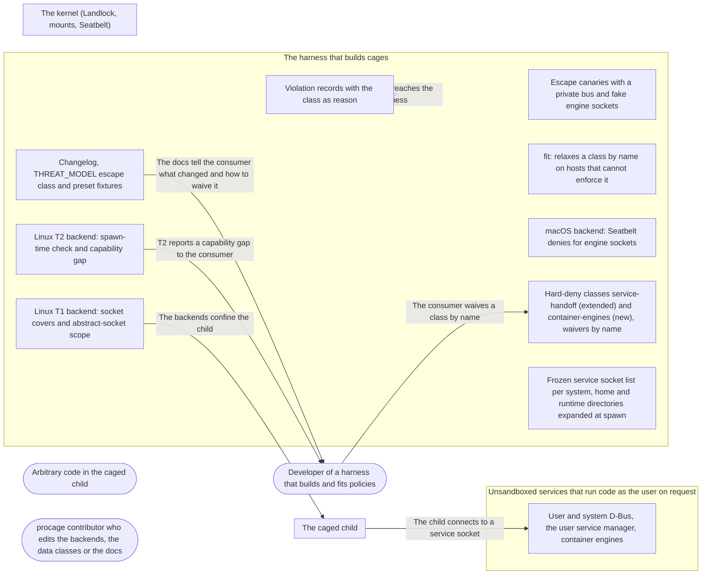

# Threat Model: No service handoff over Unix sockets

**Feature**: `041-service-sockets` · **Generated**: 2026-11-01T21:13:45Z · **Profiles**: stride, llm, agent · **Canonical**: `threat-model.yaml`

> Rendered by ThreatSpec. Edit `threat-model.yaml`, not this file.

## Summary

| Threats | Critical | High | Medium | Low | Needs clarification | Not applicable | Mitigations | Requirements | Decisions |
|---|---|---|---|---|---|---|---|---|---|
| 14 | 2 | 7 | 4 | 1 | 3 | 27 | 13 | 13 | 0 |

### Needs clarification

- `threat.q-abstract-scope` — [NEEDS CLARIFICATION: the Landlock abstract-socket scope refuses every abstract socket outside the cage, not only the bus; is that accepted when service-handoff is not waived, and is it waivable separately?] (spec.md#Clarifications)
- `threat.q-engine-from-env` — [NEEDS CLARIFICATION: are engine sockets named by DOCKER_HOST, CONTAINER_HOST or a tool profile at a path outside the frozen list in scope, expanded from the harness environment at spawn, or a documented harness responsibility?] (spec.md#Key-Entities)
- `threat.q-linux-report` — [NEEDS CLARIFICATION: Linux records only system calls the seccomp filter refuses; how does a connect stopped by a mount cover or a Landlock scope reach the record with the class as its reason (FR-006)?] (spec.md#FR-006)

## Actors

| ID | Name | Trust | Description |
|---|---|---|---|
| `actor.caged-code` | Arbitrary code in the caged child | untrusted |  |
| `actor.consumer` | Developer of a harness that builds and fits policies | trusted |  |
| `actor.contributor` | procage contributor who edits the backends, the data classes or the docs | semi-trusted |  |

## Trust Zones

| ID | Name | Trust rating | Description |
|---|---|---|---|
| `tz.cage` | The caged child | 5 |  |
| `tz.harness` | The harness that builds cages | 90 |  |
| `tz.os` | The kernel (Landlock, mounts, Seatbelt) | 95 |  |
| `tz.services` | Unsandboxed services that run code as the user on request | 60 |  |

## Assets

| ID | Name | Type | Classification | C / I / A | Source |
|---|---|---|---|---|---|
| `asset.harness` | Runs that legitimately use a project socket or a container engine | capability | internal | 0 / 30 / 70 | spec.md#US2 |
| `asset.host` | The user's files, secrets and processes outside the policy | credential | secret | 100 / 90 / 50 | spec.md#Context |
| `asset.policy` | The hard-deny tier and its waivers, as compiled and recorded | configuration | internal | 0 / 95 / 30 | spec.md#FR-005 |
| `asset.record` | The violation record the harness shows its user and may act on | capability | internal | 30 / 80 / 30 | spec.md#FR-006 |

## Components

| ID | Name | Type | Trust zone | Source |
|---|---|---|---|---|
| `component.canaries` | Escape canaries with a private bus and fake engine sockets | test | `tz.harness` | spec.md#US1 |
| `component.docs` | Changelog, THREAT_MODEL escape class and preset fixtures | document | `tz.harness` | spec.md#FR-007 |
| `component.fit` | fit: relaxes a class by name on hosts that cannot enforce it | library | `tz.harness` | spec.md#FR-008 |
| `component.linux-t1` | Linux T1 backend: socket covers and abstract-socket scope | library | `tz.harness` | spec.md#FR-003 |
| `component.linux-t2` | Linux T2 backend: spawn-time check and capability gap | library | `tz.harness` | spec.md#FR-003 |
| `component.macos` | macOS backend: Seatbelt denies for engine sockets | library | `tz.harness` | spec.md#FR-002 |
| `component.policy` | Hard-deny classes service-handoff (extended) and container-engines (new), waivers by name | library | `tz.harness` | spec.md#Key-Entities |
| `component.services` | User and system D-Bus, the user service manager, container engines | service | `tz.services` | spec.md#Context |
| `component.socket-list` | Frozen service socket list per system, home and runtime directories expanded at spawn | library | `tz.harness` | spec.md#Key-Entities |
| `component.violations` | Violation records with the class as reason | library | `tz.harness` | spec.md#FR-006 |

## Data Flows

| ID | Name | From | To | Assets | Crosses |
|---|---|---|---|---|---|
| `flow.claims` | The docs tell the consumer what changed and how to waive it | `component.docs` | `actor.consumer` | `asset.policy` |  |
| `flow.confine` | The backends confine the child | `component.linux-t1` | `tz.cage` | `asset.host` | `tz.harness`, `tz.cage` |
| `flow.connect` | The child connects to a service socket | `tz.cage` | `component.services` | `asset.host` | `tz.cage`, `tz.services` |
| `flow.gap` | T2 reports a capability gap to the consumer | `component.linux-t2` | `actor.consumer` | `asset.policy` |  |
| `flow.record` | The record reaches the harness | `component.violations` | `tz.harness` | `asset.record` |  |
| `flow.waiver` | The consumer waives a class by name | `actor.consumer` | `component.policy` | `asset.policy` |  |

## Threats

| ID | Threat | Category | Technique | Severity | Status | Mitigations | Mappings | Source |
|---|---|---|---|---|---|---|---|---|
| `threat.engine-handoff` | Caged code connects to a container engine socket (Docker, Podman, containerd, Colima, OrbStack) and starts a container that mounts the home directory, on Linux or macOS | Elevation of Privilege | broken-access-control | **critical** | open | `mitigation.engine-deny`, `mitigation.paired-canaries` |  | spec.md#US2 |
| `threat.user-bus-handoff` | With the network on, caged code connects to the user bus or the user service manager on Linux and starts a transient unit (systemd-run --user, StartTransientUnit) that runs as the user outside the sandbox | Elevation of Privilege | broken-access-control | **critical** | open | `mitigation.linux-bus-deny`, `mitigation.paired-canaries` |  | spec.md#US1 |
| `threat.abstract-bus` | A bus listening on an abstract address (older systems) is reached because path rules and mount covers do not apply to abstract sockets, and the kernel cannot scope them or the scope is not applied | Elevation of Privilege | broken-access-control | **high** | open | `mitigation.abstract-scope` |  | spec.md#FR-004 |
| `threat.list-gap` | The frozen socket list misses a variant in use (rootless containerd, a Podman machine, Colima or Lima profiles, a new engine), so that engine stays reachable | Elevation of Privilege | broken-access-control | **high** | open | `mitigation.versioned-list` |  | spec.md#Assumptions |
| `threat.post-spawn-socket` | A bus or engine socket created after spawn (an engine started later, a restarted bus) is not covered on T1 because the covers are made from the file system at spawn | Elevation of Privilege | broken-access-control | **high** | open | `mitigation.cover-directories` |  | spec.md#Edge-Cases |
| `threat.runtime-dir-expansion` | The runtime or home directory is expanded from a variable that is unset or points elsewhere in the harness (sudo, a container, a service), so the real bus or engine socket is not covered | Elevation of Privilege | injection | **high** | open | `mitigation.uid-expansion` |  | spec.md#Key-Entities |
| `threat.system-bus-handoff` | Caged code reaches the system bus and asks a service for an action that polkit allows for an active local session, so the action runs outside the sandbox | Elevation of Privilege | broken-access-control | **high** | open | `mitigation.linux-bus-deny` |  | spec.md#Context |
| `threat.t2-silent-reach` | On T2, which cannot deny one socket inside an allowed tree, a service socket present at spawn stays reachable and the cage is made without a capability gap | Elevation of Privilege | broken-access-control | **high** | open | `mitigation.t2-gap` |  | spec.md#FR-003 |
| `threat.vacuous-canary` | The canaries pass without proving the deny: the fake service does not listen at the expanded path, the test skips without a user session, or it never runs with the network on | Repudiation | missing-audit-trail | **high** | open | `mitigation.paired-canaries` |  | spec.md#Assumptions |
| `threat.alias-path` | Caged code reaches a listed socket under another name: a symbolic link, /var/run instead of /run, a differently spelled runtime directory, or a hard link it makes to the socket inside a writable tree | Elevation of Privilege | broken-access-control | **medium** | open | `mitigation.resolved-object` |  | spec.md#Edge-Cases |
| `threat.over-deny` | A pattern also matches a project's own socket under a granted writable tree, or the abstract-socket scope cuts unrelated local services, so legitimate runs fail and consumers waive whole classes to get work done | Denial of Service | resource-exhaustion | **medium** | open | `mitigation.exact-patterns` |  | spec.md#Edge-Cases |
| `threat.waiver-broadens` | Waiving container-engines (or service-handoff) drops more than that class's denies, waives the other class too, matches a waiver by a string pattern, or is not recorded | Elevation of Privilege | broken-access-control | **medium** | open | `mitigation.class-scoped-waiver` |  | spec.md#FR-005 |
| `threat.wrong-reason` | A refused connect is recorded as not granted or as network, not as the class, so the harness asks the user for a grant that does not help or opens the network | Repudiation | missing-audit-trail | **medium** | open | `mitigation.class-reason` |  | spec.md#FR-006 |
| `threat.silent-tightening` | Policies and frozen presets become stricter without a Security entry or a fixture review, so harnesses break unexplained, or a fixture diff hides an unrelated loosening | Repudiation | missing-audit-trail | **low** | open | `mitigation.reviewed-fixtures` |  | spec.md#FR-007 |

### Techniques evaluated without findings

| Technique | Disposition | Reason |
|---|---|---|
| credential-theft | not-applicable | procage authenticates no one; the services trust the caged code's uid, which is the threat modelled as handoff |
| identity-spoofing | not-applicable | no authentication surface in procage |
| data-tampering-in-transit | no-threat-detected | checked flow.connect: procage carries no data over these sockets, it only denies the connect |
| data-tampering-at-rest | not-applicable | no store; the socket list is compiled-in data, its gaps are threat.list-gap |
| sensitive-data-exposure | no-threat-detected | the class only adds denies; the disclosure paths are the handoff threats |
| cross-tenant-leak | not-applicable | single user |
| privilege-escalation-via-config | not-applicable | no configuration store added; planted user units are R-23 |
| prompt-injection-direct | not-applicable | procage is a library that calls no model and runs no agent; LLM-written code is the adversary inside the child, modelled under STRIDE |
| prompt-injection-indirect | not-applicable | procage is a library that calls no model and runs no agent; LLM-written code is the adversary inside the child, modelled under STRIDE |
| sensitive-information-disclosure | not-applicable | procage is a library that calls no model and runs no agent; LLM-written code is the adversary inside the child, modelled under STRIDE |
| excessive-agency | not-applicable | procage is a library that calls no model and runs no agent; LLM-written code is the adversary inside the child, modelled under STRIDE |
| model-supply-chain | not-applicable | procage is a library that calls no model and runs no agent; LLM-written code is the adversary inside the child, modelled under STRIDE |
| training-data-poisoning | not-applicable | procage is a library that calls no model and runs no agent; LLM-written code is the adversary inside the child, modelled under STRIDE |
| unbounded-consumption | not-applicable | procage is a library that calls no model and runs no agent; LLM-written code is the adversary inside the child, modelled under STRIDE |
| misinformation | not-applicable | procage is a library that calls no model and runs no agent; LLM-written code is the adversary inside the child, modelled under STRIDE |
| hidden-context-exposure | not-applicable | procage is a library that calls no model and runs no agent; LLM-written code is the adversary inside the child, modelled under STRIDE |
| vector-embedding-weakness | not-applicable | procage is a library that calls no model and runs no agent; LLM-written code is the adversary inside the child, modelled under STRIDE |
| improper-output-handling | not-applicable | procage is a library that calls no model and runs no agent; LLM-written code is the adversary inside the child, modelled under STRIDE |
| model-extraction | not-applicable | procage is a library that calls no model and runs no agent; LLM-written code is the adversary inside the child, modelled under STRIDE |
| goal-hijack | not-applicable | procage is a library that calls no model and runs no agent; LLM-written code is the adversary inside the child, modelled under STRIDE |
| tool-misuse | not-applicable | procage is a library that calls no model and runs no agent; LLM-written code is the adversary inside the child, modelled under STRIDE |
| identity-privilege-abuse | not-applicable | procage is a library that calls no model and runs no agent; LLM-written code is the adversary inside the child, modelled under STRIDE |
| agentic-supply-chain | not-applicable | procage is a library that calls no model and runs no agent; LLM-written code is the adversary inside the child, modelled under STRIDE |
| unexpected-code-execution | not-applicable | procage is a library that calls no model and runs no agent; LLM-written code is the adversary inside the child, modelled under STRIDE |
| memory-context-poisoning | not-applicable | procage is a library that calls no model and runs no agent; LLM-written code is the adversary inside the child, modelled under STRIDE |
| insecure-inter-agent-communication | not-applicable | procage is a library that calls no model and runs no agent; LLM-written code is the adversary inside the child, modelled under STRIDE |
| cascading-failure | not-applicable | procage is a library that calls no model and runs no agent; LLM-written code is the adversary inside the child, modelled under STRIDE |
| human-agent-trust-exploitation | not-applicable | procage is a library that calls no model and runs no agent; LLM-written code is the adversary inside the child, modelled under STRIDE |
| rogue-agent | not-applicable | procage is a library that calls no model and runs no agent; LLM-written code is the adversary inside the child, modelled under STRIDE |

## Mitigations

| ID | Mitigation | Kind | Threats | Requirements | Touchpoints | Status |
|---|---|---|---|---|---|---|
| `mitigation.abstract-scope` | Abstract service addresses found at spawn are scoped on Landlock ABI 6 and above, otherwise a gap naming the address | preventive | `threat.abstract-bus` | SR-004 | `component.linux-t1`, `component.linux-t2` | required |
| `mitigation.class-reason` | A refused connect to a listed socket is recorded with the class as its reason | detective | `threat.wrong-reason` | SR-011 | `component.violations` | required |
| `mitigation.class-scoped-waiver` | Each class is a typed name; a waiver removes exactly that class's denies and is recorded in the receipt | preventive | `threat.waiver-broadens` | SR-009 | `component.policy`, `component.fit` | required |
| `mitigation.cover-directories` | On T1 the runtime-directory entries of the classes are covered as names, so a socket made after spawn at a listed path is unreachable; what cannot be covered is documented as the spawn-snapshot approximation | preventive | `threat.post-spawn-socket` | SR-008 | `component.linux-t1`, `component.docs` | required |
| `mitigation.engine-deny` | container-engines denies every listed engine socket on Linux and macOS under every network setting | preventive | `threat.engine-handoff` | SR-002 | `component.linux-t1`, `component.macos`, `component.policy` | required |
| `mitigation.exact-patterns` | Patterns match only listed names under the expanded directories; a granted project socket stays reachable | preventive | `threat.over-deny` | SR-010 | `component.socket-list`, `component.linux-t1` | required |
| `mitigation.linux-bus-deny` | Linux service-handoff covers the user bus, the system bus and the service-manager sockets on T1 under every network setting | preventive | `threat.user-bus-handoff`, `threat.system-bus-handoff` | SR-001 | `component.linux-t1`, `component.policy` | required |
| `mitigation.paired-canaries` | Escape canaries with a private bus and fake engine sockets at the expanded paths, network on, T1, T2 and macOS, each paired with a waived positive control; they fail, never skip | detective | `threat.vacuous-canary`, `threat.user-bus-handoff`, `threat.engine-handoff` | SR-012 | `component.canaries` | required |
| `mitigation.resolved-object` | Denies apply to the socket object: T1 covers the resolved socket, macOS rules name the resolved path and refuse hard links to listed sockets | preventive | `threat.alias-path` | SR-005 | `component.linux-t1`, `component.macos` | required |
| `mitigation.reviewed-fixtures` | Security entry in the changelog, the escape class in the threat model, and regenerated preset fixtures whose diff is only the new denies | detective | `threat.silent-tightening` | SR-013 | `component.docs`, `component.policy` | required |
| `mitigation.t2-gap` | T2 checks the expanded list at spawn and fails with a capability gap naming the class and each socket found, unless the class is waived; fit relaxes by name | preventive | `threat.t2-silent-reach` | SR-003 | `component.linux-t2`, `component.fit` | required |
| `mitigation.uid-expansion` | The runtime directory is expanded from the variable and from /run/user/<uid>; the home from the variable and the account; both spellings are denied | preventive | `threat.runtime-dir-expansion` | SR-006 | `component.socket-list` | required |
| `mitigation.versioned-list` | The socket list is versioned data with its sources, covered by a table test, and the docs name what it does not cover | detective | `threat.list-gap` | SR-007 | `component.socket-list`, `component.docs` | required |

## Security Requirements

### SR-001 (P1) — unverified

On Linux T1, the service-handoff class MUST make a connect from the caged child to the user bus, the system bus and the user service-manager sockets fail under every network setting, unless the class is waived.

- **Given** T1, Network::All and a private bus at $XDG_RUNTIME_DIR/bus and a fake socket at $XDG_RUNTIME_DIR/systemd/private, **when** the child connects to each, and to a fake system bus socket at its path, **then** every connect fails and the fake services record no connection
- **Given** the same setup with Network::None, **when** the child connects, **then** every connect fails
- Mitigations: `mitigation.linux-bus-deny`
- Tasks: — none —

### SR-002 (P1) — unverified

The container-engines class MUST make a connect to every listed engine socket fail on Linux (T1) and macOS under every network setting, unless the class is waived.

- **Given** macOS, Network::All and fake engine sockets at each listed home-directory path, **when** the child connects to each, **then** every connect is denied and no fake engine records a connection
- **Given** Linux T1 in a container lane with fake sockets at each listed system and runtime path, **when** the child connects to each, **then** every connect fails
- Mitigations: `mitigation.engine-deny`
- Tasks: — none —

### SR-003 (P1) — unverified

On T2, if a socket of an unwaived class exists at spawn, making the cage MUST fail with a capability gap naming the class and every such socket path; fit MUST relax the class by name and say what lifts the gap.

- **Given** T2 and a socket at $XDG_RUNTIME_DIR/bus, **when** the cage is made, **then** it fails with a gap naming service-handoff and that path
- **Given** the same host and fit, **when** fit runs, **then** it relaxes service-handoff by name and states what would lift the gap
- **Given** T2 and no listed socket, **when** the cage is made, **then** it succeeds unchanged
- Mitigations: `mitigation.t2-gap`
- Tasks: — none —

### SR-004 (P1) — unverified

An abstract address of a service-handoff bus found at spawn MUST be scoped where the kernel supports abstract-socket scoping (Landlock ABI 6), and otherwise MUST fail the cage with a gap naming the address.

- **Given** a fake bus on an abstract address and Landlock ABI 6, **when** the child connects, **then** the connect fails
- **Given** the same bus and a kernel below ABI 6, **when** the cage is made, **then** it fails with a gap naming the address
- Mitigations: `mitigation.abstract-scope`
- Tasks: — none —

### SR-005 (P1) — unverified

A deny MUST hold for the socket object, not its spelling: a connect through a symbolic link, /var/run instead of /run, or a hard link made inside the cage to a listed socket MUST fail like the direct path.

- **Given** a writable workspace with a symbolic link to a listed fake socket, **when** the child connects through it, **then** the connect fails on T1 and macOS
- **Given** a listed fake socket, **when** the child makes a hard link to it in the workspace and connects, **then** the link or the connect fails
- Mitigations: `mitigation.resolved-object`
- Tasks: — none —

### SR-006 (P1) — unverified

The runtime and home directories MUST be expanded both from the environment and from the account (/run/user/<uid>, the account's home), and the listed sockets denied under each spelling.

- **Given** a harness with XDG_RUNTIME_DIR unset and a fake bus at /run/user/<uid>/bus, **when** the child connects, **then** the connect fails
- **Given** HOME pointing to another directory, **when** the child connects to the engine socket under the account's home, **then** the connect is denied
- Mitigations: `mitigation.uid-expansion`
- Tasks: — none —

### SR-007 (P1) — unverified

The service socket list MUST be versioned data with a source per entry, and the docs MUST list each path and directory pattern it covers and say that sockets outside it are not covered.

- **Given** the list and the docs, **when** a table test compares them, **then** every entry appears in both with its version
- Mitigations: `mitigation.versioned-list`
- Tasks: — none —

### SR-008 (P1) — unverified

On T1 a socket created after spawn at a listed runtime-directory path MUST be unreachable; any listed path that cannot be covered that way MUST be documented as the spawn-snapshot approximation.

- **Given** T1, no bus socket at spawn, **when** a fake bus is bound at $XDG_RUNTIME_DIR/bus after spawn and the child connects, **then** the connect fails, or the path is listed as a snapshot approximation in the docs
- Mitigations: `mitigation.cover-directories`
- Tasks: — none —

### SR-009 (P1) — unverified

Each class MUST be waivable only by its typed name; a waiver MUST remove exactly that class's denies and MUST be recorded in the receipt.

- **Given** a policy compiled with and without the container-engines waiver, **when** the outputs are compared, **then** they differ only in the engine denies, service-handoff still holds, and the receipt lists the waiver
- **Given** container-engines waived, **when** the child connects to a fake engine, **then** it succeeds and a connect to the fake bus still fails
- Mitigations: `mitigation.class-scoped-waiver`
- Tasks: — none —

### SR-010 (P2) — unverified

Patterns MUST match only listed names under the expanded directories; a socket under a granted writable tree that matches no pattern MUST stay reachable.

- **Given** a project's own server socket in the writable workspace, **when** the child connects, **then** it succeeds on T1, T2 and macOS
- Mitigations: `mitigation.exact-patterns`
- Tasks: — none —

### SR-011 (P2) — unverified

With reporting on, a refused connect to a listed socket MUST be recorded with the class name as its reason.

- **Given** macOS, reporting on and a fake engine socket, **when** the child connects, **then** the record holds a violation with reason container-engines
- Mitigations: `mitigation.class-reason`
- Tasks: — none —

### SR-012 (P1) — unverified

The escape suite MUST hold a canary per class with the network on, on T1, T2 and macOS, each paired with a positive control (class waived, connect succeeds) and failing, never skipping, when the setup is missing.

- **Given** each lane, **when** the canary runs, **then** the connect is refused (T2: the gap), and the waived control connects
- **Given** a lane where the private bus cannot start, **when** the canary runs, **then** it fails
- Mitigations: `mitigation.paired-canaries`
- Tasks: — none —

### SR-013 (P2) — unverified

The change MUST ship with a Security entry in the changelog and the escape class in the threat model, and the regenerated preset fixtures MUST differ only by the new denies.

- **Given** the fixture diff, **when** it is reviewed, **then** every changed line is a service-handoff or container-engines deny
- **Given** the changelog and the threat model, **when** they are read, **then** both name container-engines, the extended service-handoff and the canaries
- Mitigations: `mitigation.reviewed-fixtures`
- Tasks: — none —
