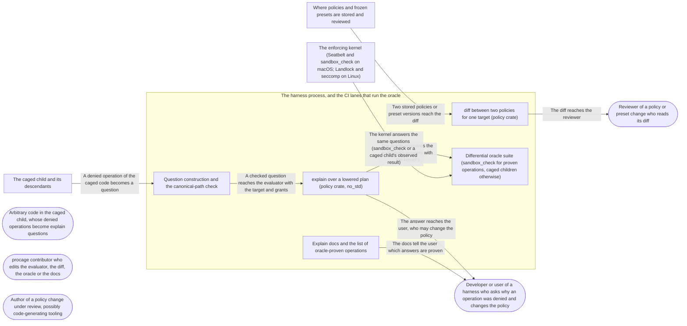

# Threat Model: Explain and diff, checked against the kernel

**Feature**: `042-explain` · **Generated**: 2026-11-02T06:39:58Z · **Profiles**: stride, llm, agent · **Canonical**: `threat-model.yaml`

> Rendered by ThreatSpec. Edit `threat-model.yaml`, not this file.

## Summary

| Threats | Critical | High | Medium | Low | Needs clarification | Not applicable | Mitigations | Requirements | Decisions |
|---|---|---|---|---|---|---|---|---|---|
| 8 | 0 | 5 | 1 | 2 | 0 | 26 | 9 | 10 | 0 |

## Actors

| ID | Name | Trust | Description |
|---|---|---|---|
| `actor.caged-code` | Arbitrary code in the caged child, whose denied operations become explain questions | untrusted |  |
| `actor.consumer` | Developer or user of a harness who asks why an operation was denied and changes the policy | trusted |  |
| `actor.contributor` | procage contributor who edits the evaluator, the diff, the oracle or the docs | semi-trusted |  |
| `actor.policy-author` | Author of a policy change under review, possibly code-generating tooling | semi-trusted |  |
| `actor.reviewer` | Reviewer of a policy or preset change who reads its diff | trusted |  |

## Trust Zones

| ID | Name | Trust rating | Description |
|---|---|---|---|
| `tz.cage` | The caged child and its descendants | 5 |  |
| `tz.harness` | The harness process, and the CI lanes that run the oracle | 90 |  |
| `tz.kernel` | The enforcing kernel (Seatbelt and sandbox_check on macOS; Landlock and seccomp on Linux) | 95 |  |
| `tz.repo` | Where policies and frozen presets are stored and reviewed | 60 |  |

## Assets

| ID | Name | Type | Classification | C / I / A | Source |
|---|---|---|---|---|---|
| `asset.answer` | An explain answer (decision, deciding rule, what would change it) a user acts on | capability | internal | 30 / 90 / 20 | spec.md#Key-Entities |
| `asset.diff` | The diff a reviewer approves a policy or preset change on | capability | internal | 10 / 95 / 20 | spec.md#US2 |
| `asset.harness` | The harness's time and memory spent on explain and diff | capability | internal | 0 / 10 / 50 | spec.md#SC-003 |
| `asset.host` | The user's files, secrets and processes outside the policy | credential | secret | 100 / 90 / 50 | spec.md#Context |

## Components

| ID | Name | Type | Trust zone | Source |
|---|---|---|---|---|
| `component.diff` | diff between two policies for one target (policy crate) | library | `tz.harness` | spec.md#FR-002 |
| `component.docs` | Explain docs and the list of oracle-proven operations | document | `tz.harness` | spec.md#FR-006 |
| `component.evaluator` | explain over a lowered plan (policy crate, no_std) | library | `tz.harness` | spec.md#FR-001 |
| `component.oracle` | Differential oracle suite (sandbox_check for proven operations, caged children otherwise) | service | `tz.harness` | spec.md#FR-004 |
| `component.query` | Question construction and the canonical-path check | library | `tz.harness` | spec.md#Clarifications |

## Data Flows

| ID | Name | From | To | Assets | Crosses |
|---|---|---|---|---|---|
| `flow.answer` | The answer reaches the user, who may change the policy | `component.evaluator` | `actor.consumer` | `asset.answer`, `asset.host` |  |
| `flow.claims` | The docs tell the user which answers are proven | `component.docs` | `actor.consumer` | `asset.answer` |  |
| `flow.compare` | The oracle compares the evaluator's answers with the kernel's | `component.evaluator` | `component.oracle` | `asset.answer` |  |
| `flow.diff` | The diff reaches the reviewer | `component.diff` | `actor.reviewer` | `asset.diff`, `asset.host` |  |
| `flow.kernel-answer` | The kernel answers the same questions (sandbox_check or a caged child's observed result) | `tz.kernel` | `component.oracle` | `asset.answer` | `tz.kernel`, `tz.harness` |
| `flow.policies` | Two stored policies or preset versions reach the diff | `tz.repo` | `component.diff` | `asset.diff` | `tz.repo`, `tz.harness` |
| `flow.question` | A checked question reaches the evaluator with the target and grants | `component.query` | `component.evaluator` | `asset.answer` |  |
| `flow.violation-question` | A denied operation of the caged code becomes a question | `tz.cage` | `component.query` | `asset.answer` | `tz.cage`, `tz.harness` |

## Threats

| ID | Threat | Category | Technique | Severity | Status | Mitigations | Mappings | Source |
|---|---|---|---|---|---|---|---|---|
| `threat.diff-hides-loosening` | diff misses a newly allowed operation (an overlapping subpath or glob, a waiver, a base or preset version change, network, process or signal rules, or a change on only one target or tier), so a reviewer approves a loosening | Elevation of Privilege | privilege-escalation-via-config | **high** | mitigated | `mitigation.sound-diff` |  | spec.md#US2 |
| `threat.false-denied` | explain answers denied, protected or hidden for an operation the kernel allows (a T1 path created after spawn, a grant left out, an undocumented Seatbelt or Landlock rule), so the user trusts a protection that does not hold | Elevation of Privilege | broken-access-control | **high** | mitigated | `mitigation.differential-oracle`, `mitigation.full-question` |  | spec.md#Edge-Cases |
| `threat.misleading-remedy` | explain names an allow the kernel does not honour, the wrong deciding rule, or a remedy wider than the question (a subpath over the home directory, a waiver), so the user weakens the policy more than needed | Elevation of Privilege | broken-access-control | **high** | mitigated | `mitigation.differential-oracle`, `mitigation.minimal-remedy` |  | spec.md#US1 |
| `threat.non-canonical-query` | A question path spelled through an alias, firmlink, symlink or dot component, or carrying pattern characters from a child-controlled violation path, is answered as if canonical and literal, so the answer is about a different file (R-02, R-03, R-12) | Tampering | injection | **high** | mitigated | `mitigation.canonical-question` |  | spec.md#Clarifications |
| `threat.oracle-overclaim` | The oracle or the docs claim proof the oracle does not give (ENOENT counted as agreement, a lane that skips, rule kinds no generated question reaches, an operation explained but never asked of the kernel) | Repudiation | missing-audit-trail | **high** | mitigated | `mitigation.differential-oracle`, `mitigation.proven-list` |  | spec.md#FR-004 |
| `threat.unmodelled-guess` | An operation explain does not model falls through to the default or the base and comes back as denied or allowed instead of not modelled | Repudiation | missing-audit-trail | **medium** | mitigated | `mitigation.closed-operations` |  | spec.md#FR-005 |
| `threat.answer-reveals-rules` | A harness relays answers into the cage, and a deciding rule's pattern wider than the path asked tells caged code which hidden or protected paths exist | Information Disclosure | sensitive-data-exposure | **low** | mitigated | `mitigation.relay-guidance` |  | spec.md#US1 |
| `threat.evaluator-exhaustion` | A crafted policy or question (deep globs, many overlapping rules, a very long path) makes explain or diff run unbounded in the harness | Denial of Service | resource-exhaustion | **low** | mitigated | `mitigation.bounded-evaluation` |  | spec.md#SC-003 |

### Techniques evaluated without findings

| Technique | Disposition | Reason |
|---|---|---|
| credential-theft | not-applicable | no authentication surface; explain and diff are pure functions over a plan |
| identity-spoofing | not-applicable | no authentication or network boundary |
| data-tampering-in-transit | not-applicable | no data in transit; questions and answers stay in the caller's process |
| data-tampering-at-rest | no-threat-detected | checked component.evaluator and component.diff: both read an in-memory plan and write nothing; a changed stored policy or preset is threat.diff-hides-loosening |
| cross-tenant-leak | not-applicable | single user; a question is asked of the caller's own policy |
| prompt-injection-direct | not-applicable | procage is a library that calls no model and runs no agent; LLM-written code is the adversary inside the child, modelled under STRIDE |
| prompt-injection-indirect | not-applicable | procage is a library that calls no model and runs no agent; LLM-written code is the adversary inside the child, modelled under STRIDE |
| sensitive-information-disclosure | not-applicable | procage is a library that calls no model and runs no agent; LLM-written code is the adversary inside the child, modelled under STRIDE |
| excessive-agency | not-applicable | procage is a library that calls no model and runs no agent; LLM-written code is the adversary inside the child, modelled under STRIDE |
| model-supply-chain | not-applicable | procage is a library that calls no model and runs no agent; LLM-written code is the adversary inside the child, modelled under STRIDE |
| training-data-poisoning | not-applicable | procage is a library that calls no model and runs no agent; LLM-written code is the adversary inside the child, modelled under STRIDE |
| unbounded-consumption | not-applicable | procage is a library that calls no model and runs no agent; LLM-written code is the adversary inside the child, modelled under STRIDE |
| misinformation | not-applicable | procage is a library that calls no model and runs no agent; LLM-written code is the adversary inside the child, modelled under STRIDE |
| hidden-context-exposure | not-applicable | procage is a library that calls no model and runs no agent; LLM-written code is the adversary inside the child, modelled under STRIDE |
| vector-embedding-weakness | not-applicable | procage is a library that calls no model and runs no agent; LLM-written code is the adversary inside the child, modelled under STRIDE |
| improper-output-handling | not-applicable | procage is a library that calls no model and runs no agent; LLM-written code is the adversary inside the child, modelled under STRIDE |
| model-extraction | not-applicable | procage is a library that calls no model and runs no agent; LLM-written code is the adversary inside the child, modelled under STRIDE |
| goal-hijack | not-applicable | procage is a library that calls no model and runs no agent; LLM-written code is the adversary inside the child, modelled under STRIDE |
| tool-misuse | not-applicable | procage is a library that calls no model and runs no agent; LLM-written code is the adversary inside the child, modelled under STRIDE |
| identity-privilege-abuse | not-applicable | procage is a library that calls no model and runs no agent; LLM-written code is the adversary inside the child, modelled under STRIDE |
| agentic-supply-chain | not-applicable | procage is a library that calls no model and runs no agent; LLM-written code is the adversary inside the child, modelled under STRIDE |
| unexpected-code-execution | not-applicable | procage is a library that calls no model and runs no agent; LLM-written code is the adversary inside the child, modelled under STRIDE |
| memory-context-poisoning | not-applicable | procage is a library that calls no model and runs no agent; LLM-written code is the adversary inside the child, modelled under STRIDE |
| insecure-inter-agent-communication | not-applicable | procage is a library that calls no model and runs no agent; LLM-written code is the adversary inside the child, modelled under STRIDE |
| cascading-failure | not-applicable | procage is a library that calls no model and runs no agent; LLM-written code is the adversary inside the child, modelled under STRIDE |
| human-agent-trust-exploitation | not-applicable | procage is a library that calls no model and runs no agent; LLM-written code is the adversary inside the child, modelled under STRIDE |
| rogue-agent | not-applicable | procage is a library that calls no model and runs no agent; LLM-written code is the adversary inside the child, modelled under STRIDE |

## Mitigations

| ID | Mitigation | Kind | Threats | Requirements | Touchpoints | Status |
|---|---|---|---|---|---|---|
| `mitigation.bounded-evaluation` | explain matches regexes with a linear-time NFA; diff compares rule lists by sorting, with no pattern pairs | preventive | `threat.evaluator-exhaustion` | SR-009 | `crates/procage-policy/src/explain/regex.rs`, `crates/procage-policy/src/explain/diff.rs` | verified |
| `mitigation.canonical-question` | Cage::explain resolves the path on the host; the policy crate refuses lexical and macOS alias spellings naming the canonical form; question paths are bytes, never patterns | preventive | `threat.non-canonical-query` | SR-006 | `crates/procage-policy/src/explain/mod.rs`, `crates/procage/src/macos/mod.rs`, `crates/procage/src/linux/mod.rs` | verified |
| `mitigation.closed-operations` | A closed set of modelled operations; anything else answers not modelled | preventive | `threat.unmodelled-guess` | SR-007 | `crates/procage-policy/src/explain/mod.rs`, `crates/procage-policy/src/explain/macos.rs` | verified |
| `mitigation.differential-oracle` | Generated questions per preset, target and rule kind, asked of the kernel on every lane; any disagreement or unresolved outcome fails and names the question; no skip | detective | `threat.false-denied`, `threat.oracle-overclaim`, `threat.misleading-remedy` | SR-001, SR-002 | `crates/procage/tests/oracle.rs` | verified |
| `mitigation.full-question` | Questions carry the target, tier and grants; T1 answers outside the spawn-time covers say covered at spawn with the limits | preventive | `threat.false-denied` | SR-004 | `crates/procage-policy/src/explain/linux.rs`, `crates/procage/src/linux/mod.rs` | verified |
| `mitigation.minimal-remedy` | The remedy is the narrowest change for the deciding rule, verified by re-lowering, and carries its own diff | preventive | `threat.misleading-remedy` | SR-005 | `crates/procage-policy/src/explain/mod.rs` | verified |
| `mitigation.proven-list` | The docs' list of proven operations is checked against the oracle suite; nothing else is called proven | preventive | `threat.oracle-overclaim` | SR-003 | `site/content/docs/explain.md`, `crates/procage/tests/oracle.rs` | verified |
| `mitigation.relay-guidance` | The docs say an answer names the deciding rule and is for the user, not to be relayed into the cage unfiltered | preventive | `threat.answer-reveals-rules` | SR-010 | `site/content/docs/explain.md`, `crates/procage-policy/src/explain/mod.rs` | verified |
| `mitigation.sound-diff` | diff is the rule-list difference for every target given, plus every other differing plan field as a setting, checked against explain on generated pairs | detective | `threat.diff-hides-loosening` | SR-008 | `crates/procage-policy/src/explain/diff.rs` | verified |

## Security Requirements

### SR-001 (P1) — verified

On every CI lane, a differential oracle MUST ask the kernel at least 1,000 generated questions per preset and target, reaching every rule kind (allow, protect, hide, hard-deny class, base, default, grant, T1 cover), for every operation listed as proven, and MUST fail naming the question on any disagreement; a lane that cannot confine its children MUST fail, never skip.

- **Given** the oracle suite on each lane, **when** it runs, **then** every rule kind is reached, at least 1,000 questions per preset and target are asked, and all agree
- **Given** an evaluator mutated to flip the decision of one rule kind, **when** the oracle runs, **then** it fails and names a question of that kind
- **Given** a lane that is itself sandboxed, **when** the oracle starts, **then** it fails with AlreadySandboxed
- Mitigations: `mitigation.differential-oracle`
- Tasks: T009 ✓, T010 ✓
- Verification `verification.sr-001.2026-11-02`: test → pass (verified) — `crates/procage/tests/oracle.rs::explain_agrees_with_the_kernel`

### SR-002 (P1) — verified

The oracle MUST ask a caged child on every lane and classify its observed result as allowed (success), denied (EACCES, EPERM, EROFS) or unresolved (anything else, including ENOENT for a file the generator made), and MUST fail on an unresolved question rather than count it as agreement.

- **Given** a question whose open fails with ENOENT or another unexpected errno, **when** the oracle compares it, **then** the suite fails naming the question
- **Given** any lane, **when** the oracle asks the kernel, **then** it uses a caged child's observed open or execve result, never sandbox_check
- Mitigations: `mitigation.differential-oracle`
- Tasks: T009 ✓
- Verification `verification.sr-002.2026-11-02`: test → pass (verified) — `crates/procage/tests/oracle.rs::explain_agrees_with_the_kernel`

### SR-003 (P1) — verified

explain MUST model exactly the operations the oracle suite proves on every target, and the docs MUST list exactly those; no other answer is called proven.

- **Given** the modelled operations, the oracle suite's covered operations and the docs list, **when** a test compares them, **then** they are equal on every target
- Mitigations: `mitigation.proven-list`
- Tasks: T009 ✓, T014 ✓
- Verification `verification.sr-003.2026-11-02`: test → pass (verified) — `crates/procage/tests/oracle.rs::the_docs_list_the_proven_operations`

### SR-004 (P1) — verified

A question MUST carry the target, the Linux tier, the per-spawn grants and the homes; on Linux an answer that holds only for paths existing at spawn (class covers on T1, piecewise hides on T2) MUST say so with the limit, never a plain denied.

- **Given** a trust-handoff name under a writable tree on T1, **when** a write to a file in it is explained, **then** the answer is denied by that class with the spawn caveat, and the oracle agrees for a file that existed at spawn
- **Given** a path outside the policy and a grant for it, **when** it is explained with and without the grant, **then** it is allowed by the grant with it and denied by the deciding rule without it, as the kernel observes
- Mitigations: `mitigation.full-question`
- Tasks: T005 ✓
- Verification `verification.sr-004.2026-11-02`: test → pass (verified) — `crates/procage/tests/oracle.rs::explain_agrees_with_the_kernel`

### SR-005 (P1) — verified

A remedy MUST be the narrowest change for the deciding rule (a literal rule of the asked access for the path asked, a waiver by class only when a hard-deny class decides, the removal of the deciding protect or hide rule), MUST be offered only when re-lowering confirms it flips the question, and MUST carry the diff of the change so it names every other question it also flips.

- **Given** every generated denied question of a preset, **when** its remedy is applied and the old and new policies are diffed, **then** the question flips and the diff equals the remedy's diff
- **Given** a write to .git/hooks/x, **when** explained, **then** the answer is denied by hard deny trust-handoff, the remedy is that waiver, and no subpath rule
- Mitigations: `mitigation.minimal-remedy`
- Tasks: T006 ✓, T007 ✓
- Verification `verification.sr-005.2026-11-02`: test → pass (verified) — `crates/procage-policy/tests/explain.rs::every_remedy_flips_its_question`

### SR-006 (P1) — verified

explain MUST accept only a canonical absolute path: a relative path, dot or dot-dot components, repeated separators, a trailing separator and the macOS alias spellings MUST return an error naming the canonical form; Cage::explain MUST resolve symbolic links on the host first; pattern characters in a question path MUST stay literal.

- **Given** /etc/hosts on macOS and /a/../b, **when** they are explained, **then** each is an error naming /private/etc/hosts and /b
- **Given** a path containing * and [ under a protect rule for a sibling, **when** it is explained, **then** the answer is about that literal path only, and the oracle agrees
- **Given** a symbolic link to a protected file, **when** Cage::explain is asked about the link, **then** the answer is about the file it resolves to
- Mitigations: `mitigation.canonical-question`
- Tasks: T003 ✓, T007 ✓, T008 ✓
- Verification `verification.sr-006.2026-11-02`: test → pass (verified) — `crates/procage-policy/tests/explain.rs::non_canonical_paths_name_their_canonical_form`

### SR-007 (P2) — verified

An operation outside the modelled set MUST return not modelled, never allowed, denied or a default.

- **Given** each operation kind the kernel knows and explain does not model, **when** it is explained under every preset, **then** the answer is not modelled
- Mitigations: `mitigation.closed-operations`
- Tasks: T003 ✓, T004 ✓, T007 ✓
- Verification `verification.sr-007.2026-11-02`: test → pass (verified) — `crates/procage-policy/tests/explain.rs::unmodelled_operations_are_never_guessed`

### SR-008 (P1) — verified

For two policies and the targets given, every question whose explain answers differ on a target MUST be covered by a diff entry for that target naming its direction; changes to waivers, the base, the preset version, network, process and signal rules MUST appear; every other plan field that differs MUST be listed as a changed setting, never as unchanged.

- **Given** generated policy pairs and generated questions, **when** explain disagrees between the two for a question, **then** a diff entry covers that question with the right direction
- **Given** a policy and the same policy with one more writable path, or one more waiver, **when** they are diffed, **then** the diff names that path and its operations only, or that class and its operations only
- **Given** every frozen preset pair vN and vN+1, **when** diffed on every target, **then** every entry comes from the base and the base setting is listed, as the changelog says
- **Given** a change only Linux expresses (a Linux layer rule), **when** diffed for macOS and Linux, **then** every entry is tagged with the Linux target
- Mitigations: `mitigation.sound-diff`
- Tasks: T011 ✓, T012 ✓
- Verification `verification.sr-008.2026-11-02`: test → pass (verified) — `crates/procage-policy/tests/explain.rs::diff_covers_every_changed_answer`

### SR-009 (P3) — verified

explain MUST run in time linear in the plan size and path length and under 1 ms per question in release on the reference machine; diff MUST run in O(n log n) in the plans' rules, with no pattern intersection.

- **Given** agent_workspace v3 and a 4,000-byte path, **when** explain is timed in a release build on the reference machine, **then** it answers in under 1 ms per question
- **Given** two policies of 10,000 rules each, **when** diffed in a release build on the reference machine, **then** it finishes in under a second
- Mitigations: `mitigation.bounded-evaluation`
- Tasks: T001 ✓, T011 ✓, T012 ✓, T013 ✓
- Verification `verification.sr-009.2026-11-02`: test → pass (verified) — `crates/procage-policy/tests/explain.rs::explain_is_fast_on_long_paths`
- Verification `verification.sr-009.2026-11-02-2`: test → pass (verified) — `crates/procage-policy/tests/explain.rs::explain_is_fast_on_long_paths`

### SR-010 (P3) — verified

The explain docs MUST state that an answer names the deciding rule and is meant for the user, and that a harness MUST NOT relay it into the cage unfiltered.

- **Given** the crate docs and the site page on explain, **when** they describe answers, **then** both say so
- Mitigations: `mitigation.relay-guidance`
- Tasks: T014 ✓
- Verification `verification.sr-010.2026-11-02`: review → pass (verified) — `site/content/docs/explain.md:41`
