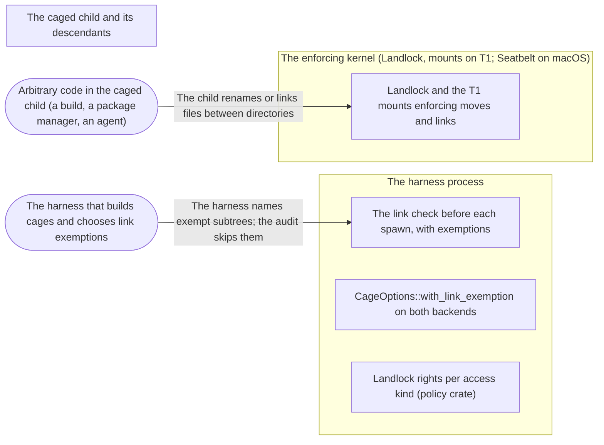

# Threat Model: Moves between writable directories, and link-check exemptions

**Feature**: `045-moves-and-link-exemptions` · **Generated**: 2026-11-02T17:37:46Z · **Profiles**: stride, llm, agent · **Canonical**: `threat-model.yaml`

> Rendered by ThreatSpec. Edit `threat-model.yaml`, not this file.

## Summary

| Threats | Critical | High | Medium | Low | Needs clarification | Not applicable | Mitigations | Requirements | Decisions |
|---|---|---|---|---|---|---|---|---|---|
| 7 | 0 | 3 | 2 | 2 | 0 | 26 | 2 | 6 | 0 |

## Actors

| ID | Name | Trust | Description |
|---|---|---|---|
| `actor.caged-code` | Arbitrary code in the caged child (a build, a package manager, an agent) | untrusted |  |
| `actor.harness` | The harness that builds cages and chooses link exemptions | trusted |  |

## Trust Zones

| ID | Name | Trust rating | Description |
|---|---|---|---|
| `tz.cage` | The caged child and its descendants | 5 |  |
| `tz.harness` | The harness process | 90 |  |
| `tz.kernel` | The enforcing kernel (Landlock, mounts on T1; Seatbelt on macOS) | 95 |  |

## Assets

| ID | Name | Type | Classification | C / I / A | Source |
|---|---|---|---|---|---|
| `asset.objects` | A repository object store shared by hard links with another repository | capability | internal | 20 / 70 / 40 | spec.md#US3 |
| `asset.protected` | Protected and hidden files (repository metadata, secrets) and their content | credential | confidential | 100 / 95 / 30 | spec.md#Context |
| `asset.workspace` | The writable workspace and the run temporary directory | capability | internal | 30 / 60 / 60 | spec.md#US1 |

## Components

| ID | Name | Type | Trust zone | Source |
|---|---|---|---|---|
| `component.audit` | The link check before each spawn, with exemptions | library | `tz.harness` | spec.md#FR-003 |
| `component.landlock` | Landlock and the T1 mounts enforcing moves and links | service | `tz.kernel` | spec.md#Context |
| `component.options` | CageOptions::with_link_exemption on both backends | library | `tz.harness` | spec.md#FR-003 |
| `component.rights` | Landlock rights per access kind (policy crate) | library | `tz.harness` | spec.md#FR-001 |

## Data Flows

| ID | Name | From | To | Assets | Crosses |
|---|---|---|---|---|---|
| `flow.exemption` | The harness names exempt subtrees; the audit skips them | `actor.harness` | `component.audit` | `asset.objects`, `asset.protected` |  |
| `flow.move` | The child renames or links files between directories | `actor.caged-code` | `component.landlock` | `asset.workspace`, `asset.protected` | `tz.cage`, `tz.kernel` |

## Threats

| ID | Threat | Category | Technique | Severity | Status | Mitigations | Mappings | Source |
|---|---|---|---|---|---|---|---|---|
| `threat.link-gives-second-name` | Caged code links a hidden or protected file into a writable tree across directories and reads or writes it there | Information Disclosure, Tampering | sensitive-data-exposure | **high** | mitigated | `mitigation.refer-with-write-only` |  | spec.md#US2 |
| `threat.move-carries-protected` | Caged code moves an ancestor of a protected target, or a file onto it, from another directory, so the protected file leaves its protection or is replaced | Tampering | broken-access-control | **high** | mitigated | `mitigation.refer-with-write-only` |  | spec.md#US2 |
| `threat.move-gains-right` | Caged code moves a file it wrote into a directory with more rights (execute) or takes a file out of a read-only tree | Elevation of Privilege | broken-access-control | **high** | mitigated | `mitigation.refer-with-write-only` |  | spec.md#US1 |
| `threat.exemption-hides-handoff` | An exemption suppresses a second name of a protected trust-handoff file (config, hooks) outside the exempt store | Tampering | broken-access-control | **medium** | mitigated | `mitigation.exemption-scoped` |  | spec.md#US3 |
| `threat.exemption-hides-secret` | An exempt subtree inside a hidden tree lets a hidden file keep a readable second name | Information Disclosure | sensitive-data-exposure | **medium** | mitigated | `mitigation.exemption-scoped` |  | spec.md#US3 |
| `threat.exempt-object-rewritten` | An exempt object with another name in a writable tree is rewritten through it, corrupting a repository | Tampering | data-tampering-at-rest | **low** | mitigated | `mitigation.exemption-scoped` |  | spec.md#US3 |
| `threat.relative-exemption` | A relative exemption resolves against the working directory and exempts an unintended tree | Tampering | privilege-escalation-via-config | **low** | mitigated | `mitigation.exemption-scoped` |  | spec.md#US3 |

### Techniques evaluated without findings

| Technique | Disposition | Reason |
|---|---|---|
| credential-theft | not-applicable | no authentication surface; the change is to Landlock rights and a pre-spawn file walk |
| identity-spoofing | not-applicable | no authentication or network boundary |
| data-tampering-in-transit | not-applicable | no data in transit |
| injection | no-threat-detected | checked component.audit: exemption paths are compared component-wise with Path::starts_with, never parsed as patterns; findings are escaped in messages as before |
| missing-audit-trail | no-threat-detected | checked component.audit: Audit::links_exempt lists every exemption of a run; the receipt keeps its fields |
| cross-tenant-leak | not-applicable | single user; runs of one caller |
| resource-exhaustion | no-threat-detected | checked component.audit: an exemption only removes entries from the walk; the walk limit is unchanged |
| prompt-injection-direct | not-applicable | procage is a library that calls no model and runs no agent; LLM-written code is the adversary inside the child, modelled under STRIDE |
| prompt-injection-indirect | not-applicable | procage is a library that calls no model and runs no agent; LLM-written code is the adversary inside the child, modelled under STRIDE |
| sensitive-information-disclosure | not-applicable | procage is a library that calls no model and runs no agent; LLM-written code is the adversary inside the child, modelled under STRIDE |
| excessive-agency | not-applicable | procage is a library that calls no model and runs no agent; LLM-written code is the adversary inside the child, modelled under STRIDE |
| model-supply-chain | not-applicable | procage is a library that calls no model and runs no agent; LLM-written code is the adversary inside the child, modelled under STRIDE |
| training-data-poisoning | not-applicable | procage is a library that calls no model and runs no agent; LLM-written code is the adversary inside the child, modelled under STRIDE |
| unbounded-consumption | not-applicable | procage is a library that calls no model and runs no agent; LLM-written code is the adversary inside the child, modelled under STRIDE |
| misinformation | not-applicable | procage is a library that calls no model and runs no agent; LLM-written code is the adversary inside the child, modelled under STRIDE |
| hidden-context-exposure | not-applicable | procage is a library that calls no model and runs no agent; LLM-written code is the adversary inside the child, modelled under STRIDE |
| vector-embedding-weakness | not-applicable | procage is a library that calls no model and runs no agent; LLM-written code is the adversary inside the child, modelled under STRIDE |
| improper-output-handling | not-applicable | procage is a library that calls no model and runs no agent; LLM-written code is the adversary inside the child, modelled under STRIDE |
| model-extraction | not-applicable | procage is a library that calls no model and runs no agent; LLM-written code is the adversary inside the child, modelled under STRIDE |
| goal-hijack | not-applicable | procage is a library that calls no model and runs no agent; LLM-written code is the adversary inside the child, modelled under STRIDE |
| tool-misuse | not-applicable | procage is a library that calls no model and runs no agent; LLM-written code is the adversary inside the child, modelled under STRIDE |
| identity-privilege-abuse | not-applicable | procage is a library that calls no model and runs no agent; LLM-written code is the adversary inside the child, modelled under STRIDE |
| agentic-supply-chain | not-applicable | procage is a library that calls no model and runs no agent; LLM-written code is the adversary inside the child, modelled under STRIDE |
| unexpected-code-execution | not-applicable | procage is a library that calls no model and runs no agent; LLM-written code is the adversary inside the child, modelled under STRIDE |
| memory-context-poisoning | not-applicable | procage is a library that calls no model and runs no agent; LLM-written code is the adversary inside the child, modelled under STRIDE |
| insecure-inter-agent-communication | not-applicable | procage is a library that calls no model and runs no agent; LLM-written code is the adversary inside the child, modelled under STRIDE |
| cascading-failure | not-applicable | procage is a library that calls no model and runs no agent; LLM-written code is the adversary inside the child, modelled under STRIDE |
| human-agent-trust-exploitation | not-applicable | procage is a library that calls no model and runs no agent; LLM-written code is the adversary inside the child, modelled under STRIDE |
| rogue-agent | not-applicable | procage is a library that calls no model and runs no agent; LLM-written code is the adversary inside the child, modelled under STRIDE |

## Mitigations

| ID | Mitigation | Kind | Threats | Requirements | Touchpoints | Status |
|---|---|---|---|---|---|---|
| `mitigation.exemption-scoped` | Exemptions by absolute name, for protected files only, listed in the run audit; every other file still refused | preventive | `threat.exemption-hides-handoff`, `threat.exemption-hides-secret`, `threat.relative-exemption`, `threat.exempt-object-rewritten` | SR-004, SR-005, SR-006 | `crates/procage/src/audit.rs`, `crates/procage/src/linux/mod.rs`, `crates/procage/src/macos/mod.rs`, `crates/procage/tests/audit.rs` | verified |
| `mitigation.refer-with-write-only` | REFER only with write; Landlock refuses moves that gain rights or leave a tree without REFER; T1 targets are mounts; T2 refuses protect and hiding in writable trees | preventive | `threat.move-carries-protected`, `threat.link-gives-second-name`, `threat.move-gains-right` | SR-001, SR-002, SR-003 | `crates/procage-policy/src/linux.rs`, `crates/procage-policy/src/lower/linux.rs`, `crates/procage/tests/escape_linux.rs` | verified |

## Security Requirements

### SR-001 (P1) — verified

A move between directories MUST NOT take a protected target out from under its protection or replace it: on T1 it stays unwritable under every name and a rename onto it fails; on T2 protect stays a refused gap.

- **Given** T1 with ws/sub/p protected, **when** the child renames ws/sub in place and into another directory, **then** the protected file is unwritable under every name and keeps its content
- **Given** T1 with the file ws/f protected, **when** the child renames a file from another directory onto it, **then** the rename fails with EBUSY (EXDEV at ABI 1)
- **Given** T2, **when** a policy protects a path, **then** the cage is refused with an fs-protect gap
- Mitigations: `mitigation.refer-with-write-only`
- Tasks: T003 ✓
- Verification `verification.sr-001.2026-11-02`: test → pass (verified) — `crates/procage/tests/escape_linux.rs::r04_a_protected_file_stays_protected_when_an_ancestor_is_renamed`
- Verification `verification.sr-001.2026-11-02-2`: test → pass (verified) — `crates/procage/tests/escape_linux.rs::r04_a_protected_file_stays_protected_when_an_ancestor_is_renamed`

### SR-002 (P1) — verified

During a run no hidden or protected file MUST gain a second name in a writable tree.

- **Given** a hidden file and a protected one (on T2 a file of a read-only tree), **when** the child links either into the writable tree, **then** both links fail on every tier
- Mitigations: `mitigation.refer-with-write-only`
- Tasks: T003 ✓
- Verification `verification.sr-002.2026-11-02`: test → pass (verified) — `crates/procage/tests/escape_linux.rs::r08_no_hard_link_can_be_made_during_the_run`
- Verification `verification.sr-002.2026-11-02-2`: test → pass (verified) — `crates/procage/tests/escape_linux.rs::r08_no_hard_link_can_be_made_during_the_run`

### SR-003 (P1) — verified

REFER MUST be granted only with write; a move or link that would give a file a right it lacks, or take it out of a read-only tree, MUST be refused, while moves between writable directories MUST work from ABI 2.

- **Given** the rights of every access kind, **when** computed at ABI 1, 2 and 12, **then** only write at ABI 2 or later includes REFER
- **Given** ws writable with ws/bin executable and a read-only tree, **when** the child moves a file into ws/bin, or moves or links one out of the read-only tree, **then** each is refused, while moves and links between ws directories and from TMPDIR succeed (EXDEV at ABI 1)
- Mitigations: `mitigation.refer-with-write-only`
- Tasks: T001 ✓, T002 ✓
- Verification `verification.sr-003.2026-11-02`: test → pass (verified) — `crates/procage/tests/escape_linux.rs::r04_files_move_between_writable_directories_and_gain_no_right`
- Verification `verification.sr-003.2026-11-02-2`: test → pass (verified) — `crates/procage/tests/escape_linux.rs::r04_files_move_between_writable_directories_and_gain_no_right`

### SR-004 (P1) — verified

A link exemption MUST skip only the named subtrees, and only for protected files; a second name of any other protected file MUST still refuse the spawn, and the run audit MUST list the exemptions.

- **Given** a clone with hard-linked objects and .git protected, **when** spawning without and then with .git/objects exempt, **then** the first is refused naming the object; the second runs and its audit lists the exemption
- **Given** the exemption and a second name for .git/config, **when** spawning, **then** the spawn is refused naming the config
- Mitigations: `mitigation.exemption-scoped`
- Tasks: T005 ✓, T006 ✓, T007 ✓
- Verification `verification.sr-004.2026-11-02`: test → pass (verified) — `crates/procage/tests/audit.rs::an_exempt_object_store_keeps_the_rest_of_the_check`
- Verification `verification.sr-004.2026-11-02-2`: test → pass (verified) — `crates/procage/tests/audit.rs::an_exempt_object_store_keeps_the_rest_of_the_check`

### SR-005 (P1) — verified

Hidden files MUST be examined inside exempt subtrees.

- **Given** a hidden tree containing an exempt subtree with a two-name file, **when** the link check runs, **then** the file is a finding
- Mitigations: `mitigation.exemption-scoped`
- Tasks: T005 ✓
- Verification `verification.sr-005.2026-11-02`: test → pass (verified) — `crates/procage/src/audit.rs::tests::an_exempt_store_is_skipped_for_protected_files_only`
- Verification `verification.sr-005.2026-11-02-2`: test → pass (verified) — `crates/procage/src/audit.rs::tests::an_exempt_store_is_skipped_for_protected_files_only`

### SR-006 (P2) — verified

A relative link exemption MUST fail the cage.

- **Given** CageOptions with a relative exemption, **when** the cage is built, **then** it fails with Unsupported::Setting
- Mitigations: `mitigation.exemption-scoped`
- Tasks: T005 ✓, T006 ✓, T007 ✓
- Verification `verification.sr-006.2026-11-02`: test → pass (verified) — `crates/procage/tests/audit.rs::an_exempt_object_store_keeps_the_rest_of_the_check`
- Verification `verification.sr-006.2026-11-02-2`: test → pass (verified) — `crates/procage/tests/audit.rs::an_exempt_object_store_keeps_the_rest_of_the_check`
