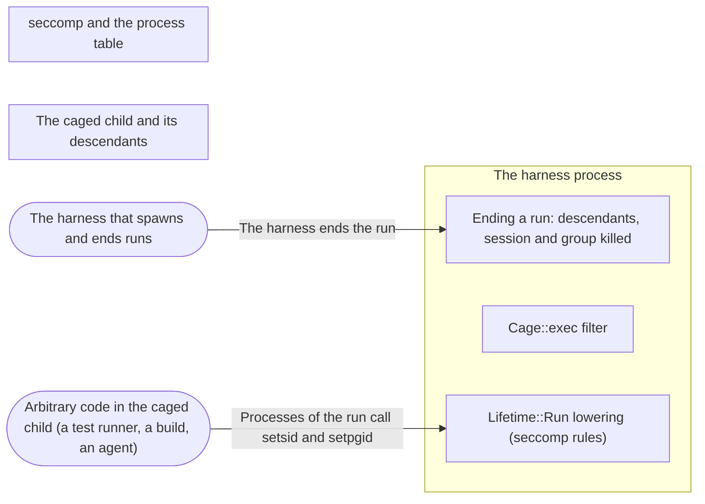

# Threat Model: Process groups under Lifetime::Run on Linux

**Feature**: `046-process-groups` · **Generated**: 2026-11-02T19:53:38Z · **Profiles**: stride, llm, agent · **Canonical**: `threat-model.yaml`

> Rendered by ThreatSpec. Edit `threat-model.yaml`, not this file.

## Summary

| Threats | Critical | High | Medium | Low | Needs clarification | Not applicable | Mitigations | Requirements | Decisions |
|---|---|---|---|---|---|---|---|---|---|
| 4 | 0 | 3 | 0 | 1 | 0 | 28 | 2 | 3 | 0 |

## Actors

| ID | Name | Trust | Description |
|---|---|---|---|
| `actor.caged-code` | Arbitrary code in the caged child (a test runner, a build, an agent) | untrusted |  |
| `actor.harness` | The harness that spawns and ends runs | trusted |  |

## Trust Zones

| ID | Name | Trust rating | Description |
|---|---|---|---|
| `tz.cage` | The caged child and its descendants | 5 |  |
| `tz.harness` | The harness process | 90 |  |
| `tz.kernel` | seccomp and the process table | 95 |  |

## Assets

| ID | Name | Type | Classification | C / I / A | Source |
|---|---|---|---|---|---|
| `asset.host` | The host after the run: no process of the run keeps running unsandboxed time | capability | internal | 40 / 80 / 60 | spec.md#Context |

## Components

| ID | Name | Type | Trust zone | Source |
|---|---|---|---|---|
| `component.end-of-run` | Ending a run: descendants, session and group killed | library | `tz.harness` | spec.md#FR-003 |
| `component.exec` | Cage::exec filter | library | `tz.harness` | spec.md#FR-002 |
| `component.lowering` | Lifetime::Run lowering (seccomp rules) | library | `tz.harness` | spec.md#FR-001 |

## Data Flows

| ID | Name | From | To | Assets | Crosses |
|---|---|---|---|---|---|
| `flow.calls` | Processes of the run call setsid and setpgid | `actor.caged-code` | `component.lowering` | `asset.host` | `tz.cage`, `tz.kernel` |
| `flow.end` | The harness ends the run | `actor.harness` | `component.end-of-run` | `asset.host` |  |

## Threats

| ID | Threat | Category | Technique | Severity | Status | Mitigations | Mappings | Source |
|---|---|---|---|---|---|---|---|---|
| `threat.caller-session` | With the caller terminal or under exec, a descendant leaves the caller group, which is the run boundary there, and outlives the run | Elevation of Privilege | broken-access-control | **high** | mitigated | `mitigation.group-boundary-kept` |  | spec.md#US2 |
| `threat.group-outlives-run` | A descendant in a process group of its own, reparented away from the child, outlives the run | Elevation of Privilege | broken-access-control | **high** | mitigated | `mitigation.session-boundary` |  | spec.md#US1 |
| `threat.session-escape` | A descendant leaves the child session with setsid and outlives the run | Elevation of Privilege | broken-access-control | **high** | mitigated | `mitigation.session-boundary` |  | spec.md#US1 |
| `threat.fork-during-kill` | Members fork while the run is being ended, so a new member is missed | Elevation of Privilege | broken-access-control | **low** | mitigated | `mitigation.session-boundary` |  | spec.md#US1 |

### Techniques evaluated without findings

| Technique | Disposition | Reason |
|---|---|---|
| credential-theft | not-applicable | no authentication surface; the change is to Landlock rights and a pre-spawn file walk |
| identity-spoofing | not-applicable | no authentication or network boundary |
| data-tampering-in-transit | not-applicable | no data in transit |
| injection | no-threat-detected | checked component.end-of-run: /proc stat is parsed after the last closing parenthesis, so a process name cannot shift the session field |
| missing-audit-trail | no-threat-detected | checked component.end-of-run: a refused setsid or setpgid is still a reported violation with reason Lifetime |
| cross-tenant-leak | not-applicable | single user; runs of one caller |
| resource-exhaustion | no-threat-detected | checked component.end-of-run: at most 64 scans of /proc, each killing only members not yet killed; a killed process cannot fork |
| prompt-injection-direct | not-applicable | procage is a library that calls no model and runs no agent; LLM-written code is the adversary inside the child, modelled under STRIDE |
| prompt-injection-indirect | not-applicable | procage is a library that calls no model and runs no agent; LLM-written code is the adversary inside the child, modelled under STRIDE |
| sensitive-information-disclosure | not-applicable | procage is a library that calls no model and runs no agent; LLM-written code is the adversary inside the child, modelled under STRIDE |
| excessive-agency | not-applicable | procage is a library that calls no model and runs no agent; LLM-written code is the adversary inside the child, modelled under STRIDE |
| model-supply-chain | not-applicable | procage is a library that calls no model and runs no agent; LLM-written code is the adversary inside the child, modelled under STRIDE |
| training-data-poisoning | not-applicable | procage is a library that calls no model and runs no agent; LLM-written code is the adversary inside the child, modelled under STRIDE |
| unbounded-consumption | not-applicable | procage is a library that calls no model and runs no agent; LLM-written code is the adversary inside the child, modelled under STRIDE |
| misinformation | not-applicable | procage is a library that calls no model and runs no agent; LLM-written code is the adversary inside the child, modelled under STRIDE |
| hidden-context-exposure | not-applicable | procage is a library that calls no model and runs no agent; LLM-written code is the adversary inside the child, modelled under STRIDE |
| vector-embedding-weakness | not-applicable | procage is a library that calls no model and runs no agent; LLM-written code is the adversary inside the child, modelled under STRIDE |
| improper-output-handling | not-applicable | procage is a library that calls no model and runs no agent; LLM-written code is the adversary inside the child, modelled under STRIDE |
| model-extraction | not-applicable | procage is a library that calls no model and runs no agent; LLM-written code is the adversary inside the child, modelled under STRIDE |
| goal-hijack | not-applicable | procage is a library that calls no model and runs no agent; LLM-written code is the adversary inside the child, modelled under STRIDE |
| tool-misuse | not-applicable | procage is a library that calls no model and runs no agent; LLM-written code is the adversary inside the child, modelled under STRIDE |
| identity-privilege-abuse | not-applicable | procage is a library that calls no model and runs no agent; LLM-written code is the adversary inside the child, modelled under STRIDE |
| agentic-supply-chain | not-applicable | procage is a library that calls no model and runs no agent; LLM-written code is the adversary inside the child, modelled under STRIDE |
| unexpected-code-execution | not-applicable | procage is a library that calls no model and runs no agent; LLM-written code is the adversary inside the child, modelled under STRIDE |
| memory-context-poisoning | not-applicable | procage is a library that calls no model and runs no agent; LLM-written code is the adversary inside the child, modelled under STRIDE |
| insecure-inter-agent-communication | not-applicable | procage is a library that calls no model and runs no agent; LLM-written code is the adversary inside the child, modelled under STRIDE |
| cascading-failure | not-applicable | procage is a library that calls no model and runs no agent; LLM-written code is the adversary inside the child, modelled under STRIDE |
| human-agent-trust-exploitation | not-applicable | procage is a library that calls no model and runs no agent; LLM-written code is the adversary inside the child, modelled under STRIDE |
| rogue-agent | not-applicable | procage is a library that calls no model and runs no agent; LLM-written code is the adversary inside the child, modelled under STRIDE |
| data-tampering-at-rest | not-applicable | no data is stored |
| sensitive-data-exposure | not-applicable | the change reads only process ids, parents and sessions |

## Mitigations

| ID | Mitigation | Kind | Threats | Requirements | Touchpoints | Status |
|---|---|---|---|---|---|---|
| `mitigation.group-boundary-kept` | setpgid stays refused with Tty::Inherit and for Cage::exec | preventive | `threat.caller-session` | SR-003 | `crates/procage-policy/src/lower/linux.rs`, `crates/procage/src/linux/mod.rs`, `crates/procage/tests/exec.rs` | verified |
| `mitigation.session-boundary` | setsid refused under Lifetime::Run; ending the run kills the child session, repeated until no live member is new | preventive | `threat.group-outlives-run`, `threat.session-escape`, `threat.fork-during-kill` | SR-001, SR-002 | `crates/procage-policy/src/lower/linux.rs`, `crates/procage/src/linux/child.rs`, `crates/procage/tests/escape_linux.rs` | verified |

## Security Requirements

### SR-001 (P1) — verified

Under Lifetime::Run no process of the run MUST be able to start a session; starting a process group MUST work with the defaults.

- **Given** a forking default policy on T1 and T2, **when** a process of the run calls setsid and setpgid(0, 0), **then** setsid fails with EPERM and setpgid succeeds
- **Given** the lowering with fork and Lifetime::Run, **when** it is lowered with Tty::None and Tty::Inherit, **then** setsid is denied in both, setpgid only with Tty::Inherit
- Mitigations: `mitigation.session-boundary`
- Tasks: T001 ✓, T003 ✓
- Verification `verification.sr-001.2026-11-02`: test → pass (verified) — `crates/procage/tests/escape_linux.rs::r23_sessions_are_locked`
- Verification `verification.sr-001.2026-11-02-2`: test → pass (verified) — `crates/procage/tests/escape_linux.rs::r23_sessions_are_locked`

### SR-002 (P1) — verified

Ending a run MUST kill every live process of the child session, including those in other process groups and outside the child tree.

- **Given** a descendant in a process group of its own whose parent exited, **when** the run ends, **then** it dies within two seconds on T1 and T2
- Mitigations: `mitigation.session-boundary`
- Tasks: T002 ✓, T003 ✓
- Verification `verification.sr-002.2026-11-02`: test → pass (verified) — `crates/procage/tests/escape_linux.rs::r23_a_descendant_in_a_group_of_its_own_dies_with_the_run`
- Verification `verification.sr-002.2026-11-02-2`: test → pass (verified) — `crates/procage/tests/escape_linux.rs::r23_a_descendant_in_a_group_of_its_own_dies_with_the_run`

### SR-003 (P1) — verified

With the caller session (Tty::Inherit, Cage::exec) setpgid MUST stay refused under Lifetime::Run.

- **Given** Cage::exec of a shell, **when** a descendant calls setsid and setpgid(0, 0), **then** both fail
- Mitigations: `mitigation.group-boundary-kept`
- Tasks: T004 ✓
- Verification `verification.sr-003.2026-11-02`: test → pass (verified) — `crates/procage/tests/exec.rs::descendants_cannot_leave_the_group`
- Verification `verification.sr-003.2026-11-02-2`: test → pass (verified) — `crates/procage/tests/exec.rs::descendants_cannot_leave_the_group`
