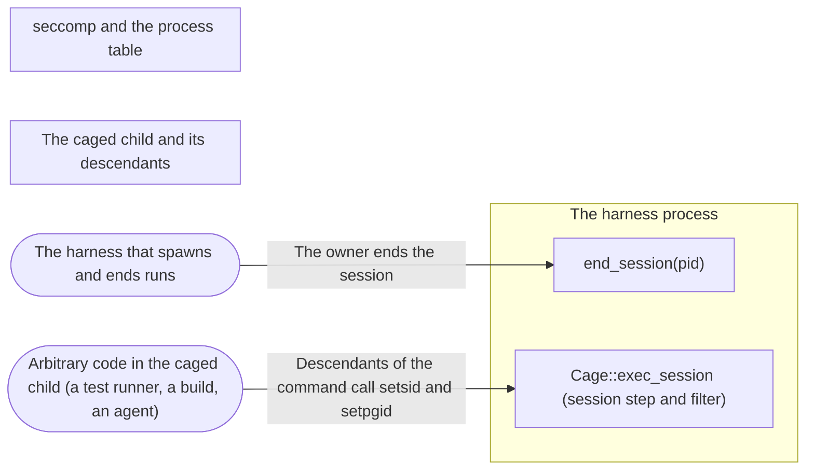

# Threat Model: A helper's command in a session of its own

**Feature**: `047-exec-session` · **Generated**: 2026-11-02T21:07:49Z · **Profiles**: stride, llm, agent · **Canonical**: `threat-model.yaml`

> Rendered by ThreatSpec. Edit `threat-model.yaml`, not this file.

## Summary

| Threats | Critical | High | Medium | Low | Needs clarification | Not applicable | Mitigations | Requirements | Decisions |
|---|---|---|---|---|---|---|---|---|---|
| 4 | 0 | 2 | 1 | 1 | 0 | 28 | 2 | 3 | 0 |

## Actors

| ID | Name | Trust | Description |
|---|---|---|---|
| `actor.caged-code` | Arbitrary code in the caged child (a test runner, a build, an agent) | untrusted |  |
| `actor.harness` | The harness that spawns and ends runs | trusted |  |

## Trust Zones

| ID | Name | Trust rating | Description |
|---|---|---|---|
| `tz.cage` | The caged child and its descendants | 5 |  |
| `tz.harness` | The harness process | 90 |  |
| `tz.kernel` | seccomp and the process table | 95 |  |

## Assets

| ID | Name | Type | Classification | C / I / A | Source |
|---|---|---|---|---|---|
| `asset.host` | The host after the run: no process of the run keeps running unsandboxed time | capability | internal | 40 / 80 / 60 | spec.md#Context |

## Components

| ID | Name | Type | Trust zone | Source |
|---|---|---|---|---|
| `component.end-session` | end_session(pid) | library | `tz.harness` | spec.md#FR-002 |
| `component.exec-session` | Cage::exec_session (session step and filter) | library | `tz.harness` | spec.md#FR-001 |

## Data Flows

| ID | Name | From | To | Assets | Crosses |
|---|---|---|---|---|---|
| `flow.calls` | Descendants of the command call setsid and setpgid | `actor.caged-code` | `component.exec-session` | `asset.host` | `tz.cage`, `tz.kernel` |
| `flow.end` | The owner ends the session | `actor.harness` | `component.end-session` | `asset.host` |  |

## Threats

| ID | Threat | Category | Technique | Severity | Status | Mitigations | Mappings | Source |
|---|---|---|---|---|---|---|---|---|
| `threat.grouped-descendant-outlives-exec` | A descendant of an exec_session command in a process group of its own outlives the run the owner ends | Elevation of Privilege | broken-access-control | **high** | mitigated | `mitigation.exec-session-boundary` |  | spec.md#US1 |
| `threat.session-escape-exec` | A descendant of an exec_session command leaves its session with setsid and outlives the run | Elevation of Privilege | broken-access-control | **high** | mitigated | `mitigation.exec-session-boundary` |  | spec.md#US1 |
| `threat.wrong-session-killed` | end_session of pid 0, 1 or a reused pid kills processes outside the run | Elevation of Privilege | broken-access-control | **medium** | mitigated | `mitigation.checked-first` |  | spec.md#US1 |
| `threat.half-applied-exec` | exec_session in a group leader fails setsid after the process changed, leaving it partly confined | Elevation of Privilege | broken-access-control | **low** | mitigated | `mitigation.checked-first` |  | spec.md#US1 |

### Techniques evaluated without findings

| Technique | Disposition | Reason |
|---|---|---|
| credential-theft | not-applicable | no authentication surface; the change is to Landlock rights and a pre-spawn file walk |
| identity-spoofing | not-applicable | no authentication or network boundary |
| data-tampering-in-transit | not-applicable | no data in transit |
| injection | no-threat-detected | checked component.end-of-run: /proc stat is parsed after the last closing parenthesis, so a process name cannot shift the session field |
| missing-audit-trail | no-threat-detected | checked component.end-of-run: a refused setsid or setpgid is still a reported violation with reason Lifetime |
| cross-tenant-leak | not-applicable | single user; runs of one caller |
| resource-exhaustion | no-threat-detected | checked component.end-of-run: at most 64 scans of /proc, each killing only members not yet killed; a killed process cannot fork |
| prompt-injection-direct | not-applicable | procage is a library that calls no model and runs no agent; LLM-written code is the adversary inside the child, modelled under STRIDE |
| prompt-injection-indirect | not-applicable | procage is a library that calls no model and runs no agent; LLM-written code is the adversary inside the child, modelled under STRIDE |
| sensitive-information-disclosure | not-applicable | procage is a library that calls no model and runs no agent; LLM-written code is the adversary inside the child, modelled under STRIDE |
| excessive-agency | not-applicable | procage is a library that calls no model and runs no agent; LLM-written code is the adversary inside the child, modelled under STRIDE |
| model-supply-chain | not-applicable | procage is a library that calls no model and runs no agent; LLM-written code is the adversary inside the child, modelled under STRIDE |
| training-data-poisoning | not-applicable | procage is a library that calls no model and runs no agent; LLM-written code is the adversary inside the child, modelled under STRIDE |
| unbounded-consumption | not-applicable | procage is a library that calls no model and runs no agent; LLM-written code is the adversary inside the child, modelled under STRIDE |
| misinformation | not-applicable | procage is a library that calls no model and runs no agent; LLM-written code is the adversary inside the child, modelled under STRIDE |
| hidden-context-exposure | not-applicable | procage is a library that calls no model and runs no agent; LLM-written code is the adversary inside the child, modelled under STRIDE |
| vector-embedding-weakness | not-applicable | procage is a library that calls no model and runs no agent; LLM-written code is the adversary inside the child, modelled under STRIDE |
| improper-output-handling | not-applicable | procage is a library that calls no model and runs no agent; LLM-written code is the adversary inside the child, modelled under STRIDE |
| model-extraction | not-applicable | procage is a library that calls no model and runs no agent; LLM-written code is the adversary inside the child, modelled under STRIDE |
| goal-hijack | not-applicable | procage is a library that calls no model and runs no agent; LLM-written code is the adversary inside the child, modelled under STRIDE |
| tool-misuse | not-applicable | procage is a library that calls no model and runs no agent; LLM-written code is the adversary inside the child, modelled under STRIDE |
| identity-privilege-abuse | not-applicable | procage is a library that calls no model and runs no agent; LLM-written code is the adversary inside the child, modelled under STRIDE |
| agentic-supply-chain | not-applicable | procage is a library that calls no model and runs no agent; LLM-written code is the adversary inside the child, modelled under STRIDE |
| unexpected-code-execution | not-applicable | procage is a library that calls no model and runs no agent; LLM-written code is the adversary inside the child, modelled under STRIDE |
| memory-context-poisoning | not-applicable | procage is a library that calls no model and runs no agent; LLM-written code is the adversary inside the child, modelled under STRIDE |
| insecure-inter-agent-communication | not-applicable | procage is a library that calls no model and runs no agent; LLM-written code is the adversary inside the child, modelled under STRIDE |
| cascading-failure | not-applicable | procage is a library that calls no model and runs no agent; LLM-written code is the adversary inside the child, modelled under STRIDE |
| human-agent-trust-exploitation | not-applicable | procage is a library that calls no model and runs no agent; LLM-written code is the adversary inside the child, modelled under STRIDE |
| rogue-agent | not-applicable | procage is a library that calls no model and runs no agent; LLM-written code is the adversary inside the child, modelled under STRIDE |
| data-tampering-at-rest | not-applicable | no data is stored |
| sensitive-data-exposure | not-applicable | the change reads only process ids, parents and sessions |

## Mitigations

| ID | Mitigation | Kind | Threats | Requirements | Touchpoints | Status |
|---|---|---|---|---|---|---|
| `mitigation.checked-first` | Group leaders without a session refused before the process changes; pids 0 and 1 ignored; end_session called before reaping | preventive | `threat.half-applied-exec`, `threat.wrong-session-killed` | SR-003 | `crates/procage/src/linux/mod.rs`, `crates/procage/src/macos/mod.rs` | verified |
| `mitigation.exec-session-boundary` | The command leads its own session; setsid refused on Linux; end_session kills the session and group, repeated for members forked meanwhile | preventive | `threat.grouped-descendant-outlives-exec`, `threat.session-escape-exec` | SR-001, SR-002 | `crates/procage/src/linux/mod.rs`, `crates/procage/src/linux/child.rs`, `crates/procage/src/macos/mod.rs`, `crates/procage/tests/exec.rs` | verified |

## Security Requirements

### SR-001 (P1) — verified

A command run with exec_session MUST lead its own session; on Linux its descendants MUST be able to start process groups and MUST NOT start sessions.

- **Given** a plain-child helper calling exec_session, **when** a descendant calls setpgid(0, 0) and setsid, **then** setpgid succeeds; on Linux setsid fails
- Mitigations: `mitigation.exec-session-boundary`
- Tasks: T001 ✓, T004 ✓
- Verification `verification.sr-001.2026-11-02`: test → pass (verified) — `crates/procage/tests/exec.rs::a_session_exec_allows_groups_and_ends_by_session`
- Verification `verification.sr-001.2026-11-02-2`: test → pass (verified) — `crates/procage/tests/exec.rs::a_session_exec_allows_groups_and_ends_by_session`

### SR-002 (P1) — verified

end_session of the helper pid MUST kill every live process of its session, including one in a process group of its own.

- **Given** a descendant in its own process group, **when** the owner calls end_session with the helper pid, **then** it dies within two seconds on macOS, T1 and T2
- Mitigations: `mitigation.exec-session-boundary`
- Tasks: T002 ✓, T004 ✓
- Verification `verification.sr-002.2026-11-02`: test → pass (verified) — `crates/procage/tests/exec.rs::a_session_exec_allows_groups_and_ends_by_session`
- Verification `verification.sr-002.2026-11-02-2`: test → pass (verified) — `crates/procage/tests/exec.rs::a_session_exec_allows_groups_and_ends_by_session`

### SR-003 (P1) — verified

exec_session in a process group leader that leads no session MUST fail before the process changes; end_session MUST ignore pids 0 and 1.

- **Given** a helper started with process_group(0), **when** it calls exec_session, **then** it fails with SpawnError::GroupLeader and the command never runs
- Mitigations: `mitigation.checked-first`
- Tasks: T003 ✓, T004 ✓
- Verification `verification.sr-003.2026-11-02`: test → pass (verified) — `crates/procage/tests/exec.rs::a_session_exec_from_a_group_leader_is_refused`
- Verification `verification.sr-003.2026-11-02-2`: test → pass (verified) — `crates/procage/tests/exec.rs::a_session_exec_from_a_group_leader_is_refused`
