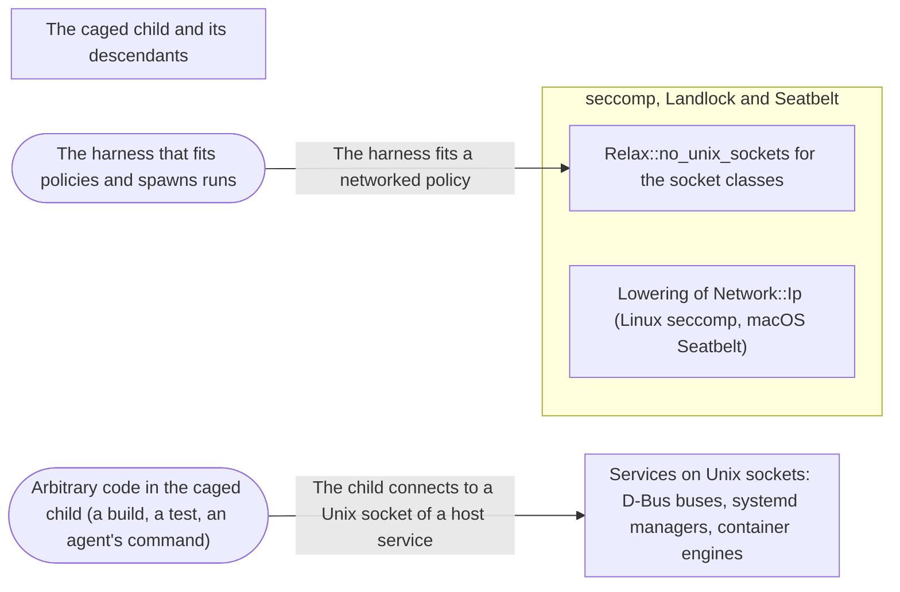

# Threat Model: An IP network without Unix sockets

**Feature**: `048-ip-network` · **Generated**: 2026-11-02T22:55:22Z · **Profiles**: stride, llm, agent · **Canonical**: `threat-model.yaml`

> Rendered by ThreatSpec. Edit `threat-model.yaml`, not this file.

## Summary

| Threats | Critical | High | Medium | Low | Needs clarification | Not applicable | Mitigations | Requirements | Decisions |
|---|---|---|---|---|---|---|---|---|---|
| 4 | 0 | 1 | 3 | 0 | 0 | 27 | 2 | 3 | 0 |

## Actors

| ID | Name | Trust | Description |
|---|---|---|---|
| `actor.caged-code` | Arbitrary code in the caged child (a build, a test, an agent's command) | untrusted |  |
| `actor.harness` | The harness that fits policies and spawns runs | trusted |  |

## Trust Zones

| ID | Name | Trust rating | Description |
|---|---|---|---|
| `tz.cage` | The caged child and its descendants | 5 |  |
| `tz.host-services` | Services on Unix sockets: D-Bus buses, systemd managers, container engines | 80 |  |
| `tz.kernel` | seccomp, Landlock and Seatbelt | 95 |  |

## Assets

| ID | Name | Type | Classification | C / I / A | Source |
|---|---|---|---|---|---|
| `asset.host-services` | Host services reachable over Unix sockets (D-Bus, Docker, systemd) | capability | internal | 80 / 90 / 60 | spec.md#Context |

## Components

| ID | Name | Type | Trust zone | Source |
|---|---|---|---|---|
| `component.fitting` | Relax::no_unix_sockets for the socket classes | library | `tz.kernel` | spec.md#FR-002 |
| `component.lowering` | Lowering of Network::Ip (Linux seccomp, macOS Seatbelt) | library | `tz.kernel` | spec.md#FR-001 |

## Data Flows

| ID | Name | From | To | Assets | Crosses |
|---|---|---|---|---|---|
| `flow.fit` | The harness fits a networked policy | `actor.harness` | `component.fitting` | `asset.host-services` |  |
| `flow.unix-connect` | The child connects to a Unix socket of a host service | `actor.caged-code` | `tz.host-services` | `asset.host-services` | `tz.cage`, `tz.kernel` |

## Threats

| ID | Threat | Category | Technique | Severity | Status | Mitigations | Mappings | Source |
|---|---|---|---|---|---|---|---|---|
| `threat.service-socket-under-ip` | A networked child under Network::Ip connects to the session bus or an engine socket and runs code outside the cage | Elevation of Privilege | broken-access-control | **high** | mitigated | `mitigation.ip-families-only` |  | spec.md#US1 |
| `threat.abstract-socket-without-namespace` | On T1 below ABI 6 with ipc.unix_sockets, a child under Network::Ip reaches an abstract host socket, with no network namespace to keep it out | Elevation of Privilege | broken-access-control | **medium** | mitigated | `mitigation.ip-families-only` |  | spec.md#US1 |
| `threat.other-socket-family` | A child under Network::Ip opens a socket of another family (netlink, packet, vsock) to reach the host | Elevation of Privilege | broken-access-control | **medium** | mitigated | `mitigation.ip-families-only` |  | spec.md#US1 |
| `threat.relaxation-changes-network` | Relax::no_unix_sockets applied to a socket-class gap changes a network setting other than All, or answers the gap without removing the route | Elevation of Privilege | broken-access-control | **medium** | mitigated | `mitigation.relax-to-ip` |  | spec.md#US1 |

### Techniques evaluated without findings

| Technique | Disposition | Reason |
|---|---|---|
| prompt-injection-direct | not-applicable | procage is a library that calls no model and runs no agent; LLM-written code is the adversary inside the child, modelled under STRIDE |
| prompt-injection-indirect | not-applicable | procage is a library that calls no model and runs no agent; LLM-written code is the adversary inside the child, modelled under STRIDE |
| sensitive-information-disclosure | not-applicable | procage is a library that calls no model and runs no agent; LLM-written code is the adversary inside the child, modelled under STRIDE |
| excessive-agency | not-applicable | procage is a library that calls no model and runs no agent; LLM-written code is the adversary inside the child, modelled under STRIDE |
| model-supply-chain | not-applicable | procage is a library that calls no model and runs no agent; LLM-written code is the adversary inside the child, modelled under STRIDE |
| training-data-poisoning | not-applicable | procage is a library that calls no model and runs no agent; LLM-written code is the adversary inside the child, modelled under STRIDE |
| unbounded-consumption | not-applicable | procage is a library that calls no model and runs no agent; LLM-written code is the adversary inside the child, modelled under STRIDE |
| misinformation | not-applicable | procage is a library that calls no model and runs no agent; LLM-written code is the adversary inside the child, modelled under STRIDE |
| hidden-context-exposure | not-applicable | procage is a library that calls no model and runs no agent; LLM-written code is the adversary inside the child, modelled under STRIDE |
| vector-embedding-weakness | not-applicable | procage is a library that calls no model and runs no agent; LLM-written code is the adversary inside the child, modelled under STRIDE |
| improper-output-handling | not-applicable | procage is a library that calls no model and runs no agent; LLM-written code is the adversary inside the child, modelled under STRIDE |
| model-extraction | not-applicable | procage is a library that calls no model and runs no agent; LLM-written code is the adversary inside the child, modelled under STRIDE |
| goal-hijack | not-applicable | procage is a library that calls no model and runs no agent; LLM-written code is the adversary inside the child, modelled under STRIDE |
| tool-misuse | not-applicable | procage is a library that calls no model and runs no agent; LLM-written code is the adversary inside the child, modelled under STRIDE |
| identity-privilege-abuse | not-applicable | procage is a library that calls no model and runs no agent; LLM-written code is the adversary inside the child, modelled under STRIDE |
| agentic-supply-chain | not-applicable | procage is a library that calls no model and runs no agent; LLM-written code is the adversary inside the child, modelled under STRIDE |
| unexpected-code-execution | not-applicable | procage is a library that calls no model and runs no agent; LLM-written code is the adversary inside the child, modelled under STRIDE |
| memory-context-poisoning | not-applicable | procage is a library that calls no model and runs no agent; LLM-written code is the adversary inside the child, modelled under STRIDE |
| insecure-inter-agent-communication | not-applicable | procage is a library that calls no model and runs no agent; LLM-written code is the adversary inside the child, modelled under STRIDE |
| cascading-failure | not-applicable | procage is a library that calls no model and runs no agent; LLM-written code is the adversary inside the child, modelled under STRIDE |
| human-agent-trust-exploitation | not-applicable | procage is a library that calls no model and runs no agent; LLM-written code is the adversary inside the child, modelled under STRIDE |
| rogue-agent | not-applicable | procage is a library that calls no model and runs no agent; LLM-written code is the adversary inside the child, modelled under STRIDE |
| credential-theft | not-applicable | no authentication surface; the change is a socket-family filter and Seatbelt network rules |
| identity-spoofing | not-applicable | no authentication boundary |
| data-tampering-in-transit | not-applicable | procage does not carry the child's traffic under Network::Ip |
| injection | no-threat-detected | checked component.lowering: no caller string enters the Seatbelt rules for Network::Ip; ipc.unix_sockets paths are quoted as before |
| missing-audit-trail | no-threat-detected | checked component.fitting: every relaxed gap is returned and listed in the receipts with its lift |
| cross-tenant-leak | not-applicable | single user; runs of one caller |
| resource-exhaustion | no-threat-detected | checked component.lowering and component.fitting: one seccomp rule and two Seatbelt rules, and fitting runs at most four rounds as before; nothing the child does adds work |
| data-tampering-at-rest | not-applicable | no data is stored |
| sensitive-data-exposure | no-threat-detected | checked component.lowering: the change narrows what a networked child reaches; IP egress is the policy's stated intent |

## Mitigations

| ID | Mitigation | Kind | Threats | Requirements | Touchpoints | Status |
|---|---|---|---|---|---|---|
| `mitigation.ip-families-only` | Linux: socket() for AF_INET and AF_INET6 only, AF_UNIX only with ipc.unix_sockets (handled as with the network off); macOS: IP addresses and the resolver socket only; T1 below ABI 6 with ipc.unix_sockets unsupported | preventive | `threat.service-socket-under-ip`, `threat.other-socket-family`, `threat.abstract-socket-without-namespace` | SR-001, SR-003 | `crates/procage-policy/src/lower/linux.rs`, `crates/procage-policy/src/lower/macos.rs`, `crates/procage/tests/escape_linux.rs`, `crates/procage/tests/escape_macos.rs`, `crates/procage-policy/tests/network_ip.rs` | verified |
| `mitigation.relax-to-ip` | NoUnixSockets answers socket-class gaps only under Network::All (or Ip), switching to Network::Ip and clearing ipc.unix_sockets; the cage is made again from the relaxed policy | preventive | `threat.relaxation-changes-network` | SR-002 | `crates/procage-policy/src/lower/fit.rs`, `crates/procage-policy/tests/fit.rs`, `crates/procage/tests/escape_linux.rs` | verified |

## Security Requirements

### SR-001 (P1) — verified

Under Network::Ip no Unix socket outside ipc.unix_sockets MUST be reachable on macOS, T1 or T2, while IP connects, listening and name resolution MUST work.

- **Given** Network::Ip without ipc.unix_sockets, **when** the child connects over TCP, listens, resolves a name and connects to a Unix socket, **then** the IP operations succeed and the Unix connect fails on every tier
- **Given** Network::Ip with ipc.unix_sockets naming a socket, **when** the child connects to it, **then** it connects (T1 and T2 from ABI 9, macOS)
- Mitigations: `mitigation.ip-families-only`
- Tasks: T002 ✓, T003 ✓, T004 ✓, T005 ✓
- Verification `verification.sr-001.2026-11-02`: test → pass (verified) — `crates/procage/tests/escape_linux.rs::r34_the_ip_network_keeps_every_unix_socket_out, crates/procage/tests/escape_macos.rs::r34_the_ip_network_keeps_every_unix_socket_out`
- Verification `verification.sr-001.2026-11-02-2`: test → pass (verified) — `crates/procage/tests/escape_linux.rs::r34_the_ip_network_keeps_every_unix_socket_out, crates/procage/tests/escape_macos.rs::r34_the_ip_network_keeps_every_unix_socket_out`

### SR-002 (P1) — verified

Relax::no_unix_sockets MUST answer hd-service-handoff and hd-container-engines gaps only under Network::All, by switching the policy to Network::Ip; under any other network the gap MUST stay.

- **Given** T2, Network::All and a session bus socket in a runtime directory, **when** fitting with no_unix_sockets, **then** the cage is made with Network::Ip, the gap is reported relaxed with the T1 lift, and the child cannot connect to the bus
- **Given** a socket-class gap and a Loopback network, **when** applying no_unix_sockets, **then** the gap is returned unanswered and the policy is unchanged
- Mitigations: `mitigation.relax-to-ip`
- Tasks: T006 ✓, T007 ✓
- Verification `verification.sr-002.2026-11-02`: test → pass (verified) — `crates/procage/tests/escape_linux.rs::r34_fit_keeps_unix_sockets_out_of_a_networked_command, crates/procage-policy/tests/fit.rs::no_unix_sockets_leaves_a_socket_class_gap_of_another_network`
- Verification `verification.sr-002.2026-11-02-2`: test → pass (verified) — `crates/procage/tests/escape_linux.rs::r34_fit_keeps_unix_sockets_out_of_a_networked_command, crates/procage-policy/tests/fit.rs::no_unix_sockets_leaves_a_socket_class_gap_of_another_network`

### SR-003 (P1) — verified

On Linux, Network::Ip MUST refuse every socket family but AF_INET, AF_INET6 and, with ipc.unix_sockets, AF_UNIX; ipc.unix_sockets with Network::Ip on T1 below ABI 6 MUST be unsupported.

- **Given** Network::Ip lowered for T1 and T2, **when** the plan is built, **then** seccomp refuses socket() except AF_INET and AF_INET6 (and AF_UNIX with ipc.unix_sockets), even with socket-families waived
- **Given** Network::Ip with ipc.unix_sockets on T1 at ABI 5, **when** lowering, **then** ipc-unix-sockets is an unsupported gap
- Mitigations: `mitigation.ip-families-only`
- Tasks: T002 ✓, T004 ✓
- Verification `verification.sr-003.2026-11-02`: test → pass (verified) — `crates/procage-policy/tests/network_ip.rs::only_ip_sockets_are_created_without_a_namespace_or_a_socket_search, crates/procage-policy/tests/network_ip.rs::unix_sockets_at_their_paths_as_with_the_network_off`
- Verification `verification.sr-003.2026-11-02-2`: test → pass (verified) — `crates/procage-policy/tests/network_ip.rs::only_ip_sockets_are_created_without_a_namespace_or_a_socket_search, crates/procage-policy/tests/network_ip.rs::unix_sockets_at_their_paths_as_with_the_network_off`
