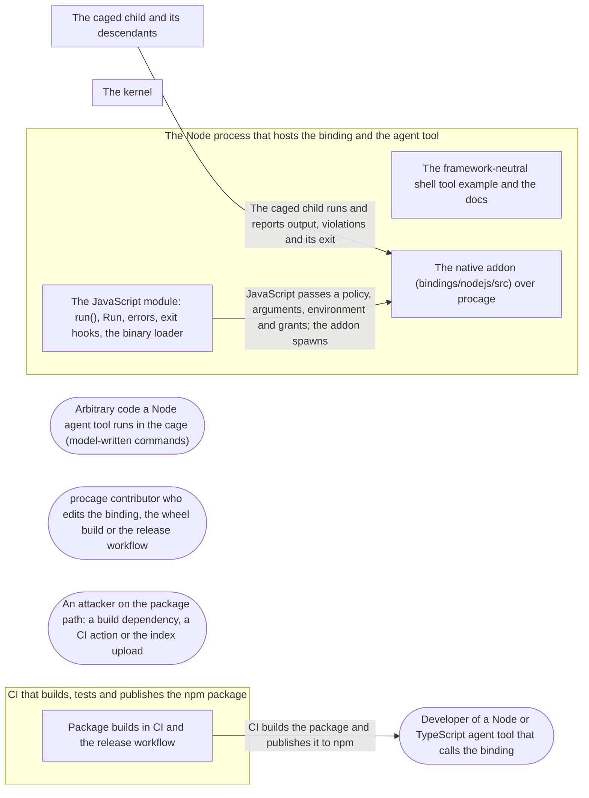

# Threat Model: Node.js bindings

**Feature**: `049-nodejs` · **Generated**: 2026-11-03T22:44:52Z · **Profiles**: stride, llm, agent · **Canonical**: `threat-model.yaml`

> Rendered by ThreatSpec. Edit `threat-model.yaml`, not this file.

## Summary

| Threats | Critical | High | Medium | Low | Needs clarification | Not applicable | Mitigations | Requirements | Decisions |
|---|---|---|---|---|---|---|---|---|---|
| 8 | 0 | 2 | 5 | 1 | 0 | 27 | 8 | 8 | 0 |

## Actors

| ID | Name | Trust | Description |
|---|---|---|---|
| `actor.caged-code` | Arbitrary code a Node agent tool runs in the cage (model-written commands) | untrusted |  |
| `actor.consumer` | Developer of a Node or TypeScript agent tool that calls the binding | trusted |  |
| `actor.contributor` | procage contributor who edits the binding, the wheel build or the release workflow | semi-trusted |  |
| `actor.supply-chain` | An attacker on the package path: a build dependency, a CI action or the index upload | untrusted |  |

## Trust Zones

| ID | Name | Trust rating | Description |
|---|---|---|---|
| `tz.build` | CI that builds, tests and publishes the npm package | 70 |  |
| `tz.cage` | The caged child and its descendants | 5 |  |
| `tz.os` | The kernel | 95 |  |
| `tz.python` | The Node process that hosts the binding and the agent tool | 85 |  |

## Assets

| ID | Name | Type | Classification | C / I / A | Source |
|---|---|---|---|---|---|
| `asset.host` | The user's files, secrets, environment and processes outside the policy | credential | secret | 100 / 90 / 50 | spec.md#Context |
| `asset.policy` | The policy a Python caller passes, and its enforcement | configuration | internal | 0 / 95 / 20 | spec.md#FR-001 |
| `asset.wheel` | The published npm package and its prebuilt binaries | source-code | public | 0 / 100 / 40 | spec.md#FR-004 |

## Components

| ID | Name | Type | Trust zone | Source |
|---|---|---|---|---|
| `component.example` | The framework-neutral shell tool example and the docs | document | `tz.python` | spec.md#US2 |
| `component.native` | The native addon (bindings/nodejs/src) over procage | library | `tz.python` | spec.md#FR-001 |
| `component.release` | Package builds in CI and the release workflow | pipeline | `tz.build` | spec.md#FR-004 |
| `component.wrapper` | The JavaScript module: run(), Run, errors, exit hooks, the binary loader | library | `tz.python` | spec.md#FR-002 |

## Data Flows

| ID | Name | From | To | Assets | Crosses |
|---|---|---|---|---|---|
| `flow.child` | The caged child runs and reports output, violations and its exit | `tz.cage` | `component.native` | `asset.host` | `tz.cage`, `tz.python` |
| `flow.publish` | CI builds the package and publishes it to npm | `component.release` | `actor.consumer` | `asset.wheel` | `tz.build`, `tz.python` |
| `flow.spawn` | JavaScript passes a policy, arguments, environment and grants; the addon spawns | `component.wrapper` | `component.native` | `asset.policy`, `asset.host` |  |

## Threats

| ID | Threat | Category | Technique | Severity | Status | Mitigations | Mappings | Source |
|---|---|---|---|---|---|---|---|---|
| `threat.env-leak` | The binding copies process.env (or the caller's whole environment) into the command as explicit variables, which procage always keeps, so secrets in the environment reach the cage past the allowlist | Information Disclosure | sensitive-data-exposure | **high** | mitigated | `mitigation.explicit-env` |  | spec.md#FR-001 |
| `threat.silent-weakening` | The binding loosens what the caller asked: an unknown or misspelt field is dropped, a gap is ignored, or a default policy allows more than the Rust default | Elevation of Privilege | broken-access-control | **high** | mitigated | `mitigation.same-semantics` |  | spec.md#FR-002 |
| `threat.binary-substitution` | The loader picks the native addon from an environment variable, the working directory or a search path, so whoever controls those loads their own code into the agent process in place of the sandbox | Elevation of Privilege | privilege-escalation-via-config | **medium** | mitigated | `mitigation.fixed-loader` |  | spec.md#Clarifications |
| `threat.orphaned-run` | A run outlives its JavaScript object or the process (collection deferred, exit skipping finalisers, an aborted request), so caged processes keep running unowned | Elevation of Privilege | broken-access-control | **medium** | mitigated | `mitigation.end-on-release` |  | spec.md#US1 |
| `threat.python-in-child` | JavaScript runs in the child between fork and exec (a callback across the fork), or the spawn runs on the event loop thread | Elevation of Privilege | privilege-escalation-via-config | **medium** | mitigated | `mitigation.rust-spawn` |  | spec.md#FR-003 |
| `threat.untested-wheel` | A binary is published for a platform where the binding was never run against the kernel, or the docs claim more than the tests show | Repudiation | missing-audit-trail | **medium** | mitigated | `mitigation.tested-wheels` |  | spec.md#SC-001 |
| `threat.wheel-tampering` | An attacker on the package path (a build dependency, a mutable CI action, a stored npm token) publishes a package that does not cage, under the procage name | Tampering | injection | **medium** | mitigated | `mitigation.trusted-publishing` |  | spec.md#FR-004 |
| `threat.gil-starvation` | A blocking spawn, wait or read runs on the event loop thread, so the whole Node process stalls while one command runs | Denial of Service | resource-exhaustion | **low** | mitigated | `mitigation.release-gil` |  | spec.md#FR-005 |

### Techniques evaluated without findings

| Technique | Disposition | Reason |
|---|---|---|
| credential-theft | not-applicable | no authentication surface in the binding; publishing credentials are modelled as threat.wheel-tampering |
| identity-spoofing | not-applicable | no authentication or network boundary |
| data-tampering-in-transit | not-applicable | no network transit at run time; the package download is modelled as threat.wheel-tampering |
| data-tampering-at-rest | not-applicable | no store |
| cross-tenant-leak | not-applicable | single user; one interpreter owns its runs |
| prompt-injection-direct | not-applicable | procage is a library that calls no model and runs no agent; LLM-written code is the adversary inside the child, modelled under STRIDE |
| prompt-injection-indirect | not-applicable | procage is a library that calls no model and runs no agent; LLM-written code is the adversary inside the child, modelled under STRIDE |
| sensitive-information-disclosure | not-applicable | procage is a library that calls no model and runs no agent; LLM-written code is the adversary inside the child, modelled under STRIDE |
| excessive-agency | not-applicable | procage is a library that calls no model and runs no agent; LLM-written code is the adversary inside the child, modelled under STRIDE |
| model-supply-chain | not-applicable | procage is a library that calls no model and runs no agent; LLM-written code is the adversary inside the child, modelled under STRIDE |
| training-data-poisoning | not-applicable | procage is a library that calls no model and runs no agent; LLM-written code is the adversary inside the child, modelled under STRIDE |
| unbounded-consumption | not-applicable | procage is a library that calls no model and runs no agent; LLM-written code is the adversary inside the child, modelled under STRIDE |
| misinformation | not-applicable | procage is a library that calls no model and runs no agent; LLM-written code is the adversary inside the child, modelled under STRIDE |
| hidden-context-exposure | not-applicable | procage is a library that calls no model and runs no agent; LLM-written code is the adversary inside the child, modelled under STRIDE |
| vector-embedding-weakness | not-applicable | procage is a library that calls no model and runs no agent; LLM-written code is the adversary inside the child, modelled under STRIDE |
| improper-output-handling | not-applicable | procage is a library that calls no model and runs no agent; LLM-written code is the adversary inside the child, modelled under STRIDE |
| model-extraction | not-applicable | procage is a library that calls no model and runs no agent; LLM-written code is the adversary inside the child, modelled under STRIDE |
| goal-hijack | not-applicable | procage is a library that calls no model and runs no agent; LLM-written code is the adversary inside the child, modelled under STRIDE |
| tool-misuse | not-applicable | procage is a library that calls no model and runs no agent; LLM-written code is the adversary inside the child, modelled under STRIDE |
| identity-privilege-abuse | not-applicable | procage is a library that calls no model and runs no agent; LLM-written code is the adversary inside the child, modelled under STRIDE |
| agentic-supply-chain | not-applicable | procage is a library that calls no model and runs no agent; LLM-written code is the adversary inside the child, modelled under STRIDE |
| unexpected-code-execution | not-applicable | procage is a library that calls no model and runs no agent; LLM-written code is the adversary inside the child, modelled under STRIDE |
| memory-context-poisoning | not-applicable | procage is a library that calls no model and runs no agent; LLM-written code is the adversary inside the child, modelled under STRIDE |
| insecure-inter-agent-communication | not-applicable | procage is a library that calls no model and runs no agent; LLM-written code is the adversary inside the child, modelled under STRIDE |
| cascading-failure | not-applicable | procage is a library that calls no model and runs no agent; LLM-written code is the adversary inside the child, modelled under STRIDE |
| human-agent-trust-exploitation | not-applicable | procage is a library that calls no model and runs no agent; LLM-written code is the adversary inside the child, modelled under STRIDE |
| rogue-agent | not-applicable | procage is a library that calls no model and runs no agent; LLM-written code is the adversary inside the child, modelled under STRIDE |

## Mitigations

| ID | Mitigation | Kind | Threats | Requirements | Touchpoints | Status |
|---|---|---|---|---|---|---|
| `mitigation.end-on-release` | kill, disposal, abort, timeout, collection and the exit hooks end a run | preventive | `threat.orphaned-run` | SR-004 | `bindings/nodejs/src/lib.rs`, `bindings/nodejs/index.js` | verified |
| `mitigation.explicit-env` | The binding passes only the variables the caller names in env=; the policy decides the rest, as in Rust | preventive | `threat.env-leak` | SR-001 | `bindings/nodejs/src/lib.rs`, `bindings/nodejs/index.js` | verified |
| `mitigation.fixed-loader` | The loader loads only the package file for the host platform by a fixed path relative to the module; no environment variable, working directory or search path; an unsupported platform throws | preventive | `threat.binary-substitution` | SR-008 | `bindings/nodejs/index.js` | verified |
| `mitigation.release-gil` | Spawn, wait and reads run on the libuv thread pool | preventive | `threat.gil-starvation` | SR-007 | `bindings/nodejs/src/lib.rs` | verified |
| `mitigation.rust-spawn` | Spawning is the Rust child sequence on a worker thread; the binding exposes no hook that runs in the child | preventive | `threat.python-in-child` | SR-002 | `bindings/nodejs/src/lib.rs` | verified |
| `mitigation.same-semantics` | Policies come only through the Rust presets and the versioned format, which refuses unknown fields; every Rust error becomes a typed exception; no binding default differs from Rust | preventive | `threat.silent-weakening` | SR-003 | `bindings/nodejs/src/lib.rs`, `bindings/nodejs/index.js` | verified |
| `mitigation.tested-wheels` | Each published platform runs the escape subset and the example from the packed package, on the kernel, in CI | detective | `threat.untested-wheel` | SR-006 | `bindings/nodejs/build.sh`, `bindings/nodejs/test/procage.test.js`, `.github/workflows/ci.yml` | verified |
| `mitigation.trusted-publishing` | The package is built from the tag by pinned actions and published with npm Trusted Publishing and provenance from a protected environment; no stored token | preventive | `threat.wheel-tampering` | SR-005 | `.github/workflows/release.yml` | verified |

## Security Requirements

### SR-001 (P1) — verified

The binding MUST NOT copy process.env into the command; only variables passed in env are set explicitly, and the policy environment rules decide the rest.

- **Given** a secret variable in process.env and a preset policy, **when** a caged command prints its environment, **then** the secret is absent
- **Given** the same and env naming one variable, **when** the command prints its environment, **then** that variable is present and the secret absent
- Mitigations: `mitigation.explicit-env`
- Tasks: T003 ✓, T005 ✓
- Verification `verification.sr-001.2026-11-03`: test → pass (verified) — `bindings/nodejs/test/procage.test.js::escape subset::process.env is not copied`
- Verification `verification.sr-001.2026-11-03-2`: test → pass (verified) — `bindings/nodejs/test/procage.test.js::escape subset::process.env is not copied`

### SR-002 (P1) — verified

The binding MUST NOT run JavaScript in the child between fork and exec, and MUST spawn off the event loop thread.

- **Given** many concurrent runs started from one event loop, **when** they all run, **then** every spawn completes
- Mitigations: `mitigation.rust-spawn`
- Tasks: T003 ✓, T005 ✓
- Verification `verification.sr-002.2026-11-03`: test → pass (verified) — `bindings/nodejs/test/procage.test.js::concurrency::many runs at once, and the event loop stays free`
- Verification `verification.sr-002.2026-11-03-2`: test → pass (verified) — `bindings/nodejs/test/procage.test.js::concurrency::many runs at once, and the event loop stays free`

### SR-003 (P1) — verified

A policy MUST reach the cage only through the presets or the versioned format, an unknown field or invalid value MUST throw PolicyError, a gap MUST throw CapabilityGapError with the gaps, and the binding MUST add no default the Rust API does not have.

- **Given** a JSON policy with an unknown field, **when** Policy.fromJSON is called, **then** PolicyError is thrown
- **Given** a policy the host cannot enforce, **when** a Cage is made, **then** CapabilityGapError is thrown with the gaps
- Mitigations: `mitigation.same-semantics`
- Tasks: T002 ✓, T003 ✓, T005 ✓
- Verification `verification.sr-003.2026-11-03`: test → pass (verified) — `bindings/nodejs/test/procage.test.js::policies::a gap throws with the gaps`
- Verification `verification.sr-003.2026-11-03-2`: test → pass (verified) — `bindings/nodejs/test/procage.test.js::policies::a gap throws with the gaps`

### SR-004 (P1) — verified

Every process of a run MUST be killed when it is killed, disposed, aborted, timed out, collected, or the Node process exits.

- **Given** a running command and an AbortSignal, **when** the signal aborts, **then** its processes are dead
- **Given** a running command when the Node process exits, **when** the process exits, **then** its processes are dead
- Mitigations: `mitigation.end-on-release`
- Tasks: T004 ✓, T005 ✓
- Verification `verification.sr-004.2026-11-03`: test → pass (verified) — `bindings/nodejs/test/procage.test.js::lifetime::aborting ends the run`
- Verification `verification.sr-004.2026-11-03-2`: test → pass (verified) — `bindings/nodejs/test/procage.test.js::lifetime::aborting ends the run`

### SR-005 (P1) — verified

The package MUST be built from the tagged commit by actions pinned to full SHAs and published with npm Trusted Publishing and provenance from a protected environment, with no stored token.

- **Given** the release workflow, **when** the workflows gate runs, **then** every action is SHA-pinned and the publish job uses OIDC in the npm environment with provenance
- Mitigations: `mitigation.trusted-publishing`
- Tasks: T008 ✓, T011 ✓
- Verification `verification.sr-005.2026-11-03`: review → inconclusive (implemented-unverified) — `.github/workflows/release.yml:142`
- Verification `verification.sr-005.2026-11-03-2`: test → pass (verified) — `.github/workflows/release.yml::npm`

### SR-006 (P2) — verified

Every published platform MUST run the escape subset and the shell tool example from the packed package on its CI lane, and the docs MUST claim no platform beyond them.

- **Given** each platform lane, **when** the Node tests run against the installed package, **then** reads and writes outside the workspace, secrets and the network are refused and the example runs
- Mitigations: `mitigation.tested-wheels`
- Tasks: T005 ✓, T006 ✓, T007 ✓, T012 ✓
- Verification `verification.sr-006.2026-11-03`: review → inconclusive (implemented-unverified) — `.github/workflows/ci.yml:112`
- Verification `verification.sr-006.2026-11-03-2`: test → pass (verified) — `bindings/nodejs/test/procage.test.js::escape subset::reading outside the workspace is refused`

### SR-007 (P3) — verified

Spawn, wait and the reading of output MUST NOT block the event loop.

- **Given** a run of one second, **when** a timer is due meanwhile, **then** it fires on time
- Mitigations: `mitigation.release-gil`
- Tasks: T003 ✓, T005 ✓
- Verification `verification.sr-007.2026-11-03`: test → pass (verified) — `bindings/nodejs/test/procage.test.js::concurrency::many runs at once, and the event loop stays free`
- Verification `verification.sr-007.2026-11-03-2`: test → pass (verified) — `bindings/nodejs/test/procage.test.js::concurrency::many runs at once, and the event loop stays free`

### SR-008 (P1) — verified

The package MUST load its native addon only from its own directory by a fixed name for the host platform, ignoring environment variables and the working directory, and MUST throw a typed error on an unsupported platform.

- **Given** an environment variable naming another addon, **when** the package is imported, **then** the packaged addon is loaded
- **Given** an unsupported platform, **when** the package is imported, **then** it throws UnsupportedError naming the platform
- Mitigations: `mitigation.fixed-loader`
- Tasks: T002 ✓, T005 ✓
- Verification `verification.sr-008.2026-11-03`: test → pass (verified) — `bindings/nodejs/test/procage.test.js::loader::loads the packaged addon whatever the environment says`
- Verification `verification.sr-008.2026-11-03-2`: test → pass (verified) — `bindings/nodejs/test/procage.test.js::loader::loads the packaged addon whatever the environment says`
