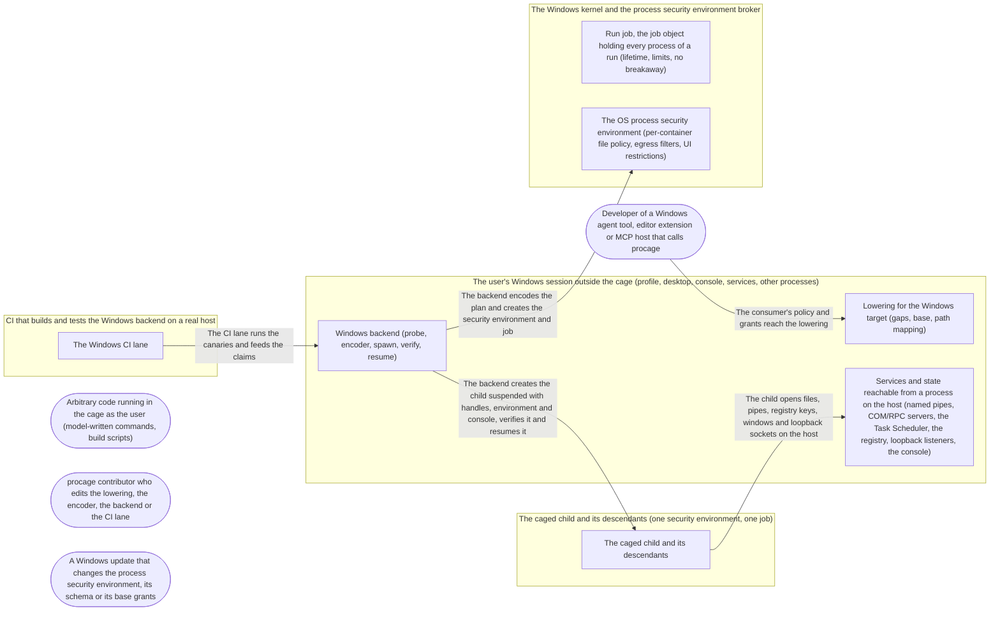

# Threat Model: Windows backend

**Feature**: `050-windows` · **Generated**: 2026-11-07T20:17:54Z · **Profiles**: stride, llm, agent · **Canonical**: `threat-model.yaml`

> Rendered by ThreatSpec. Edit `threat-model.yaml`, not this file.

## Summary

| Threats | Critical | High | Medium | Low | Needs clarification | Not applicable | Mitigations | Requirements | Decisions |
|---|---|---|---|---|---|---|---|---|---|
| 20 | 0 | 13 | 7 | 0 | 0 | 25 | 15 | 16 | 0 |

## Actors

| ID | Name | Trust | Description |
|---|---|---|---|
| `actor.caged-code` | Arbitrary code running in the cage as the user (model-written commands, build scripts) | untrusted |  |
| `actor.consumer` | Developer of a Windows agent tool, editor extension or MCP host that calls procage | trusted |  |
| `actor.contributor` | procage contributor who edits the lowering, the encoder, the backend or the CI lane | semi-trusted |  |
| `actor.os-update` | A Windows update that changes the process security environment, its schema or its base grants | semi-trusted |  |

## Trust Zones

| ID | Name | Trust rating | Description |
|---|---|---|---|
| `tz.build` | CI that builds and tests the Windows backend on a real host | 70 |  |
| `tz.cage` | The caged child and its descendants (one security environment, one job) | 0 |  |
| `tz.host` | The user's Windows session outside the cage (profile, desktop, console, services, other processes) | 80 |  |
| `tz.os` | The Windows kernel and the process security environment broker | 100 |  |

## Assets

| ID | Name | Type | Classification | C / I / A | Source |
|---|---|---|---|---|---|
| `asset.claims` | What the README, rustdoc, the threat model and receipts promise about Windows |  | public | 0 / 90 / 20 | spec.md#Functional-Requirements |
| `asset.host-session` | The user's desktop, console, clipboard, other processes, autorun points and local services |  | confidential | 70 / 90 / 60 | spec.md#User-Story-3 |
| `asset.parent` | The calling process, its handles, its environment and its loaded code |  | secret | 90 / 100 / 60 | spec.md#User-Story-2 |
| `asset.policy` | The lowered plan and its encoding for the OS, which decide what the cage holds |  | internal | 10 / 100 / 40 | spec.md#Functional-Requirements |
| `asset.secrets` | Credentials in the user's profile and services (.ssh, cloud and registry credentials, agent tokens, Credential Manager, the OpenSSH agent pipe) |  | secret | 100 / 60 / 20 | spec.md#User-Story-1 |
| `asset.user-files` | Files outside the policy's grants, and protected or hidden paths inside them |  | confidential | 80 / 90 / 50 | spec.md#User-Story-3 |

## Components

| ID | Name | Type | Trust zone | Source |
|---|---|---|---|---|
| `component.backend` | Windows backend (probe, encoder, spawn, verify, resume) | library | `tz.host` | spec.md#FR-001 |
| `component.child` | The caged child and its descendants | process | `tz.cage` | spec.md#User-Story-1 |
| `component.ci` | The Windows CI lane | ci | `tz.build` | spec.md#FR-010 |
| `component.host-services` | Services and state reachable from a process on the host (named pipes, COM/RPC servers, the Task Scheduler, the registry, loopback listeners, the console) | os-service | `tz.host` | spec.md#User-Story-3 |
| `component.job` | Run job, the job object holding every process of a run (lifetime, limits, no breakaway) | os-service | `tz.os` | spec.md#FR-006 |
| `component.lowering` | Lowering for the Windows target (gaps, base, path mapping) | library | `tz.host` | spec.md#FR-003 |
| `component.psec` | The OS process security environment (per-container file policy, egress filters, UI restrictions) | os-service | `tz.os` | spec.md#Context |

## Data Flows

| ID | Name | From | To | Assets | Crosses |
|---|---|---|---|---|---|
| `flow.child-to-host` | The child opens files, pipes, registry keys, windows and loopback sockets on the host | `component.child` | `component.host-services` | `asset.secrets`, `asset.user-files`, `asset.host-session` | `tz.cage`, `tz.host` |
| `flow.ci-evidence` | The CI lane runs the canaries and feeds the claims | `component.ci` | `component.backend` | `asset.claims` | `tz.build`, `tz.host` |
| `flow.plan-to-os` | The backend encodes the plan and creates the security environment and job | `component.backend` | `component.psec` | `asset.policy` | `tz.host`, `tz.os` |
| `flow.policy-to-lowering` | The consumer's policy and grants reach the lowering | `actor.consumer` | `component.lowering` | `asset.policy` |  |
| `flow.spawn` | The backend creates the child suspended with handles, environment and console, verifies it and resumes it | `component.backend` | `component.child` | `asset.parent` | `tz.host`, `tz.cage` |

## Threats

| ID | Threat | Category | Technique | Severity | Status | Mitigations | Mappings | Source |
|---|---|---|---|---|---|---|---|---|
| `threat.base-overreach` | The OS grants every container read access to locations ACL'd for ALL_APPLICATION_PACKAGES; caged code reads a secret or user file stored there although the policy never granted it | Information Disclosure | sensitive-data-exposure | **high** | open | `mitigation.measured-base` |  | spec.md#Clarifications |
| `threat.dll-hijack` | The parent loads the OS interface's DLL by a search path that includes the working directory or PATH, and caged code that wrote a DLL of that name into the workspace runs its code in the parent | Elevation of Privilege | privilege-escalation-via-config | **high** | open | `mitigation.system32-load` |  | spec.md#FR-002 |
| `threat.env-leak` | The child receives the parent's environment block (tokens, secret-looking names) because the backend passes none and Windows inherits the parent's | Information Disclosure | sensitive-data-exposure | **high** | open | `mitigation.explicit-handles-env` |  | spec.md#User-Story-2 |
| `threat.handle-leak` | The child inherits handles the caller did not declare (every inheritable handle of the parent, including ones another thread created at the same moment), and uses one to reach a file, pipe or process outside the cage | Information Disclosure, Elevation of Privilege | broken-access-control | **high** | open | `mitigation.explicit-handles-env` |  | spec.md#User-Story-2 |
| `threat.loopback-bypass` | With Network::None or Proxy, caged code connects to a host loopback listener other than the proxy (local dev servers, debug ports, a Docker TCP socket) | Elevation of Privilege | broken-access-control | **high** | open | `mitigation.loopback-canaries` |  | spec.md#User-Story-4 |
| `threat.orphaned-run` | A descendant outlives the run because it was created before the child joined the job, broke away from the job, or the parent died without closing the job | Elevation of Privilege | broken-access-control | **high** | open | `mitigation.job-at-creation` |  | spec.md#FR-007 |
| `threat.path-alias` | Caged code reaches a protected, hidden or denied path, or renames a writable root or an anchor, through an 8.3 short name, a case variant, an alternate data stream, a \\?\ or device path, a junction or a symbolic link the lowering or the OS treats as a different path | Elevation of Privilege, Tampering | broken-access-control | **high** | open | `mitigation.path-matrix` |  | spec.md#User-Story-3 |
| `threat.persistence` | Caged code writes an autorun point (HKCU Run keys, the Startup folder, a scheduled task, a shell profile) that the user's session runs later outside the cage | Elevation of Privilege | privilege-escalation-via-config | **high** | open | `mitigation.hard-deny-windows` |  | spec.md#User-Story-3 |
| `threat.planted-link` | Caged code replaces a directory in its writable tree with a junction or symbolic link to a secret location, and procage, resolving a later grant below it to its final path, grants the link's target to the next spawn | Elevation of Privilege | privilege-escalation-via-config | **high** | open | `mitigation.no-follow-resolution` |  | research.md#R7 |
| `threat.service-handoff` | Caged code hands work to an uncaged service through a named pipe, COM/RPC or the Task Scheduler (the Docker engine pipe, the OpenSSH agent pipe, a scheduled task), or opens another of the user's processes | Elevation of Privilege | broken-access-control | **high** | open | `mitigation.hard-deny-windows` |  | spec.md#User-Story-3 |
| `threat.silent-fallback` | On a host without the process security environment, an untested schema version, or a missing optional feature (denied paths, ingress), the backend still starts the child with a weaker cage instead of refusing | Elevation of Privilege | broken-access-control | **high** | open | `mitigation.probe-or-refuse` |  | spec.md#FR-002 |
| `threat.ui-injection` | Caged code injects input into another window or a shared console (SendInput, window messages, writing the console input buffer with Tty::Inherit), or reads the clipboard | Elevation of Privilege, Information Disclosure | broken-access-control | **high** | open | `mitigation.hard-deny-windows` |  | spec.md#Edge-Cases |
| `threat.untested-claims` | Docs or the threat model claim Windows enforcement that no caged test on a real host shows, for example because the CI lane skips on a host without the feature | Repudiation | missing-audit-trail | **high** | open | `mitigation.lane-fails-closed` |  | spec.md#FR-010 |
| `threat.acl-residue` | The backend changes the ACL of a granted path to make the grant work, and a crash or a killed parent leaves the entry behind, opening the path to every later container | Tampering, Elevation of Privilege | privilege-escalation-via-config | **medium** | open | `mitigation.no-acl-writes` |  | spec.md#FR-005 |
| `threat.cmdline-quoting` | The backend joins argv into a Windows command line that the target parses differently (quotes, backslashes, a .bat/.cmd target re-parsed by cmd.exe), so the caged program runs with arguments the caller never passed | Tampering | injection | **medium** | open | `mitigation.argv-quoting` |  | plan.md#Layout |
| `threat.cross-run-grants` | Two concurrent runs in one parent share an OS container identity, so one run reads or writes the other's per-spawn grants | Information Disclosure | cross-tenant-leak | **medium** | open | `mitigation.environment-per-spawn` |  | spec.md#Edge-Cases |
| `threat.resource-exhaustion` | Caged code exhausts the host's process table or CPU because the job carries no limits | Denial of Service | resource-exhaustion | **medium** | open | `mitigation.job-at-creation` |  | spec.md#User-Story-2 |
| `threat.schema-mismatch` | procage's encoding of the plan does not match the schema the OS reads (slot order, version, defaults), so the OS drops the denied paths or reads a read-only list as read-write | Tampering | injection | **medium** | open | `mitigation.pinned-schema` |  | spec.md#Edge-Cases |
| `threat.unrecorded-run` | A receipt or Plan omits the Windows build, the probed features or the base grant, so a reviewer cannot tell what the cage held | Repudiation | missing-audit-trail | **medium** | open | `mitigation.measured-base` |  | spec.md#User-Story-5 |
| `threat.unverified-child` | The security-environment attribute is ignored or fails silently on some build, and the child runs its target uncaged because nothing checks it before it is resumed | Elevation of Privilege | broken-access-control | **medium** | open | `mitigation.verify-before-resume` |  | spec.md#User-Story-2 |

### Techniques evaluated without findings

| Technique | Disposition | Reason |
|---|---|---|
| credential-theft | not-applicable | no authentication surface in the backend; credentials on the host are assets the cage protects, modelled as threat.base-overreach and threat.service-handoff |
| identity-spoofing | not-applicable | no authentication or network boundary between the caller and procage; the proxy peer identity is part of threat.loopback-bypass |
| data-tampering-in-transit | not-applicable | the policy goes from the parent to the OS in process memory; no network transit |
| data-tampering-at-rest | no-threat-detected | procage keeps no store of its own on Windows (bytecode-like plans live in memory); writes by the child outside its grants are threat.path-alias, writes to autorun points are threat.persistence |
| prompt-injection-direct | not-applicable | procage is a library that calls no model and runs no agent; LLM-written code is the adversary inside the child, modelled under STRIDE |
| prompt-injection-indirect | not-applicable | procage is a library that calls no model and runs no agent; LLM-written code is the adversary inside the child, modelled under STRIDE |
| sensitive-information-disclosure | not-applicable | procage is a library that calls no model and runs no agent; disclosure by caged code is modelled under STRIDE (threat.base-overreach, threat.env-leak) |
| excessive-agency | not-applicable | procage is a library that calls no model and runs no agent; LLM-written code is the adversary inside the child, modelled under STRIDE |
| model-supply-chain | not-applicable | no model is loaded or distributed |
| training-data-poisoning | not-applicable | no model is trained |
| unbounded-consumption | not-applicable | no model inference; process resource use by caged code is threat.resource-exhaustion |
| misinformation | not-applicable | no model output is produced or relayed |
| hidden-context-exposure | not-applicable | no model context exists in the library |
| vector-embedding-weakness | not-applicable | no retrieval or embeddings |
| improper-output-handling | not-applicable | procage does not interpret the child's output; it returns bytes to the caller |
| model-extraction | not-applicable | no model is served |
| goal-hijack | not-applicable | procage runs no agent; the agent is the consumer's, outside this record |
| tool-misuse | not-applicable | procage is the containment for an agent's tools, not a tool an agent selects; misuse by caged code is modelled under STRIDE |
| identity-privilege-abuse | not-applicable | procage runs no agent identity; the child runs as the user inside the cage, modelled under STRIDE |
| agentic-supply-chain | not-applicable | procage loads no agent plugins or MCP servers; its own supply chain is unchanged by this record |
| unexpected-code-execution | not-applicable | running untrusted code is the purpose of the cage; its containment is modelled under STRIDE |
| memory-context-poisoning | not-applicable | no agent memory |
| insecure-inter-agent-communication | not-applicable | no agents communicate through procage |
| cascading-failure | not-applicable | no multi-agent pipeline; one run's failure is contained by its job |
| human-agent-trust-exploitation | not-applicable | procage has no user interface; approvals belong to the harness |
| rogue-agent | not-applicable | procage runs no agent |

## Mitigations

| ID | Mitigation | Kind | Threats | Requirements | Touchpoints | Status |
|---|---|---|---|---|---|---|
| `mitigation.argv-quoting` | One quoting function, the exact inverse of CommandLineToArgvW, property-tested; .bat and .cmd targets refused unless the caller passes the shell command line explicitly | preventive | `threat.cmdline-quoting` | SR-015 | `crates/procage/src/windows/cmdline.rs` | required |
| `mitigation.environment-per-spawn` | One security environment per spawn, released at the end of the run; per-spawn grants never shared between runs | preventive | `threat.cross-run-grants` | SR-012 | `crates/procage/src/windows/mod.rs`, `crates/procage/src/windows/spawn.rs` | required |
| `mitigation.explicit-handles-env` | Pass an explicit handle list (stdio and declared handles only) and an explicit environment block from the allowlist on every creation; no console unless asked | preventive | `threat.handle-leak`, `threat.env-leak` | SR-007 | `crates/procage/src/windows/spawn.rs` | required |
| `mitigation.hard-deny-windows` | Each hard-deny class is enforced on Windows by denied paths, UI restrictions and the container's isolation, with a canary per class, or is a typed gap | preventive | `threat.service-handoff`, `threat.persistence`, `threat.ui-injection` | SR-010 | `crates/procage-policy/src/presets.rs`, `crates/procage-policy/src/lower/windows.rs`, `crates/procage/tests/escape_windows.rs` | required |
| `mitigation.job-at-creation` | Create the child suspended and already in a kill-on-close job that forbids breakaway and carries the limits | preventive | `threat.orphaned-run`, `threat.resource-exhaustion` | SR-008, SR-014 | `crates/procage/src/windows/spawn.rs`, `crates/procage/src/windows/child.rs` | required |
| `mitigation.lane-fails-closed` | The Windows lane fails when the feature is missing, and the docs claim only what the lane's canaries show | detective | `threat.untested-claims` | SR-013 | `.github/workflows/ci.yml`, `crates/procage/THREAT_MODEL.md`, `README.md` | required |
| `mitigation.loopback-canaries` | Lower Loopback and Proxy only where the probe reports support and a canary shows no other loopback listener is reachable; deny host loopback otherwise | preventive | `threat.loopback-bypass` | SR-011 | `crates/procage-policy/src/lower/windows.rs`, `crates/procage/tests/escape_windows.rs` | required |
| `mitigation.measured-base` | Measure the OS base per tested build, record it on the Plan and in receipts, name it in explain, deny the secret classes explicitly, and make Base::None a gap | detective | `threat.base-overreach`, `threat.unrecorded-run` | SR-002 | `crates/procage-policy/src/base.rs`, `crates/procage-policy/src/lower/windows.rs`, `crates/procage/src/receipt.rs` | required |
| `mitigation.no-acl-writes` | The backend never changes ACLs, owners or attributes of caller paths; a residue check after killed runs proves it | preventive | `threat.acl-residue` | SR-005 | `crates/procage/src/windows/sys.rs`, `crates/procage/tests/spawn_windows.rs` | required |
| `mitigation.no-follow-resolution` | Resolve policy and grant paths component by component without following reparse points; a reparse point inside a writable tree refuses the spawn; grants resolved again at every spawn | preventive | `threat.planted-link` | SR-016 | `crates/procage/src/windows/paths.rs`, `crates/procage/tests/escape_windows.rs` | required |
| `mitigation.path-matrix` | Resolve every policy path through the path component (long names, case, prefixes, reparse points) and prove each alias class with a canary on a real host; an alias the OS does not close is a gap | preventive | `threat.path-alias` | SR-003 | `crates/procage/src/windows/paths.rs`, `crates/procage-kernel-facts/src/sys/windows.rs`, `crates/procage/tests/escape_windows.rs` | required |
| `mitigation.pinned-schema` | Pin the schema version procage encodes, test the encoding against the vendored schema and on the OS, and treat an untested major version as Unsupported | preventive | `threat.schema-mismatch` | SR-004 | `crates/procage/src/windows/psec.rs`, `crates/procage/src/windows/psec.fbs` | required |
| `mitigation.probe-or-refuse` | Probe the interface, the schema version and each optional feature once per process; refuse with Unsupported or a typed gap; no fallback mechanism exists | preventive | `threat.silent-fallback` | SR-001 | `crates/procage/src/windows/probe.rs`, `crates/procage-policy/src/lower/windows.rs` | required |
| `mitigation.system32-load` | Load the OS interface's DLL from the system directory only, never by search path | preventive | `threat.dll-hijack` | SR-006 | `crates/procage/src/windows/probe.rs`, `crates/procage/src/windows/sys.rs` | required |
| `mitigation.verify-before-resume` | Before resuming, verify from the parent that the child's token is in the expected security environment and the process is in the run's job; terminate it otherwise | preventive | `threat.unverified-child` | SR-009 | `crates/procage/src/windows/spawn.rs` | required |

## Security Requirements

### SR-001 (P1) — unverified

The backend MUST return Unsupported when the OS interface, a tested schema version or a required feature is missing, MUST return a typed gap for any construct whose OS feature the host lacks, and MUST NOT use any other mechanism (restricted tokens, ACL changes, local users) as a fallback.

- **Given** a host whose probe reports no process security environment, **when** a cage is built, **then** Unsupported names what is missing and no process starts
- **Given** a host without native denied paths and a policy with a Hide rule, **when** it is lowered for that host, **then** a CapabilityGap names the rule
- Mitigations: `mitigation.probe-or-refuse`
- Tasks: T004, T011, T012, T015

### SR-002 (P1) — unverified

The Windows base MUST be measured per tested build, recorded on the Plan and in every receipt with the build and the probed features, and named by explain; Base::None MUST be a gap; the secret classes MUST be denied explicitly even where the base would allow them.

- **Given** a cage on Windows, **when** a run ends, **then** its receipt names the build, the features and the base version
- **Given** a read of a system DLL, **when** explain is asked, **then** it answers allowed by the Windows base
- **Given** a secret-class path readable by the base, **when** the child reads it, **then** it is refused
- Mitigations: `mitigation.measured-base`
- Tasks: T010, T022, T027, T028, T029

### SR-003 (P1) — unverified

Protect, Hide, denied paths and rename anchors MUST hold for 8.3 short names, case variants, alternate data streams, \\?\ and device paths, junctions and symbolic links, each proven by a canary on a real host; an alias class the OS does not close MUST be a documented gap.

- **Given** a protected file inside a writable workspace, **when** the child writes it through its short name, an alternate data stream or a junction, **then** each write is refused
- **Given** a hidden directory inside a readable tree, **when** the child reads it with a different case or a \\?\ prefix, **then** each read is refused
- Mitigations: `mitigation.path-matrix`
- Tasks: T008, T023

### SR-004 (P1) — unverified

The encoder MUST produce the schema version procage pins, MUST be tested against the vendored schema and on the OS, and an untested major version reported by the OS MUST be Unsupported.

- **Given** a plan with read-only, read-write and denied paths, **when** it is encoded and decoded with the vendored schema, **then** every list round-trips exactly
- **Given** an OS reporting an untested major version, **when** a cage is built, **then** Unsupported is returned
- Mitigations: `mitigation.pinned-schema`
- Tasks: T005, T006

### SR-005 (P1) — unverified

The backend MUST NOT change the ACL, owner or attributes of any caller path or any path below it.

- **Given** a workspace whose security descriptors are recorded, **when** 1,000 runs complete, some killed and one parent killed abruptly, **then** every security descriptor is byte-identical and no procage process remains
- Mitigations: `mitigation.no-acl-writes`
- Tasks: T015, T020

### SR-006 (P1) — unverified

The backend MUST load the OS interface's DLL from the system directory only.

- **Given** a DLL of the interface's name in the parent's working directory and on PATH, **when** a cage is built, **then** the planted DLL is not loaded
- Mitigations: `mitigation.system32-load`
- Tasks: T004

### SR-007 (P1) — unverified

Every child MUST be created with an explicit handle list of stdio and declared handles only, an explicit environment block built from the policy's allowlist, and no console unless the policy asks for one.

- **Given** an undeclared inheritable handle in the parent, created by another thread during the spawn, **when** the child enumerates its handles, **then** only stdio and declared handles are present
- **Given** a secret-looking variable in the parent's environment, **when** the child prints its environment, **then** the variable is absent
- Mitigations: `mitigation.explicit-handles-env`
- Tasks: T016, T019

### SR-008 (P1) — unverified

With Lifetime::Run, every process of a run MUST be in the run's job from its creation, MUST NOT break away, and MUST be killed when the run ends, its Child is dropped or the parent exits.

- **Given** a run whose grandchild requests breakaway, **when** the Child is dropped, **then** every process of the run is gone
- **Given** a running cage, **when** the parent is terminated abruptly, **then** every process of the run is gone
- Mitigations: `mitigation.job-at-creation`
- Tasks: T016, T017, T019

### SR-009 (P1) — unverified

The child MUST be verified from the parent (security environment and job membership) before it is resumed, and terminated without running if the check fails.

- **Given** a fault injected so the security environment is not attached, **when** the child is spawned, **then** SpawnError is returned and the target never runs
- Mitigations: `mitigation.verify-before-resume`
- Tasks: T016, T019

### SR-010 (P1) — unverified

Each hard-deny class MUST be enforced on Windows with a canary that fails without the enforcement, or be a typed gap waivable by name; the threat model MUST state which per class.

- **Given** the default policy, **when** the child opens the Docker engine pipe, the OpenSSH agent pipe, writes an HKCU Run value or the Startup folder, creates a scheduled task, sends input to another window, or writes the console input buffer, **then** each is refused, or its class is a listed gap
- **Given** a policy with Tty::Inherit and no TerminalInjection waiver, **when** it is lowered for Windows, **then** lowering refuses it, naming the waiver that would accept it
- Mitigations: `mitigation.hard-deny-windows`
- Tasks: T021, T022, T023, T024

### SR-011 (P1) — unverified

Network::None MUST deny all IP traffic including host loopback; Network::Proxy MUST lower only where the probe reports support and a canary shows the proxy is the only destination reachable; Network::Loopback, Ip and All MUST lower only where the build has the ingress and host-loopback features; otherwise each MUST be a gap.

- **Given** Network::Proxy on a supported host and an unrelated loopback listener, **when** the child connects to the listener, to a public address and through the proxy, **then** the listener and the public address are refused and the proxy connection succeeds
- **Given** Network::None and a host loopback listener, **when** the child connects to it, **then** it is refused
- Mitigations: `mitigation.loopback-canaries`
- Tasks: T025, T026

### SR-012 (P2) — unverified

Each spawn MUST get its own security environment, released when the run ends; concurrent runs MUST NOT reach each other's per-spawn grants.

- **Given** two concurrent runs of one cage with different per-spawn grants, **when** each reads the other's grant, **then** both reads are refused
- Mitigations: `mitigation.environment-per-spawn`
- Tasks: T013, T015

### SR-013 (P1) — unverified

The Windows CI lane MUST fail, never skip, when the host lacks the feature, and the README, rustdoc and threat model MUST claim only what the lane's caged tests show.

- **Given** the Windows lane on a host without the feature, **when** the tests run, **then** they fail
- Mitigations: `mitigation.lane-fails-closed`
- Tasks: T002, T024, T030

### SR-014 (P2) — unverified

The policy's process count and CPU time limits MUST be enforced by the run's job; a limit without a Windows equivalent (open files, file size, core size) MUST be a gap.

- **Given** a process-count limit of 4, **when** the child starts a fifth process, **then** the creation fails
- **Given** a policy with a core-size limit, **when** it is lowered for Windows, **then** a CapabilityGap names it
- Mitigations: `mitigation.job-at-creation`
- Tasks: T018, T019

### SR-015 (P2) — unverified

The backend MUST build the command line with one quoting function whose output CommandLineToArgvW parses back to the exact argv, and MUST refuse a .bat or .cmd program in argv form.

- **Given** arbitrary argv strings with quotes, backslashes, spaces and empty strings, **when** they are quoted and parsed back, **then** the parsed argv equals the input
- **Given** a .cmd program with argv, **when** it is spawned, **then** SpawnError names the refusal
- Mitigations: `mitigation.argv-quoting`
- Tasks: T014

### SR-016 (P1) — unverified

procage MUST resolve policy and grant paths on Windows without following any reparse point inside a tree the policy makes writable, MUST refuse the spawn with GrantError::Link when one is found, and MUST resolve per-spawn grants again at every spawn.

- **Given** a run that replaced a granted subdirectory with a junction to the user's .ssh directory, **when** the next spawn carries that grant, **then** it fails with GrantError::Link and no process starts
- **Given** the same with a directory symbolic link, **when** the next spawn carries that grant, **then** it fails with GrantError::Link
- Mitigations: `mitigation.no-follow-resolution`
- Tasks: T008, T023
