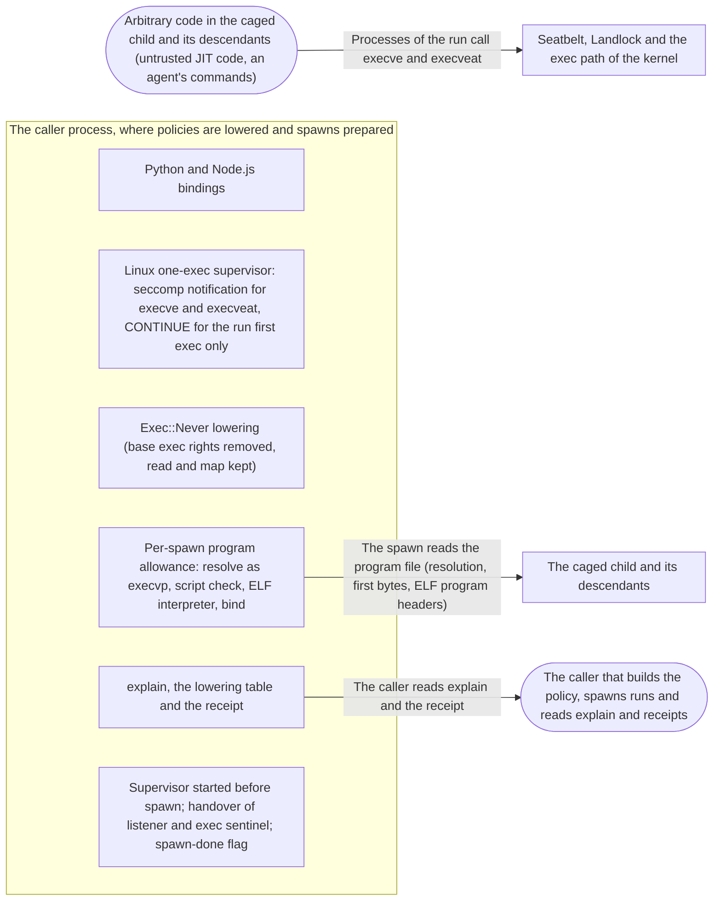

# Threat Model: Exec::Never and Exec::Program — the child executes only its program

**Feature**: `051-exec-never` · **Generated**: 2026-11-12T20:02:55Z · **Profiles**: stride, llm, agent · **Canonical**: `threat-model.yaml`

> Rendered by ThreatSpec. Edit `threat-model.yaml`, not this file.

## Summary

| Threats | Critical | High | Medium | Low | Needs clarification | Not applicable | Mitigations | Requirements | Decisions |
|---|---|---|---|---|---|---|---|---|---|
| 13 | 1 | 2 | 6 | 4 | 0 | 27 | 8 | 9 | 2 |

## Actors

| ID | Name | Trust | Description |
|---|---|---|---|
| `actor.caged-code` | Arbitrary code in the caged child and its descendants (untrusted JIT code, an agent's commands) | untrusted |  |
| `actor.harness` | The caller that builds the policy, spawns runs and reads explain and receipts | trusted |  |

## Trust Zones

| ID | Name | Trust rating | Description |
|---|---|---|---|
| `tz.cage` | The caged child and its descendants | 5 |  |
| `tz.harness` | The caller process, where policies are lowered and spawns prepared | 90 |  |
| `tz.kernel` | Seatbelt, Landlock and the exec path of the kernel | 95 |  |

## Assets

| ID | Name | Type | Classification | C / I / A | Source |
|---|---|---|---|---|---|
| `asset.exec-boundary` | What a run may execute: under Exec::Never, only its program | capability | internal | 40 / 85 / 30 | spec.md#Context |
| `asset.harness` | The caller process that prepares the spawn | capability | internal | 60 / 80 / 60 | spec.md#FR-003 |
| `asset.reports` | The truth of explain, the lowering table and the receipt about exec | log | internal | 10 / 80 / 20 | spec.md#US3 |

## Components

| ID | Name | Type | Trust zone | Source |
|---|---|---|---|---|
| `component.bindings` | Python and Node.js bindings | library | `tz.harness` | spec.md#US3 |
| `component.exec-supervisor` | Linux one-exec supervisor: seccomp notification for execve and execveat, CONTINUE for the run first exec only | library | `tz.harness` | spec.md#Clarifications |
| `component.lowering` | Exec::Never lowering (base exec rights removed, read and map kept) | library | `tz.harness` | spec.md#FR-002 |
| `component.program-allowance` | Per-spawn program allowance: resolve as execvp, script check, ELF interpreter, bind | library | `tz.harness` | spec.md#FR-003 |
| `component.receipt-explain` | explain, the lowering table and the receipt | library | `tz.harness` | spec.md#FR-007 |
| `component.spawn-handshake` | Supervisor started before spawn; handover of listener and exec sentinel; spawn-done flag | library | `tz.harness` | plan.md#Design |

## Data Flows

| ID | Name | From | To | Assets | Crosses |
|---|---|---|---|---|---|
| `flow.exec-calls` | Processes of the run call execve and execveat | `actor.caged-code` | `tz.kernel` | `asset.exec-boundary` | `tz.cage`, `tz.kernel` |
| `flow.program-file` | The spawn reads the program file (resolution, first bytes, ELF program headers) | `component.program-allowance` | `tz.cage` | `asset.harness`, `asset.exec-boundary` | `tz.harness` |
| `flow.report` | The caller reads explain and the receipt | `component.receipt-explain` | `actor.harness` | `asset.reports` |  |

## Threats

| ID | Threat | Category | Technique | Severity | Status | Mitigations | Mappings | Source |
|---|---|---|---|---|---|---|---|---|
| `threat.base-exec-under-never` | Caged code executes system programs under Exec::Never or Exec::Program because the base still allows exec in the system code directories | Elevation of Privilege | broken-access-control | **critical** | mitigated | `mitigation.never-strips-base-exec` |  | spec.md#Context |
| `threat.interpreter-route` | On Linux caged code executes the allowed ELF interpreter directly (ld.so <file>) or the program again, and so starts any readable ELF after the run has started | Elevation of Privilege | broken-access-control | **high** | mitigated | `mitigation.one-exec-supervisor` |  | spec.md#Clarifications |
| `threat.report-disagrees` | explain and the lowering table report Exec::Never as exact while the kernel allows exec, so the caller trusts a boundary that is not drawn | Repudiation | missing-audit-trail | **high** | mitigated | `mitigation.kernel-checked-reports` |  | spec.md#US3 |
| `threat.first-exec-claimed` | Caged code gets the one allowed exec for itself (its own execve answered CONTINUE), or races the path of the allowed exec | Elevation of Privilege | broken-access-control | **medium** | mitigated | `mitigation.one-exec-supervisor` |  | spec.md#Clarifications |
| `threat.program-loader-route` | Under Exec::Program on Linux caged code executes the allowed ELF interpreter directly and starts any readable ELF, while the caller believes only the program can run | Elevation of Privilege | broken-access-control | **medium** | mitigated | `mitigation.no-supervisor-is-a-gap` |  | spec.md#Clarifications |
| `threat.script-interpreter` | A script program makes its interpreter executable, so the child can run any script it can read under Exec::Never | Elevation of Privilege | broken-access-control | **medium** | mitigated | `mitigation.refuse-scripts` |  | spec.md#US2 |
| `threat.sentinel-leak` | The exec sentinel write end reaches the program or a descendant (not closed on exec), so the supervisor keeps answering CONTINUE after the program started | Elevation of Privilege | broken-access-control | **medium** | mitigated | `mitigation.supervisor-before-spawn` |  | plan.md#Child-call-sequence |
| `threat.supervisor-late` | The child first exec notifies before any supervisor serves the listener, so the spawn hangs (std waits for the exec) or a later answer is misattributed | Denial of Service | resource-exhaustion | **medium** | mitigated | `mitigation.supervisor-before-spawn` |  | research.md#R3 |
| `threat.supervisor-unavailable` | Where the one-exec supervisor cannot be installed (an outer seccomp listener, Cage::exec), the run silently falls back to Landlock alone and the loader route and re-execution reopen | Elevation of Privilege | broken-access-control | **medium** | mitigated | `mitigation.no-supervisor-is-a-gap` |  | spec.md#FR-001a |
| `threat.allowance-crosses-runs` | The program allowance of one spawn reaches another run of the same cage (shared profile or ruleset), so that run may execute a program it was not started as | Elevation of Privilege | broken-access-control | **low** | mitigated | `mitigation.allowance-per-spawn` |  | spec.md#FR-003 |
| `threat.hostile-program-header` | A program file written by caged code (an earlier run) carries a malformed or hostile ELF header that crashes the caller or names an arbitrary interpreter to allow | Tampering, Denial of Service | injection | **low** | mitigated | `mitigation.bounded-header-parse` |  | spec.md#Edge-Cases |
| `threat.macos-reexec` | Under Exec::Never on macOS the program executes itself again (with arguments of the caged code), since Seatbelt cannot count executions | Elevation of Privilege | broken-access-control | **low** | accepted (until 2027-05-11) | — |  | spec.md#Clarifications |
| `threat.program-path-replaced` | On macOS caged code with write access to the program path puts another file there and re-executes it under the path-bound allowance (on Linux the one-exec rule refuses any second exec) | Elevation of Privilege | broken-access-control | **low** | accepted (until 2027-05-11) | `mitigation.allowance-per-spawn`, `mitigation.one-exec-supervisor` |  | spec.md#Edge-Cases |

### Techniques evaluated without findings

| Technique | Disposition | Reason |
|---|---|---|
| credential-theft | not-applicable | no authentication surface; the change is to exec rights and a per-spawn allowance |
| identity-spoofing | not-applicable | no authentication or network boundary |
| data-tampering-in-transit | not-applicable | no data in transit |
| data-tampering-at-rest | not-applicable | no data is stored; the program file is the caller's input, covered by threat.program-path-replaced |
| sensitive-data-exposure | no-threat-detected | checked component.receipt-explain: the receipt gains the program path the caller itself chose; nothing of the child reaches it |
| cross-tenant-leak | not-applicable | single caller; separation between runs of one caller is modelled as threat.allowance-crosses-runs |
| privilege-escalation-via-config | no-threat-detected | checked component.lowering: an Exec rule or grant under Exec::Never stays a PolicyError (ExecConflict); the allowance is bound by procage, not by policy |
| prompt-injection-direct | not-applicable | procage is a library that calls no model and runs no agent; LLM-written code is the adversary inside the child, modelled under STRIDE |
| prompt-injection-indirect | not-applicable | procage is a library that calls no model and runs no agent; LLM-written code is the adversary inside the child, modelled under STRIDE |
| sensitive-information-disclosure | not-applicable | procage is a library that calls no model and runs no agent; LLM-written code is the adversary inside the child, modelled under STRIDE |
| excessive-agency | not-applicable | procage is a library that calls no model and runs no agent; LLM-written code is the adversary inside the child, modelled under STRIDE |
| model-supply-chain | not-applicable | procage is a library that calls no model and runs no agent; LLM-written code is the adversary inside the child, modelled under STRIDE |
| training-data-poisoning | not-applicable | procage is a library that calls no model and runs no agent; LLM-written code is the adversary inside the child, modelled under STRIDE |
| unbounded-consumption | not-applicable | procage is a library that calls no model and runs no agent; LLM-written code is the adversary inside the child, modelled under STRIDE |
| misinformation | not-applicable | procage is a library that calls no model and runs no agent; LLM-written code is the adversary inside the child, modelled under STRIDE |
| hidden-context-exposure | not-applicable | procage is a library that calls no model and runs no agent; LLM-written code is the adversary inside the child, modelled under STRIDE |
| vector-embedding-weakness | not-applicable | procage is a library that calls no model and runs no agent; LLM-written code is the adversary inside the child, modelled under STRIDE |
| improper-output-handling | not-applicable | procage is a library that calls no model and runs no agent; LLM-written code is the adversary inside the child, modelled under STRIDE |
| model-extraction | not-applicable | procage is a library that calls no model and runs no agent; LLM-written code is the adversary inside the child, modelled under STRIDE |
| goal-hijack | not-applicable | procage is a library that calls no model and runs no agent; LLM-written code is the adversary inside the child, modelled under STRIDE |
| tool-misuse | not-applicable | procage is a library that calls no model and runs no agent; LLM-written code is the adversary inside the child, modelled under STRIDE |
| identity-privilege-abuse | not-applicable | procage is a library that calls no model and runs no agent; LLM-written code is the adversary inside the child, modelled under STRIDE |
| agentic-supply-chain | not-applicable | procage is a library that calls no model and runs no agent; LLM-written code is the adversary inside the child, modelled under STRIDE |
| unexpected-code-execution | not-applicable | procage is a library that calls no model and runs no agent; LLM-written code is the adversary inside the child, modelled under STRIDE |
| memory-context-poisoning | not-applicable | procage is a library that calls no model and runs no agent; LLM-written code is the adversary inside the child, modelled under STRIDE |
| insecure-inter-agent-communication | not-applicable | procage is a library that calls no model and runs no agent; LLM-written code is the adversary inside the child, modelled under STRIDE |
| cascading-failure | not-applicable | procage is a library that calls no model and runs no agent; LLM-written code is the adversary inside the child, modelled under STRIDE |
| human-agent-trust-exploitation | not-applicable | procage is a library that calls no model and runs no agent; LLM-written code is the adversary inside the child, modelled under STRIDE |
| rogue-agent | not-applicable | procage is a library that calls no model and runs no agent; LLM-written code is the adversary inside the child, modelled under STRIDE |

## Mitigations

| ID | Mitigation | Kind | Threats | Requirements | Touchpoints | Status |
|---|---|---|---|---|---|---|
| `mitigation.allowance-per-spawn` | The allowance is bound per spawn, like a grant, never compiled into the cage shared by its runs; on Linux it is opened by descriptor and stays with the inode that was checked | preventive | `threat.allowance-crosses-runs`, `threat.program-path-replaced` | SR-002 | `crates/procage/src/unix.rs`, `crates/procage/src/macos/spawn.rs`, `crates/procage/src/linux/spawn.rs`, `crates/procage-policy/src/linux.rs` | verified |
| `mitigation.bounded-header-parse` | The ELF header is read with fixed bounds and no panics; the interpreter must be an absolute path to an existing regular file, else the spawn is refused | preventive | `threat.hostile-program-header` | SR-006 | `crates/procage-policy/src/elf.rs`, `crates/procage-policy/fuzz/fuzz_targets/elf.rs`, `crates/procage/src/unix.rs` | verified |
| `mitigation.kernel-checked-reports` | explain answers exec under Exec::Never from the same allowance, checked by caged tests; the lowering table and the receipt state the program allowance | detective | `threat.report-disagrees` | SR-004, SR-005 | `crates/procage/tests/oracle.rs`, `crates/procage-policy/src/lowering.md`, `crates/procage-policy/tests/lowering_table.rs`, `bindings/python/src/lib.rs`, `bindings/nodejs/src/lib.rs` | verified |
| `mitigation.never-strips-base-exec` | Under Exec::Never and Exec::Program the lowering drops execute rights from every base rule (keeping read and map) and allows exec only through the per-spawn program allowance | preventive | `threat.base-exec-under-never` | SR-001 | `crates/procage-policy/src/lower/macos.rs`, `crates/procage-policy/src/lower/linux.rs`, `crates/procage/tests/escape_macos.rs`, `crates/procage/tests/escape_linux.rs` | verified |
| `mitigation.no-supervisor-is-a-gap` | Exec::Never without a supervisor and Exec::Program on Linux are typed gaps (outcome Approximated); only acceptance by name proceeds, listed in the receipt; the gap message names the accepting call | preventive | `threat.supervisor-unavailable`, `threat.program-loader-route` | SR-008 | `crates/procage/src/linux/probe.rs`, `crates/procage/src/linux/mod.rs`, `crates/procage-policy/src/lower/linux.rs`, `crates/procage-policy/src/lower/mod.rs` | verified |
| `mitigation.one-exec-supervisor` | On Linux execve and execveat raise a seccomp notification; the parent supervisor answers CONTINUE once, for the exec procage child code issues before any caller code runs, and EPERM for every later one, of any process of the run | preventive | `threat.interpreter-route`, `threat.first-exec-claimed`, `threat.program-path-replaced` | SR-007 | `crates/procage/src/linux/supervisor.rs`, `crates/procage/src/linux/sys.rs`, `crates/procage/src/linux/mod.rs`, `crates/procage-policy/src/lower/linux.rs` | verified |
| `mitigation.refuse-scripts` | A program that starts with '#!' is refused under Exec::Never before forking | preventive | `threat.script-interpreter` | SR-003 | `crates/procage/src/unix.rs`, `crates/procage/src/linux/mod.rs`, `crates/procage/src/macos/mod.rs` | verified |
| `mitigation.supervisor-before-spawn` | The supervisor thread starts before command.spawn and waits for the handover until the child sends it or the parent marks the spawn done; the sentinel is created in the child with O_CLOEXEC after mark_fds and its read end closed there | preventive | `threat.supervisor-late`, `threat.sentinel-leak` | SR-009 | `crates/procage/src/linux/mod.rs`, `crates/procage/src/linux/supervisor.rs`, `crates/procage/src/linux/sys.rs` | verified |

## Security Requirements

### SR-001 (P1) — verified

Under Exec::Never and Exec::Program no process of the run MUST be able to execute any file other than its program (and, on Linux, that program ELF interpreter), whatever the base, on macOS, T1 and T2.

- **Given** Base V1, V2 or V3 with Exec::Never or Exec::Program and fork, on macOS, T1 and T2, **when** the caged shell and a descendant it forks execute /bin/echo, /usr/bin/env and /bin/sh, **then** every execution is refused, while the same probes under Exec::Granted run
- **Given** Base::None with Exec::Never and read access to what the program loads, **when** the program is spawned, **then** it runs and exits with its own status
- **Given** Exec::Never on T1 and T2 and a dynamically linked program, **when** it executes its ELF interpreter directly (ld.so /bin/echo) or executes itself again, **then** both are refused
- Mitigations: `mitigation.never-strips-base-exec`
- Tasks: T010 ✓, T011 ✓, T012 ✓, T013 ✓, T014 ✓, T020 ✓, T021 ✓
- Verification `verification.sr-001.2026-11-12`: test → pass (verified) — `crates/procage/tests/escape_macos.rs::r38_only_the_program_executes, crates/procage/tests/escape_linux.rs::r38_only_the_program_executes, crates/procage/tests/spawn_linux.rs::program_only_settings_start_the_program, crates/procage/tests/spawn_macos.rs::program_only_settings_start_the_program`
- Verification `verification.sr-001.2026-11-12-2`: test → pass (verified) — `crates/procage/tests/escape_macos.rs::r38_only_the_program_executes, crates/procage/tests/escape_linux.rs::r38_only_the_program_executes, crates/procage/tests/spawn_linux.rs::program_only_settings_start_the_program, crates/procage/tests/spawn_macos.rs::program_only_settings_start_the_program`

### SR-002 (P1) — verified

The program allowance MUST hold for its own spawn only and MUST NOT let another run of the same cage execute that program.

- **Given** one cage under Exec::Never and two spawns of different programs A and B, **when** the run of A tries to execute B, **then** it is refused
- **Given** Exec::Program on Linux and a program in a writable tree, **when** the program replaces its own file by rename and executes the path again, **then** the exec is refused (the rule holds the original inode)
- Mitigations: `mitigation.allowance-per-spawn`
- Tasks: T013 ✓, T014 ✓, T021 ✓, T028 ✓, T029 ✓
- Verification `verification.sr-002.2026-11-12`: test → pass (verified) — `crates/procage/tests/spawn_macos.rs::the_program_allowance_is_per_spawn, crates/procage/tests/spawn_linux.rs::the_program_allowance_is_per_spawn_and_per_file`
- Verification `verification.sr-002.2026-11-12-2`: test → pass (verified) — `crates/procage/tests/spawn_macos.rs::the_program_allowance_is_per_spawn, crates/procage/tests/spawn_linux.rs::the_program_allowance_is_per_spawn_and_per_file`

### SR-003 (P1) — verified

Under Exec::Never and Exec::Program a program that starts with '#!' MUST be refused before forking with a typed error.

- **Given** Exec::Never and an executable shell script as the program, **when** it is spawned or passed to Cage::exec, **then** the call fails before forking with an error naming the script
- Mitigations: `mitigation.refuse-scripts`
- Tasks: T008 ✓, T009 ✓
- Verification `verification.sr-003.2026-11-12`: test → pass (verified) — `crates/procage/tests/spawn_macos.rs::program_only_settings_refuse_a_script, crates/procage/tests/spawn_linux.rs::program_only_settings_refuse_scripts_and_bad_interpreters`
- Verification `verification.sr-003.2026-11-12-2`: test → pass (verified) — `crates/procage/tests/spawn_macos.rs::program_only_settings_refuse_a_script, crates/procage/tests/spawn_linux.rs::program_only_settings_refuse_scripts_and_bad_interpreters`

### SR-004 (P1) — verified

explain MUST answer for execution under Exec::Never and Exec::Program as the kernel decides.

- **Given** Exec::Never with a base, **when** explain asks whether /bin/echo may be executed and a caged shell tries it, **then** both say denied
- Mitigations: `mitigation.kernel-checked-reports`
- Tasks: T030 ✓
- Verification `verification.sr-004.2026-11-12`: test → pass (verified) — `crates/procage/tests/oracle.rs::explain_agrees_with_the_kernel`
- Verification `verification.sr-004.2026-11-12-2`: test → pass (verified) — `crates/procage/tests/oracle.rs::explain_agrees_with_the_kernel`

### SR-005 (P1) — verified

The lowering table and the Exec docs MUST state each setting per platform (exact, approximated, and the macOS re-execution under Exec::Never), and an accepted approximation MUST be listed in the receipt.

- **Given** the lowering table, **when** the table test compares it with the lowering on every target, **then** exec-never and exec-program match their outcomes
- **Given** an accepted exec-program approximation on Linux, **when** the run receipt is read, **then** its approximations list exec-program
- Mitigations: `mitigation.kernel-checked-reports`
- Tasks: T031 ✓, T032 ✓, T033 ✓
- Verification `verification.sr-005.2026-11-12`: test → pass (verified) — `crates/procage-policy/tests/lowering_table.rs::every_row_matches_the_lowering, crates/procage/tests/spawn_linux.rs::program_reexecutes_itself_and_nothing_else, crates/procage/tests/spawn_linux.rs::exec_never_without_a_listener_is_a_gap`
- Verification `verification.sr-005.2026-11-12-2`: test → pass (verified) — `crates/procage-policy/tests/lowering_table.rs::every_row_matches_the_lowering, crates/procage/tests/spawn_linux.rs::program_reexecutes_itself_and_nothing_else, crates/procage/tests/spawn_linux.rs::exec_never_without_a_listener_is_a_gap`

### SR-006 (P2) — verified

Reading the program header MUST be bounded and MUST NOT panic on any input; an interpreter that is not an absolute path to an existing regular file MUST fail the spawn.

- **Given** arbitrary bytes as the program file, **when** the header reader runs (fuzz target), **then** it returns a value or a typed error, never panics, and reads no more than its bound
- **Given** an ELF whose interpreter is relative, missing or a directory, **when** it is spawned under Exec::Never, **then** the spawn fails before forking with a typed error
- Mitigations: `mitigation.bounded-header-parse`
- Tasks: T006 ✓, T007 ✓, T008 ✓, T009 ✓
- Verification `verification.sr-006.2026-11-12`: test → pass (verified) — `crates/procage-policy/src/elf.rs::tests::every_truncation_is_an_error_not_a_panic, crates/procage-policy/src/elf.rs::tests::bounds_hold, crates/procage-policy/fuzz/fuzz_targets/elf.rs, crates/procage/tests/spawn_linux.rs::program_only_settings_refuse_scripts_and_bad_interpreters`
- Verification `verification.sr-006.2026-11-12-2`: test → pass (verified) — `crates/procage-policy/src/elf.rs::tests::every_truncation_is_an_error_not_a_panic, crates/procage-policy/src/elf.rs::tests::bounds_hold, crates/procage-policy/fuzz/fuzz_targets/elf.rs, crates/procage/tests/spawn_linux.rs::program_only_settings_refuse_scripts_and_bad_interpreters`

### SR-007 (P1) — verified

On Linux under Exec::Never exactly one exec MUST succeed per run, the one procage issues to start the program; every later execve and execveat of any process of the run MUST be refused.

- **Given** Exec::Never on T1 and T2, **when** the program, after it started, executes itself, its interpreter and /bin/echo, and a forked descendant does the same, **then** every call fails with EPERM and the program had started
- **Given** Exec::Never with violation reporting on, **when** the program executes /bin/echo, **then** the refusal is reported as a violation
- Mitigations: `mitigation.one-exec-supervisor`
- Tasks: T004 ✓, T011 ✓, T015 ✓, T016 ✓, T017 ✓, T021 ✓
- Verification `verification.sr-007.2026-11-12`: test → pass (verified) — `crates/procage/tests/escape_linux.rs::r38_never_refuses_every_exec_after_the_first, crates/procage/tests/spawn_linux.rs::a_refused_exec_is_reported`
- Verification `verification.sr-007.2026-11-12-2`: test → pass (verified) — `crates/procage/tests/escape_linux.rs::r38_never_refuses_every_exec_after_the_first, crates/procage/tests/spawn_linux.rs::a_refused_exec_is_reported`

### SR-008 (P1) — verified

On Linux, Exec::Never where the one-exec supervisor cannot be installed and Exec::Program MUST fail as typed gaps unless the caller accepted the approximation by name; the gap message MUST name the accepting call.

- **Given** Exec::Never and Cage::exec on Linux, **when** it is called without accepting the approximation, **then** it fails before the cage is applied with the gap named
- **Given** an outer seccomp listener (simulated) and Exec::Never, **when** a run is spawned, **then** it fails with the gap; with the approximation accepted it runs and its receipt names it
- **Given** Exec::Program on Linux, **when** the cage is created without accepting exec-program, **then** it fails with a gap whose message names the call that accepts it
- Mitigations: `mitigation.no-supervisor-is-a-gap`
- Tasks: T018 ✓, T019 ✓, T023 ✓, T027 ✓, T029 ✓
- Verification `verification.sr-008.2026-11-12`: test → pass (verified) — `crates/procage/tests/exec.rs::exec_never_runs_the_command_and_nothing_else, crates/procage/tests/spawn_linux.rs::exec_never_without_a_listener_is_a_gap, crates/procage/tests/spawn_linux.rs::program_reexecutes_itself_and_nothing_else`
- Verification `verification.sr-008.2026-11-12-2`: test → pass (verified) — `crates/procage/tests/exec.rs::exec_never_runs_the_command_and_nothing_else, crates/procage/tests/spawn_linux.rs::exec_never_without_a_listener_is_a_gap, crates/procage/tests/spawn_linux.rs::program_reexecutes_itself_and_nothing_else`

### SR-009 (P1) — verified

A spawn under Exec::Never on Linux MUST NOT block on its own exec, and the exec sentinel MUST NOT reach the program or any descendant.

- **Given** Exec::Never on T1 and T2 with and without violation reporting, from a parent with 8 threads spawning concurrently, **when** 100 programs are spawned, **then** every spawn returns and every program runs
- **Given** Exec::Never, **when** the program lists its open descriptors, **then** only stdio and declared descriptors are open, and an exec it tries is refused
- Mitigations: `mitigation.supervisor-before-spawn`
- Tasks: T015 ✓, T016 ✓, T017 ✓, T021 ✓, T022 ✓
- Verification `verification.sr-009.2026-11-12`: test → pass (verified) — `crates/procage/tests/spawn_linux.rs::exec_never_spawns_from_many_threads, crates/procage/tests/escape_linux.rs::r38_the_program_holds_no_supervisor_descriptor`
- Verification `verification.sr-009.2026-11-12-2`: test → pass (verified) — `crates/procage/tests/spawn_linux.rs::exec_never_spawns_from_many_threads, crates/procage/tests/escape_linux.rs::r38_the_program_holds_no_supervisor_descriptor`

## Risk Decisions

| ID | Threat | Status | Owner | Expires | Rationale |
|---|---|---|---|---|---|
| `decision.macos-path-replaced` | `threat.program-path-replaced` | accepted | hupe1980 | 2027-05-11 | macOS extension tokens are path-bound; a replaced program in a writable tree runs no more than the child already can. Same contract as decision.macos-reexec (clarification 2026-11-12: UX and DX first). |
| `decision.macos-reexec` | `threat.macos-reexec` | accepted | hupe1980 | 2027-05-11 | Seatbelt cannot count executions; re-executing the program runs nothing the child cannot already run. Recorded as the documented macOS contract of Exec::Never (clarification 2026-11-12: UX and DX first, no opt-in for a small, stated limit). |
